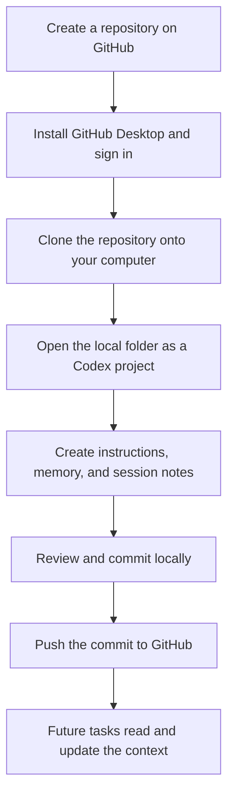
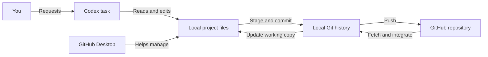
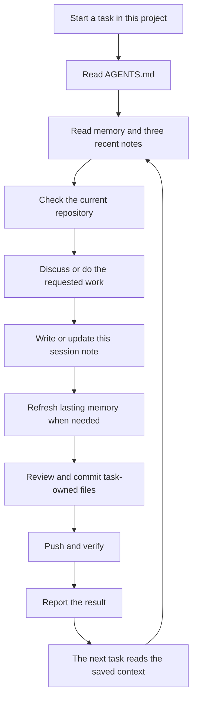

# How this project works

GitHub holds the online project, your computer holds its working copy, and Codex works on the files. Written memory and session notes give future tasks context they can read and continue.

## 1. From an empty repository to a working project

1. **Create the repository on GitHub.** A repository is a collection of files with a history of saved changes. Yours is named **MDLM_CODEX_MEMORY**.
2. **Install GitHub Desktop and sign in.** GitHub Desktop provides a visual interface for managing repositories. Git is the version-control system; GitHub is the online service.
3. **Clone the repository.** Cloning creates a local working copy and connects it to the online repository. Your copy is at `C:\Users\mettrma\Documents\GitHub\MDLM_CODEX_MEMORY`.
4. **Open that folder in Codex.** Tasks associated with the folder can work on its files. The folder connects the conversation to the repository.
5. **Create the continuity files.** We added working instructions, durable memory, and dated notes. Each has a different role, shown below.
6. **Commit the changes.** A commit saves selected changes as a named snapshot in local Git history. Saving a file and committing it are separate actions.
7. **Push the commit.** Pushing uploads local commits to GitHub. A local commit has not been uploaded until its push succeeds.
8. **Continue in a later task.** The next task reads the saved context, does the requested work, and records its results.

The path, remote, files, and initial commit were verified in this conversation. Repository creation, installing GitHub Desktop, signing in, and the original clone happened before the visible record. Those earlier steps explain the process; they are not a verified history of your exact clicks.

## 2. What lives where

Codex and GitHub Desktop work with the same local repository. You do not need to copy files between the applications. Codex used Git commands for the initial commit and push; GitHub Desktop provides a visual way to perform similar operations.

| Component | Its job | Familiar comparison |
| --- | --- | --- |
| GitHub repository | Holds uploaded files and commit history | Online project archive |
| Local folder | Holds files being read and edited | Working desk |
| GitHub Desktop | Helps inspect, commit, and synchronize changes | Control panel |
| Codex | Responds to requests and works with files | Collaborator |
| AGENTS.md | Gives future tasks working instructions | Procedure sheet |
| MEMORY.md | Holds lasting facts and current priorities | Briefing sheet |
| sessions/ | Records individual sessions | Project journal |

## 3. How one session helps the next

For example, a discussion explaining cloning belongs in a session note. Your decision to publish every session is a lasting preference, so it also belongs in memory and the working instructions.

You have authorized recording and pushing **every session in this project**, including explanation-only sessions. Tasks should save a note before each final response, update that note when the conversation continues, and publish it without asking for routine confirmation again. Separate tasks use separate notes.

Codex supports project instructions through AGENTS.md; see [the official documentation](https://learn.chatgpt.com/docs/agent-configuration/agents-md). Our repository instructions require this memory workflow.

This setup saves **session summaries**, not automatic verbatim chat exports. A task must access this repository and follow its instructions. Closing or interrupting a task before it writes can leave a session unsaved. A failed push leaves the record local until publication succeeds. No background recorder or scheduled automation has been installed.

## 4. Where to look

- [Working instructions](AGENTS.md)
- [Current project memory](MEMORY.md)
- [Initial setup record](sessions/2026-09-22-initial-setup.md)
- [This conversation's explanations and session policy](sessions/2026-09-22-setup-guide-and-session-policy.md)

## 5. Useful words

| Term | Meaning |
| --- | --- |
| Clone | Make a local working copy of a remote repository |
| Stage | Choose changes for the next commit |
| Commit | Save a snapshot in local version history |
| Push | Upload local commits to the remote |
| Fetch | Download commits and information from the remote |
| Pull | Fetch remote changes and integrate them into the local branch |
| Branch | A named line of development; this project began on main |
| Origin | The conventional name for the configured remote |
| Clean working tree | No pending tracked changes or untracked files |
