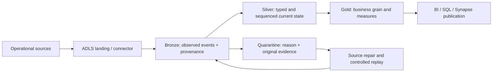
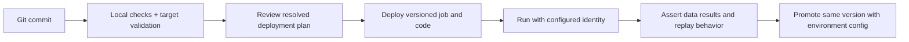

# 01 — Databricks core study guide

[Learning path](README.md) · [Course companion](02_COURSE_COMPANION.md) · [Official sources](09_OFFICIAL_DOC_INDEX.md)

Checked against official documentation on **7 October 2026**. SQL and PySpark below are original teaching examples. Cloud execution remains to be done. Record your runtime, access mode, workspace features and identities before applying examples.

## 1. Know what each component does

Imagine a distribution centre. ADLS stores incoming boxes; Spark performs the work of sorting and combining their contents; Delta records which files form a committed table; Unity Catalog defines which named assets exist and who can use them; a job coordinates the work. Medallion layers describe the increasingly useful datasets, not three different processing engines.

| Component | Responsibility | It does not establish by itself |
|---|---|---|
| Azure Databricks workspace | Development and operational surface for code, compute, jobs and data access | That all callers use the same identity or data environment |
| ADLS Gen2 | Cloud object storage for files and table data | Table semantics or correct business totals |
| Apache Spark / PySpark | Distributed execution and DataFrame transformations | Source completeness or business uniqueness |
| Delta Lake | Table format with a transaction log and transactional writes | Atomic publication of an entire multi-table pipeline |
| Unity Catalog | Named catalogs/schemas/assets, permissions and governance | Governance of an external client's direct ADLS access |
| Lakeflow Jobs | Task dependencies, schedules, retries and run history | Idempotent task implementation |
| Spark Declarative Pipelines | Declarative transformation graph and managed pipeline execution | A replacement for deciding grain, sequencing or quality policy |
| Auto Loader | Incremental discovery/ingestion of files | Business-event deduplication across files |
| Declarative Automation Bundles | Versioned deployment definitions and associated code | A data migration or automatic grant of table privileges |
| SQL warehouse | Compute suited to SQL analytics | Universal support for arbitrary Python notebook execution |

Keep the **control path** and **data path** separate. A CLI can reach the workspace API while job compute cannot reach a source database. A SQL connection can work while the staging-storage connection used by a bulk transfer fails.

Official entry points: [Databricks overview](https://learn.microsoft.com/en-us/azure/databricks/introduction/) · [Spark DataFrames](https://spark.apache.org/docs/latest/api/python/user_guide/dataframes.html) · [Unity Catalog](https://learn.microsoft.com/en-us/azure/databricks/data-governance/unity-catalog/)

## 2. Catalogs, environments and medallion layers are different axes

Unity Catalog table names use `catalog.schema.table`. A catalog groups governed objects; a schema groups assets inside it. A metastore provides the broader governance container attached to workspaces. A notebook folder is a code organization choice, not a schema declaration.

```text
training_dev                 # environment/domain boundary for this lab
  bronze.order_events        # observed source events
  silver.orders_current      # current order state, including tombstones
  silver.order_quarantine    # rejected events with reasons
  gold.daily_store_sales     # analytical result at day/store grain
  ops.lab_files              # volume holding uploaded fixtures
```

For a substantial domain, `rmn_dev`, `rmn_uat`, `rmn_prod` with Bronze/Silver/Gold schemas remains a valid **example** from the existing concepts guide; RMN's expansion is unknown. An environment catalog such as `dev` with domain/layer schemas can also work. Choose based on ownership, isolation, grants and workspace/storage boundaries, not a universal naming law.

Dev Gold and Prod Gold can have the same logical model and different data, release versions, permissions and SLAs. Code promotion deploys a tested version with production configuration. It does not automatically copy a development dataset or synchronize catalogs.

For a table read, compare the caller's `USE CATALOG`, `USE SCHEMA` and `SELECT` privileges. Writing an existing table also requires appropriate write privileges; creating an object requires creation rights in its parent. Volumes use `READ VOLUME`/`WRITE VOLUME`. Cloud storage access and workspace/compute access remain separate checks. Workspace catalog bindings can restrict where a catalog is usable. [Unity Catalog privileges](https://learn.microsoft.com/en-us/azure/databricks/data-governance/unity-catalog/manage-privileges/privileges) · [Unity Catalog practices](https://learn.microsoft.com/en-us/azure/databricks/data-governance/unity-catalog/best-practices)

Cross-reference: [existing catalog/environment explanation](../guides/data-engineering/DATA_AND_DBT_CONCEPTS_GUIDE.md).

## 3. Start with the source contract

ETL extracts data, transforms it and loads results. ELT loads raw data before the main transformations. In practice a pipeline may validate transport while extracting, land raw payloads, then perform most business transformation in Databricks. The useful question is which state you retain and where each responsibility runs.

Before picking a connector, answer:

| Contract item | Orders example | Failure if missing |
|---|---|---|
| Grain and key | One event per source event ID; one current row per source/order | Accidental deduplication of legitimate lines or cross-system collisions |
| Operation | `UPSERT` or `DELETE` | Deletes silently ignored |
| Ordering | Monotonic sequence per order | Late older event replaces a newer correction |
| Delivery | At least once; exact events can repeat | Retries create duplicate business effects |
| Data types | Decimal amount, ISO date, UTC timestamp | Invalid parsing or timezone shift |
| Completeness | Batch manifest plus all published files | Empty batch interpreted as deletion of all rows |
| Schema change policy | Additive optional field reviewed; key/type changes gated | Incompatible contracts propagate downstream |
| Cadence and freshness | Hourly delivery; consumer target defined separately | Frequent jobs merely republish stale source data |
| Owner and retention | Named source owner; replay availability agreed | An outage exceeds recoverable source history |

The lab uses source system `POS`, an order-level current-state model and sequences supplied by the source. A real POS may publish order **lines** with composite keys and may represent refunds as separate transactions. Do not copy the lab grain or reject negative values without checking your business contract.

For multiple systems, use a composite identity such as `(source_system, order_id)`. Event time says when an event happened, source sequence says its ordering for a key, ingestion time says when you observed it, and processing time says when a transformation ran. They answer different questions.

## 4. Design Bronze, Silver and Gold around responsibilities



**Bronze** retains enough source information to audit and reprocess. Record source identity, file/message identity, ingestion timestamp and batch/run ID. Prefer preserving a malformed business value as raw data over silently discarding its row. Truly unreadable files require a transport-level failure route or preserved original bytes; a rescued field alone is not a universal archive.

**Silver** establishes types, standardizes business codes, validates required fields, resolves duplicates and handles changes. Quarantine includes the original event or a durable reference, failed rule, processing version and recovery status. A rejected row should be explainable to its owner.

**Gold** expresses consumer definitions and grain: one row per day/store, one row per customer dimension version, or one row per transaction fact. Gold can be detailed; an aggregation is not compulsory. Measures must reconcile to appropriate Silver inputs after intentional exclusions.

Medallion is a design pattern, not a guarantee that a folder named Silver contains clean data. Delta transactional writes apply to individual tables; a task chain can leave Bronze committed and Gold unchanged after a Silver failure. Consumers needing a consistent release need an explicit publication strategy. [Medallion architecture](https://learn.microsoft.com/en-us/azure/databricks/lakehouse/medallion)

**Check yourself:** If two systems both have order 123, what is your key? If a correction arrived yesterday but refers to last month, which Gold date changes? If a customer dimension is missing, will you lose the order or preserve it under an unknown member?

## 5. Read PySpark as a plan for distributed work

A Spark DataFrame describes structured data and operations. Transformations such as `select`, `filter` and `join` build plans; actions such as a write or `count()` trigger execution. A failure at a write can originate in an earlier cast or expression evaluated lazily. Python's local variables and Spark column expressions operate at different levels.

```python
from pyspark.sql import functions as F

raw = spark.table("training_dev.bronze.order_events")
typed = raw.select(
    "source_system", "order_id", "event_id",
    F.upper(F.trim(F.col("op"))).alias("op"),
    F.expr("try_cast(amount_raw AS DECIMAL(18,2))").alias("amount"),
    F.expr("try_cast(order_date_raw AS DATE)").alias("order_date"),
    F.expr("try_cast(sequence_raw AS BIGINT)").alias("sequence")
)
valid = typed.filter(
    F.col("order_id").isNotNull()
    & F.col("sequence").isNotNull()
    & F.col("op").isin("UPSERT", "DELETE")
)
valid.printSchema()
valid.explain("formatted")
```

This is a fragment, not the complete quality policy; the [lab notebook](03_OPERATIONAL_DATA_LAB/notebooks/operational_pipeline.py) also handles empty keys, dates, amounts and conflicts. `try_cast` converts invalid input to null, which requires explicit rejection handling. It is not a reason to turn invalid amounts into zero.

| Common error | Why it occurs | Useful first check |
|---|---|---|
| Using Python `and` / `or` on Columns | Python attempts to evaluate a distributed expression as one boolean | Use parenthesized expressions with `&` / `\|` |
| `if F.col("amount") > 0:` | A Column is not a local row value | Use `when`, `filter` or a DataFrame expression |
| Unresolved or ambiguous column | Rename, missing field or duplicate names after a join | `printSchema()`, aliases and explicit projection |
| Cast exception | Invalid text or incompatible type under ANSI behavior | Inspect raw value and parsing contract; use tolerant parsing plus quarantine when appropriate |
| Driver out of memory | `collect()` / `toPandas()` transfers too much data | Keep distributed processing; bound diagnostic samples |
| Python/UDF worker error | Serialization, package or row-level function defect | First Python exception, environment versions, tiny representative input |
| One long-running task | Skewed key or giant file/partition | Stage metrics and per-key distribution |

Prefer built-in expressions where they express the transformation; they expose more work to Spark's optimizer and avoid many Python serialization issues. A UDF can still be appropriate for a justified function, with explicit dependencies and tests. Cache only reused expensive work after measurement; caching every layer consumes resources and can conceal stale expectations.

**Join example:** Before enriching orders, prove the store dimension has at most one row per matching key. A left join preserves orders with unknown stores, but it still multiplies orders if the dimension has duplicates. Measure `count`, distinct business keys and sum before and after. Filtering right-side columns in a post-join `where` can turn the intended left join into an effective inner join for unmatched rows.

Reference: [Spark SQL semantics](https://spark.apache.org/docs/latest/sql-ref-null-semantics.html) · [PySpark Column](https://spark.apache.org/docs/latest/api/python/reference/pyspark.sql/api/pyspark.sql.Column.html).

## 6. Clean data with explicit policies

An empty identifier, an invalid amount and an unknown store are different defects. They need different treatment.

| Condition | Lab treatment | Why |
|---|---|---|
| Missing order key | Quarantine | Cannot safely identify state to update |
| Non-numeric or negative upsert amount | Quarantine | Violates this lab's declared nonnegative-order contract |
| Unknown store code | Keep order and label dimension attributes unknown | Completeness is visible; revenue is not lost |
| Exact duplicate event | Retain source evidence, collapse business effect | Re-delivery should not inflate results |
| Different payloads at the same key/sequence | Fail the batch before state mutation | No authoritative winner is known |
| Delete event | Retain sequenced tombstone | Prevent an older replay from resurrecting the row |
| Older sequence | Preserve Bronze evidence; ignore state change | Arrival order is not business order |

Requiredness is separate from accepted domain and uniqueness. A `NOT NULL` rule says nothing about whether store `S99` is recognized. In Databricks, informational primary/foreign keys are not a substitute for uniqueness/referential checks. Enforced `NOT NULL`/`CHECK` rules and pipeline expectations have different capabilities and failure effects; select deliberately. [Constraints](https://learn.microsoft.com/en-us/azure/databricks/tables/constraints) · [Pipeline expectations](https://learn.microsoft.com/en-us/azure/databricks/ldp/expectations)

For quality metrics, report input events, accepted events, rejects, duplicate deliveries, superseded changes and resulting state separately. `Bronze count = Silver count` is usually false for a change stream that updates current state. A useful fixture reconciliation is `raw events = valid raw events + rejected raw events`, followed by a different reconciliation of the latest active state to Gold.

Correct bad values only when you have an approved rule. Trimming whitespace or normalizing an agreed status code is often safe; guessing a customer's identifier or overwriting a missing amount with a mean changes evidence. A quarantine replay should record both the original defect and corrected event/version.

## 7. Understand Delta before using MERGE

A Delta table combines data files with a transaction log defining the committed snapshot. A successful commit makes the table's change visible atomically. Failed speculative output files are not permission to read every Parquet file directly and bypass the log.

Incremental correctness has three decisions:

1. **Selection:** Did you read every relevant new/changed/deleted record?
2. **Matching:** Does your key find the right state row?
3. **Application:** Does sequencing and operation handling apply the right state change?

`MERGE` can insert, update and delete, but it cannot infer your authoritative ordering. Collapse a current-state batch to one authoritative candidate per key before merging. Matching duplicate source rows against an existing target can fail; duplicate unmatched source rows can also be inserted. Runtime 16.0+ includes matched-clause conditions in duplicate-match detection, unlike 15.4 LTS and earlier. Design unique candidates rather than relying on this difference. [Merge reference](https://learn.microsoft.com/en-us/azure/databricks/delta/merge)

```sql
-- candidates already has one row per source_system/order_id.
-- Both source and target retain sequence and an is_deleted tombstone.
MERGE INTO training_dev.silver.orders_current AS t
USING candidates AS s
ON t.source_system = s.source_system AND t.order_id = s.order_id
WHEN MATCHED AND s.sequence > t.sequence THEN
  UPDATE SET *
WHEN NOT MATCHED THEN
  INSERT *;
```

This schematic example assumes aligned schemas and separately checked equal-sequence conflicts. A delete is represented as `is_deleted = true`; Gold filters it out. Retaining the sequence prevents a replay of an earlier upsert from reintroducing the order. Real history/CDC needs additional modeling; read [04](04_DELTA_AND_STREAMING.md).

`WHEN NOT MATCHED BY SOURCE THEN DELETE` requires an authoritative, complete source scope. A changed-rows feed contains only changes, so absence does not mean deletion. A timestamp watermark based on the target's maximum business timestamp can skip late updates; ingestion offsets, source CDC or an explicitly justified overlap are safer designs.

## 8. Separate batch, streaming and CDC

| Pattern | Input behavior | Correctness question |
|---|---|---|
| Full batch snapshot | Complete state at a point in time | Was the snapshot complete and consistently extracted? |
| Incremental batch | New/change subset, often offset-based | Can offsets miss ties, late changes or deletes? |
| Structured Streaming | Incrementally processes tracked source data | What state/checkpoint/sink guarantees apply? |
| Auto Loader | Discovers new cloud files | Is each file immutable and is business-event re-delivery handled? |
| CDC | Source records insert/update/delete changes | What keys, sequence and retention preserve ordering? |
| Delta change data feed | Changes emitted from a Delta table | Can consumers resume before retained changes disappear? |

A streaming job can use an available-now trigger to process discovered data and stop. Streaming describes incremental processing semantics, not necessarily a process running continuously. Checkpoints record progress and state; schema tracking describes observed file schema. Do not casually delete either to resolve a failure.

Auto Loader's file tracking does not deduplicate order events arriving in two different files. `foreachBatch` allows custom micro-batch processing but provides at-least-once callback execution; idempotency must be designed for your writes and side effects. [Auto Loader](https://learn.microsoft.com/en-us/azure/databricks/ingestion/cloud-object-storage/auto-loader/) · [foreachBatch](https://learn.microsoft.com/en-us/azure/databricks/structured-streaming/foreach)

## 9. Deploy code, configure execution and validate data separately

The deployment identity creates/updates resources. The run identity executes the job. The storage identity accesses external cloud data through the configured route. A developer's interactive identity may be none of these.



Bundles encode resources and parameters in version control. A YAML parse is not bundle validation; bundle validation is not deployment; deployment is not successful execution; execution is not business reconciliation. The course's [bundle chapter](06_BUNDLES_AND_ORCHESTRATION.md) separates all five.

Choose one owner for the end-to-end trigger and failure state. ADF/Synapse may coordinate external extraction and invoke a Databricks job; that job can own internal transformation dependencies. Avoid overlapping schedules in both systems for the same workload. Record correlation IDs across them so a successful trigger request is not confused with a completed pipeline.

## 10. Optimize after proving correctness

Start with representative evidence: input bytes/rows, output cardinality, job duration, task skew, shuffle, spill, file count/size and compute usage. Separate compute startup time, source latency, transformation time and downstream publication time.

| Observation | Plausible cause | First experiment |
|---|---|---|
| Full scan for selective query | Filter cannot prune useful data, incompatible expression or layout | Examine plan and scan metrics with representative predicates |
| Join multiplies rows | Wrong relationship or duplicated dimension | Prove cardinality before tuning compute |
| One task dominates | Skewed key or partition | Profile key frequency and stage task distribution |
| Thousands of tiny files | Small frequent writes | Measure overhead; evaluate compaction/write sizing |
| Driver failure | Unbounded local collection | Eliminate large collection and keep distributed work |
| High cost for modest latency target | Frequency/compute overprovisioned | Benchmark a lower-frequency trigger and right-sized compute |

Partitioning splits data by explicit directory-level keys; clustering improves arrangement within the table to support pruning. Liquid clustering is an option for supported Delta tables and is not combined with partitioning or Z-order on the same table. Changing layout may change reader/table-feature compatibility; evaluate consumers before enabling it. A 16-row lab cannot establish that a layout is faster at production scale. [Liquid clustering](https://learn.microsoft.com/en-us/azure/databricks/tables/clustering) · [Spark tuning](https://spark.apache.org/docs/latest/sql-performance-tuning.html)

Photon, adaptive query execution and managed optimization can help supported workloads. None fixes an incorrect join or skipped change. Keep benchmarking conditions comparable and include costs associated with source systems and downstream services, not just a job's duration.

## 11. Operate with clocks, owners and recovery evidence

Define **freshness** from a real source signal, **latency** from event/source availability to consumer visibility, **completeness** from agreed delivery scope, and **quality** from explicit rules. They are independent. A processing timestamp advances even if the source sends no new data.

An operational audit can record `pipeline`, `run_id`, `batch_id`, `code_version`, input scope, start/end, source offset, table versions, counts and rejection reason totals. Commit an offset only after required durable effects and checks succeed. A control-table update and business-table write are separate transactions unless you have deliberately designed another guarantee.

Alert on actionable symptoms: missing expected delivery, freshness breach, unusual reject rate, unresolved sequence conflicts, failed dependencies or failed publication. Capture the first relevant error; downstream skipped tasks can be symptoms. For each incident, record impact, failing boundary, hypothesis, evidence, bounded repair, replay scope and prevention owner.

The [workbook](07_TROUBLESHOOTING_PRACTICE.md) develops this method. The [capstone](08_READINESS_AND_CAPSTONE.md) requires evidence that the next retry preserves results.

## 12. Explain these distinctions without notes

1. Table name versus storage path versus notebook folder.
2. Event ID versus business key versus source sequence.
3. Raw event count versus current active state count.
4. Schema inference versus schema enforcement versus schema evolution.
5. File deduplication versus event deduplication versus latest-state selection.
6. Watermark versus source offset versus streaming checkpoint.
7. Delta transaction versus multi-table publication.
8. Deployment permission versus runtime data permission.
9. Databricks-to-Synapse transfer versus Synapse-to-Databricks extraction.
10. Green job status versus freshness, correctness and completeness.

If any explanation depends on “it just happens automatically,” find the exact component, configuration and evidence that supports it before moving to the lab.
