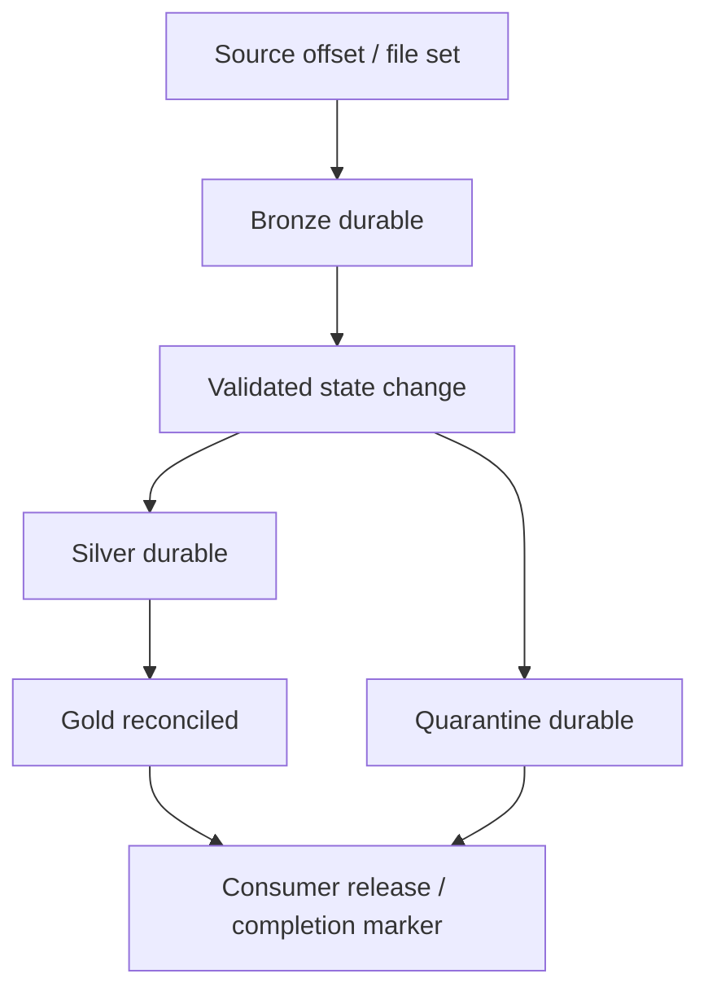

# 04 — Delta Lake, CDC and streaming deep dive

[Learning path](README.md) · [Lab](03_OPERATIONAL_DATA_LAB/README.md) · [Incident workbook](07_TROUBLESHOOTING_PRACTICE.md)

This chapter focuses on state correctness and recovery. Examples require adaptation to your runtime and source contract. Do experimental writes in isolated development tables. Official platform details were checked on 7 October 2026; none of the cloud examples was executed.

## 1. A transaction log defines the table

A Delta snapshot is the set of files and metadata described by its log at a committed version. Updates may rewrite data files or use supported table features such as deletion vectors. A folder scan of all Parquet files is therefore not a substitute for reading the Delta table.

For an incident, preserve:

```sql
DESCRIBE DETAIL training_dev.silver.orders_current;
DESCRIBE HISTORY training_dev.silver.orders_current;
SHOW TBLPROPERTIES training_dev.silver.orders_current;
```

History identifies operations/versions and may expose operation metrics. Correlate it with job/run IDs, input scope and code version. Version numbers are local to a table; version 12 of Bronze and version 12 of Gold do not imply a shared release.

Time travel can inspect a retained old snapshot; restore creates a new table change returning its state to an earlier version. Neither is an unconditional backup. Missing old files, retention, schema changes or reader features can limit recovery. Downstream consumers must be considered before restoring because a restore is another data change they may process. [Table history](https://learn.microsoft.com/en-us/azure/databricks/delta/history) · [Table properties](https://learn.microsoft.com/en-us/azure/databricks/tables/table-properties)

## 2. Investigate a MERGE failure in layers

Do not assume every merge error means duplicate keys. First identify the error class, target version, runtime, candidate source, match condition and simultaneous writers.

| Failure family | Evidence | Bounded repair | Proof after repair |
|---|---|---|---|
| Ambiguous matches | Source multiplicity for each target key; exact ON/WHEN clauses | Authoritative candidate selection with sequencing | One source candidate per key and expected final state |
| Duplicate target state | Target key counts, historical load versions | Rebuild/correct scoped state from authoritative evidence | Target uniqueness plus business reconciliation |
| Schema/type mismatch | Source/target schema and failing expression/value | Explicit aligned projection or reviewed schema migration | Types and values preserved; consumers compatible |
| Constraint violation | Constraint and violating source rows | Correct/quarantine source under approved policy | Rule holds and rejects reconcile |
| Concurrent transaction | Other writer history, overlapping predicates and isolation | Coordinate writers or retry a safe transaction | One correct effect after retry; no lost changes |
| Privilege/storage failure | Run identity, object grants, storage/network error | Fix access at the failing boundary | Same job identity can perform required operation |

Useful investigations:

```sql
-- Use the exact candidate source from the failing run.
SELECT source_system, order_id, COUNT(*) AS candidates
FROM candidate_changes
GROUP BY source_system, order_id
HAVING COUNT(*) > 1;

SELECT source_system, order_id, COUNT(*) AS copies
FROM training_dev.silver.orders_current
GROUP BY source_system, order_id
HAVING COUNT(*) > 1;
```

`candidate_changes` here is a diagnostic view you create from the captured failing input. Running the query against a different extraction can hide the defect. Preserve enough source evidence to reproduce it before updating a cursor or replacing a file.

Some duplicate rows matter only for matched targets, while unmatched duplicate source rows can insert multiple copies. Check the complete candidate set and target, not only the error's named key. Runtime-dependent matched-clause duplicate detection is discussed in core §7; do not build correctness on accepting ambiguous input. [Merge semantics](https://learn.microsoft.com/en-us/azure/databricks/delta/merge)

## 3. Deterministic deduplication requires authority

Consider this input:

| order_id | sequence | amount | Meaning |
|---|---:|---:|---|
| 101 | 7 | 90.00 | Older state |
| 101 | 8 | 110.00 | Newer state |
| 101 | 8 | 110.00 | Equivalent re-delivery |

If the contract says sequence is authoritative per order, sequence 8 wins and the equivalent duplicate has one business effect. If two sequence-8 rows have different amounts, choosing an arbitrary event ID as a tie-breaker merely makes the error repeatable. Either the source supplies another authoritative ordering component or the batch must stop/quarantine under a documented policy.

```python
from pyspark.sql import functions as F, Window

# typed_valid already passed parsing, domain and equal-sequence conflict checks.
w = Window.partitionBy("source_system", "order_id").orderBy(
    F.col("sequence").desc(), F.col("event_id").desc()
)
candidates = (typed_valid.withColumn("rn", F.row_number().over(w))
              .filter("rn = 1").drop("rn"))
```

The last ordering component is only a deterministic representative among **equivalent** payloads in this example. Decide whether the source's sequence is per key, per partition or global, whether it resets after an application migration, and whether initial snapshots and later CDC offsets inhabit a common ordering domain.

For **current-state** Silver you may keep the latest change per key. For an **event ledger**, retain each unique event. For **SCD2**, retain every relevant ordered state change and validity interval; collapsing a batch to its latest event first loses intermediate history. Choose the output model before writing deduplication code.

## 4. Updates, deletes and history need different state

The lab uses a current-state table including tombstones. A greater sequence replaces state; an equal equivalent state does nothing; an older sequence does nothing. Delete sets `is_deleted=true` and retains its sequence. Gold filters deleted state.

```text
1002 / sequence 1 / UPSERT / 50.00
1002 / sequence 2 / DELETE / tombstone retained
1002 / sequence 1 / UPSERT / replay ignored
```

Physically deleting state without retaining its last sequence can let an older replay appear unmatched and insert. Safe physical deletion needs another durable sequencing mechanism or a proven source replay boundary. Tombstone retention must exceed the allowed late/replay horizon; indefinitely retaining tombstones is also a policy/cost decision.

SCD type 1 represents latest attributes. SCD type 2 keeps versions with validity boundaries, requiring temporal join logic for “which store/customer attributes applied when the order occurred?” A current-dimension join can relabel historical facts if attributes change. A type-2 join needs non-overlapping intervals, a defined timezone and exact boundary semantics.

For a historical correction, decide whether it changes the originally observed history, the business-effective history or both. A sequence alone does not answer that business question. Label effective time and observation/system time separately when the requirement needs both.

**Scope trap:** `WHEN NOT MATCHED BY SOURCE` can apply to every unmatched target row unless scoped. Use it only with a confirmed complete snapshot/window and compatible target/source scope. A changed-rows batch, failed partial extraction or empty delivery is not evidence that the absent keys were deleted.

## 5. Concurrency, constraints and schema are separate concerns

Delta optimistic concurrency can reject conflicting writes. Investigate both operations, affected data and isolation/table features. Row-level concurrency depends on supported runtime/table conditions; partitioned tables do not gain the same row-level conflict behavior as supported unpartitioned deletion-vector tables. It still does not resolve two business changes to the same key. [Isolation](https://learn.microsoft.com/en-us/azure/databricks/optimizations/isolation/) · [Row-level concurrency](https://learn.microsoft.com/en-us/azure/databricks/optimizations/isolation/row-level-concurrency)

Use a single logical writer for a state table unless the multi-writer contract is deliberate. `max_concurrent_runs=1` controls one job's runs, not every job/manual notebook targeting the table. Retrying after a conflict is appropriate only when re-reading state and reapplying the same input is safe. A retry cannot repair a wrong match predicate or contradictory sequence.

Distinguish schema operations:

| Operation | Purpose | Review question |
|---|---|---|
| Enforcement | Reject writes incompatible with table schema | Is this an upstream contract defect or a needed migration? |
| Evolution | Allow supported schema additions/changes | Have consumers, constraints and streams been reviewed? |
| Type parsing | Convert raw text to declared typed values | Are failed conversions quarantined and counted? |
| Rename/drop | Change table interface | Do readers understand required table features and new names? |
| Constraint addition | Enforce a rule | Do existing data pass, and can every writer satisfy it? |

Global automatic schema evolution can let an unexpected source field propagate through every layer. Prefer an explicit reviewed schema at consumer boundaries and supported scoped evolution when needed. A new optional Bronze field is not automatic permission to change a Gold contract. [Schema enforcement](https://learn.microsoft.com/en-us/azure/databricks/tables/schema-enforcement) · [Schema evolution](https://learn.microsoft.com/en-us/azure/databricks/tables/update-schema)

## 6. Auto Loader extension: preserve state and classify schema changes

The supplied lab is batch CSV. This optional experiment uses a **different** JSON landing directory, Bronze table and state directory. Populate complete immutable files with event records; use unique filenames and a source publication contract. The example keeps business fields as strings for later parsing.

```python
from pyspark.sql import functions as F

# These paths must exist and be writable/readable for the job identity.
landing = "/Volumes/training_dev/ops/stream_lab/landing"
schema_path = "/Volumes/training_dev/ops/stream_lab/state/orders_schema"
checkpoint = "/Volumes/training_dev/ops/stream_lab/state/orders_checkpoint"

events = (spark.readStream.format("cloudFiles")
          .option("cloudFiles.format", "json")
          .option("cloudFiles.schemaLocation", schema_path)
          .option("cloudFiles.schemaEvolutionMode", "rescue")
          .option("rescuedDataColumn", "_rescued_data")
          .load(landing)
          .select("*", F.col("_metadata.file_path").alias("source_file"),
                  F.current_timestamp().alias("ingested_at")))

query = (events.writeStream.format("delta")
         .option("checkpointLocation", checkpoint)
         .trigger(availableNow=True)
         .toTable("training_dev.bronze.order_events_stream_lab"))
query.awaitTermination()
```

Create the separate `ops.stream_lab` volume and table namespace only in your scratch environment. With rescue mode, unexpected fields are retained in rescued data rather than automatically adding columns. Consumers must inspect that field and decide how to promote it. Other modes behave differently; additive evolution can stop a stream so it restarts with the updated schema. Test the chosen mode with a new field and a type conflict. JSON/CSV inference defaults differ from typed formats. [Auto Loader schema behavior](https://learn.microsoft.com/en-us/azure/databricks/ingestion/cloud-object-storage/auto-loader/schema)

Schema location tracks observed schema; checkpoint tracks processing/state. Use distinct logical query state directories and avoid two writers sharing a checkpoint. File ingestion can be restartable while the same event appears twice in different files; Silver still needs its event/key policy. Prove an unchanged source gives no new effect and a newly named duplicate file does not inflate business results.

For ingestion failure, inspect file discovery, parsing/rescued data, state location permissions, target write and run error separately. Increasing compute cannot fix a missing file notification route or incompatible source type.

## 7. Watermarks and foreachBatch are not universal exactly-once switches

An event-time watermark limits how long supported stateful streaming operators retain state and how they handle late events. Its behavior depends on the operator, output mode and query. It is neither a source extraction cursor nor the condition deciding whether sequence 8 supersedes sequence 7.

For example, deduplicating event IDs within an event-time horizon can bound memory, but a re-delivery outside the retained horizon can escape that deduplication. A late business correction might still need to update current state and prior-period Gold even if it is too late for a particular streaming aggregation. Specify a reconciliation/backfill path for that requirement.

`foreachBatch` gives you a micro-batch DataFrame and ID for custom writes. A callback can execute again after failure. Make the merge, quarantine writes and external effects independently safe to repeat. A batch ID is scoped to its streaming query/checkpoint lifecycle; checkpoint reset can make relying on that ID alone unsafe.

```python
def apply_microbatch(batch_df, batch_id):
    # Illustrative boundary only: implement and test the named functions.
    candidates, rejects = validate_and_select(batch_df)
    persist_rejects_idempotently(rejects)
    merge_sequenced_state(candidates)
    record_durable_completion(batch_id)

# bronze_stream.writeStream.foreachBatch(apply_microbatch)
#     .option("checkpointLocation", unique_checkpoint).start()
```

This is intentionally a design fragment, not extra executable lab code. If the callback writes Silver and then sends an external message before failing, the retry must not resend a duplicate business action. Consider an outbox/idempotency key plus consumer deduplication. If the completion marker writes before Silver, a retry might skip missing effects. Define the order and verify failure at each boundary.

When a stateful operator feeds `foreachBatch`, ensure each batch is completely consumed as required by the query. Do not process only a sample and mark it complete. [foreachBatch guarantees](https://learn.microsoft.com/en-us/azure/databricks/structured-streaming/foreach) · [Spark streaming guide](https://spark.apache.org/docs/latest/streaming/index.html)

## 8. Recovery must preserve the source-to-sink boundary



The arrows express required sequencing, not one distributed transaction. If Silver commits and Gold fails, replay/resume must rebuild Gold without duplicating Silver effects. If the source cursor advances before Bronze is durable, source records can be missed unless retained extraction can replay them.

Before changing a checkpoint, capture query ID, source/sink identifiers, offsets, schema state, error, recent code changes and the last durable publication. Determine whether the change is supported with the existing checkpoint. If a new checkpoint is necessary, use a controlled replay target or idempotent sink, explicit source start and reconciliations; resetting state is a migration/recovery operation.

| Failure boundary | State possibly committed | Recovery question |
|---|---|---|
| Discovery/extraction | Source read or partial landing only | Is the file/batch complete and republishable? |
| Bronze write | Earlier batches only, or this batch if acknowledgement lost | Can the same source identity be retried once? |
| Silver/quarantine | One table may commit before another | Can both writes repeat independently? |
| Gold | Silver current state advanced | Which prior periods/groups must recompute? |
| External publication | Export/load may complete without final marker | Can downstream load and publication be detected and resumed? |

Record recovery time objective and recovery point objective against retained source/table history. A one-day replay horizon cannot cover a three-day outage. Do not disable retention safety or use zero-hour vacuum as a routine error repair.

## 9. Delta change data feed is downstream change evidence

CDF exposes row-level changes from a Delta table; it is different from obtaining CDC directly from the operational database. Use it for downstream incremental consumers only with a defined bootstrap, offset and retention plan. The explicit enablement pattern below uses the longstanding CDF interface; new automatic CDF capabilities require their own availability checks.

```sql
ALTER TABLE training_dev.silver.orders_current
SET TBLPROPERTIES (delta.enableChangeDataFeed = true);

-- Substitute an actual retained start/end version after enablement.
SELECT * FROM table_changes('training_dev.silver.orders_current', 5, 8);
```

The version interval is illustrative, not a promise that this lab has versions 5–8. Check history and enablement first. For updates, understand before/after row semantics and what the consumer should apply. CDF retention is finite; it is not a permanent audit archive. If a consumer falls behind retained changes, re-bootstrap from a consistent snapshot and resume from the corresponding boundary rather than skipping directly to “now.” [CDF](https://learn.microsoft.com/en-us/azure/databricks/tables/features/change-data-feed) · [table_changes](https://learn.microsoft.com/en-us/azure/databricks/sql/language-manual/functions/table_changes)

## 10. Declarative pipelines: use the graph, preserve the contract

Spark Declarative Pipelines separates dataset definitions from execution management. In its Python context, a dataset function returns a DataFrame. Avoid manual table writes, destructive SQL, network side effects or arbitrary collection inside dataset-definition functions; the engine can evaluate definitions more than once during planning/execution. [Python pipeline reference](https://learn.microsoft.com/en-us/azure/databricks/ldp/developer/python-ref)

For a prevalidated, append-only typed change feed in a configured **Databricks pipeline**, an illustrative current-state CDC definition is:

```python
from pyspark import pipelines as dp
from pyspark.sql.functions import col, expr

@dp.view
def order_changes():
    return spark.readStream.table("training_dev.bronze.typed_order_changes")

dp.create_streaming_table("orders_current_cdc")
dp.create_auto_cdc_flow(
    target="orders_current_cdc",
    source="order_changes",
    keys=["source_system", "order_id"],
    sequence_by=col("sequence"),
    apply_as_deletes=expr("op = 'DELETE'"),
    except_column_list=["op"],
    stored_as_scd_type=1,
)
```

The input table is a prerequisite, not created by the bounded lab. This API requires supported Databricks pipeline capabilities; it is not supplied just by installing open-source PySpark. Choose a CDC-capable edition/serverless pipeline as documented. Keep sequence validity, keys, conflicts, tombstone/late horizon and source completeness in the contract. SCD2 needs all relevant changes and correct historical joins. [AUTO CDC overview](https://learn.microsoft.com/en-us/azure/databricks/ldp/cdc) · [Replication tutorial](https://learn.microsoft.com/en-us/azure/databricks/ldp/database-replication)

Expectations offer different policies: observe/retain, drop invalid rows or fail an update. Dropping without retaining original evidence can make remediation difficult. Use a complementary quarantine dataset/routing design and reconcile reason counts. A row expectation alone cannot establish global business-key uniqueness or source completeness. [Expectations](https://learn.microsoft.com/en-us/azure/databricks/ldp/expectations)

## 11. Design incremental Gold for corrections, not only new dates

If an order changes amount, store or date, both its old and new group may need recomputation. If an order is deleted and it was a group's last member, an upsert-only aggregate can leave a stale group behind. Use an explicit affected-key strategy based on previous/new state, complete scoped recomputation, or a supported declarative/materialized-view design tested for your query.

For a scoped rebuild, capture the affected dates/stores, recompute them from authoritative Silver and delete obsolete groups within that confirmed scope. Do not introduce a narrow `ON t.date >= current_date()-7` to accelerate a business-key merge unless your contract proves keys cannot match outside that scope. Otherwise an old matching row becomes “unmatched” and can be duplicated.

The lab full overwrite intentionally avoids this complexity at tiny scale. Your capstone must explain how you would replace it without losing late corrections, deletes or consumer consistency. Optimizing only recent dates is a business assumption that needs evidence, a limit and a backfill plan.
