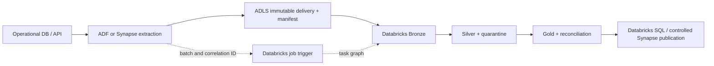
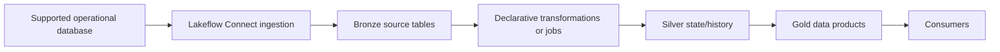
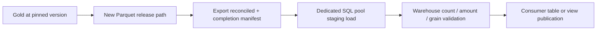

# 05 — Azure integration and operational-source onboarding

[Learning path](README.md) · [Deploy and orchestrate](06_BUNDLES_AND_ORCHESTRATION.md) · [Capstone](08_READINESS_AND_CAPSTONE.md)

This chapter is an architectural and implementation guide. It does not connect to your Azure tenant, configure a source or migrate an existing Synapse solution. Source systems, SLAs, network topology and existing Synapse engine remain unspecified. Examples are synthetic, with current official sources checked on 7 October 2026.

## 1. Name the actual services before drawing a connection

“Synapse” can mean several independent components:

| Component | Typical responsibility | Integration question |
|---|---|---|
| Synapse pipelines / Azure Data Factory | Copy/extraction and orchestration | Which integration runtime, connector and execution identity? |
| Synapse dedicated SQL pool | Provisioned relational warehouse | How is data loaded, distributed and published to consumers? |
| Synapse serverless SQL pool | Query supported files through SQL | Which file/table features can the reader interpret? |
| Synapse Spark pool | Separate Spark execution environment | Which Spark/Delta versions and storage routes? |
| Azure Databricks | Lakehouse processing, governance and serving | Which compute, Unity Catalog assets and run identity? |
| ADLS Gen2 | Shared or dedicated storage | Which identity accesses which paths, from which network? |

Two Spark engines sharing ADLS are not automatically compatible Delta readers/writers. A dedicated SQL pool is not a Spark pool, and a serverless SQL endpoint is not the dedicated SQL pool connector's target. Write the **direction** of each transfer: operational database → landing, landing → Databricks, Databricks Gold → Synapse, or Synapse warehouse → Databricks.

## 2. Source onboarding contract you can reuse

Copy and fill this table for each operational source. An unresolved contract item is an assigned question, not an implementation assumption.

| Item | Required entry |
|---|---|
| Source owner / support contact | Named role/team and incident route |
| Business purpose / consumers | Measures, data products and decision latency |
| Source engine / connector | Product/version; extraction method and supported features |
| Object scope | Databases/tables/API resources/files; intentional exclusions |
| Grain / keys | Business key, event identity, source namespace; null/reuse policy |
| Changes / deletes | Snapshot or CDC; operation meanings; hard/soft delete behavior |
| Ordering | Authoritative sequence/cursor; ties, resets and snapshot boundary |
| Data types / encoding | Decimal precision, timestamp timezone, date format, JSON nesting |
| Delivery / completeness | Cadence, manifests, file counts, partition scope, completion signal |
| Schema evolution | Additive field, rename/drop/type-change process and owners |
| Authentication | Source identity, storage identity, job run identity; secret manager reference |
| Network | DNS, TLS, endpoints, firewall/private access and integration runtime |
| Replay / retention | Source log/file retention, recovery horizon and bootstrap plan |
| Quality / reconciliation | Required fields, domain rules, key checks, source counts/totals |
| Security / privacy | Classification, masking, purpose, dev sampling and retention |
| Source load | Query frequency, concurrency limits, rate limits and extraction windows |
| Freshness / recovery | Source/consumer SLOs, RPO, RTO and alert ownership |
| Release / rollback | Code/config/schema versions; backfill and consumer cutover |

For a source without a delete feed, write “deletes unobservable between snapshots” rather than implying a timestamp filter handles them. For an API without snapshot-consistent pagination, document possible movement/duplication during extraction and the reconciliation method.

## 3. Choose ingestion based on the contract

| Option | Suitable situation | Main tradeoff / investigation |
|---|---|---|
| ADF/Synapse copy → ADLS → Auto Loader | Existing extraction estate; durable files desired | Two progress boundaries and complete file publication |
| Managed Lakeflow Connect | A supported operational connector with required capabilities | Verify source versions, permissions, gateway/staging and retention |
| JDBC extraction in Spark | Controlled database batch reads | Source load, query partitioning, snapshot consistency and deletes |
| Event streaming | Low latency with retained ordered messages/offsets | Message delivery, schema, source sequence and replay horizon |
| REST API extraction | SaaS/custom application with no direct database access | Pagination, rate limiting, token refresh and mutable pages |
| Lakehouse Federation | Governed live access/exploration without copying | Source availability/load; no independent retained Bronze history |
| Full snapshots | Small sources or weak change capabilities | Consistent scope, compare cost and verified completeness |

Managed connectors reduce implementation work but do not remove your responsibility to verify source-specific CDC limitations and failure behavior. For SQL Server, inspect source database variation, supported CDC/change tracking and permissions rather than applying generic JDBC assumptions. [Lakeflow Connect](https://learn.microsoft.com/en-us/azure/databricks/ingestion/lakeflow-connect/) · [SQL Server concepts](https://learn.microsoft.com/en-us/azure/databricks/ingestion/lakeflow-connect/sql-server-concepts) · [Federation](https://learn.microsoft.com/en-us/azure/databricks/query-federation/)

### Architecture A: preserve existing extraction and add Databricks transformations



This is useful when the current estate already has reliable extraction and source connectivity. Each delivery has an immutable scope ID and completion manifest. Databricks begins only when the required extraction scope is complete. A retry uses the same batch/source identity and does not advance the source cursor ahead of durable landing.

### Architecture B: managed operational ingestion



Confirm connector-specific staging/gateway/compute/network needs, initial snapshot consistency, CDC retention and sequence semantics. Do not run a second scheduled full extraction over the same target simply because an older ADF pipeline exists; decide the system of record and migration boundary.

## 4. Implement reliable extraction boundaries

### Timestamp-based database extraction

A naive `WHERE modified_at > last_max` misses equal timestamps, updates older than a late arrival and hard deletes. If the source has no CDC, define a documented overlap or composite cursor and reconcile periodically. Example contract: timestamp is UTC, extraction uses a bounded upper cutoff, `(modified_at, stable_id)` orders rows, updates change `modified_at`, and reconciliation snapshots detect deletes. If those claims are false, redesign.

```text
read durable last-successful cursor
choose upper boundary / extraction snapshot
extract bounded scope with source-approved consistency
land immutable files plus row counts and source scope
publish completion manifest
ingest and reconcile required durable outputs
record completed scope and advance cursor under recovery policy
```

Whether the extraction cursor advances after landing or after all transformations is a design choice. If after landing, landing must be independently durable/replayable and downstream progress tracked separately. A single ambiguous “last_run” field cannot represent both source extraction and consumer publication.

### JDBC design fragment

```python
# Configuration is supplied by a reviewed deployment/secret route.
# No real credentials are embedded; secret scope/key must exist for run identity.
options = {
    "url": jdbc_url,
    "driver": "com.microsoft.sqlserver.jdbc.SQLServerDriver",
    "dbtable": approved_bounded_source_query,
    "user": source_user,
    "password": dbutils.secrets.get("source-access", "operational-db-password"),
}
source_df = spark.read.format("jdbc").options(**options).load()
```

These names are inputs you must provide, not ready-to-run fixture code. The SQL query must be a reviewed bounded subquery/alias appropriate for the driver, not arbitrary user input. Use TLS and a supported authentication route; OAuth/managed identity options vary by source/driver. Do not print options containing passwords.

When parallelizing JDBC, `partitionColumn`, bounds and number of partitions describe partitioned reads; bounds are not automatically a data filter. Put the intended scope in the source query. Too many partitions can overload the source database. Concurrent queries may not observe one consistent snapshot unless the source/extraction mechanism provides it. [Spark JDBC](https://spark.apache.org/docs/latest/sql-data-sources-jdbc.html)

### API design

Use the provider's continuation token/page contract, handle 429/temporary failures with bounded backoff, and persist enough page/scope state to resume. Record request scope and source record identity; a “last page reached” marker says little if earlier pages were overwritten or not landed. Prefer provider-supported change cursors or consistent snapshots over guessing from sorted timestamps. For each page, preserve raw payload and extraction metadata, then validate business fields in Silver.

An API retry can repeat records; two mutable pages can miss a moved record. Business-key/event deduplication helps duplicates but cannot recover an unseen event. Reconciliation/completeness must be designed at source level.

## 5. Azure identity and network access: trace both sides

For Unity Catalog-managed storage access, Azure managed identities through an Access Connector/storage credential are a supported approach. External locations associate a storage path with a credential; volumes/tables expose governed assets. Cloud RBAC and applicable ADLS ACLs/network controls still need to allow the configured route. [Managed identities for storage](https://learn.microsoft.com/en-us/azure/databricks/connect/unity-catalog/cloud-storage/azure-managed-identities)

| Boundary | Caller you should identify | Independent check |
|---|---|---|
| CI/CD → Databricks API | Deploying service principal/workload identity | Auth audience/host, workspace assignment, resource permissions |
| Job → Unity Catalog | Configured `run_as` principal | Catalog/schema/object/volume grants and workspace bindings |
| Databricks → ADLS | Configured storage credential identity for that route | Storage RBAC/ACL/network reachability |
| ADF/Synapse → source | Linked-service/integration-runtime identity | Database/API permissions, DNS/TLS/firewall |
| Synapse SQL → ADLS | SQL credential/workspace identity or configured caller route | Read permissions to actual exported/staging paths |
| Consumer → SQL endpoint | BI/application identity | SQL compute/endpoint plus data permissions |

A developer browsing a volume successfully does not prove the job principal has `READ VOLUME`. A Unity Catalog `SELECT` grant does not grant a Synapse external client access to an ADLS path. An external client reading storage directly bypasses Unity Catalog's query-time controls, so align cloud-side governance separately. [Volumes](https://learn.microsoft.com/en-us/azure/databricks/volumes/)

For a timeout, separate name resolution, connection establishment, TLS and authorization. A 403 is not usually repaired by adding Spark workers. If public access is disabled, identify the appropriate private routing/integration runtime and the identity actually used at runtime. Do not substitute a personal storage key simply to bypass an unexplained access failure.

## 6. Gold consumption and Synapse reader compatibility

### Option 1: serve Gold through Databricks SQL

BI/tools query governed Gold through a configured SQL warehouse/endpoint. This avoids creating a second data copy solely for SQL access. Review consumer identity, row/column policy, query load, costs and refresh/data-as-of behavior. If the existing warehouse contract requires Synapse, design a controlled publication rather than silently redirecting consumers.

### Option 2: Synapse serverless SQL reads supported Delta files

Microsoft's current serverless documentation describes **Delta Lake version 1.0** support and warns that newer features, including deletion vectors and v2 checkpoints, require another compatible reader. Do not assume a current Databricks table can be queried safely simply because it uses Delta. Inspect table protocol/features and test updates/deletes, not only initial inserts. [Synapse Delta reader limits](https://learn.microsoft.com/en-us/azure/synapse-analytics/sql/query-delta-lake-format)

For a deliberately compatible external Delta path, the SQL shape is:

```sql
-- Synapse SERVERLESS SQL fragment: storage credential/access must be configured.
SELECT TOP 100 order_date, store_id, order_count, order_amount
FROM OPENROWSET(
    BULK 'https://<storage>.dfs.core.windows.net/<container>/published/compatible-delta/',
    FORMAT = 'DELTA'
) AS sales;
```

This is not a path to the lab's Unity Catalog managed table and is not an instruction to expose managed storage. Direct path access, reader compatibility and cloud-side permissions must be explicitly arranged. Disabling a property after writes is not automatically a protocol downgrade or removal of existing feature usage. Do not force a modern primary table into legacy constraints without assessing every reader/writer.

**Unsafe workaround:** `FORMAT='PARQUET'` over a Delta table's data directory can include obsolete files or fail to honor deletions. Instead use a compatible Delta reader or create a separate, validated Parquet snapshot export.

### Option 3: publish a versioned Parquet snapshot

```python
# Design fragment. approved_export_path is an authorized EXTERNAL destination,
# not a Unity Catalog managed-table directory. Use a new path for each release.
published = spark.read.option("versionAsOf", source_version).table(gold_table)
published.write.mode("errorifexists").parquet(approved_export_path)
```

Pin a retained Gold table version; export all needed partitions to a new release path. Validate schema, rows, group keys and measures. Only then publish a manifest or change a consumer view/path to that completed release. A collection of successful file writes is not an atomic consumer cutover. Keep the old completed release until rollback/retention permits removal.

Suggested manifest fields:

```text
release_id / source table and version / code version
input batch scope / source data-as-of / export schema version
export path and file set / row count / sum(order_count) / sum(order_amount)
export validation status / downstream load status / consumer publication time
```

Partitioned exports need scope-aware counts, not just a total across whichever files happen to exist. If a date/store group disappeared after a delete, an incremental downstream publication must remove it; blindly appending changed aggregate rows preserves obsolete results.

## 7. Dedicated SQL pool: treat loading as its own pipeline

A dedicated pool stores relational tables. A bulk-load route can publish a reviewed Parquet export in ADLS, load into a staging table via supported `COPY INTO`/copy activity, validate, then publish through the warehouse's designed transaction/view/swap strategy. It is not a live Delta-table reader.



Determine data type mappings, string lengths, decimal precision, nullability, timezone/date interpretation and distribution/index design independently. A small dimension may use a replication strategy where suitable; a large fact table may benefit from an appropriate distribution key. Choose from observed join/distribution characteristics, not from the lab's tiny row count.

For retry, use a stable release ID and a known staging target. If data loaded but the final marker failed, verify/reuse the loaded release instead of blindly appending again. A warehouse publication must not mix half of one release with half of another. [ADLS-to-dedicated-pool loading](https://learn.microsoft.com/en-us/azure/synapse-analytics/sql-data-warehouse/sql-data-warehouse-load-from-azure-data-lake-store) · [ADF connector catalogue](https://learn.microsoft.com/en-us/azure/data-factory/connector-overview)

### Existing legacy Synapse connector

Older Databricks notebooks may use `com.databricks.spark.sqldw`, JDBC and a `tempDir` staging route. Current documentation is under **archive/connectors**. Inspect the existing runtime/connector support rather than choosing this automatically for a new architecture. The documented staging rules and identity options are connector-specific; notably, the archived page says a Unity Catalog external location cannot be used as `tempDir`. A UC volume is not an interchangeable argument. [Archived connector reference](https://learn.microsoft.com/en-us/azure/databricks/archive/connectors/synapse-analytics)

For a legacy failure, diagnose SQL endpoint/authentication, temporary-storage write/read, source query, data conversion and post-load actions separately. A post-action failure can occur after data has already loaded; rerunning an append blindly can duplicate it. Preserve existing behavior while preparing a reviewed migration with reconciliation.

## 8. Orchestration with ADF/Synapse

Use a supported Databricks job/notebook activity and a configured linked service when the existing orchestrator owns extraction. Pass durable batch ID, input scope and target/environment parameters; capture the Databricks run ID and wait for the required completion outcome. UI labels and activity capabilities can vary; inspect your activity type rather than transplanting another service's JSON. [Databricks Job activity](https://learn.microsoft.com/en-us/azure/data-factory/transform-data-databricks-job) · [Notebook activity](https://learn.microsoft.com/en-us/azure/data-factory/transform-data-using-databricks-notebook)

Choose one end-to-end owner. External orchestration can own extraction → Databricks job → warehouse publication, while the job owns internal Bronze → Silver → Gold dependencies. Disable duplicate automatic triggers where their scopes overlap. Configure retry only after proving that the called task is safe to restart.

An extraction success signal should mean the delivery contract is complete, not merely that an HTTP job-trigger request was accepted. An alert should identify which boundary failed and which data release consumers still see. Correlate ADF/Synapse pipeline run, source batch, Databricks job/run and publication release.

## 9. Reconciliation and rollout for a new source

1. Profile source keys, types, volume and change/delete behavior on an approved sample.
2. Land a complete bounded scope and preserve provenance.
3. Build Silver with explicit quality and ordering rules; compare source counts and business measures under the same scope/time semantics.
4. Build Gold and validate grain, join cardinality and consumer definitions.
5. Run retries, late updates, deletes, schema changes and interrupted extraction in development/UAT.
6. Shadow the existing pipeline without writing its production consumer target. Compare by key/period, not just totals.
7. Agree on acceptable differences, source-load impact, owners and rollback.
8. Cut over from a documented offset/snapshot boundary; prevent duplicate owners.
9. Monitor freshness, delivery completeness, rejects and reconciliations during the agreed stabilization window.

A comparison must use equivalent source scope and clocks. A correct new pipeline processing later data can differ from yesterday's old snapshot without having a defect. Conversely matching overall sales can conceal wrong store attribution or missing orders balanced by duplicates.

## 10. Collaboration handoff

Provide the source team with raw failing record references and rule meanings. Provide platform engineers with exact identity, path, network boundary and error class. Provide data engineers with captured input scope, schemas, candidate counts and target versions. Provide BI consumers with measure definition, grain and published data-as-of.

Use a joint definition of done: **delivered scope verified, state changes correct, consumer product reconciled, retries demonstrated, monitoring owned and recovery documented**. A connector test or successful notebook alone is insufficient evidence for this full outcome.
