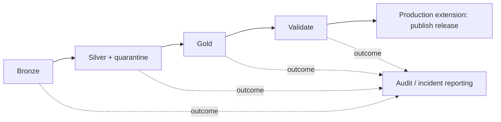

# 06 — DAB deployment, CI/CD and orchestration

[Learning path](README.md) · [Lab bundle](03_OPERATIONAL_DATA_LAB/bundle/databricks.yml) · [Practice](07_TROUBLESHOOTING_PRACTICE.md)

Current documentation uses **Declarative Automation Bundles**, formerly **Databricks Asset Bundles**. The abbreviation DAB and `databricks bundle` commands remain useful when discussing existing projects. This chapter explains both a working development scaffold and the decisions required for production. Cloud validation/deployment remains unperformed.

## 1. Know the five stages and their evidence

| Stage | Example action | What evidence establishes | What remains to prove |
|---|---|---|---|
| Local syntax | Python AST/YAML parsing | Files are syntactically readable | Bundle schema, workspace access and runtime behavior |
| Bundle resolution/validation | `bundle validate -t dev` | Selected config/resources resolve under that invocation | Resource creation and data access at runtime |
| Deployment planning | `bundle plan -t dev` | Proposed resource differences for that target | Actual deployment and successful execution |
| Deployment | `bundle deploy -t dev` | Resource/code deployment reported by CLI | Correct run identity, inputs, state and business outputs |
| Runtime/data verification | `bundle run` + assertions/reconciliation | The observed run produces checked results | Other inputs, recovery paths, scale and long-term SLOs |

An error in each stage calls for different evidence. Editing transformation code cannot fix malformed bundle YAML. Editing YAML can fix a wrong notebook path while leaving a source database permission failure unresolved. Keep the full CLI invocation/target/version with the first relevant error.

## 2. Understand the configuration surfaces

The supplied [databricks.yml](03_OPERATIONAL_DATA_LAB/bundle/databricks.yml) defines bundle name, engine, included resource YAML, variables, file sync and one dev target. [jobs.yml](03_OPERATIONAL_DATA_LAB/bundle/resources/jobs.yml) defines the task graph and notebook parameters.

| Surface | Controls | Common confusion |
|---|---|---|
| `bundle.name` | Logical deployment name | Does not name a catalog or database |
| `targets` | Environment-specific deployment settings | Target selection does not automatically rewrite hard-coded tables |
| `variables` / `${var...}` | Deployment-time configuration | Different from job run parameters |
| `workspace.host` or auth profile | Workspace endpoint | Host/profile/environment precedence can choose the wrong workspace |
| `workspace.root_path` | Deployment/state location for selected identity/target | Sharing roots can cause concurrent deployments to manage the same resources |
| `sync.paths` | Code files included from outside bundle root | Relative path and artifact presence still require checks |
| `resources.jobs` | Job configuration/task definitions | A deployed job is not a completed data release |
| `run_as` | Execution identity | Deployment user and run identity can differ |
| `permissions` | Workspace resource ACLs | Does not grant Unity Catalog table/volume access |
| Job parameters | Values supplied per run, such as batch ID | Not a safe mechanism for arbitrary privileged table names |

Resolution uses supported configuration precedence. Rather than memorizing every precedence detail, inspect the resolved target under the **exact** command and environment your runner uses. Record host alias, target, root, catalog, notebook path and execution identity. Never publish the resolved output if it contains secrets.

The source YAML path for the notebook is relative to its defining resource file. This lab includes external notebook files through `sync.paths`; a CI checkout must contain them. Renaming a notebook without updating its configured path can deploy a resource that cannot execute the intended code. [Bundle configuration](https://learn.microsoft.com/en-us/azure/databricks/dev-tools/bundles/settings) · [Sharing bundle files](https://learn.microsoft.com/en-us/azure/databricks/dev-tools/bundles/sharing)

## 3. Make deployment identity stable and state deliberate

Personal development targets can use a user-specific root so developers do not collide. Production should have a stable team-owned deployment root, a reviewed resource owner and a configured service principal/workload identity. Changing root/name/target/identity can make the CLI see a different deployment and create additional resources instead of updating existing ones. Inspect existing resource IDs before deciding whether an asset needs binding or migration.

Do not delete local/remote bundle state as a routine fix. Back up and inspect state, host, target, name, root and existing resource IDs. If an existing job was created outside a bundle, follow documented binding/import procedures under reviewed ownership. Two pipelines racing on the same state are a CI/CD coordination problem.

The sample explicitly chooses `bundle.engine: direct`. Current docs describe direct and legacy Terraform deployment engines with different state formats and configuration-removal behavior. Pin your validated CLI version and record the engine; investigate proxy/Terraform errors against the actual engine rather than assuming every bundle requires Terraform. Follow the official migration process for an existing deployment instead of changing state files by hand. [Direct engine](https://learn.microsoft.com/en-us/azure/databricks/dev-tools/bundles/direct)

### Deployment modes

Development mode applies conveniences such as resource prefixes and paused schedules; inspect resource/preset overrides. The sample explicitly keeps `max_concurrent_runs: 1`. Production mode applies deployment validations, but it does not mask data, grant runtime table access or prove business correctness. [Deployment modes](https://learn.microsoft.com/en-us/azure/databricks/dev-tools/bundles/deployment-modes)

A schematic production target for **generalized production code**, separate from the guarded fixture notebook, might contain:

```yaml
targets:
  prod:
    mode: production
    git:
      branch: main
    workspace:
      root_path: /Workspace/Shared/.bundle/operational-orders/prod
    run_as:
      service_principal_name: <existing-production-principal-application-id>
    permissions:
      - group_name: data-engineering-release
        level: CAN_MANAGE
    variables:
      catalog: operations_prod
```

This fragment is not a complete deployable file. Workspace/profile, compute, identities/groups, privileges, code and publication controls must exist. The lab notebook rejects non-dev catalogs and its fixed assertions are unsuitable for production. Do not simply append this fragment to the lab and bypass its guard.

## 4. Authentication and permissions: identify all callers

For interactive development, use supported CLI OAuth login. For automation, choose a configured workload identity/federation or OAuth machine-to-machine service principal route supported by your environment. OAuth authentication to an API does not grant table/volume access. Azure Databricks-managed OAuth and Microsoft Entra service-principal authentication have distinct setup requirements; do not substitute client secrets/audiences between them blindly. [CLI authentication](https://learn.microsoft.com/en-us/azure/databricks/dev-tools/cli/authentication) · [OAuth M2M](https://learn.microsoft.com/en-us/azure/databricks/dev-tools/auth/oauth-m2m) · [Federation](https://learn.microsoft.com/en-us/azure/databricks/dev-tools/auth/oauth-federation)

For a job that succeeds interactively but fails on schedule, compare:

1. Workspace/target and resolved catalog/input path.
2. Job `run_as` versus interactive user.
3. Workspace access to notebook/files, job/compute rights and source connection.
4. UC catalog/schema/table/volume rights for run identity.
5. Cloud-side identity/network route for external storage/database access.
6. Runtime/access mode and required libraries/configuration.

Separating deploy and run identities may require permission to use the chosen service principal. Setting `run_as` to an application's ID is not enough to provision or authorize it. Workspace job ACLs and UC data grants are separate. [Run identity](https://learn.microsoft.com/en-us/azure/databricks/dev-tools/bundles/run-as)

Store secrets in approved secret-management/CI credentials; YAML variables are not a secret store. Avoid printing environment variables or whole authentication configuration while debugging. Host, auth method, principal identifier and error class usually provide useful evidence without exposing credentials.

## 5. Orchestrate required data tasks and failure paths

The lab's required path is:



Required successors should depend on successful required predecessors. A notification/audit task may run under a completion condition even after failure, but its success must not transform a failed data release into a successful release. Inspect job task run conditions rather than assuming a line on the graph always means success dependency. [Task control flow](https://learn.microsoft.com/en-us/azure/databricks/jobs/control-flow)

Parameters should identify a bounded source scope and approved environment. Validate allowed values before constructing names/paths. Do not let arbitrary job callers select a production destination with a privileged run identity. Version the transformation and schema contract; a backfill must name its date/source scope and coexistence policy with normal runs.

### Retry matrix

| Failure | Typical policy | Required precondition |
|---|---|---|
| Temporary source/network failure | Bounded retry with backoff | Same request/batch can safely repeat |
| Delta write conflict | Retry after fresh state/coordination if safe | Deterministic input and idempotent effects |
| Invalid source payload | Quarantine or fail under quality policy | Repair owner and reconciliation visible |
| Contradictory sequence | Stop/escalate source contract defect | No arbitrary winner chosen |
| Bad path/permission/dependency | Correct configuration first | Same run identity/path then verified |
| Driver memory failure | Inspect plan/collection/resource evidence | No blind indefinite retry on unchanged workload |
| Partial downstream load | Detect committed release before retry | Stable release ID and repeatable staging/publication |

A repair run restarts selected unsuccessful tasks with current settings/code. It does not resume Python execution from the failed line or automatically make previously written data idempotent. Capture the original run's input/version and evaluate whether current code should repair it or whether a separate controlled backfill is needed. [Repair job failures](https://learn.microsoft.com/en-us/azure/databricks/jobs/repair-job-failures)

## 6. CI/CD that promotes evidence

Use one source-controlled project with target configuration for environments. A practical release chain is:

```text
pull request:
  parse/lint changed code and configs
  run meaningful fixture/logic checks
  validate intended development target under runner identity
  review contract/schema/deployment changes

integration environment:
  deploy reviewed commit and compatible runtime/dependencies
  run representative inputs and failure/replay drills
  reconcile required outputs and capture resource/table versions

production:
  use approved commit, target and stable deployment identity
  inspect deployment plan and data migration/publication scope
  deploy, run bounded smoke verification and monitor release
  retain rollback/recovery evidence
```

Do not execute cloud commands during a documentation review merely to make a check appear complete. Conversely, do not label local syntax checks “integration tests.” The provided offline oracle proves synthetic expectations; a cloud run adds distinct evidence.

For a wheel/package, pin and version dependencies, build a reproducible artifact and ensure compute installs the intended version. A changed source file may not update an already installed cached package without a version change/redeploy. Notebook tasks, wheel tasks and serverless environments configure dependencies differently. [Bundle dependencies](https://learn.microsoft.com/en-us/azure/databricks/dev-tools/bundles/library-dependencies) · [Serverless environment](https://learn.microsoft.com/en-us/azure/databricks/compute/serverless/dependencies)

### Rollback includes data state

Redeploying yesterday's code does not undo today's bad data or schema migration. Before release, define how to identify affected input/table versions, rebuild the scoped result, restore only when appropriate, and preserve newer valid changes. Revisit downstream CDF/export consumers after data repair. Avoid a wholesale historical restore when it would remove unrelated valid concurrent changes.

For breaking schema changes, consider a parallel v2 table/view contract, validation and deliberate consumer migration. Compatibility and retention may require an overlap period. Code rollback should remain usable against the retained data/schema version, or its limitations must be explicit.

## 7. Diagnose DAB deployment incidents systematically

| Symptom | First evidence | Reasoned next step |
|---|---|---|
| YAML parse/unknown property | Exact file/line, CLI version, schema/help | Fix indentation/key/unsupported field; validate again |
| Undefined variable/substitution | Selected target, overrides, included files | Check variable/resource spelling and resolved values |
| Missing notebook/artifact | Local relative path, sync rules, CI checkout/build output | Include/build correct asset and inspect deployed path |
| Wrong workspace/catalog | Host/profile/target and config precedence | Resolve exact invocation; verify environment boundary |
| Deployment 403 | Deployment principal and named denied resource | Fix deployment permission, separately from data grants |
| Deploy passes, runtime 403 | Job run principal, UC/storage/compute access | Repair the failing runtime boundary |
| Extra duplicate jobs | Bundle/root/target identity and old resource IDs | Stop competing deployments; reconcile ownership/state |
| Locked/conflicting deployment | Active runner/deploy state and engine | Coordinate writers and follow supported recovery |
| Runtime reads old code | Deployed notebook/artifact version, task source, cache | Verify actual asset/version used and redeploy correctly |
| Legacy Terraform/proxy error | Actual engine, migration history, CLI/dependency versions | Investigate that engine; use documented migration where appropriate |

For every repair, verify that the expected existing resource changed, the correct code is deployed, the job uses the intended run identity, and data checks pass. A fresh new job with a different ID is not proof that the old production deployment was repaired.

## 8. Monitoring: distinguish usage from money and job status from freshness

Use job run history and task output for immediate incidents. Where available and authorized, system tables support historical job/usage/audit analysis. The following query shape counts **usage units**, not an invoice total:

```sql
SELECT usage_date, sku_name, usage_unit,
       SUM(usage_quantity) AS usage_quantity
FROM system.billing.usage
WHERE usage_date >= current_date() - INTERVAL 7 DAYS
GROUP BY usage_date, sku_name, usage_unit
ORDER BY usage_date, sku_name, usage_unit;
```

Interpret correction/retraction records and the applicable billing semantics; units must not be mixed. List-price joins can estimate list-price cost but do not automatically represent negotiated charges, credits or every Azure storage/network/source expense. Cost attribution differs for shared all-purpose compute and dedicated job/serverless execution. Check enabled schemas/permissions and retention; missing access is not zero usage. [Billable usage reference](https://learn.microsoft.com/en-us/azure/databricks/admin/system-tables/billing) · [Jobs system tables](https://learn.microsoft.com/en-us/azure/databricks/admin/system-tables/jobs)

Operational indicators should include:

- Last expected delivery versus observed complete delivery.
- Published source data-as-of and end-to-end latency.
- Raw/valid/rejected/duplicate-event counts with clear denominators.
- Sequence conflicts and missing-key/reference rates.
- Required task failures/skips and unresolved repair state.
- Consumer release ID and downstream reconciliation.
- Duration/scan/shuffle/spill/file-size trends and attributable usage.

Choose alert thresholds from actual business expectations and baseline behavior. A timestamp updated by a daily job must not imply the operational source is fresh. Avoid sending alerts on every normal run; notify owners when an outcome is actionable.

## 9. Release review checklist with concrete evidence

Use [14 — Pipeline operations and optimisation](14_PIPELINE_OPERATIONS_AND_OPTIMISATION.md) for operational dashboards/queries, worked fixes, recovery and a representative benchmark worksheet. Its release checks connect resolved configuration with data reconciliation and consumer publication.

Before promotion, provide a reviewer with the exact commit and target, resolved identities/paths, deployment plan, schema/contract diff, representative data checks, replay/delete/late-arrival evidence, failure-repair drill, performance/cost observation and rollback/publication plan. Keep access changes reviewed under the platform's normal ownership process.

In this repository, publication of the course and sample files is authorized; deployment of cloud resources is a separate learner activity. The course's [verification record](verification.json) names the checks actually performed, and the [capstone](08_READINESS_AND_CAPSTONE.md) defines the missing runtime evidence.
