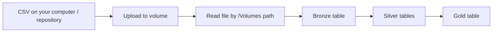

# 10 — Unity Catalog volumes: what, setup and contents

[Learning path](README.md) · [Operational-data lab](03_OPERATIONAL_DATA_LAB/README.md) · [Azure integration](05_AZURE_INTEGRATION.md)

For external locations versus external/managed tables, storage ownership, use cases and table setup, read [13 — Managed and external storage](13_MANAGED_AND_EXTERNAL_STORAGE_GUIDE.md).

**A volume is a named, governed place for files in cloud storage.** You can put a CSV, JSON document, PDF or library artifact in it and give users/jobs permission to read or write those files through Unity Catalog. Its files have paths such as `/Volumes/training_dev/ops/lab_files/order_events.csv`.

Read this supplementary guide **before the upload step in lab 03**. It is numbered 10 so the original 00–09 files keep their existing names. Official documentation checked **7 October 2026**; setup examples were reviewed but not executed in your workspace. No storage, volume or permission was created for you.

## 1. Picture a warehouse with a labelled cupboard

Imagine your data platform is a warehouse:

- A **catalog** is a section assigned to a domain/environment.
- A **schema** organizes related assets within that section.
- A **volume** is a labelled cupboard holding files.
- A **table** is a structured register you query by columns and rows.

For the course:

```text
training_dev                         catalog
├── ops                              schema
│   └── lab_files                    volume
│       └── order_events.csv          file inside the volume
├── bronze                           schema
│   └── order_events                 table created by the pipeline
├── silver                           schema
│   └── orders_current               table created by the pipeline
└── gold                             schema
    └── daily_store_sales            table created by the pipeline
```

The cupboard analogy explains organization and permission boundaries. Physically, the files live in cloud object storage, such as ADLS Gen2. A volume is not Spark memory or a separate computer disk, and creating one does not create a new Azure storage account.

The CSV can contain rows and columns and still be a **file** in a volume. Reading it and writing a Delta table creates a separately governed table. Uploading `orders.csv` alone does not define the named SQL relation `bronze.orders`.

| Question | Volume/file | Unity Catalog table |
|---|---|---|
| How do I address it? | File path | `catalog.schema.table` |
| What do I access? | A file or directory | A defined table of rows/columns |
| Where are access grants applied? | Volume, plus parent usage privileges | Table, plus parent usage privileges |
| Example | `.../lab_files/order_events.csv` | `training_dev.bronze.order_events` |
| Typical operation | Upload/list/read/write files | Query, insert, update or merge table rows |

[Official volume overview](https://learn.microsoft.com/en-us/azure/databricks/volumes/)

## 2. Understand the object name and file path

The **volume object name** is:

```text
training_dev.ops.lab_files
catalog      schema volume
```

The **file path** is:

```text
/Volumes/training_dev/ops/lab_files/order_events.csv
         catalog      schema volume    file
```

Additional directories belong after the volume name:

```text
/Volumes/training_dev/ops/lab_files/incoming/2026-10-07/orders.json
```

`incoming` and `2026-10-07` are ordinary directories, not extra Unity Catalog schemas/volumes. Create the catalog/schema/volume as governed objects, then create directories inside the volume. A filesystem `mkdir` cannot provision those first three object levels.

Use `/Volumes/...` with the APIs shown here. Some Spark/Databricks interfaces also accept `dbfs:/Volumes/...`; that prefix does not make the volume an old DBFS root folder. Avoid `/dbfs/Volumes/...`. To list files, give a complete volume path, not just `/Volumes/<catalog>` and expect it to enumerate catalogs/schemas.

On classic compute, volumes require Unity Catalog-compatible compute and **DBR 13.3 LTS or later**. The main course uses a later intended baseline. On unsupported old runtimes, an apparently successful `/Volumes` write can use ephemeral storage rather than the intended volume. Check actual compute support; a SQL warehouse can run SQL, while Python examples need compatible notebook/job compute. [Requirements and path rules](https://learn.microsoft.com/en-us/azure/databricks/volumes/)

## 3. Choose managed or external

| Choice | Who chooses the physical location? | Example decision |
|---|---|---|
| **Managed volume** | Databricks/Unity Catalog uses configured managed storage | “I want a simple governed home for the course CSV.” |
| **External volume** | You register an approved existing cloud directory | “ADF already lands POS files in this ADLS directory.” |

Both give Databricks callers the same style of `/Volumes/...` path. For this lab, choose **managed** unless you have a reason to use an existing external landing zone.

An external volume can expose existing files without copying them into another storage account. External systems writing directly to ADLS still need their own cloud access controls. Their direct storage access is not automatically authorized by a Unity Catalog grant to a Databricks user.

Keep object lifecycle separate from individual file operations. Dropping a managed volume marks its files for deletion under the managed-storage lifecycle. Dropping an external volume leaves the underlying cloud files in place. Deleting a file through a volume is still a file deletion; “external” does not mean the file is immune from writes/deletes by authorized callers. Use a separate retention/backup policy appropriate for source evidence and stream state. [Managed/external behavior](https://learn.microsoft.com/en-us/azure/databricks/volumes/) · [Volume management](https://learn.microsoft.com/en-us/azure/databricks/volumes/utility-commands)

## 4. What belongs in a volume?

Use it when your workflow needs a **file** rather than a directly queryable table interface.

| Contents | Example | What happens next? |
|---|---|---|
| Raw delivery files | POS CSV, API JSON, supplier Parquet | Ingestion reads them into Bronze tables |
| Unstructured documents | Invoices, policies, PDFs, images, audio | Parsing/extraction or AI processing reads the files |
| Small reference files | Approved store mapping CSV | Pipeline validates and loads a reference table if needed |
| Export files | Versioned CSV/Parquet consumer release | Consumer reads a completed export under a publication contract |
| Build/library artifacts | Versioned wheel or JAR | Compatible task/compute installs or uses the artifact |
| Supporting metadata | Manifest, schema/config file without secrets | Pipeline verifies delivery scope/configuration |
| Operational file state | Streaming checkpoint/schema tracking directories | Query manages its durable progress/state |

For example, a retail pipeline could use separate volumes for POS landing files, document files and streaming state. Folder names should describe purpose, ownership and retention; a folder named `bronze` does not itself establish Bronze quality.

```text
ops_dev.ops.pos_landing                 external volume
  incoming/batch_20261007_001/orders.json
  incoming/batch_20261007_001/manifest.json

ops_dev.ops.pipeline_state              managed volume, if suitable
  checkpoints/pos_orders/query_v1/
  schemas/pos_orders/query_v1/

ops_dev.documents.invoices              volume chosen for the integration
  received/2026/10/invoice_001.pdf
```

This is a proposed layout, not newly created objects. Separate volumes are useful when readers/writers or retention differ. Ordinary directories within one volume do **not** create separate `READ VOLUME`/`WRITE VOLUME` ACLs. If invoice access differs from POS file access, design distinct governed assets rather than relying on folder names.

Use **Git/workspace project files** as the authoritative home for application source and bundle definitions. Volumes can hold built artifacts, but a pile of scripts in a volume does not provide the course's source-control/release workflow. Store secrets in approved secret management, not a configuration JSON beside source CSVs.

Use **tables** for governed Bronze/Silver/Gold table datasets. You can ingest a volume's CSV/Parquet into a managed table; do not register a UC table whose data directory lies inside a volume. The source file and destination table have distinct locations/access controls. [File use cases](https://learn.microsoft.com/en-us/azure/databricks/volumes/volume-files) · [Table/volume boundary](https://learn.microsoft.com/en-us/azure/databricks/volumes/)

## 5. Set up a managed volume for the course

### Prerequisites

You need a Unity Catalog-enabled workspace, an existing `training_dev` catalog with usable managed storage, and appropriate creation/use permissions. Creating the `ops` schema is a separate operation; if the platform owner already provided it, use it. Creation rights are not a reason to make every learner an administrator.

The course's [setup SQL](03_OPERATIONAL_DATA_LAB/sql/01_setup.sql) already creates `ops.lab_files`. Reuse that object if it exists and has the expected type/location/owner.

### Option A: SQL

Run in an authorized Databricks SQL editor or SQL notebook context:

```sql
-- Existing development catalog; use your approved name if different.
CREATE SCHEMA IF NOT EXISTS training_dev.ops;

CREATE VOLUME IF NOT EXISTS training_dev.ops.lab_files
COMMENT 'Synthetic fixtures for the Databricks study lab';

DESCRIBE VOLUME training_dev.ops.lab_files;
SHOW VOLUMES IN training_dev.ops;
```

`CREATE SCHEMA` requires its own catalog privilege. Creating the managed volume requires `USE CATALOG`, `USE SCHEMA` and `CREATE VOLUME` on the corresponding parents. The platform must have configured managed storage; this SQL does not create storage credentials or Azure storage.

`IF NOT EXISTS` leaves an existing object unchanged. Inspect it rather than assuming it replaced a wrong location/type. A folder in Catalog Explorer is not proof that your job principal can read it.

### Option B: Catalog Explorer

Open **Catalog**, select schema `training_dev.ops`, then choose **Create → Volume**. Give it name `lab_files`, select **Managed**, create it and inspect its details. This is an alternative to the SQL creation, not another storage object required by the lab. If the option is unavailable, investigate privileges/UC setup with the platform owner.

[Create and manage volumes](https://learn.microsoft.com/en-us/azure/databricks/volumes/utility-commands) · [CREATE VOLUME syntax](https://learn.microsoft.com/en-us/azure/databricks/sql/language-manual/sql-ref-syntax-ddl-create-volume)

## 6. Set access for people and jobs

| Operation | Parent privileges | Additional privileges |
|---|---|---|
| Read/list files | `USE CATALOG`, `USE SCHEMA` | `READ VOLUME` on the volume |
| Create/update/delete files | Same parent privileges | `READ VOLUME`, `WRITE VOLUME` on the volume |
| Create managed volume | Same parent privileges | `CREATE VOLUME` on the schema |
| Create external volume | Same parent privileges | `CREATE VOLUME` on schema and `CREATE EXTERNAL VOLUME` on external location |

An authorized owner/privilege manager can grant an existing learning group access:

```sql
-- study_learners is an illustrative EXISTING account-level group.
GRANT USE CATALOG ON CATALOG training_dev TO `study_learners`;
GRANT USE SCHEMA ON SCHEMA training_dev.ops TO `study_learners`;
GRANT READ VOLUME, WRITE VOLUME
ON VOLUME training_dev.ops.lab_files TO `study_learners`;
```

For a job that only reads the uploaded fixture, grant its **run identity** usage plus read access; it does not need volume write access solely to read. A query writing checkpoints needs write access to its state volume. Grants for destination Bronze/Silver/Gold tables are separate from volume grants.

```sql
SHOW GRANTS ON VOLUME training_dev.ops.lab_files;
```

Use the actual existing principal/group and inspect inherited privileges. The person who uploads, the principal that deploys a bundle and the principal that runs a job can differ. A developer's successful upload cannot establish the scheduled job's access. [Volume privileges](https://learn.microsoft.com/en-us/azure/databricks/volumes/privileges)

## 7. Upload and read the lab's CSV

Open the workspace's **Add or upload data → Upload files to a volume** interface. Choose [order_events.csv](03_OPERATIONAL_DATA_LAB/data/order_events.csv) and destination `/Volumes/training_dev/ops/lab_files/`, then upload. Catalog Explorer's upload entry is another way into this interface. Copy/verify the resulting path.

For this exact lab, keep the filename at the volume root:

```text
/Volumes/training_dev/ops/lab_files/order_events.csv
```

The job reads a Databricks cloud volume path, not your Windows Downloads path. A GitHub link or local repository file is not automatically uploaded. The current UI has a 5 GB per-file upload limit; larger files require a supported transfer/API route. [Upload instructions](https://learn.microsoft.com/en-us/azure/databricks/volumes/volume-files)

In a compatible Databricks Python notebook, inspect a bounded sample:

```python
volume_path = "/Volumes/training_dev/ops/lab_files"
input_file = f"{volume_path}/order_events.csv"

display(dbutils.fs.ls(volume_path))
raw = (spark.read.format("csv")
       .option("header", "true")
       .option("inferSchema", "false")
       .load(input_file))
raw.printSchema()
display(raw.limit(5))
```

This exploratory fragment keeps fields as strings. The supplied pipeline applies its explicit raw schema and Silver validation. Listing proves file discovery for that caller; parsing a sample does not prove all rows meet the business contract.

Then follow lab 03 with `catalog=training_dev` and the input path above. Its Bronze stage reads the CSV from the volume and writes the separate table `training_dev.bronze.order_events`. Silver and Gold tables also live as UC table assets, not as folders beneath `lab_files`.



## 8. Write a small support file inside the volume

This optional notebook example writes a new development-only JSON support file. It is illustrative and was not run here. File writing needs volume write access; the exclusive create mode avoids overwriting an existing file.

```python
import json

folder = "/Volumes/training_dev/ops/lab_files/notes"
dbutils.fs.mkdirs(folder)
manifest = {
    "purpose": "study-example",
    "input_file": "order_events.csv",
    "expected_total_fixture_lines": 16,
}
with open(f"{folder}/example_manifest.json", "x", encoding="utf-8") as handle:
    json.dump(manifest, handle, indent=2)
```

The lab does not read this example manifest. A production completion manifest must come from verified delivery evidence; a hand-written expected count is not a source completeness guarantee. Do not place notes/manifests among data files if an ingestion reader scans all files without a format/path filter.

## 9. Set up an external volume over ADLS

Use this path when a system such as ADF already publishes to an approved ADLS landing directory. Establish the cloud connection first:

1. Platform owner provides an ADLS Gen2 account/container and the intended directory.
2. Configure the Azure identity/storage access route, commonly an Access Connector managed identity, and applicable cloud RBAC/ACL/network access.
3. In Unity Catalog, configure a storage credential for that identity and an external location covering the approved ADLS path.
4. Give the volume creator the parent/schema privileges and `CREATE EXTERNAL VOLUME` on that external location.
5. Register a dedicated subdirectory as the external volume; avoid overlap with table directories or other volumes.

The identity, credential and external location are prerequisites, not placeholders that this volume SQL provisions. [Azure managed identity storage setup](https://learn.microsoft.com/en-us/azure/databricks/connect/unity-catalog/cloud-storage/azure-managed-identities) · [External locations](https://learn.microsoft.com/en-us/azure/databricks/connect/unity-catalog/cloud-storage/external-locations)

```sql
-- Replace cloud identifiers and use an approved existing external location.
CREATE EXTERNAL VOLUME training_dev.ops.pos_landing
LOCATION 'abfss://landing@<storage-account>.dfs.core.windows.net/pos/orders/'
COMMENT 'POS file landing directory';

DESCRIBE VOLUME training_dev.ops.pos_landing;
```

The `LOCATION` belongs inside the configured external location's permitted scope. The external-location **object name** is not the `/Volumes` path. A file stored physically as `.../pos/orders/batch_001/orders.json` becomes accessible through the registered volume as:

```text
/Volumes/training_dev/ops/pos_landing/batch_001/orders.json
```

Registering the volume adds the Databricks-governed interface; it does not perform ingestion, parsing or table creation. ADF publishes through its approved ADLS connection, while Databricks reads through the volume. Govern ADF's direct cloud access separately and reconcile source delivery before starting transformations.

The existing course notebook restricts inputs to `ops.lab_files` and the fixed CSV. This external POS example is a separate integration design; it is not a replacement path you can pass into the guarded lab unchanged.

## 10. File organization and troubleshooting

For real file ingestion, decide who owns delivery, which paths readers watch, how completion is signalled and what stays immutable. Put streaming state outside watched incoming directories. Give every logical query its own checkpoint/schema directories and preserve them through restarts. Use separate access/retention policies when source files and state have different owners.

| Symptom | First investigation |
|---|---|
| Cannot create volume | Existing catalog/schema, creation privileges and managed storage configuration |
| Upload works but job read fails | Actual job run identity, parent usage and volume read access |
| File not found | Exact copied path, uploaded filename and full volume name |
| List at `/Volumes/training_dev` fails | List a specific volume's files; browse objects through Catalog/SQL |
| External volume returns storage denial | UC grants plus configured storage identity/cloud permissions/network |
| File read succeeds but no table exists | Was an ingestion/table-creation operation actually run? |
| Spark rejects malformed CSV | File format/schema/value contract; volume storage did not validate it |
| Stream repeats history after cleanup | Checkpoint/query state was reset; use controlled replay/reconciliation |
| Another consumer cannot use `/Volumes/...` | It needs a supported Databricks file/API route or approved direct external-storage integration |

Treat volume permission as access to files, not validation that those files are correct. Avoid replacing immutable delivery files under the same name without a reviewed ingestion/replay policy. Do not delete checkpoints to make a run green, and do not use a Delta table's underlying file directory as an interchangeable export location.

## 11. Quick recall

1. What is the difference between `training_dev.ops.lab_files` and its CSV path?
2. Why can a CSV be in a volume while a Bronze table is a separate asset?
3. Which choice fits a small uploaded course fixture, and which fits existing ADF landing files?
4. Which principal must have volume read access for a scheduled job?
5. Why do two directories in one volume not establish two volume ACL boundaries?
6. Which folders are safe for an ingestion reader to scan, and which hold operational state?

For this course, your concrete starting point is **create/reuse `training_dev.ops.lab_files`, upload the supplied CSV, verify its path/read access, then run lab 03**.
