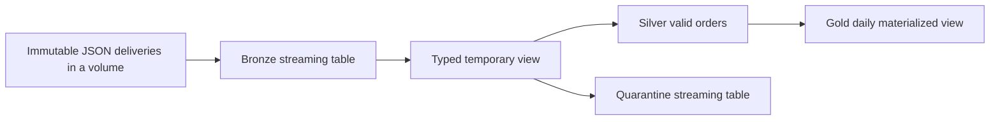

# 11 — Lakeflow pipelines and the former Delta Live Tables (DLT)

Read with [04 — Delta and streaming](04_DELTA_AND_STREAMING.md), [06 — Bundles and orchestration](06_BUNDLES_AND_ORCHESTRATION.md) and [10 — Volumes](10_UNITY_CATALOG_VOLUMES_GUIDE.md). Official documentation reviewed **7 October 2026**. The worked example is original, optional and unexecuted in a workspace.

The requested [What are pipelines? page](https://docs.databricks.com/aws/en/ldp/concepts/pipelines) uses the current term **Lakeflow pipelines**. You will also encounter **Lakeflow Spark Declarative Pipelines**, the former product name **Delta Live Tables**, and the Python import **`dlt`**. Recognizing these names helps you read existing projects without assuming that every historical example matches today's configuration.

The linked page is the AWS edition. The concepts below also inform the Azure course, but cloud identity, networking, storage URLs, region availability and compute settings must follow your Azure workspace's documentation. This guide uses Unity Catalog volume paths to keep its sample free of AWS storage assumptions.

Continue with [12 — Fake-table pattern examples](12_PIPELINES_CDF_CDC_AUTO_LOADER_EXAMPLES.md) for realistic Auto Loader deliveries, mutable Delta CDF, CDC sequencing/deletes and a CDF-to-CDC replica.

## 1. What a pipeline contains

A declarative pipeline combines source files describing datasets and their transformations with configuration for execution and publication. Databricks analyzes the references between datasets, builds a dependency graph and runs the necessary work. Python and SQL files can participate in one pipeline; their filenames do not establish execution order.

A pipeline **update** is an execution that brings its datasets up to date. It is different from editing the source code or deploying its resource definition. A successful deployment alone does not demonstrate correct output. [Pipeline concepts](https://docs.databricks.com/aws/en/ldp/concepts/pipelines)

For an operational orders workload, our proposed graph could be:



In that design, the team still owns the business contract: what counts as an order, whether duplicates are possible, how corrections are sequenced, and which source deliveries must arrive before publication. The framework cannot infer those rules from the diagram.

## 2. Pipeline, job, bundle, Auto Loader and volume

Use these boundaries when explaining the architecture to another engineer:

| Component | Responsibility in this course's design | Concrete example |
|---|---|---|
| Volume | Store governed files | `incoming/orders_001.json` |
| Auto Loader | Incrementally discover/read delivered files | `cloudFiles` JSON source |
| Declarative pipeline | Define and maintain dependent datasets | Bronze → typed view → Silver → Gold |
| Lakeflow Job | Coordinate broader workflow execution | Delivery readiness → pipeline task → reconciliation task |
| Declarative Automation Bundle, formerly Databricks Asset Bundle | Version deployment resources and environment settings | Pipeline/job definitions promoted through development and production |
| Unity Catalog table/view assets | Expose governed queryable results | `training_dev.pipeline_demo.gold_daily_sales` |

For example, a Synapse/ADF workflow could finish an ADLS delivery, a Databricks job could run the pipeline, and a subsequent task could publish a reconciled consumer snapshot. Define completion evidence and retry ownership at each boundary. A time-based trigger alone is not proof that the upstream delivery is complete.

The existing [lab 03](03_OPERATIONAL_DATA_LAB/README.md) runs imperative notebook stages through a four-task job. The example here is a separate teaching implementation; installing it does not convert that job automatically. Keep its output names and ownership separate.

## 3. Choose the right dataset type

| Type | Think of it as | Example choice |
|---|---|---|
| Streaming table | Persisted Delta-backed dataset maintained by incremental flows | Capture new file records; retain accepted event rows |
| Materialized view | Persisted result of a defining query, refreshed to match that query | Daily totals over the accepted orders table |
| Temporary view | Reusable pipeline query without its own persisted result | Parse fields once for valid/quarantine branches |
| Flow | Processing logic feeding a destination | Append one source, or apply sequenced CDC |

An append-oriented streaming table processes new rows; changing its expression does not retroactively transform all old rows. Likewise, a streaming join to a static dimension does not revisit all previous output when that dimension changes. Plan backfills and historical semantics explicitly. For update/delete feeds, choose appropriate CDC processing rather than treating every message as a new order. [Streaming tables](https://docs.databricks.com/aws/en/ldp/concepts/streaming-tables)

A materialized view is useful when you want the result of a query over the current source state. Databricks may refresh incrementally or recompute, depending on the query and supported optimization. **Materialized view does not mean that every update is guaranteed to be incremental or cheap.** In our proposed graph, a daily sum can use this model while ingestion uses streaming tables. [Materialized views](https://docs.databricks.com/aws/en/ldp/concepts/materialized-views)

A temporary view is useful for shared transformations but is not a published materialized Silver table. Its query is evaluated when referenced. Here we use one to keep parsing and validity logic consistent for two output branches. [Temporary views](https://docs.databricks.com/aws/en/ldp/developer/ldp-python-ref-view)

Medallion layers describe responsibilities and quality. They do not dictate the same dataset type for every layer. This small example puts all objects in one isolated schema and uses layer prefixes; a production domain can use separate Bronze/Silver/Gold schemas as explained in the core guide.

## 4. Translate older DLT code carefully

The older `dlt` API remains usable; current guidance recommends `pyspark.pipelines`, commonly imported as `dp`. Read the source DataFrame and configuration before changing a decorator. [Current Python reference and DLT mapping](https://docs.databricks.com/aws/en/ldp/developer/python-ref)

| Existing DLT code | Current equivalent for that meaning |
|---|---|
| `import dlt` | `from pyspark import pipelines as dp` |
| `@dlt.table` returning a streaming DataFrame | `@dp.table` |
| `@dlt.table` returning a batch DataFrame | `@dp.materialized_view` |
| `@dlt.view` | `@dp.temporary_view` |
| `@dlt.append_flow` | `@dp.append_flow` |
| `@dlt.expect(...)` | `@dp.expect(...)` |
| `dlt.apply_changes(...)` | `dp.create_auto_cdc_flow(...)` |

The batch-versus-streaming distinction is why replacing every `dlt.table` with `dp.table` is insufficient. For example, this older definition is a **materialized view**:

```python
import dlt

@dlt.table(name="gold_daily_sales")
def daily_sales_legacy():
    return spark.read.table("silver_orders").groupBy("order_date").sum("amount")
```

The current form is:

```python
from pyspark import pipelines as dp
from pyspark.sql import functions as F

@dp.materialized_view(name="gold_daily_sales")
def daily_sales_current():
    return (spark.read.table("silver_orders")
            .groupBy("order_date")
            .agg(F.sum("amount").alias("sales_amount")))
```

These are alternative illustrations of the same concept, not two definitions to add to one pipeline. New code typically reads datasets with `spark.read.table` or `spark.readStream.table`; do not assume an old helper or `LIVE` qualifier is required. [Develop pipeline code with Python](https://docs.databricks.com/aws/en/ldp/developer/python-dev)

Older pipelines can have **legacy publishing mode** and a `LIVE` virtual schema. Inspect publishing mode, target catalog/schema, dataset ownership and name resolution before migrating. Test in an isolated target; preserve checkpoints/state unless a controlled rebuild is intended. The API import, product name and publishing mode are separate migration concerns. [Current configuration and legacy publishing context](https://docs.databricks.com/aws/en/ldp/configure-pipeline)

Apache Spark includes its own declarative pipelines framework from Spark 4.1. Databricks extends it: expectations and AUTO CDC are examples of Databricks-specific capabilities. Installing open-source PySpark alone does not supply those services. Most pipeline APIs require pipeline context, although supported serverless notebooks can define standalone streaming tables/materialized views with selected decorators. The worked example below is **pipeline source**, not an ordinary notebook job. [Python API scope](https://docs.databricks.com/aws/en/ldp/developer/python-ref)

## 5. Set up an isolated teaching pipeline

Use existing development catalog `training_dev`. Run these preparation commands separately from pipeline dataset definitions, with authorized schema/volume creation rights:

```sql
CREATE SCHEMA IF NOT EXISTS training_dev.pipeline_demo;
CREATE VOLUME IF NOT EXISTS training_dev.ops.pipeline_demo
COMMENT 'Separate input files for the optional declarative pipeline example';
```

Follow [guide 10](10_UNITY_CATALOG_VOLUMES_GUIDE.md) for the volume prerequisites and file access. Prepare `orders_001.json` containing exactly these **three newline-delimited JSON records**, then upload it into the volume's `incoming/` directory:

```json
{"event_id":"E001","order_id":"O001","order_date_raw":"2026-10-01","amount_raw":"120.00"}
{"event_id":"E002","order_id":"O002","order_date_raw":"2026-10-01","amount_raw":"45.00"}
{"event_id":"E003","order_id":"O003","order_date_raw":"2026-10-01","amount_raw":"bad"}
```

This is JSON Lines, not one JSON array. Each record is a new, distinct order; delivery files are immutable, no order is updated/deleted, and there are no duplicate event IDs. Those assumptions make the example's simple append-and-sum correct. Do **not** use lab 03's change-event CSV in this reader: its format and update/delete contract differ.

Create an **ETL pipeline** through **New → ETL pipeline** or Jobs & Pipelines. Add a Python source file containing section 6. Select `training_dev` as catalog and `pipeline_demo` as default schema, a supported compute configuration and **Triggered** mode. Serverless is the current recommended starting option where available. Ensure the chosen edition/capabilities support expectations; classic edition selection requires **Advanced** for them. [Configure pipelines](https://docs.databricks.com/aws/en/ldp/configure-pipeline)

The pipeline run identity needs parent usage and `READ VOLUME` on the source volume, source-code access and appropriate destination creation/update permissions. Inspect the configured **Run as** identity; granting only your interactive user is insufficient. The source directory is:

```text
/Volumes/training_dev/ops/pipeline_demo/incoming
```

The destination schema is `training_dev.pipeline_demo`. Their similar names do not make the volume and table schema the same object. Never point this source at a directory containing notes, manifests or unrelated files.

## 6. Current Python example: ingestion, validation, quarantine and aggregation

Add the following as **one Python pipeline source file**. It declares five datasets, using a typed temporary view for shared branching logic. Dataset functions return DataFrames; the framework performs writes. Do not call the decorated functions yourself, start streams inside them or add file/network side effects. Definitions can be evaluated repeatedly during planning. [Python development requirements](https://docs.databricks.com/aws/en/ldp/developer/python-dev)

```python
from pyspark import pipelines as dp
from pyspark.sql import functions as F

SOURCE = "/Volumes/training_dev/ops/pipeline_demo/incoming"
RAW_SCHEMA = "event_id STRING, order_id STRING, order_date_raw STRING, amount_raw STRING"
VALID_RULE = """
    event_id IS NOT NULL AND trim(event_id) <> ''
    AND order_id IS NOT NULL AND trim(order_id) <> ''
    AND order_date IS NOT NULL
    AND amount IS NOT NULL AND amount >= 0
"""

@dp.table(name="bronze_orders")
def raw_orders():
    return (spark.readStream.format("cloudFiles")
            .option("cloudFiles.format", "json")
            .schema(RAW_SCHEMA)
            .load(SOURCE))

@dp.temporary_view(name="typed_orders")
def parsed_orders():
    return (spark.readStream.table("bronze_orders")
            .withColumn("order_date", F.expr("try_cast(order_date_raw AS DATE)"))
            .withColumn("amount", F.expr("try_cast(amount_raw AS DECIMAL(12,2))"))
            .withColumn("is_valid", F.coalesce(F.expr(VALID_RULE), F.lit(False))))

@dp.table(name="silver_orders")
@dp.expect_or_drop("valid_order_fields", "is_valid = true")
def accepted_orders():
    return spark.readStream.table("typed_orders")

@dp.table(name="orders_quarantine")
def rejected_orders():
    return (spark.readStream.table("typed_orders")
            .filter(~F.col("is_valid"))
            .withColumn("reject_reason", F.lit("required field, date or amount invalid")))

@dp.materialized_view(name="gold_daily_sales")
def daily_sales():
    return (spark.read.table("silver_orders")
            .groupBy("order_date")
            .agg(F.count("*").alias("order_count"),
                 F.sum("amount").alias("sales_amount")))
```

The temporary view retains raw fields and makes unknown/failed parsing invalid explicitly. Silver's expectation drops invalid records from **that destination**; the separate quarantine branch preserves them for investigation. The drop action does not create a quarantine dataset automatically. The reject message is deliberately coarse; extend it with specific reason codes in a production contract.

Auto Loader within a Lakeflow pipeline has managed schema/checkpoint locations. That is why this source definition has no manually supplied `checkpointLocation` or `cloudFiles.schemaLocation`, and no `.writeStream.start()`. The imperative streaming examples in guide 04 have different state-management responsibilities. [Auto Loader schema/state management](https://docs.databricks.com/aws/en/ingestion/cloud-object-storage/auto-loader/schema)

No deduplication, authoritative sequencing, CDC, source completeness gate or foreign-key check is implemented here. The input contract excludes those conditions. For real POS change events, retain the controls taught in lab 03 and guide 04; a pipeline framework does not replace them.

### Validate before trusting the output

Inspect the graph/analysis result, then run an update. Outside dataset functions, query outputs in SQL:

```sql
SELECT COUNT(*) AS raw_rows FROM training_dev.pipeline_demo.bronze_orders;
SELECT COUNT(*) AS accepted_rows FROM training_dev.pipeline_demo.silver_orders;
SELECT event_id, amount_raw, reject_reason
FROM training_dev.pipeline_demo.orders_quarantine;
SELECT * FROM training_dev.pipeline_demo.gold_daily_sales;
```

For an initially empty pipeline and only the supplied file, expect **3 raw, 2 accepted, 1 quarantined** and one Gold row: **2026-10-01, 2 orders, 165.00**. These are manually derived expectations, not claimed workspace results. Raw = accepted + quarantined is a useful bounded check here, not a universal quality metric for joins/CDC.

Run a second ordinary update without changing input: counts and total should remain unchanged. Then add a new immutable file with a genuinely new event/order and reconcile its contribution. Re-uploading the same business event under a new filename can duplicate it: file discovery state is not a business-key deduplication policy. [Auto Loader file behavior](https://docs.databricks.com/aws/en/ingestion/cloud-object-storage/auto-loader/faq)

## 7. SQL alternative and expectations policy

Teams can use SQL source files where that fits their transformations. For example, the Silver declaration above has this SQL alternative, assuming `typed_orders` already exists in the same pipeline:

```sql
CREATE OR REFRESH STREAMING TABLE silver_orders (
  CONSTRAINT valid_order_fields EXPECT (is_valid = true) ON VIOLATION DROP ROW
) AS
SELECT * FROM STREAM(typed_orders);
```

Replace the Python Silver definition if using this alternative. Do not define the same destination twice. A single pipeline can combine SQL and Python files while keeping each source file in its own language.

| Policy | Python decorator | Effect on an invalid row |
|---|---|---|
| Observe | `@dp.expect` | Keep row and record quality metrics |
| Exclude from this target | `@dp.expect_or_drop` | Drop row and record metrics |
| Stop affected processing | `@dp.expect_or_fail` | Fail on violation; investigate before retry |

Choose the action from business consequences. An optional descriptive field might be observed; an unusable amount might route to quarantine; a release-blocking invariant might fail processing. An expectation is a row predicate, not proof of global uniqueness or complete delivery. A failed flow does not establish that every parallel target in a triggered pipeline was rolled back. Design a separate publication gate when downstream readers need a reconciled release. [Expectations semantics](https://docs.databricks.com/aws/en/ldp/expectations)

## 8. Execution modes and recovery

Keep these decisions separate:

| Decision | What it controls |
|---|---|
| Streaming versus batch read | How a transformation processes its source |
| Triggered versus continuous execution | When/how long the pipeline runs |
| Development versus production configuration | Operational behavior for iteration versus operation |
| Serverless versus classic compute | Compute management and available configuration |
| Default refresh versus full refresh | Incremental progress versus rebuilding selected datasets |

A triggered pipeline can contain streaming tables: streaming is a processing model, not a promise of an always-running service. For a scheduled daily delivery, our teaching design uses triggered updates. If a production workload needs continuous orchestration, current guidance recommends a continuous job around the pipeline; review latency requirements and workspace capabilities first. [Execution configuration](https://docs.databricks.com/aws/en/ldp/configure-pipeline)

An ordinary refresh processes new streaming input and refreshes materialized results. A **full refresh** of a streaming table clears its data and associated flow checkpoints, then rebuilds from available source history. A **checkpoint reset** can replay history without clearing target data. These are different operations: the latter can duplicate append output. A full refresh cannot recover files/messages that source retention has already removed. Before either action, document source availability, target effects, replay rules and reconciliation. [Refresh and reset semantics](https://docs.databricks.com/aws/en/ldp/updates)

For example, changing the Silver amount rule will affect newly processed rows in the streaming table. Revalidating history needs a planned backfill/rebuild, or a different dataset design. Keeping only seven days of landing files while promising a complete rebuild of a year's orders is an inconsistent recovery contract.

## 9. Updates and deletes: where AUTO CDC fits

Our sample counts immutable new orders. A source message saying “change O001 from 120 to 135” must update order state, not add another 135 to lifetime sales. Similarly, a deletion must be reflected in current-state reporting according to the business contract.

Use AUTO CDC when a validated change feed provides keys, sequence and operation semantics. Decide SCD1 current state versus SCD2 history, tie-breaking, deletes, late arrivals and retention. The newer API is `dp.create_auto_cdc_flow`; existing `APPLY CHANGES`/`dlt.apply_changes` terminology still appears in projects. The framework handles CDC mechanics, but your source must supply a meaningful ordering/key contract. [AUTO CDC](https://docs.databricks.com/aws/en/ldp/cdc)

Guide 04 contains a current-state CDC definition. Lab 03 demonstrates why sequence guards, duplicate/conflicting-event checks and tombstones matter. Do not replace those controls with `dropDuplicates("order_id")`: that discards meaningful changes and lacks an authoritative ordering policy.

## 10. Operate, diagnose and promote the pipeline

Use the graph to locate the first failed dependency. Use the pipeline event log for update progress, errors, lineage and quality evidence; these observations serve different questions. Query event-log fields against the current documented schema rather than assuming a pipeline's UI success implies every business reconciliation passed. [Pipeline event log](https://docs.databricks.com/aws/en/ldp/monitor-event-logs)

The following investigation sequence is our engineering checklist, not a claim that the platform automatically validates these contracts:

| Symptom | Evidence to collect before changing state |
|---|---|
| Analysis fails | First error, dataset/column names, target defaults and dependency references |
| Decorator/import fails | Execution context, supported runtime/API and legacy/current source syntax |
| Volume read denied | Pipeline run identity, parent usage, volume grants and exact source path |
| No new rows | Actual delivery files, discovery/checkpoint progress, watched directory and upstream completion |
| Quality drops increase | Failing rule, preserved raw values, source schema/value changes and quarantine samples |
| Totals double | New filenames carrying repeated business events, checkpoint reset and event-key policy |
| Older rows retain old logic | Streaming transformation semantics and approved historical reprocessing plan |
| Gold is unexpectedly expensive | Refresh strategy, supported query shape, input changes and measured execution details |
| One branch succeeds and another fails | Dataset/update status and downstream publication gate; do not assume global rollback |
| Development succeeds, production fails | Resolved deployment settings, identities, source/destination grants and compute/network differences |

For promotion, keep source code and resource definitions in Git, use environment-specific catalog/schema/source settings and assign a clear owner to each destination. A bundle deploys configuration; a job pipeline task runs an update. Apply the validation, promotion and retry practices in guide 06 and reconcile outputs after a release. This supplement does not add a pipeline resource to the existing lab bundle or change its four-task job.

## 11. Retrieval practice and evidence to record

Attempt these without consulting the code first. Answers are withheld under the course's practice convention.

1. Why does old `@dlt.table` require inspecting the returned DataFrame before migration?
2. Why can a triggered pipeline contain streaming tables?
3. Which assets contain files, and which contain queryable Bronze/Silver/Gold results?
4. Why is the quarantine branch separate from an expectation's drop action?
5. Which contract assumptions make 165.00 correct in this example?
6. What would break if an update message were appended as a new order?
7. What evidence is needed before a full refresh or checkpoint reset?
8. Why can a successful deployment coexist with a failed pipeline update?
9. Why might a changed dimension require a materialized view rather than a streaming join?
10. What should block consumer publication if one parallel branch fails?

Record the dataset graph, resolved target and run identity, input files, update ID/status, counts, quality/quarantine evidence, Gold reconciliation and unchanged second-update results. Keep legacy migration notes separate from runtime test evidence. Local Markdown/Python parsing validates structure and syntax only; live pipeline creation, access, refresh and recovery remain workspace exercises.
