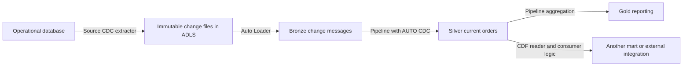

# 12 — Practical pipelines, CDF, CDC and Auto Loader examples

This cookbook uses **fake retail order tables** to show realistic engineering patterns. It complements [11 — Pipelines and DLT](11_LAKEFLOW_PIPELINES_AND_DLT_GUIDE.md), [10 — Volumes](10_UNITY_CATALOG_VOLUMES_GUIDE.md) and [04 — Delta/streaming](04_DELTA_AND_STREAMING.md). Official sources reviewed **7 October 2026**. All code is for an authorized, isolated development workspace; cloud execution remains unverified.

Follow the examples independently in order. They demonstrate different mechanisms, not several writers updating the same table. SQL setup runs in a SQL notebook/editor; ordinary Python streams run in a compatible notebook/job; `dp` definitions run as ETL pipeline source. Use your approved development catalog if it differs from `training_dev`, changing all matching identifiers/paths.

## 1. Select a pattern from the actual business requirement

The following are proposed engineering use cases, not reports of deployments at your workplace.

| Business requirement | Pattern | Why it fits | Essential condition |
|---|---|---|---|
| New POS file deliveries arrive in ADLS | Auto Loader → Bronze | Discover/process new files incrementally | Immutable files, explicit format/schema and preserved progress |
| Keep an order's latest value after corrections/cancellations | CDC → AUTO CDC SCD1 | Apply changes by key and source order | Key, operation, authoritative sequence and delete handling |
| Recompute daily reporting from latest order state | Pipeline materialized view over current state | Maintain results of a defining query | Correct Silver state and explicit refresh/publication contract |
| Send only changes from a Delta table to a downstream consumer | CDF → incremental consumer | Read inserts, updates and deletes between table versions | Bootstrap/resume boundary, retention and idempotent application |
| Preserve a history of Delta modifications | CDF → separate change archive | Persist change evidence beyond the source's retention | Archive ownership/retention; operational access controls |
| Report supplier attributes as they were when an order happened | CDC SCD2 + temporal join | Keep versions and effective intervals | Meaningful event time/sequence and interval join policy |
| Reject malformed prices while retaining evidence | Pipeline expectations + quarantine branch | Publish usable rows and investigate rejected values | Row rules plus complete delivery reconciliation |
| Load a downstream Synapse dedicated SQL table | Reconciled current snapshot or change export | Make a defined consumer contract explicit | Supported format/connector, deletes and retry behavior |

These tools can work together, but are not interchangeable:

- **CDC — Change Data Capture:** a process/feed representing changes, often from an operational system. It supplies insert/update/delete semantics.
- **CDF — Change Data Feed:** row-change evidence read from a supported table. For Delta examples, it reports changes to the Delta table, not the original database's entire history.
- **Auto Loader:** incremental file ingestion using `cloudFiles`; it does not infer that an order correction must replace an older value.
- **Pipeline:** dataset definitions and managed execution; it can use Auto Loader, quality rules and CDC processing.

For example, ADF can land database CDC events as immutable JSON files in ADLS; Auto Loader can ingest those files; AUTO CDC can maintain Silver current state; Gold can aggregate it; CDF can expose later table changes to another consumer. Each arrow still needs an agreed contract.

### When to use each: start with four questions

1. **Do I need a repeatable source → clean → reporting process?** Design a data pipeline. This is the overall workflow; Lakeflow declarative pipelines are one Databricks implementation. Use a job/workflow to coordinate external delivery checks, pipeline updates and consumer publication where needed.
2. **Is the next input a newly delivered cloud file?** Consider Auto Loader for ongoing incremental file ingestion. A one-off file read can be simpler when there is no continuing delivery requirement.
3. **Does an existing business record change or disappear?** Establish CDC semantics: key, operation and authoritative sequence. Capture those changes through a supported source connector/extractor, then apply them using AUTO CDC or another reviewed implementation. AUTO CDC does not independently connect to every operational database or discover its transaction log.
4. **Has the change already happened inside a Delta table, and must another consumer receive it?** Consider CDF. Read retained table changes and apply them according to the downstream contract; do not mistake the feed itself for a completed target synchronization.

These questions address different boundaries. A project can need all four. A batch pipeline can use CDC/CDF; choosing them does not require an always-running stream. Conversely, frequent execution does not make an ordinary repeated full extract a CDC feed. [Pipeline execution model](https://docs.databricks.com/aws/en/ldp/concepts/pipelines) · [AUTO CDC](https://docs.databricks.com/aws/en/ldp/cdc) · [CDF](https://learn.microsoft.com/en-us/azure/databricks/tables/features/change-data-feed) · [Auto Loader](https://docs.databricks.com/aws/en/ingestion/cloud-object-storage/auto-loader/)

### Scenario 1: store sales arrive as new files every 15 minutes

**Situation:** stores export distinct new transactions to an ADLS landing directory. Reporting needs sales by store/day. The files do not contain corrections or deletions.

**Proposed design:** Auto Loader ingests newly delivered files into Bronze. A pipeline parses amounts/dates, checks event IDs and routes invalid rows to quarantine; Silver holds accepted sales and Gold calculates store totals. A job runs updates on the agreed schedule after delivery readiness checks.

**Use:** pipeline + Auto Loader. **Add CDC** only when the source actually supplies corrections/deletes that must change current state. **Add CDF** when another consumer needs changes from a maintained Delta table. Auto Loader's file progress cannot identify the same transaction copied into another filename. Sections 4 and 8 provide the fake-file/quality examples.

### Scenario 2: an operational order is corrected and then cancelled

**Situation:** a SQL database stores O001 at 120.00. A correction changes it to 135.00; a cancellation later deletes or marks it inactive. A dashboard must reflect current orders rather than count each correction as another sale.

**Proposed design:** a supported extractor captures source changes with order key, operation and source ordering. Land/stream the change messages, then use AUTO CDC SCD1 in a pipeline to maintain Silver current state. Gold queries that state. If the changes arrive as files, Auto Loader handles file ingestion before CDC application.

**Use:** CDC + pipeline; Auto Loader depends on transport. A business cancellation may be a status update rather than a physical database delete: implement the business rule that decides whether it remains in reporting. Section 6 demonstrates authoritative sequencing, stale correction handling and a delete event with expected totals.

### Scenario 3: Silver orders already change in Delta; another system must follow

**Situation:** Databricks has a maintained Silver Delta orders table. A second mart, cache or downstream integration needs the changed rows rather than another full scan/export.

**Proposed design:** read Silver's CDF from a consistent bootstrap/resume boundary. Upsert inserts/postimages by order key and propagate deletes. Preserve consumer progress and make retries safe for the selected sink. A target table inside Databricks can use the CDF-to-AUTO CDC pattern in section 7. A Synapse/external target needs its own supported transport and application logic.

**Use:** CDF + consumer pipeline. Auto Loader is useful only if a file boundary is part of that design. CDF is finite history; an outage beyond retained versions requires a controlled re-bootstrap rather than silently resuming at the latest version.

### Scenario 4: investigate how an order's value changed

**Situation:** an analyst asks why O001 moved from 120.00 to 135.00 and whether it was subsequently deleted.

**Proposed design:** read available CDF preimages/postimages/deletes and persist required change evidence to a separately governed archive before source history expires. If the reporting requirement is historical supplier/store attributes with effective intervals, use an appropriate SCD2 history design and temporal joins.

**Use:** CDF + archival pipeline for Delta change evidence; CDC/SCD2 for the modeled historical-state requirement. Neither automatically provides a human actor/reason field, permanent retention or a complete compliance audit. Obtain business actor/reason from the originating system where required. Section 5 provides the fake CDF history/archive.

### Scenario 5: a small complete supplier snapshot arrives nightly

**Situation:** a source provides a small, authoritative full supplier list once per day, with no reliable change-event interface. Nightly freshness is sufficient.

**Proposed design:** a scheduled batch pipeline validates delivery completeness, keys and schema, then replaces/reconciles the isolated current-state target under the chosen release strategy. If history is needed, compare complete snapshots under an explicit policy or use supported snapshot CDC capabilities.

**Use:** a batch pipeline can be enough. A regular file landing can use Auto Loader, but file ingestion alone does not infer which suppliers were deleted. Absence means deletion only when the source guarantees that this is a complete authoritative snapshot; it cannot be inferred safely from a partial extract. CDF becomes useful if a downstream consumer needs changes from the resulting Delta table.

### One combined architecture

This is an illustrative integration, not an implemented production system:



The **source CDC extractor** captures business changes; **Auto Loader** discovers files; **AUTO CDC** applies ordered changes; **CDF** exposes changes from the maintained table; the **pipeline** connects repeatable processing stages. Choose only the mechanisms required by the source, transport, change semantics and consumers.

## 2. One fake business story, three representations

Three orders initially exist:

| order_id | store_id | order_date | amount |
|---|---|---|---:|
| O001 | S01 | 2026-10-01 | 120.00 |
| O002 | S02 | 2026-10-01 | 45.00 |
| O003 | S02 | 2026-10-02 | 80.00 |

Initial current total: **3 orders, 245.00**. Later, O001 is corrected to 135.00, O002 is deleted, and O004 is added for 25.00. The desired final current table is:

| order_id | store_id | order_date | amount |
|---|---|---|---:|
| O001 | S01 | 2026-10-01 | 135.00 |
| O003 | S02 | 2026-10-02 | 80.00 |
| O004 | S99 | 2026-10-01 | 25.00 |

Final current total: **3 orders, 240.00**. S99 remains visible as an unknown store rather than disappearing in an inner dimension join. Its amount still belongs in reconciliation.

We use three independent representations:

| Asset | Meaning |
|---|---|
| JSON files → `bronze_file_orders` | Append-only new-order deliveries; no corrections/deletes in this example |
| `fake_orders` | Mutable current Delta table on which we demonstrate CDF |
| `fake_order_changes` → pipeline `silver_orders_current` | Append-only CDC messages applied to current state |

A record in a change log is not necessarily another order. Summing every event amount is therefore a different, usually wrong, calculation for current sales.

## 3. Common development preparation

Use an existing catalog with usable managed storage. Run once with appropriate schema/volume creation rights:

```sql
CREATE SCHEMA IF NOT EXISTS training_dev.pattern_demo;
CREATE SCHEMA IF NOT EXISTS training_dev.pattern_cdc;
CREATE VOLUME IF NOT EXISTS training_dev.ops.pattern_files;
CREATE VOLUME IF NOT EXISTS training_dev.ops.pattern_state;
```

Source files and streaming state are in separate volumes. The ordinary stream's run identity needs parent usage, source-volume read, state-volume read/write and destination table creation/write privileges. The declarative CDC pipeline also needs access to its source table and destination schema. File/table access and pipeline/job permissions are separate.

This cookbook intentionally uses `CREATE TABLE` without replacement for its fake source tables. If an object already exists, stop and inspect it rather than appending the seed twice. Use fresh isolated names for another run. Creation commands do not grant privileges or create Azure storage infrastructure.

## 4. Use case A — Auto Loader for new POS files

### Storage can be Azure, AWS or Google Cloud

Auto Loader supports Amazon S3, Google Cloud Storage and ADLS, as well as Unity Catalog volume paths. The Azure examples in this course are not a restriction to Azure storage. [Supported Auto Loader sources](https://learn.microsoft.com/en-us/azure/databricks/ingestion/cloud-object-storage/auto-loader/)

| Provider | Example source directory | Common workspace pairing |
|---|---|---|
| AWS Amazon S3 | `s3://retail-landing/orders/` | Databricks on AWS |
| Google Cloud Storage | `gs://retail-landing/orders/` | Databricks on Google Cloud |
| Azure ADLS Gen2 | `abfss://landing@retailstorage.dfs.core.windows.net/orders/` | Azure Databricks |

These are illustrative paths, not configured buckets. The source files can use the same agreed JSON/CSV/Parquet contract; storage access needs the appropriate cloud identity, grants and network route. A UC external volume can expose a supported registered storage directory through `/Volumes/...`. Merely changing the path does not provision credentials or file discovery notifications.

Cross-cloud capabilities require checking the actual workspace/compute and UC storage integration. In particular, Azure Databricks documents an **S3 external location with read-only access**. That can provide source reads; place writable checkpoint/schema state and destinations in supported writable storage. This does not establish that every workspace can register every cloud's bucket with identical UC/file-events support. A direct Azure-to-GCS configuration was not established in this follow-up. [Azure Databricks S3 external-location setup](https://learn.microsoft.com/en-us/azure/databricks/connect/unity-catalog/cloud-storage/s3/s3-external-location-manual)

### Deliver two files

Create/upload `orders_001.json` under:

```text
/Volumes/training_dev/ops/pattern_files/new_orders/
```

Its contents are newline-delimited JSON:

```json
{"event_id":"E001","order_id":"O001","store_id":"S01","order_date":"2026-10-01","amount":"120.00"}
{"event_id":"E002","order_id":"O002","store_id":"S02","order_date":"2026-10-01","amount":"45.00"}
{"event_id":"E003","order_id":"O003","store_id":"S02","order_date":"2026-10-02","amount":"80.00"}
```

Later, upload `orders_002.json` to the same incoming directory:

```json
{"event_id":"E004","order_id":"O004","store_id":"S99","order_date":"2026-10-01","amount":"25.00"}
```

Upload only file 001 before the first run. File 002 represents another new order, **not** the correction/delete story. Keep delivery filenames/content immutable. Auto Loader is designed to process newly discovered files; it does not deduplicate identical business events copied into different files. [Auto Loader overview](https://docs.databricks.com/aws/en/ingestion/cloud-object-storage/auto-loader/) · [File behavior](https://docs.databricks.com/aws/en/ingestion/cloud-object-storage/auto-loader/faq)

### Read files into an append-only Bronze table

Run this in an ordinary compatible Databricks notebook/job, outside declarative dataset functions:

```python
source_path = "/Volumes/training_dev/ops/pattern_files/new_orders"
state_path = "/Volumes/training_dev/ops/pattern_state/new_orders_v1"
raw_schema = "event_id STRING, order_id STRING, store_id STRING, order_date STRING, amount STRING"

raw_orders = (spark.readStream.format("cloudFiles")
              .option("cloudFiles.format", "json")
              .option("cloudFiles.schemaLocation", f"{state_path}/schemas")
              .schema(raw_schema)
              .load(source_path))

query = (raw_orders.writeStream
         .option("checkpointLocation", f"{state_path}/checkpoint")
         .trigger(availableNow=True)
         .toTable("training_dev.pattern_demo.bronze_file_orders"))
query.awaitTermination()
```

Here we manage the checkpoint location explicitly. In guide 11's declarative Auto Loader example, the pipeline manages that state. `availableNow` processes available input and stops; running it again with the same checkpoint resumes progress. Keep one state directory per logical query. [Auto Loader production/state guidance](https://learn.microsoft.com/en-us/azure/databricks/ingestion/cloud-object-storage/auto-loader/production)

### Reconcile each delivery

Outside the stream definition:

```sql
SELECT COUNT(*) AS rows,
       COUNT(DISTINCT event_id) AS distinct_events,
       SUM(try_cast(amount AS DECIMAL(12,2))) AS amount
FROM training_dev.pattern_demo.bronze_file_orders;
```

| Step | Files available | Expected rows | Expected total |
|---|---|---:|---:|
| First completed run | 001 | 3 | 245.00 |
| Unchanged second run | 001 | 3 | 245.00 |
| Upload 002, run again | 001 and 002 | 4 | 270.00 |

This query inspects raw fields; failed casts must also be counted/quarantined before production publication. The **270.00** is correct for this append-only scenario and differs from the **240.00** current-state CDC story. Preserve that distinction when comparing patterns.

### Exercise: repeat an event in a new file

Predict the result before uploading a third file with E001 again. File progress can remain correct while business counts become wrong. Decide an event-key deduplication/conflict policy before solving that problem. Do not clear the checkpoint as a repair: that abandons discovery history and changes replay behavior.

## 5. Use case B — CDF from a mutable fake Delta table

### Create and seed the source

This example selects **explicit legacy Delta CDF** for compatibility and visible setup:

```sql
CREATE TABLE training_dev.pattern_demo.fake_orders (
  order_id STRING,
  store_id STRING,
  order_date DATE,
  amount DECIMAL(12,2)
) USING DELTA
TBLPROPERTIES ('delta.enableChangeDataFeed' = 'true');

INSERT INTO training_dev.pattern_demo.fake_orders VALUES
  ('O001', 'S01', DATE '2026-10-01', 120.00),
  ('O002', 'S02', DATE '2026-10-01', 45.00),
  ('O003', 'S02', DATE '2026-10-02', 80.00);

DESCRIBE HISTORY training_dev.pattern_demo.fake_orders;
```

The legacy property captures changes after enablement. Current Azure Databricks also documents **automatic CDF** on qualifying Unity Catalog tables with DBR 19+; Delta requires row tracking. It uses the same reading APIs and is a different configuration path. Check actual runtime/table requirements before choosing or migrating; do not enable both approaches together. This example deliberately keeps its explicit property. [Azure CDF requirements and modes](https://learn.microsoft.com/en-us/azure/databricks/tables/features/change-data-feed)

### Apply the business changes

Run these once against the isolated fake table:

```sql
UPDATE training_dev.pattern_demo.fake_orders
SET amount = 135.00 WHERE order_id = 'O001';

DELETE FROM training_dev.pattern_demo.fake_orders
WHERE order_id = 'O002';

INSERT INTO training_dev.pattern_demo.fake_orders VALUES
  ('O004', 'S99', DATE '2026-10-01', 25.00);

SELECT * FROM training_dev.pattern_demo.fake_orders ORDER BY order_id;
SELECT COUNT(*) AS orders, SUM(amount) AS total
FROM training_dev.pattern_demo.fake_orders;
DESCRIBE HISTORY training_dev.pattern_demo.fake_orders;
```

The current snapshot should now be the three rows in section 2, totaling **240.00**. Record actual commit versions from history; do not infer them from wall-clock time or a different table's versions.

### Inspect change records

On this new table, CDF was enabled at creation, so the example can inspect retained changes from version 0:

```sql
SELECT order_id, amount, _change_type, _commit_version, _commit_timestamp
FROM table_changes('training_dev.pattern_demo.fake_orders', 0)
ORDER BY _commit_version, order_id, _change_type;
```

`table_changes` accepts an inclusive start and optional inclusive end version. In a real consumer, substitute a verified boundary instead of repeatedly reading all history. [table_changes reference](https://learn.microsoft.com/en-us/azure/databricks/sql/language-manual/functions/table_changes)

Expected **business change records**, assuming only the shown operations:

| Event | order_id | amount | `_change_type` |
|---|---|---:|---|
| Seed | O001 | 120.00 | `insert` |
| Seed | O002 | 45.00 | `insert` |
| Seed | O003 | 80.00 | `insert` |
| Correction before | O001 | 120.00 | `update_preimage` |
| Correction after | O001 | 135.00 | `update_postimage` |
| Cancellation | O002 | 45.00 | `delete` |
| New order | O004 | 25.00 | `insert` |

CDF includes before/after update values and commit metadata. It is not the current snapshot. A current-state consumer normally applies inserts/postimages as upserts and deletes as deletes, rather than inserting every record. Preimages are useful for old-value evidence or subtracting a previous aggregate contribution. [Delta Lake CDF schema](https://docs.delta.io/delta-change-data-feed/)

Our correction contributes **+15.00**, the delete **−45.00**, and the new order **+25.00**: `245 + 15 − 45 + 25 = 240`. A consumer summing only inserts and postimages would reach 405.00, demonstrating the wrong metric. This arithmetic is an explanation, not a production incremental-aggregate implementation; changes to store/date require retracting the old group and adding to the new one.

### Archive changes with a resumable stream

Run outside pipeline dataset functions after the above SQL operations, while the needed history remains available:

```python
changes = (spark.readStream
           .option("readChangeFeed", "true")
           .option("startingVersion", 0)
           .table("training_dev.pattern_demo.fake_orders"))

archive_query = (changes.writeStream
                 .option("checkpointLocation",
                         "/Volumes/training_dev/ops/pattern_state/orders_cdf_archive_v1")
                 .trigger(availableNow=True)
                 .toTable("training_dev.pattern_demo.orders_change_archive"))
archive_query.awaitTermination()
```

For a fresh archive/checkpoint and only these operations, expect seven business change records. Reusing the checkpoint without new source changes should leave that archive unchanged. An omitted streaming start version instead bootstraps the current snapshot as inserts and follows later changes, so it would not produce this same historical archive. CDF history is finite; the archive needs its own retention/access policy. [CDF bootstrap and history](https://docs.delta.io/delta-change-data-feed/)

If a downstream Synapse target already contains a snapshot, resume from the corresponding **next** retained commit, not from 0. Sending changes to an external system also needs idempotent sink behavior and a durable successful-processing boundary. A Spark checkpoint does not automatically make an arbitrary external write exactly once.

## 6. Use case C — CDC with out-of-order corrections and deletes

### Build a fake operational CDC feed

This source table holds messages, not current orders. Run its preparation outside the pipeline:

```sql
CREATE TABLE training_dev.pattern_demo.fake_order_changes (
  event_id STRING,
  order_id STRING,
  store_id STRING,
  order_date DATE,
  amount DECIMAL(12,2),
  operation STRING,
  source_sequence BIGINT
) USING DELTA;

INSERT INTO training_dev.pattern_demo.fake_order_changes VALUES
  ('C001', 'O001', 'S01', DATE '2026-10-01', 120.00, 'I', 1),
  ('C002', 'O002', 'S02', DATE '2026-10-01', 45.00,  'I', 1),
  ('C003', 'O003', 'S02', DATE '2026-10-02', 80.00,  'I', 1);
```

The intended contract is: unique event IDs; non-null order key/sequence; one unambiguous value per key/sequence; sequence authoritative **within each order**; `I/U/D` operations; full row images for upserts; null amount/date permitted for delete messages. Raw invalid/conflicting messages must be investigated before applying them. `event_id` identifies a message; `order_id` identifies the state row.

### Define the current-state pipeline

Create a **separate** ETL pipeline with default catalog `training_dev`, schema `pattern_cdc`, triggered mode, supported CDC capability and source/target permissions. Add this Python source:

```python
from pyspark import pipelines as dp
from pyspark.sql import functions as F

@dp.table(name="bronze_order_changes")
def change_messages():
    return spark.readStream.table("training_dev.pattern_demo.fake_order_changes")

dp.create_streaming_table(name="silver_orders_current")

dp.create_auto_cdc_flow(
    target="silver_orders_current",
    source="bronze_order_changes",
    keys=["order_id"],
    sequence_by=F.col("source_sequence"),
    apply_as_deletes=F.expr("operation = 'D'"),
    except_column_list=["event_id", "operation", "source_sequence"],
    stored_as_scd_type=1,
    ignore_null_updates=False,
)

@dp.materialized_view(name="gold_daily_sales")
def current_daily_sales():
    return (spark.read.table("silver_orders_current")
            .groupBy("order_date", "store_id")
            .agg(F.count("*").alias("order_count"),
                 F.sum("amount").alias("sales_amount")))
```

The target is declared as a streaming table before its CDC flow. We omit an explicit target schema so the framework supplies required internal structure. Keys identify the order; sequence determines authoritative ordering; the delete predicate distinguishes cancellations from upserts. This example uses full images, so null updates are not ignored. Sparse patches need an explicit distinction between absent fields and deliberate nulls. [create_auto_cdc_flow reference](https://docs.databricks.com/aws/en/ldp/developer/ldp-python-ref-apply-changes)

Run the first update: expect three current orders/245.00. Then, separately, append these four messages once:

```sql
INSERT INTO training_dev.pattern_demo.fake_order_changes VALUES
  ('C004', 'O001', 'S01', DATE '2026-10-01', 135.00, 'U', 3),
  ('C005', 'O001', 'S01', DATE '2026-10-01', 125.00, 'U', 2),
  ('C006', 'O002', NULL, NULL, NULL, 'D', 2),
  ('C007', 'O004', 'S99', DATE '2026-10-01', 25.00, 'I', 1);
```

The O001 sequence-2 correction is stale relative to sequence 3. SQL insertion order is not the sequencing contract. After the next pipeline update, **135.00 wins**, O002 is absent from visible current state, and O004 is present. AUTO CDC handles logical order; delete tombstone retention must cover the real late/replay horizon. [AUTO CDC concepts](https://docs.databricks.com/aws/en/ldp/cdc)

### Check fake outputs

```sql
SELECT * FROM training_dev.pattern_cdc.silver_orders_current ORDER BY order_id;
SELECT COUNT(*) AS orders, SUM(amount) AS total
FROM training_dev.pattern_cdc.silver_orders_current;
SELECT * FROM training_dev.pattern_cdc.gold_daily_sales
ORDER BY order_date, store_id;
```

Expected current-state reconciliation: **3 orders, 240.00**.

| order_date | store_id | order_count | sales_amount |
|---|---|---:|---:|
| 2026-10-01 | S01 | 1 | 135.00 |
| 2026-10-01 | S99 | 1 | 25.00 |
| 2026-10-02 | S02 | 1 | 80.00 |

The source has seven messages, the current output has three orders. Summing all non-null event amounts gives 530.00, which is not current sales. A processing design that lets stale 125.00 overwrite 135.00 would give 230.00 instead of 240.00. These two wrong totals diagnose different semantic mistakes.

Run another ordinary update without inserting messages: expected state is unchanged. For a real feed, also validate repeated events, conflicting same-sequence values, delayed deletes and recovery. The fixture/lab in 03 provides stronger explicit conflict/replay controls than this small assumed-valid CDC source.

### SCD2 extension: supplier/store history

If the question is “what was the supplier's classification when the order occurred?”, use historical versions rather than only today's classification. A separate SCD2 target can track attribute changes and expose effective intervals. Join order time to the matching interval, with explicit time zone and boundary rules. Switching `stored_as_scd_type` does not by itself define a correct temporal business join. Keep that experiment in a different target/pipeline to preserve this example's SCD1 output contract.

## 7. Use case D — Apply CDF as CDC input

CDF and CDC can be composed: a Delta table's CDF provides change messages, and AUTO CDC maintains another current-state target. This differs from section 6's custom source sequence. Here the source is one Delta table and its **commit version** orders that table's changes.

For a separate ETL pipeline targeting schema `training_dev.pattern_cdf_replica`, first create that schema with authorized SQL. Use this source file while the fake table's history from version 0 is retained:

```python
from pyspark import pipelines as dp
from pyspark.sql import functions as F

@dp.table(name="bronze_delta_changes")
def delta_changes():
    return (spark.readStream
            .option("readChangeFeed", "true")
            .option("startingVersion", 0)
            .table("training_dev.pattern_demo.fake_orders")
            .filter(F.col("_change_type") != "update_preimage"))

dp.create_streaming_table(name="orders_replica")
dp.create_auto_cdc_flow(
    target="orders_replica",
    source="bronze_delta_changes",
    keys=["order_id"],
    sequence_by=F.col("_commit_version"),
    apply_as_deletes=F.expr("_change_type = 'delete'"),
    except_column_list=["_change_type", "_commit_version", "_commit_timestamp"],
    stored_as_scd_type=1,
)
```

The preimage filter prevents treating the old and new values from one update as competing same-key/same-version upserts. Assume at most one applicable final change per key per commit in this simple source. Multiple source tables' commit versions are not a shared business clock. [CDF reading contract](https://learn.microsoft.com/en-us/azure/databricks/tables/features/change-data-feed) · [CDC flow parameters](https://docs.databricks.com/aws/en/ldp/developer/ldp-python-ref-apply-changes)

For an initially empty replica and the full shown history, expect the same three current rows/240.00. Compare keys and values in both directions, not only row counts/totals. For an existing replica, bootstrap/resume from a consistent snapshot boundary and retained next version; do not blindly reuse the example's start-at-zero setting.

## 8. Pipeline quality example: malformed orders

Guide 11 supplies a full five-dataset pipeline using a volume's JSON files, Auto Loader, typed temporary view, Silver expectation/drop, quarantine and Gold materialized view. Its three input records produce **3 raw / 2 accepted / 1 quarantined / 165.00 Gold** because the third amount is `bad`.

That scenario answers “how do I prepare usable records and keep rejected evidence?” Sections 5–7 answer “how do I propagate corrections/deletes and preserve current state?” Treat them as separate experiments until you have defined quality rules for CDC: a null amount can be invalid for an upsert but valid for a delete. Applying one blanket non-null amount expectation would silently discard legitimate cancellations.

## 9. Failure drills and production handoff

Attempt the drills first; the course's practice convention withholds worked solutions until your attempt or request for help.

| Drill | Evidence to investigate |
|---|---|
| Same event copied into a new filename | File discovery progress versus event-key uniqueness |
| O001 sequence 2 arrives after sequence 3 | Source sequence and current state, not arrival timestamp |
| Delete with null amount is rejected | Operation-aware validity rules and retained message |
| CDF consumer resumes beyond retained history | Last successful boundary, available source versions and consistent bootstrap |
| CDF update inflates sales | Preimage/postimage interpretation and aggregate grain |
| Checkpoint reset duplicates Bronze/archive | Source replay scope, target contents and durable consumer state |
| Gold hides S99 | Dimension join behavior and unknown-member policy |
| One pipeline dataset is owned by two deployments | Resource/dataset ownership and deployment targets |
| Source schema drops a field midstream | Actual schema evolution, CDF range compatibility and contract version |
| Job says success but Synapse differs | Publication snapshot/change boundary, sink retries and both-side reconciliation |

Before using the design for a real source, record delivery ownership, key/grain, sequence/operation semantics, schema, duplicate/conflict policy, bootstrap/replay horizon, retention, run identity, quality/quarantine rules, publication gate and recovery evidence. Define who owns an external sink's idempotency. Measure throughput/freshness/cost using representative inputs; these tiny fixtures cannot establish performance.

## 10. Expected results and execution limits

| Experiment | Expected evidence |
|---|---|
| Auto Loader first file | 3 raw rows / 245.00 |
| Auto Loader second new-order file | 4 raw rows / 270.00 |
| Mutable Delta snapshot after correction/delete/insert | 3 current rows / 240.00 |
| CDF full shown history | 7 business change records |
| AUTO CDC after stale correction/delete/new order | O001=135.00, O002 absent; 3 visible orders / 240.00 |
| CDF-to-CDC replica | Same keys/values as fake_orders / 240.00 |
| Quality pipeline in guide 11 | 3 raw / 2 accepted / 1 quarantined / 165.00 |

These are authored expectations, not observed Spark/cloud results. The companion verification record separates local syntax/navigation checks from live workspace execution. Record actual update IDs, table versions, counts, keys/values, state paths, reject evidence and restart results when you run the examples.
