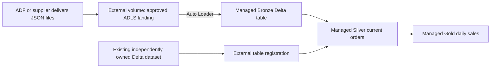

# 13 — External locations, external tables and managed storage

[Learning path](README.md) · [10 — Volumes](10_UNITY_CATALOG_VOLUMES_GUIDE.md) · [12 — Ingestion/change examples](12_PIPELINES_CDF_CDC_AUTO_LOADER_EXAMPLES.md)

Official Unity Catalog documentation reviewed **8 October 2026**. This guide uses Azure examples and current Unity Catalog semantics, not legacy Hive metastore rules. Commands illustrate setup; none was executed in a cloud workspace.

**An external location authorizes a cloud path. A table defines rows to query. Managed versus external determines who controls table storage and its lifecycle.** These are related choices at different levels.

## 1. Separate the objects before choosing

Imagine a company owns a warehouse containing several storage areas. A storage credential represents the authorized access mechanism; an external location identifies an approved area; a table is a named structured dataset in that area. This analogy helps distinguish access from data organization. The actual assets are cloud files and Unity Catalog objects.

| Object | Meaning | Example |
|---|---|---|
| Cloud storage path | Physical container/bucket and directory | `abfss://lake@retailstorage.dfs.core.windows.net/pos/` |
| Storage credential | UC object representing the cloud access identity/mechanism | `retail_adls_credential` references an Azure managed identity |
| External location | UC object pairing a cloud path with a storage credential | `pos_external_location` covers the `/pos/` path |
| External table | Named table using a specified directory under an authorized external location | `training_dev.storage_demo.orders_external` |
| Managed storage location | Storage root configured for a catalog/schema/metastore | Approved root used for managed datasets |
| Managed table | Named table whose storage placement/layout/lifecycle UC manages | `training_dev.storage_demo.orders_managed` |
| Volume | Named governed file asset | `training_dev.ops.pos_files` exposes incoming JSON files |

An external location is not a SQL table, does not parse files and does not copy data. Creating one does not ingest a single row. It provides the authorized path/credential relationship used by other operations. [Cloud storage and Unity Catalog objects](https://learn.microsoft.com/en-us/azure/databricks/connect/unity-catalog/cloud-storage/)

Storage credentials and external locations are metastore-level objects. Tables and volumes belong to catalogs/schemas. Thus `pos_external_location` is an object name, while `training_dev.storage_demo.orders_external` is a three-part table name. A cloud URI is a third, different identifier.

## 2. Managed versus external tables

| Question | Managed table | External table |
|---|---|---|
| Who chooses its individual data directory? | Unity Catalog within configured managed storage | You specify `LOCATION` |
| Who controls storage lifecycle/layout? | Unity Catalog | Your platform/storage owners |
| What does UC register? | Table metadata plus managed storage relationship | Table metadata referring to the specified files |
| How do analysts query it? | `catalog.schema.table` | `catalog.schema.table` |
| Are UC permissions used for table queries? | Yes | Yes |
| What does `DROP TABLE` mean for files? | Files are purged under managed recovery/lifecycle rules | Files remain; table registration is removed |
| Common choice | Databricks-owned Bronze/Silver/Gold transformations | Existing dataset or required direct file interoperability |

**Both can physically live in your organization's cloud account.** “Managed” describes Unity Catalog's management responsibilities, not a promise that data is stored in a separate Databricks-owned account. An external table may also be Delta and support transactional operations; “external” does not mean “CSV”, “unstructured” or “read-only”. Whether writes are permitted depends on the format, storage integration and permissions. [Managed tables](https://learn.microsoft.com/en-us/azure/databricks/tables/managed) · [External tables](https://learn.microsoft.com/en-us/azure/databricks/tables/external)

An existing Delta directory can be registered without copying its data. By contrast, `CREATE TABLE ... AS SELECT ...` into a new managed table materializes a separate output dataset. Neither registering nor copying inherently cleanses values, deduplicates keys or reconciles totals.

## 3. An external location can support managed storage

The word **external** in *external location* does not force every dataset beneath its approved scope to be an external table.

A catalog/schema managed storage root can be configured inside an approved external location. Unity Catalog then creates and manages individual managed-table directories there. For example:

```text
UC storage credential: retail_adls_credential
    represents Azure access identity

UC external location: managed_area_location
    authorizes abfss://lake@retailstorage.../databricks-managed/

Catalog/schema MANAGED LOCATION
    selects an approved root within that location

Managed table: training_dev.storage_demo.orders_managed
    UC allocates its data directory within managed storage
```

The managed root resolves from schema first, then catalog, then metastore if configured. Not every workspace has a metastore-level default. Ordinary table creators can use a preconfigured parent root without provisioning their own storage credential/location.

Managed tables/volumes, external tables and external volumes must respect UC path-overlap rules. Use distinct managed roots, table directories and file-volume directories rather than registering several asset types over the same folder. [Managed storage configuration](https://learn.microsoft.com/en-us/azure/databricks/connect/unity-catalog/cloud-storage/managed-storage) · [Path rules](https://learn.microsoft.com/en-us/azure/databricks/volumes/paths)

## 4. Why choose one or another?

### A. New Databricks analytical tables: start with managed

You ingest POS events, clean orders and publish daily store sales. The engineering team owns these Delta datasets and wants UC to manage their lifecycle and available maintenance features.

Our proposed design uses external file landing plus managed Bronze/Silver/Gold tables. Managed tables are Databricks' recommended default; automatic optimization capabilities depend on their configuration/availability. The recommendation is not a benchmark proving your particular query will be faster. [Managed-table features](https://learn.microsoft.com/en-us/azure/databricks/tables/managed)

### B. An existing enterprise Delta/Parquet dataset: external can avoid an initial copy

Another team already owns an approved ADLS dataset, its directory structure and retention. Register it as an external table if you need a governed table interface while preserving that ownership and physical path. Confirm its actual format/schema, writer compatibility and coordination before allowing writes.

For example, Databricks can register an existing Delta orders directory as a source, then write its cleaned outputs as managed tables. This is a source integration choice, not a rule that every Bronze dataset must be external.

### C. A tool requires a stable direct cloud path: investigate external

A non-Databricks reader might require direct Parquet/Delta file access at an agreed directory and cannot use supported catalog APIs. External tables can fit that requirement, with cloud access governed separately.

Merely having an external consumer does not automatically require an external table: managed tables support documented external-access interfaces. Verify the specific engine and format/features. For Synapse, preserve the reader/component compatibility checks in guide 05 rather than assuming that any external Delta table is readable. [External-table use cases](https://learn.microsoft.com/en-us/azure/databricks/tables/external) · [Azure/Synapse integration](05_AZURE_INTEGRATION.md)

### D. CSV/JSON/PDF file deliveries: choose a volume for the file boundary

ADF delivers JSON files or a supplier uploads PDFs. Register a dedicated directory as an external volume when its storage lifecycle is externally owned. Auto Loader can read incoming supported files and create managed table outputs. A managed volume is suitable when you want UC to manage the file asset's storage lifecycle, such as a small study-fixture directory.

An external location, external volume and external table do different jobs. You do not need an external table just to let Auto Loader ingest files. Do not register a UC table whose underlying data directory is inside a volume. [Volumes and setup](10_UNITY_CATALOG_VOLUMES_GUIDE.md) · [Volume/table path rules](https://learn.microsoft.com/en-us/azure/databricks/volumes/paths)

## 5. Platform setup for an Azure external location

This setup normally belongs to the platform/storage administrator. It is required before an engineer can register external tables or volumes on the path. Use development resources; placeholders below are not real configured account details.

1. Provide an ADLS Gen2 account/container and approved directories; establish applicable network access.
2. Create an **Access Connector for Azure Databricks** with a managed identity.
3. Give that identity the required cloud storage access, commonly appropriately scoped **Storage Blob Data Contributor**, with applicable ACL/network requirements.
4. In Databricks Catalog Explorer, create a **storage credential** using **Azure Managed Identity**, supplying the Access Connector resource ID and user-assigned identity details if applicable. Call it `retail_adls_credential` for this example.
5. Create external locations using that credential for the approved paths. Inspect/test their configuration and apply UC privileges to the actual creators/run identities.

Credential creation needs `CREATE STORAGE CREDENTIAL` on the metastore. External-location creation needs `CREATE EXTERNAL LOCATION` on the metastore and storage credential. Those rights do not replace Azure permissions. [Official ADLS identity/credential setup](https://learn.microsoft.com/en-us/azure/databricks/connect/unity-catalog/cloud-storage/external-locations-adls)

Once the credential exists, illustrative SQL is:

```sql
-- Platform provisioning, not something every analyst needs to run.
CREATE EXTERNAL LOCATION retail_tables_location
URL 'abfss://lake@<storage-account>.dfs.core.windows.net/external-tables/'
WITH (STORAGE CREDENTIAL retail_adls_credential);

DESCRIBE EXTERNAL LOCATION retail_tables_location;
SHOW GRANTS ON EXTERNAL LOCATION retail_tables_location;
```

This registers the approved root. It does not create a named table or populate its files. A table creator's `CREATE EXTERNAL TABLE` permission applies to the external-location object covering the chosen table path. [External-location setup syntax](https://learn.microsoft.com/en-us/azure/databricks/connect/unity-catalog/cloud-storage/external-locations-adls)

## 6. Create a managed table: use the parent's managed storage

Prerequisites: existing UC catalog `training_dev`, a usable managed storage root inherited/configured for the schema, `USE CATALOG`, `USE SCHEMA` and `CREATE TABLE` on the relevant parents. Creating a new schema separately requires catalog `CREATE SCHEMA`.

Run in an authorized SQL notebook/editor:

```sql
CREATE SCHEMA IF NOT EXISTS training_dev.storage_demo;

CREATE TABLE training_dev.storage_demo.orders_managed (
  order_id STRING,
  store_id STRING,
  amount DECIMAL(12,2)
) USING DELTA;

INSERT INTO training_dev.storage_demo.orders_managed
VALUES ('O001', 'S01', 120.00);

SELECT * FROM training_dev.storage_demo.orders_managed;
DESCRIBE TABLE EXTENDED training_dev.storage_demo.orders_managed;
```

**No table `LOCATION` was supplied.** UC selects its directory. Expected initial content is one fake order/120.00; inspect `Type` and other metadata for the actual table classification. Existing table names deliberately cause creation to fail rather than silently replacing an object or seeding it twice.

### Optional platform configuration: choose a managed root

If the platform wants a dedicated schema storage root, configure it at schema creation rather than adding an individual `LOCATION` to each table:

```sql
-- Separate approved location; credential already exists.
CREATE EXTERNAL LOCATION retail_managed_location
URL 'abfss://lake@<storage-account>.dfs.core.windows.net/databricks-managed/'
WITH (STORAGE CREDENTIAL retail_adls_credential);

CREATE SCHEMA training_dev.managed_demo
MANAGED LOCATION
  'abfss://lake@<storage-account>.dfs.core.windows.net/databricks-managed/demo/';

CREATE TABLE training_dev.managed_demo.orders (
  order_id STRING,
  amount DECIMAL(12,2)
) USING DELTA;
```

The schema creator needs normal creation rights plus `CREATE MANAGED STORAGE` on the external location. Its managed tables remain managed even though an external-location object authorized the root. This optional schema is separate from `storage_demo`; do not run both paths thinking each is required.

Current documented `ALTER CATALOG/SCHEMA SET MANAGED LOCATION` capabilities have runtime/version conditions and apply to newly created managed objects; they do not relocate existing tables. A storage configuration change is not a data migration. [Managed roots and privileges](https://learn.microsoft.com/en-us/azure/databricks/connect/unity-catalog/cloud-storage/managed-storage)

## 7. Create an external table: choose an approved individual path

In addition to the parent/table-creation rights above, the creator needs `CREATE EXTERNAL TABLE` on `retail_tables_location`. Use a unique approved directory for this table, outside volumes and managed roots.

### A. Create a new empty external Delta table

```sql
CREATE TABLE training_dev.storage_demo.orders_external (
  order_id STRING,
  store_id STRING,
  amount DECIMAL(12,2)
) USING DELTA
LOCATION
  'abfss://lake@<storage-account>.dfs.core.windows.net/external-tables/orders_demo/';

INSERT INTO training_dev.storage_demo.orders_external
VALUES ('O001', 'S01', 120.00);

SELECT * FROM training_dev.storage_demo.orders_external;
DESCRIBE TABLE EXTENDED training_dev.storage_demo.orders_external;
```

Here the directory is chosen by us and must be suitable for new Delta data. Inspect any existing files before proceeding; do not treat a directory already used by another writer as an empty development target. This write example requires writable ADLS access and destination `MODIFY`, in addition to creation privileges.

### B. Register an existing Delta table without copying

If `/external-tables/existing_orders/` already contains a valid, independently owned Delta table:

```sql
CREATE TABLE training_dev.storage_demo.existing_orders
USING DELTA
LOCATION
  'abfss://lake@<storage-account>.dfs.core.windows.net/external-tables/existing_orders/';

SELECT * FROM training_dev.storage_demo.existing_orders LIMIT 10;
```

This registers the existing dataset. It does not create the assumed source, convert CSV/Parquet into Delta or copy files. A Delta table includes its transaction log; using `USING DELTA` on a plain Parquet directory does not make it one. Other supported formats have their own schema/options and transactional limits. [CREATE TABLE and LOCATION behavior](https://learn.microsoft.com/en-us/azure/databricks/sql/language-manual/sql-ref-syntax-ddl-create-table-using)

### C. Materialize a managed output from the external input

For the known fake table created in A:

```sql
CREATE TABLE training_dev.storage_demo.orders_managed_copy
USING DELTA AS
SELECT order_id, store_id, amount
FROM training_dev.storage_demo.orders_external;
```

No destination `LOCATION`: this is a managed output, with a separate physical dataset. The source remains external. The example copies one row; it does not implement continuous synchronization. For a pipeline, apply the agreed ingestion/CDC/refresh strategy rather than expecting CTAS to keep following changes.

## 8. Grant table access without exposing broad storage access

An authorized grant manager can give an existing account-level analyst group table query access:

```sql
GRANT USE CATALOG ON CATALOG training_dev TO `study_analysts`;
GRANT USE SCHEMA ON SCHEMA training_dev.storage_demo TO `study_analysts`;
GRANT SELECT ON TABLE training_dev.storage_demo.orders_managed TO `study_analysts`;
GRANT SELECT ON TABLE training_dev.storage_demo.orders_external TO `study_analysts`;
```

For named table queries, analysts do not need the creator's `CREATE EXTERNAL TABLE` privilege or broad cloud-path file access. A scheduled transformation's run identity may need source `SELECT` and destination `MODIFY`; table creation, parent usage and pipeline permissions are separate.

For external systems accessing files directly, use appropriate cloud controls: UC grants are not automatically enforced on those direct file reads. Managed datasets should use supported governed table/catalog interfaces rather than independent writes to their internal directories. Inspect the actual engine/access method. [Storage governance boundaries](https://learn.microsoft.com/en-us/azure/databricks/connect/unity-catalog/cloud-storage/)

## 9. Lifecycle, interoperability and the S3 page

Dropping an external table removes its catalog registration while leaving its data files. That does not make the files immutable: authorized `DELETE`, `UPDATE`, `MERGE`, file writes or maintenance can still alter a writable dataset. Keep storage retention and writer ownership explicit.

A managed table drop uses UC recovery/purge behavior. Current documentation describes a default recovery period and configurable capabilities with availability conditions; do not assume immediate deletion, indefinite retention or a universal fixed backup guarantee. Do not run drops merely to demonstrate the distinction. [Managed lifecycle](https://learn.microsoft.com/en-us/azure/databricks/tables/managed) · [External lifecycle](https://learn.microsoft.com/en-us/azure/databricks/tables/external)

External file access does not remove Delta protocol, schema-evolution or multi-writer constraints. A consumer still must understand the table format/features. If another engine changes external-table metadata, review catalog synchronization requirements rather than assuming UC metadata follows every path-based operation automatically.

The **Azure-to-S3 page** from the preceding discussion describes read-only access to an S3 bucket. Its external location can authorize source reads. It is not a writable managed-storage root for Azure table outputs, and the ADLS insert examples above must not be transferred unchanged to that read-only integration. A practical design can read supported S3 source data and materialize Azure managed outputs. [Azure S3 external-location setup](https://learn.microsoft.com/en-us/azure/databricks/connect/unity-catalog/cloud-storage/s3/s3-external-location-manual)

## 10. Proposed retail layout and decision checks



This is a proposed organization, not a configured workspace. It separates source lifecycle from the tables Databricks maintains. A project can combine managed and external assets while using the same catalog/schema naming scheme and medallion principles.

Before choosing an external table, answer: who owns the physical path, who writes it, why is that path required, which engines read it, which table features are compatible, and who handles retention/optimization/schema changes? If the reason is simply “another tool reads our data”, check supported managed-table access interfaces first.

Before creating managed tables, confirm parent managed storage, run identity/privileges, output grain and recovery requirements. For file landing, choose a volume and ingest into tables as appropriate. Neither managed nor external determines whether a dataset is Bronze, Silver or Gold.

## 11. Retrieval checks and validation limits

1. Why does creating an external location not create an external table?
2. Can a managed table live in your organization's ADLS account?
3. Why can an external location authorize a catalog's managed root?
4. Which example registers data without copying, and which materializes a copy?
5. What table grants does a read-only analyst need?
6. Why does `DROP TABLE` leaving external files not prevent a `DELETE` from changing rows?
7. Why is a JSON landing volume different from an external Delta table?
8. Why is an external table insufficient proof that Synapse can read its format/features?

Answers are withheld under the course's practice convention. Record actual table types, cloud paths, owner/run identities, grants, source format, counts/values and recovery policy when implementing. Local documentation checks do not validate Azure IAM, storage connections, SQL execution or live table lifecycle.
