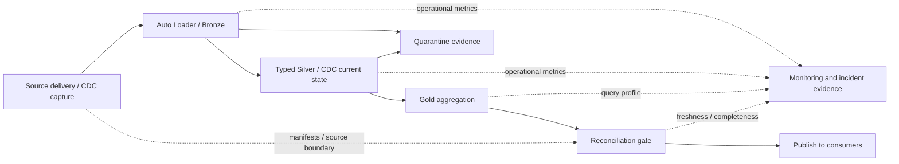

# 14 — Pipeline operations, monitoring, troubleshooting and optimisation

This guide explains how to operate a Databricks data pipeline after its first successful run: prove its output, detect problems, recover safely and improve the whole workflow. Read [11 — Lakeflow pipelines/former DLT](11_LAKEFLOW_PIPELINES_AND_DLT_GUIDE.md) for definitions and [12 — Auto Loader, CDC and CDF examples](12_PIPELINES_CDF_CDC_AUTO_LOADER_EXAMPLES.md) for the fake tables used here. Deployment mechanics remain in [06](06_BUNDLES_AND_ORCHESTRATION.md); state and retention details are in [04](04_DELTA_AND_STREAMING.md).

Official sources reviewed **8 October 2026**. Scenarios, service objectives and runbooks below are proposed teaching examples, not claims about your workplace. SQL/Python snippets require an authorised development workspace and the stated execution context. No pipeline, alert, query benchmark or recovery operation was executed in Databricks while authoring this guide. Worked fixes are explained here because you requested them; the separate [28-case practice workbook](07_TROUBLESHOOTING_PRACTICE.md) retains its attempt-first format.

## 1. What operating a pipeline actually involves

A pipeline is a repeatable process that produces data someone relies on. With Lakeflow Spark Declarative Pipelines, formerly Delta Live Tables, you define datasets and flows; the service manages their dependency graph and execution. A surrounding Lakeflow Job can coordinate delivery checks, a pipeline update, reconciliation and downstream publication. This distinction matters when a dataset finishes but an export or report refresh fails. [Pipeline concepts](https://docs.databricks.com/aws/en/ldp/concepts/pipelines) · [Job monitoring](https://learn.microsoft.com/en-us/azure/databricks/jobs/monitor)



There are three separate success questions:

1. **Execution:** did the intended update and all required downstream tasks finish?
2. **Data:** are keys, types, amounts, corrections, deletes and delivered batches correct?
3. **Service:** did consumers receive the agreed data by the agreed deadline and at acceptable cost?

A green update answers part of question 1. It cannot establish that a supplier delivered every store's file, that a join did not double sales, or that the report received the result. Define a publication gate explicitly; an update is not a transaction that automatically rolls back every dataset and external consumer together.

## 2. Real scenarios and the operating model each needs

| Proposed scenario | Suitable design | What to monitor | Typical improvement |
|---|---|---|---|
| Stores land immutable sales files every 15 minutes | Auto Loader → Bronze → typed Silver → Gold | Expected files/stores, discovery lag, reject rate, Gold data-as-of | Event-based discovery where supported; remove repeated full scans |
| Operational orders are corrected and cancelled | Captured CDC → AUTO CDC SCD1 → current-state Gold | Source sequence continuity where defined, conflicting events, deletes, consumer lag | Process changes incrementally; prevent stale overwrites |
| Inventory needs a short freshness target | Frequent or continuous ingestion and state updates | Arrival-to-publication latency, backlog trend, state size, capacity | Tune the observed bottleneck and retain enough capacity for bursts |
| Finance publishes a daily complete report | Triggered update after delivery manifest, then validation/publication | Missing deliveries, reconciliation, deadline, downstream acknowledgement | Avoid idle compute; publish only verified complete boundaries |
| Supplier attributes must reflect the time of each sale | CDC SCD2 and a temporal join | Interval overlap, missing keys, late dimensions, historical revisions | Read the needed time range; avoid an unconstrained history join |
| Synapse receives changed Delta rows | CDF plus a supported transport and idempotent consumer | Last committed consumer version, retention headroom, target key/amount checks | Send bounded changes; batch target writes instead of per-row requests |
| A one-off backfill of old source files is needed | Separate bounded backfill into isolated/reconciled output | Coverage, duplicates, source availability, impact on normal delivery | Separate capacity and publication from the normal freshness path |

The source contract decides whether a cancellation changes status or removes a record. The fake CDC example in guide 12 uses a deletion; a financial ledger might retain a reversal. Optimisation must preserve the chosen business meaning.

## 3. Start with a small service contract

For the fake retail domain, an illustrative contract could be: “Publish each complete 15-minute delivery within 10 minutes of its manifest; preserve all raw records; quarantine invalid values with reasons; apply corrections/deletes by source sequence; publish Gold only after reconciliation.” These times are examples to negotiate, not platform defaults.

| Measure | Definition | Example signal | Important limitation |
|---|---|---|---|
| Delivery completeness | Received and accounted-for files/records versus source manifest | One expected store file missing | Only meaningful if the manifest is authoritative |
| Arrival latency | Landing timestamp minus source event timestamp | Source capture suddenly late | Clock skew and timezone interpretation can distort it |
| Processing latency | Commit/publication timestamp minus landing timestamp | Input present but processing delayed | Separate capture delay from Databricks delay |
| Business freshness | Now minus latest **verified published boundary** | Report still serves yesterday's complete batch | `MAX(event_time)` alone can hide missing stores |
| Rejection rate | Unique rejected input records / records evaluated for that boundary | Currency parser rejects a new source format | Use a consistent grain and denominator |
| Throughput/backlog | Committed work per interval and outstanding work | Backlog rises across several comparable intervals | A burst differs from sustained insufficient capacity |
| Correctness | Expected keys, values, totals and delete effects | Same count, wrong total after a join | Counts alone cannot establish equality |
| Recovery headroom | Retention boundary minus oldest unconsumed required boundary | Consumer outage approaches retained CDF limit | Measured in the source's own version/time contract |
| Efficiency | Usage/cost per verified delivery, volume or output | Same workload costs more after a release | Include failed attempts, maintenance and idle time |

Use a control record such as `pipeline_id`, `update_id`, code revision, source batch/boundary, expected/received files, evaluated/accepted/rejected counts, output count/amount, validation status, publication time and consumer acknowledgement. **This is a proposed schema, not a built-in Databricks table.** Populate it with your orchestration/validation implementation.

For append-only valid/invalid branching, `evaluated = accepted + rejected` can be a useful check if the branches are disjoint and exhaustive. It is not a CDC current-state reconciliation: seven change messages can legitimately produce three visible orders. A record failing two expectations is still one rejected record; adding rule failure counts can count it twice.

## 4. Where to monitor: choose the view that answers the question

| View | Use it for | First action |
|---|---|---|
| Jobs & Pipelines → pipeline page | Update history, graph dependencies, dataset quality/backlog | Open the affected update and first failing flow |
| Job run → task graph/details | Queueing, task dependencies, retries, run identity and overall delivery path | Locate the earliest failed required task and its error |
| Pipeline event log | Structured update/flow evidence and errors | Filter to the affected update ID; retain timestamps and messages |
| Query History → pipeline compute / pipeline Performance tab | Flow refresh queries, operator costs and reads/writes | Open the slow `REFRESH` statement and query profile |
| Spark UI on supported classic compute | Stages, tasks, skew, shuffle spill and executor behaviour | Find the longest stage and compare its task distribution |
| Streaming progress / Auto Loader observations | Input rate, batch duration, discovery and backlog | Compare several batches, not just one observation |
| Business validation/control records | Completeness, current-state truth and consumer publication | Compare the same authoritative source boundary |
| Billing/system tables | Usage history and attributable workload trends | Filter by workspace/pipeline and keep usage units separate |

In the pipeline UI, select an update, inspect its graph and open the dataset/flow detail. Compare with the previous healthy update. In the job UI, inspect the entire dependency chain, including checks and publication. Screens differ by compute and release; collect IDs so another engineer can retrieve the same evidence. [Pipeline UI](https://learn.microsoft.com/en-us/azure/databricks/ldp/monitoring-ui) · [Jobs UI](https://learn.microsoft.com/en-us/azure/databricks/jobs/monitor)

Query History exposes pipeline flow execution through `REFRESH` statements. The Performance tab links to profiles; pipeline query history currently excludes provisioning and queued time. Use job/pipeline timeline evidence for those phases rather than assuming query duration equals delivery duration. [Pipeline query history](https://learn.microsoft.com/en-us/azure/databricks/ldp/query-history)

For a query profile, inspect scan pruning, expensive operators, joins and shuffles. Aggregated task time is not elapsed wall-clock time because tasks run concurrently. A result served from query cache may have no profile. Access requires the appropriate query/compute monitoring permissions. Classic Spark UI instructions do not imply every serverless workload exposes the same interface. [Query profile](https://learn.microsoft.com/en-us/azure/databricks/sql/user/queries/query-profile) · [Spark UI investigation](https://learn.microsoft.com/en-us/azure/databricks/optimizations/spark-ui-guide/)

## 5. Practical event-log queries

Run these in a normal SQL editor/notebook with permission to read the pipeline event log. Replace the UUID with the actual pipeline ID. The temporary view exists only for the current SQL session. Pipeline-managed event logs can be hidden Unity Catalog tables; the run identity normally has access. Use a governed view/grants for other operators rather than broadening unrelated access. Preserve the event log and its storage. [Event-log access and schema](https://learn.microsoft.com/en-us/azure/databricks/ldp/monitor-event-logs)

```sql
CREATE OR REPLACE TEMP VIEW retail_pipeline_events AS
SELECT *
FROM event_log('00000000-0000-0000-0000-000000000000');

-- Inspect actual payloads before depending on their nested schema.
SELECT timestamp, event_type, level, origin.update_id,
       origin.flow_name, message, details
FROM retail_pipeline_events
WHERE timestamp >= current_timestamp() - INTERVAL 1 DAY
ORDER BY timestamp DESC
LIMIT 100;

-- Latest observed update state, not necessarily a final state.
WITH states AS (
  SELECT timestamp, id, origin.update_id AS update_id,
         get_json_object(details, '$.update_progress.state') AS state,
         row_number() OVER (
           PARTITION BY origin.update_id ORDER BY timestamp DESC, id DESC
         ) AS rn
  FROM retail_pipeline_events
  WHERE event_type = 'update_progress'
    AND origin.update_id IS NOT NULL
)
SELECT update_id, timestamp AS state_observed_at, state
FROM states WHERE rn = 1
ORDER BY state_observed_at DESC;

-- Narrow to one affected update before diagnosing a cascade.
SELECT timestamp, event_type, origin.flow_name, message, error
FROM retail_pipeline_events
WHERE origin.update_id = 'replace-with-affected-update-id'
  AND level = 'ERROR'
ORDER BY timestamp, id;
```

The event log's `details` payload varies by event type. These examples use its JSON-string representation; do not blindly apply them to a system table with a different schema. An unknown/null state is “not established,” not success. Also retain warnings: the important source clue can precede the error.

To inspect quality rule observations without pretending that all observations are distinct business records:

```sql
WITH rule_observations AS (
  SELECT timestamp, origin.flow_name AS flow_name,
         explode(from_json(
           get_json_object(details, '$.flow_progress.data_quality.expectations'),
           'array<struct<name:string,dataset:string,passed_records:bigint,failed_records:bigint>>'
         )) AS rule
  FROM retail_pipeline_events
  WHERE event_type = 'flow_progress'
    AND origin.update_id = 'replace-with-affected-update-id'
)
SELECT timestamp, flow_name, rule.dataset, rule.name,
       rule.passed_records, rule.failed_records
FROM rule_observations
ORDER BY timestamp, flow_name, rule.name;
```

Inspect metric availability and whether values represent batches or accumulated observations before building aggregates. A missing expectation metric does not prove zero failures. The distinct quarantine record count is your own data check, separate from per-rule metrics. [Expectations behaviour and limitations](https://learn.microsoft.com/en-us/azure/databricks/ldp/expectations)

### Account-wide monitoring: current Beta schema

At the review date, the regional aggregate table is **`system.lakeflow_pipeline_events_preview.pipeline_events`**, in Beta. Its schema differs from the per-pipeline event log: it has top-level pipeline/update IDs, `event_time` and a variant `details`. The documented eventual GA path is `system.lakeflow.pipeline_events`; do not use that future path as if it already exists. Availability and system-schema grants are prerequisites. [Pipeline-events system table](https://learn.microsoft.com/en-us/azure/databricks/admin/system-tables/pipeline-events)

```sql
-- Optional: only where the Beta system table is available and authorised.
SELECT workspace_id, pipeline_id, update_id, event_time,
       event_type, level, message
FROM system.lakeflow_pipeline_events_preview.pipeline_events
WHERE event_time >= current_timestamp() - INTERVAL 1 DAY
  AND pipeline_id = 'replace-with-pipeline-id'
  AND level IN ('ERROR', 'WARN')
ORDER BY event_time DESC;
```

Use central views/dashboard ownership so preview-path/schema changes have one place to be maintained. Keep operational alerting tied to evidence delivery freshness as well: a missing telemetry row can mean missing access or delayed observation.

## 6. Auto Loader and streaming monitoring

For ordinary Auto Loader streams, progress observations can expose outstanding files/bytes and batch processing. Compare `numFilesOutstanding`, `numBytesOutstanding`, input rate and batch duration over time. `cloud_files_state` inspects discovered files using the stream's checkpoint path. **Use your own ordinary-stream checkpoint, such as the one explicitly configured in guide 12; Lakeflow owns internal flow checkpoints and you should not invent or edit their paths.** [Production Auto Loader monitoring](https://learn.microsoft.com/en-us/azure/databricks/ingestion/cloud-object-storage/auto-loader/production)

```sql
-- Ordinary Auto Loader stream only. Replace with its actual checkpoint path.
SELECT *
FROM cloud_files_state(
  '/Volumes/training_dev/pattern_files/ingestion_state/checkpoints/orders'
)
LIMIT 100;
```

This sample path is a placeholder; it does not create a volume or checkpoint. Inspect the returned schema for your runtime before relying on file-state columns. File discovery evidence is not proof that the target business record is correct.

For Lakeflow, use dataset/backlog UI and event-log evidence instead. A useful latency decomposition is:

`source event → landing → discovery → first processing → target commit → validation → consumer publication`

If landing is late, larger Databricks compute cannot make the source deliver sooner. If discovery is slow but execution is fast, investigate listing/file-events configuration. If discovery is prompt but processing/backlog grows, investigate throughput. If target commits are timely but reports are late, examine validation/export/report refresh. [Auto Loader observability](https://learn.microsoft.com/en-us/azure/databricks/ingestion/cloud-object-storage/auto-loader/observability)

Alert on a sustained backlog combined with missed freshness, not on every nonzero backlog. A normal burst should be processed; an ever-growing queue is a capacity or blockage problem. Keep a separate “no expected delivery” alert because zero outstanding files can mean that the supplier delivered nothing.

## 7. Alert design that leads to action

Proposed alerts for this retail example:

| Alert | Trigger to define with owners | Evidence attached | First owner/action |
|---|---|---|---|
| Failed required update/task | Terminal failure after permitted retries | Pipeline/update/job IDs, first error, code revision | Pipeline owner diagnoses first failed dependency |
| Missing complete delivery | Manifest deadline passed and expected coverage incomplete | Missing stores/files and last source boundary | Source owner investigates delivery; hold publication |
| Freshness missed | Latest verified published boundary exceeds agreed age | Last good boundary, processing status and consumer acknowledgement | Trace the latency phases |
| Quality regression | Reject rate breaches agreed absolute/rate threshold | Rule names, numerator/denominator, redacted samples | Contract owner assesses source change |
| Capacity/replay risk | Backlog or consumer lag approaches recovery headroom | Trend, oldest pending boundary, retention | Engineering owner restores progress before history expires |
| Cost regression | Comparable workload usage exceeds its baseline budget | Workload volume, attempts, compute and code revision | Investigate scans, retries, idle time and maintenance |

Thresholds need minimum sample sizes, expected business schedules and sustained windows. A reject rate of 50% means something different for 2 rows and 2 million rows. Deduplicate incidents by pipeline/flow/boundary; include recovery notification and a runbook link. Notifications can be configured at pipeline/job level depending on orchestration. Nothing in this guide sends a message or configures a notification endpoint. [Monitoring surfaces](https://learn.microsoft.com/en-us/azure/databricks/ldp/observability)

## 8. A repeatable troubleshooting sequence

1. **Establish impact:** which consumers are wrong/stale, last verified boundary, next deadline, available replay history? Hold affected publication if its validation fails.
2. **Preserve evidence:** update/job/task IDs, first error and preceding warnings, code revision, resolved parameters, run identity, source files/versions, target history and progress.
3. **Find the first failure:** a downstream missing table can be a consequence of an upstream parse failure. Distinguish analysis, provisioning, access, discovery, transformation, writing and publication.
4. **Compare with the last healthy run:** source schema/volume, code/config, identity/grants, compute/runtime and table features. Change one hypothesis at a time.
5. **Reproduce narrowly:** affected file, key or bounded version range in development. Protect normal targets and existing stream state.
6. **Choose recovery scope:** ordinary retry, job repair, bounded backfill, compatible rewind, controlled checkpoint reset or rebuild. Check what already committed and whether replay is idempotent.
7. **Verify business output:** keys, amounts, store/day attribution, deletes, late arrivals, quarantine and unchanged second execution; then verify downstream receipt.
8. **Close the cause:** regression check, contract/monitor/runbook change, ownership and measured recovery time. “Restarted successfully” is only an execution observation.

A useful incident note has: symptom → evidence → cause → change → replay scope → reconciliation → prevention. Avoid pasting full sensitive source records into logs; retain governed raw/quarantine evidence and identifiers.

## 9. Worked failures: diagnosis, fix and proof

### A. Runs as a developer, fails as the deployed service principal

**Symptom:** Bronze cannot read its `/Volumes/...` input after deployment. **Evidence:** failing run identity differs from the notebook user; exact path is correct; the principal lacks parent usage or volume read permission, or cloud/network access differs.

**Fix:** grant the approved execution principal the required catalog/schema usage and `READ VOLUME` on that input volume, plus destination privileges appropriate to the design. For raw external-location access, investigate its corresponding grants/credential/cloud permissions instead. Correct network policy if authorised; a UC grant does not bypass a storage firewall. Deployer and run identity are separate. [Volume setup](10_UNITY_CATALOG_VOLUMES_GUIDE.md) · [Run identity](https://learn.microsoft.com/en-us/azure/databricks/dev-tools/bundles/run-as)

**Proof:** run a bounded source read and target write under the deployed identity in development, then the update and reconciliation. Do not infer production access from a developer's successful read.

### B. A source adds a column or changes `amount` from decimal text to currency text

**Symptom:** schema evolution stops ingestion, or parsing produces nulls/rescued data. **Evidence:** compare the actual file/header/payload with the contract; identify new column versus changed meaning/type; count affected records.

**Fix:** agree whether the new field is allowed; update the schema/configuration and downstream definitions together. For `'$135.00'`, implement an explicitly approved currency parser or quarantine it rather than turning failure into zero. Auto Loader's evolution/rescue behaviour depends on its configured mode; an add-column mode can require restart after schema expansion. [Schema evolution](https://learn.microsoft.com/en-us/azure/databricks/ingestion/cloud-object-storage/auto-loader/schema)

**Proof:** original files still parse correctly, new valid cases are accepted, invalid cases retain reasons, and boundary counts/totals reconcile. A schema fix affects future streaming rows; repair already-written bad history separately.

### C. Delta MERGE reports multiple source matches

**Symptom:** a micro-batch has two changes for O001 matching one target key. **Evidence:** group the candidate source by business key and inspect operation/sequence; distinguish identical duplicates from conflicting messages.

**Fix:** validate the key/sequence contract. For a batch SCD1 merge, select the authoritative final event per key using a meaningful source sequence and defined tie policy, retaining the final delete where appropriate. Reject same-sequence conflicting values. Use sequence guards against stale changes and preserve deletion ordering/tombstones where required. AUTO CDC is another suitable implementation for a validated feed. `dropDuplicates('order_id')` provides no authoritative latest-event policy. Runtime-specific merge match rules still matter. [Merge/CDC deep dive](04_DELTA_AND_STREAMING.md)

**Proof:** O001 remains 135 after replaying its older 125 event; O002 stays deleted; the visible current state is three orders totaling 240. Check the exact keys/values as well as the sum. Do not apply this “last state only” reduction to a ledger that must retain all transactions.

### D. A successful Gold update reports 530 or 405 instead of 240

**Evidence:** guide 12's seven change messages sum to **530**; treating CDF insert/postimage rows as additive sales yields the separate incorrect **405** example. These are messages/change images, not visible current orders.

**Fix:** maintain current state with the agreed CDC contract and aggregate that state, or implement a mathematically correct change-based aggregate with update/delete reversal and replay handling. The current-state materialized result is easier to reason about in this small example.

**Proof:** O001=135, O003=80, O004=25; O002 absent; total=240. A cancellation/deletion must alter Gold on refresh. Replaying the same source boundary must not add another sale. See the [worked feed and replica](12_PIPELINES_CDF_CDC_AUTO_LOADER_EXAMPLES.md).

### E. No new rows: wrong path, no source delivery or failed discovery?

**Evidence:** compare expected manifest, actual immutable files, exact watched path/glob, discovery/progress and source access. Confirm whether the file is new, a rewrite of an old path, or outside the watched directory.

**Fix:** repair the delivery path/access/discovery configuration identified by evidence. Agree immutable naming with the supplier. `cloudFiles.includeExistingFiles` is evaluated when a stream first starts; changing it on a stream with established progress is not a historical backfill. Arrange an explicit bounded backfill instead of deleting a checkpoint to “see what happens.” [Auto Loader option semantics](https://learn.microsoft.com/en-us/azure/databricks/spark/api-options)

**Proof:** the missing delivery appears in accounted-for input and the correct output once; a second update leaves business state unchanged.

### F. Backlog grows despite successful micro-batches

**Evidence:** source arrival volume exceeds committed processing over comparable intervals. Profile batch duration, listing time, shuffle, spill and write time. Check whether retries, one large file or resource contention dominate.

**Fix:** address that bottleneck: improve discovery, reduce unnecessary transformations/shuffles, adjust eligible ingestion rate controls, batch external writes, or increase appropriate compute capacity. If one file overwhelms executors, negotiate a source file layout suitable for the reader; admission byte caps cannot split an individual Auto Loader file between batches.

**Proof:** backlog returns to its normal range within the agreed catch-up window, freshness meets target, and costs/correctness are measured on comparable input. A larger cluster that still falls behind has not solved the service problem.

### G. CDF consumer resumes after required history has expired

**Symptom:** the consumer's needed start version is unavailable. **Evidence:** last successfully applied source version, retained source history/change availability and downstream state.

**Fix:** recover from a retained change archive or rebuild the consumer from a consistent source snapshot with a documented handoff to subsequent changes. If bootstrapping from a snapshot at V, resume changes after that represented boundary; coordinate concurrent writes. Do not start at the newest version and declare the omitted interval processed. [CDF retention and recovery](https://learn.microsoft.com/en-us/azure/databricks/tables/features/change-data-feed)

**Proof:** key/value/delete equality at the agreed boundary, consumer watermark committed only after successful target application, and repeated delivery is idempotent. Add retention-headroom alerts and retention sized for realistic outages/backfills.

### H. A join silently inflates sales or loses unknown stores

**Evidence:** fact keys are unique but dimension S01 occurs twice. The fake 135 sale then contributes twice. An inner join also drops S99's 25 because the dimension does not contain it.

**Fix:** establish dimension grain and uniqueness; select an authoritative dimension version or use the correct temporal interval join. Keep unknown references with an explicit bucket when the reporting contract requires it. Do not choose an arbitrary dimension row or hide inflation with `DISTINCT` after aggregation.

**Proof:** fact amount is 240 before and after enrichment; unknown-store amount is 25. Section 11 gives executable-in-development SQL and the expected outputs. A faster wrong join is still a failed pipeline.

### I. Driver out-of-memory or executors spill heavily

**Evidence:** driver error follows `collect()`/`toPandas()` on a large dataset, versus executor failures or disk spill during a wide join/aggregation. These are different pressure points.

**Fix:** keep large transformations distributed, filter/project before transfer, and collect only bounded diagnostic samples. For executor pressure, reduce join/shuffle data, inspect skew/partitioning and adjust appropriate worker memory/parallelism if measurements justify it. More workers do not distribute a driver-side full collection. [Spark UI diagnosis](https://learn.microsoft.com/en-us/azure/databricks/optimizations/spark-ui-guide/)

**Proof:** no full-data collection in the processing path, task memory/spill improves on representative input, and full output reconciles without sampling away records.

### J. One hot key makes the last stage take most of the run

**Evidence:** one task reads far more data than its peers; many facts share one null/unknown/customer key. Mean task duration hides the long tail.

**Fix:** check whether the join itself is valid; reduce/filter input and preaggregate when semantics allow. Inspect adaptive query execution's chosen plan and skew handling. Broadcast only a genuinely bounded eligible side. Deliberate salting can help some cases but requires correct duplication/reaggregation and skew-specific proof; it is not the first universal knob. [AQE](https://learn.microsoft.com/en-us/azure/databricks/optimizations/aqe)

**Proof:** compare maximum and median task size/time, shuffle/spill and unchanged business results. Doubling partitions cannot divide every hot-key workload automatically.

### K. Query runtime is short, but delivery misses its deadline

**Evidence:** wall-clock time is spent waiting for resources, provisioning, serial orchestration or a downstream refresh. Query-profile time does not contain every phase.

**Fix:** tune the relevant phase: appropriate compute availability, supported scheduling/queue policy, fewer redundant startups, parallel independent tasks or faster downstream publication. Keep required validation dependencies. Do not rerun an expensive healthy Silver task merely because a later export failed; use a reviewed job repair scope. [Repair job runs](https://learn.microsoft.com/en-us/azure/databricks/jobs/repair-job-failures)

**Proof:** end-to-end delivery meets its target, including validation and consumer acknowledgement; task repair reads the intended committed boundary.

### L. Materialized Gold suddenly scans all source history

**Evidence:** query profile and planning/event evidence indicate full recomputation after a query/source change. Compare supported incremental query shape, source features and changed volume.

**Fix:** check compute first: materialized-view incremental refresh requires serverless pipelines; classic pipeline materialized views fully recompute. Then use supported incremental expressions/source features where appropriate, simplify the query or schedule a legitimate full recomputation within the service budget. A supported query can still fully recompute based on cost or source changes. Do not replace a correct current-state result with append-only sales just to make it cheaper. [Incremental refresh](https://learn.microsoft.com/en-us/azure/databricks/ldp/incremental-refresh)

**Proof:** observe the actual refresh strategy, result equality and measured duration/cost after the change. An “incremental” name in your code does not prove an incremental execution plan.

### M. Bundle deployment succeeds, but the update uses the wrong target

**Evidence:** resolved workspace/profile, target variables, catalog/schema/source settings, deployed resource ID and execution identity differ from the intended environment.

**Fix:** correct the resolved settings and resource ownership under the intended deployment identity; validate/plan with the installed CLI and deploy to isolated development targets first. Inspect actual deployed settings, not just source YAML. Then run and reconcile. [Bundle deployment workflow](06_BUNDLES_AND_ORCHESTRATION.md)

**Proof:** resource points to the intended code/targets and runs under the intended identity. A deployment success establishes neither source access nor output truth. Redeploying old code does not reverse already-written data or stream state.

### N. API/Synapse publication times out or receives throttling

**Evidence:** Databricks transformations have committed, but external batches failed or only part of the consumer boundary was applied. Inspect request/batch IDs, target transaction/progress and service throttling.

**Fix:** use supported bulk/staging routes, bounded concurrency and retry/backoff consistent with the destination. Make writes and acknowledgement idempotent using stable batch/key/version semantics. A retry after an uncertain response must not duplicate previously accepted rows. Avoid per-row network side effects inside declarative dataset functions. [Integration boundaries](05_AZURE_INTEGRATION.md)

**Proof:** target matches the intended source boundary; partial retries preserve keys, amounts and deletes; publication marker advances only on completed delivery.

### O. A stateful stream fails after changing its grouping/key/schema

**Evidence:** the change is incompatible with existing state/checkpoint metadata, rather than an ordinary transient failure.

**Fix:** use a compatible change where possible, or plan a controlled rebuild/migration into separate output with available source history. Choose a documented recovery operation; removing random state files is not a migration strategy. Section 10 distinguishes the options.

**Proof:** validate historical coverage, late-event policy, key/value output and resumed progress. Restoring only target data without aligning progress/state can skip or duplicate work.

## 10. Recovery options: choose by cause and available history

| Operation | Suitable situation | Effect you must account for |
|---|---|---|
| Ordinary retry/resume | Transient failure with compatible state | Resume from progress; external side effects still need idempotency |
| Job repair | Some tasks failed and committed upstream output remains valid | Rerun chosen scope; confirm its dependencies/source boundary |
| Bounded backfill | Known missing/wrong historical subset | Reconcile overlap and publish repaired data explicitly |
| Pipeline rewind/replay, if supported | Bad data/transformation from a known recoverable point | Coordinates table data, source offsets and operator state; external consumers remain separate |
| Selective checkpoint reset | Invalid/incompatible checkpoint where the documented operation fits | Preserves target contents; replay can duplicate append output |
| Full refresh/rebuild | Entire selected result must be reconstructed | Clears streaming table data/state and requires sufficient source history |

Lakeflow owns flow checkpoints. Current documentation describes full refresh, backup/backfill and selective resets; reset versus rebuild has different target effects. You cannot reconstruct removed source history just by resetting state. For ordinary Structured Streaming, protect its explicit checkpoint from lifecycle cleanup and use a stable, distinct checkpoint for each logical query. [Checkpoint recovery](https://learn.microsoft.com/en-us/azure/databricks/ldp/recover-streaming) · [Streaming production considerations](https://learn.microsoft.com/en-us/azure/databricks/structured-streaming/production)

**Rewind is currently Beta**, with Preview-channel/configuration and source/flow eligibility requirements. It needs prior rewind points and retained data; it does not fix incompatible/corrupt checkpoints, restore code/config/grants or coordinate another pipeline/external sink. Review current limitations before adopting it. Deploy the corrected compatible definition before replaying and verify downstream consumers separately. Do not switch a production pipeline to Preview solely on the basis of this teaching example. [Rewind requirements and limitations](https://learn.microsoft.com/en-us/azure/databricks/ldp/rewind)

Before a recovery, write down: last good boundary; affected datasets/consumers; code/config to use; source/table history still available; existing committed output; replay/idempotency policy; expected keys/values/deletes; rollback/publication plan; and owner. Validate in development before relying on it as an incident procedure.

## 11. Optimise a real query while preserving business meaning

The first optimisation target is unnecessary work with an unchanged result. The fake current orders from guide 12 are:

| order_id | order_date | store_id | amount |
|---|---|---|---:|
| O001 | 2026-10-01 | S01 | 135.00 |
| O003 | 2026-10-02 | S02 | 80.00 |
| O004 | 2026-10-01 | S99 | 25.00 |

O002 has been deleted. These three rows total **240.00**. The following read-only SQL is self-contained in a Databricks SQL editor; it demonstrates correctness, not a performance benchmark on three rows.

```sql
WITH orders AS (
  SELECT * FROM VALUES
    ('O001', DATE '2026-10-01', 'S01', CAST(135.00 AS DECIMAL(12,2))),
    ('O003', DATE '2026-10-02', 'S02', CAST(80.00 AS DECIMAL(12,2))),
    ('O004', DATE '2026-10-01', 'S99', CAST(25.00 AS DECIMAL(12,2)))
  AS o(order_id, order_date, store_id, amount)
), store_dimension AS (
  SELECT * FROM VALUES ('S01', 'Sydney'), ('S02', 'Newcastle')
  AS d(store_id, city)
), filtered AS (
  SELECT order_date, store_id, amount
  FROM orders
  WHERE order_date >= DATE '2026-10-01'
    AND order_date < DATE '2026-11-01'
), daily AS (
  SELECT order_date, store_id, COUNT(*) AS order_count, SUM(amount) AS sales
  FROM filtered
  GROUP BY order_date, store_id
)
SELECT a.order_date, a.store_id, COALESCE(d.city, 'Unknown') AS city,
       a.order_count, a.sales
FROM daily AS a
LEFT JOIN store_dimension AS d ON a.store_id = d.store_id
ORDER BY a.order_date, a.store_id;
```

Expected result:

| order_date | store_id | city | order_count | sales |
|---|---|---|---:|---:|
| 2026-10-01 | S01 | Sydney | 1 | 135.00 |
| 2026-10-01 | S99 | Unknown | 1 | 25.00 |
| 2026-10-02 | S02 | Newcastle | 1 | 80.00 |

For representative data, replace the `orders` CTE with a read of **`training_dev.pattern_cdc.silver_orders_current`** after running guide 12's CDC example. Replace the dimension CTE with your uniquely keyed governed dimension. Apply the same query and prepend `EXPLAIN FORMATTED` to inspect the plan before timing actual execution. This guide does not create either table.

The design offers several possible reductions:

- Select needed columns rather than carrying wide raw payloads through a join/shuffle.
- Filter the typed date with a direct range. Avoid unnecessary per-row string formatting/parsing of an already typed date. The actual pruning benefit depends on layout, statistics and the optimiser's plan.
- Aggregate facts to store/day before enriching with a unique static store dimension, reducing the join input for a large fact table.
- Keep unknown stores under this example's agreed contract.

Preaggregation is valid here because `sales` and order count are additive at the chosen grain, and a unique static dimension does not change membership. It is not universally safe: distinct customers cannot be summed across days; temporal dimensions need the correct effective-time match; dimension filters can change the required calculation. Verify the metric's grain and semantics first.

### Prove that the join cannot change the fact grain accidentally

For your real dimension, run a key check in the validation task:

```sql
-- Replace with the proposed real static dimension table.
SELECT store_id, COUNT(*) AS rows_per_key
FROM training_dev.pattern_cdc.dim_store
GROUP BY store_id
HAVING COUNT(*) > 1 OR store_id IS NULL;
```

`dim_store` is an illustrative table name, not created by the earlier fixture. For SCD2, several rows per business key are expected; test non-overlapping intervals and uniqueness at the temporal join's effective grain instead.

In the fake result, duplicating S01 in the dimension makes the left join produce four rows and **375.00**: `135 + 135 + 80 + 25`. Using the unique dimension but switching to an inner join produces two rows and **215.00**. These two checks expose different mistakes. Reconcile keys and store/day values, not only a grand total that might conceal offsetting errors.

## 12. Read less, shuffle less, then tune execution

| Improvement | When it is useful | Evidence and tradeoff |
|---|---|---|
| Push selective filters/projections early | Only a range/subset/columns is needed | Less scan/shuffle data; inspect actual plan/pruning |
| Built-in SQL/Spark expressions | Equivalent logic is currently in a Python UDF | Supported vectorised/native execution may improve; null/rounding semantics must match |
| Avoid repeated reads/transforms | Several outputs recalculate the same expensive boundary | Materialise a useful shared result where justified; adds writes/storage/ownership |
| Correct join type/order/grain | Wide fact enrichment or duplicate dimension join | Lower fanout/shuffle with unchanged keys/results |
| Preaggregate when valid | Additive metrics need a coarser output grain | Fewer rows shuffled/joined; non-additive metrics require different logic |
| Let AQE adapt supported work | Runtime data differs from initial estimates | Inspect final plan for coalescing/join/skew choices |
| Use a bounded broadcast candidate | An eligible small join side is genuinely small in memory | Reduced shuffle; stale estimates/hints can create memory failure |
| Tune partitioning after measuring | Too few oversized tasks or excessive tiny tasks | Balance parallelism/task overhead; no universal partition count |
| Limit reuse-oriented caching | Expensive static data is repeatedly reused in an appropriate context | Cache has memory/lifecycle cost; do not cache everything |

AQE can revise supported physical-plan choices during execution, including partition sizing and some skew/join decisions. It does not repair bad keys, missing filters or incorrect aggregations. Inspect its effective settings and final plan on the selected compute; avoid assuming every serverless configuration is user-tunable. [AQE reference](https://learn.microsoft.com/en-us/azure/databricks/optimizations/aqe)

Never use `coalesce(1)` across a large processing path just to obtain one output file. It concentrates work and restricts parallelism. If an external contract truly requires a small single file, produce it only for a bounded final export after reconciling its size. Likewise, a broad `.repartition()` everywhere adds shuffles rather than automatically removing them.

A pipeline temporary view shares a definition; it is not a promise that every expensive operation is cached once. Dataset definitions should return DataFrames. Keep benchmarking actions, `.collect()`, `.count()`, `.toPandas()`, explicit writes and network calls outside declarative definition functions. Choose published/private materialised intermediates deliberately where supported, balancing repeated compute against persistence. [Pipeline Python development](https://docs.databricks.com/aws/en/ldp/developer/python-dev)

## 13. Improve Delta layout and statistics

Many small files increase metadata/open overhead. Large unselective scans may read too much data despite a selective business query. First inspect table size/file patterns and actual bytes/files scanned. Then choose maintenance/layout based on repeated filter/join patterns rather than indexing every column.

Liquid clustering is a current layout option for eligible Delta tables and can evolve with access patterns. It cannot be combined with partitioning or `ZORDER` on the same table. Choose representative clustering keys and account for protocol/reader compatibility, especially if Synapse or another engine reads files directly. Do not apply physical changes to pipeline-owned datasets through ad hoc operations without following their supported definition/maintenance workflow. [Liquid clustering](https://learn.microsoft.com/en-us/azure/databricks/delta/clustering)

The following is an **optional maintenance template for an ordinary Delta table you own**. It is not a command to run against the AUTO CDC streaming target from guide 12. Replace the example identifier with an appropriate development table and confirm eligibility/privileges.

```sql
-- Existing unpartitioned, eligible ordinary Delta table only.
ALTER TABLE training_dev.performance_demo.orders
CLUSTER BY (order_date, store_id);

OPTIMIZE training_dev.performance_demo.orders;

-- Optimiser column statistics, when manual collection is appropriate.
ANALYZE TABLE training_dev.performance_demo.orders
COMPUTE STATISTICS FOR COLUMNS order_date, store_id;
```

Optimiser statistics inform cardinality/join planning. They are distinct from Delta file statistics used for data skipping; `ANALYZE ... COMPUTE DELTA STATISTICS` has separate supported semantics/requirements. Inspect what is already maintained before scheduling another full analysis scan. [Cost-based optimiser](https://learn.microsoft.com/en-us/azure/databricks/optimizations/cbo) · [ANALYZE syntax](https://learn.microsoft.com/en-us/azure/databricks/sql/language-manual/sql-ref-syntax-aux-analyze-compute-statistics)

For eligible Unity Catalog managed tables, predictive optimisation can manage `OPTIMIZE`, `ANALYZE` and `VACUUM` and uses billed serverless compute. It does not cover external tables or run Z-ordering. Check inherited settings, prerequisites, maintenance costs and retention before adding your own competing schedules. [Predictive optimisation](https://learn.microsoft.com/en-us/azure/databricks/optimizations/predictive-optimization)

`VACUUM` removes unreferenced files; it is not a repair for wrong values or failed merges. Shortening retention can destroy recovery/time-travel/change-consumption evidence. Size retention for outage, consumer lag and backfill requirements, including dependent systems. Data layout, source retention and recovery promises must agree.

## 14. Improve ingestion and streaming state

**Discovery:** prefer supported file-event discovery for suitable ongoing workloads rather than repeatedly listing a large directory. Verify cloud/UC/runtime/network prerequisites. AWS S3, GCS and ADLS source support does not mean identical cross-cloud discovery/credential behaviour; see guide 12's cloud-storage comparison. [Auto Loader discovery choices](https://learn.microsoft.com/en-us/azure/databricks/ingestion/cloud-object-storage/auto-loader/production)

**Execution mode:** continuous processing can justify low freshness targets; triggered execution can avoid idle compute for periodic demand. Ordinary Auto Loader jobs can use `AvailableNow` to process a bounded available backlog incrementally. A Lakeflow triggered pipeline is a different configuration surface; do not insert `writeStream.start()` inside declarative dataset functions. [Trigger intervals](https://learn.microsoft.com/en-us/azure/databricks/structured-streaming/triggers)

**Admission control:** where manual controls are appropriate, Auto Loader exposes `cloudFiles.maxFilesPerTrigger` and `cloudFiles.maxBytesPerTrigger`; the byte limit is soft and individual files are not split across micro-batches. With both limits, the first reached constrains the batch. Current reference states these options are dynamically configured in Runtime 18.0+; review effective platform behaviour before pinning values copied from old notebooks. Do not aggressively shorten `cloudFiles.maxFileAge` just to shrink metadata: missed/duplicate discovery is possible. [Current options](https://learn.microsoft.com/en-us/azure/databricks/spark/api-options)

**State:** monitor state growth for streaming joins, deduplication and aggregations. A watermark can bound state for supported event-time operations, but encodes a lateness policy; it does not bound every kind of streaming state or fix arbitrary skew. Decide what happens to records later than the permitted window, and ensure rejected/late evidence is observable. Test the oldest permitted late event and an event outside the policy. [Stateful streaming](https://learn.microsoft.com/en-us/azure/databricks/structured-streaming/stateful-streaming)

**Retention and replay:** retain landing/Bronze history suitable for the promised rebuild. Coordinate any source cleanup with every consumer, archive and replay requirement; one stream finishing does not prove another stream has read the same files. Preserve ordinary checkpoint storage from lifecycle expiration. Rate tuning is not permission to omit unprocessed input.

## 15. Improve compute, orchestration and development work

### Compute: match capacity to the observed bottleneck

| Observation | Candidate action | Why larger compute may not help |
|---|---|---|
| CPU-heavy supported scans/joins/aggregations | Evaluate Photon/appropriate compute with the same query | Unsupported paths or other bottlenecks can limit benefit |
| Worker memory/spill pressure | Reduce intermediate size; evaluate memory/parallelism | Skew/incorrect join can remain regardless of worker count |
| Driver collection/init pressure | Remove full collections and heavy initialisation | Adding workers does not move driver-only work |
| Long queue/startup time | Review scheduling/capacity/compute lifecycle | Execution speed is only part of delivery latency |
| Low utilisation between periodic batches | Evaluate triggered schedule/appropriate termination | A strict low-latency target may require readiness |
| External throttling/network delay | Bulk writes, bounded concurrency, source/destination tuning | More parallel requests can worsen throttling |

Photon accelerates supported operations; measure the actual workload and supported execution path, including price/usage. Use approved compute policies and supported serverless/classic options rather than assuming an instance type or Spark setting transfers between them. [Photon](https://learn.microsoft.com/en-us/azure/databricks/compute/photon)

### Orchestration: improve the critical path

Parallelise independent dimensions/feeds, then enforce dependencies for required enrichment/reconciliation. Avoid scheduling the same write through both a job and a separate external trigger without a concurrency/ownership policy. Keep ingestion and publication boundaries explicit. A success path must require validation; failure/cleanup tasks must not publish a “complete” marker.

Measure `queue + startup + execution + validation + publication` as a timeline. Parallel task durations cannot simply be summed into elapsed time. Reuse valid committed stages where repair semantics allow; excessive full reruns increase cost, recovery time and exposure to non-idempotent effects. [Task control flow](https://learn.microsoft.com/en-us/azure/databricks/jobs/control-flow)

### Development: reduce repeated investigation and risky releases

- Keep source/configuration in Git and resolve environment-specific names/identities explicitly.
- Extract reusable parsing/contract logic; retain small fixtures for malformed values, duplicates, conflicting sequences, late events, deletes and unknown references.
- Validate bundle settings with the installed CLI, then prove access and output in development; these are different checks.
- Compare candidate output with the baseline at a fixed boundary, including keys and values. Shadow outputs avoid accidental competing writers.
- Gate promotion on correctness, recovery and representative performance evidence; use a release checklist rather than manual parameter recollection.
- Maintain runbook links in alert payloads and identify owners for source capture, pipeline, platform access and consumers.

Rolling back code/configuration does not undo committed rows or checkpoints. Pair rollback with an explicit data recovery plan. Avoid changing runtime, source parser, clustering and worker count simultaneously; attribution becomes difficult when several variables change.

## 16. Measure cost without inventing a currency total

`system.billing.usage` records usage quantity and unit, SKU, workspace and available attribution metadata. Pipeline identifiers retain legacy names such as `dlt_pipeline_id` and `dlt_update_id`; this does not mean the product is still called DLT. Include corrections/retractions when calculating net usage. Delivery is delayed, so this is historical cost evidence rather than instant incident telemetry. [Billable usage schema](https://learn.microsoft.com/en-us/azure/databricks/admin/system-tables/billing)

```sql
-- Read-only historical usage query; requires system table access.
SELECT usage_date, sku_name, usage_unit,
       SUM(usage_quantity) AS net_usage_quantity
FROM system.billing.usage
WHERE usage_date >= current_date() - INTERVAL 7 DAYS
  AND workspace_id = 'replace-with-workspace-id'
  AND usage_metadata.dlt_pipeline_id = 'replace-with-pipeline-id'
GROUP BY usage_date, sku_name, usage_unit
ORDER BY usage_date, sku_name, usage_unit;
```

Never add unlike units together or label DBUs as dollars. A currency estimate requires the applicable time/SKU/unit price and contractual treatment; reconcile it with actual billing. Also account for relevant cloud compute, storage, API/listing/queue requests, network transfer, maintenance, retries and consumer costs without double counting charges already included in the compute model.

For this course, track usage per complete verified delivery or per stable amount of input, alongside latency and correctness. A failed attempt belongs in the workload's cost. A cheaper configuration that misses the delivery target or corrupts totals is not an improvement. Conversely, a slightly more expensive run can reduce total cost if it eliminates frequent failed replays; measure the whole delivery cycle.

## 17. A benchmark worksheet you can actually use

Choose one candidate change and state the hypothesis: for example, “filter/project before store enrichment to reduce shuffled bytes without changing the October store/day result.” Measure baseline and candidate against equivalent source/target versions or immutable files.

| Record | Baseline | Candidate |
|---|---|---|
| Code revision and exact query/configuration | Fill in | Fill in |
| Table versions/source manifest and read boundary | Fill in | Same boundary |
| Input volume, selectivity and output grain | Fill in | Comparable |
| Compute/runtime/Photon/settings/concurrent load | Fill in | Controlled or explicitly different |
| Cache condition and startup inclusion | Cold/warm; define | Same definition |
| Result checks: keys, values, totals, deletes, unknowns | Pass/fail with evidence | Must match contract |
| Elapsed delivery time and query time | Measured | Measured |
| Files/bytes scanned; shuffle; spill; largest task | Measured where available | Measured where available |
| Usage/cost for the comparable completed boundary | Measured with attribution limits | Measured with attribution limits |
| Replay/late-event behaviour after the change | Verified scenario | Verified scenario |

Use enough comparable runs to understand variation. Record median and a tail measure only when the sample supports them; one run cannot establish a credible p95. Distinguish query cache hits, data cache warming and compute provisioning. Never extrapolate the three-row fixture into a production speedup.

Keep the change only when the intended bottleneck improves, output stays correct and service/cost tradeoffs are acceptable. If scans improve but overall latency does not, inspect the remaining phases before claiming end-to-end improvement.

## 18. Practical operating exercises and expected evidence

These are workspace exercises, not locally executed tests. Work in isolated authorised development targets and keep destructive recovery demonstrations separate from normal lab output.

1. **Missing store delivery:** omit a fake expected file. Show that an update can succeed while completeness blocks publication; restore the file and reconcile once.
2. **Currency schema regression:** add `'$135.00'` to a fake input. Preserve raw/quarantine evidence, implement the agreed parser/contract and reconcile the repaired boundary.
3. **CDC replay:** run guide 12's feed with stale correction/delete and replay. Prove O001=135, O002 absent and total=240, without counting messages as sales.
4. **Dimension fanout:** duplicate S01, observe the wrong 375 total, then fix dimension grain. Show unknown S99 remains 25 and correct total is 240.
5. **Consumer interruption:** stop before target acknowledgement, retry and prove idempotent publication; record the last committed boundary and retention headroom.
6. **Query optimisation:** replace fake CTE input with representative development data, capture the plan/profile and compare one justified change using section 17.
7. **Recovery handoff:** another engineer should use your incident evidence to select the correct scope, expected results and verification without relying on chat history.

Attach update/job IDs, source boundaries, code revision, monitoring observations, before/after output reconciliation, recovery scope, profiles and cost assumptions. Mark written reasoning, offline arithmetic and real workspace execution separately in [progress.csv](progress.csv). Use [08 — Readiness and capstone](08_READINESS_AND_CAPSTONE.md) to turn this evidence into a repeatable operating handoff.
