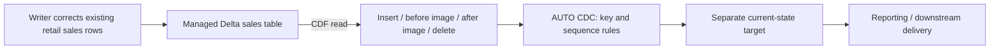

# 16 — Find and use CDC/CDF with your retail sales table

This walkthrough uses the table visible in your supplied Catalog Explorer screenshot: **`mdlm_db_trial.dev.fct_retail_sales_item`**. It answers where to find the features, how to check them and how to include them in a pipeline. Continue with [12 — Pattern examples](12_PIPELINES_CDF_CDC_AUTO_LOADER_EXAMPLES.md) for broader designs and [14 — Operations](14_PIPELINE_OPERATIONS_AND_OPTIMISATION.md) for monitoring/recovery.

Official documentation reviewed **8 October 2026**. The screenshot shows a **managed Delta table** with `PILLAR_ID` string, `MONTH_YEAR` bigint and `TOT_SALES` double, and a volume named `dev_volume`. It does **not** show row values, uniqueness, how the table is written, CDF configuration or the compute's feature version. We have not inspected or changed the live workspace. All commands below are teaching instructions for your authorised development environment.

## 1. Where are CDC and CDF in this screen?

| What you want | Where to go from the screenshot | What it means |
|---|---|---|
| Inspect existing table data | Table → **Sample Data**, or **SQL Editor** | Current visible rows |
| Inspect table properties | Table → **Details**, where exposed; definitive SQL checks below | Format/features/configuration |
| Inspect commits/version numbers | Table → **History**, or `DESCRIBE HISTORY` | Operations and table versions, not the row-by-row change feed |
| Read changed rows | **SQL Editor** using `table_changes`, or notebook `readChangeFeed` | CDF rows plus change metadata |
| Apply insert/update/delete events to a target | **Jobs & Pipelines** → create/edit an ETL pipeline | AUTO CDC source/target/key/sequence definitions |
| Capture changes from an operational database | Its CDC configuration plus an appropriate ingestion connector/extractor | Upstream CDC feed; separate from this table's CDF |

There is no extra CDC column to select in the screenshot's ordinary table schema. CDF is a way of reading changes; its metadata columns appear in that read. CDC describes capturing/applying changes; AUTO CDC is configured in pipeline code, rather than being a universal table toggle. [Catalog Explorer](https://learn.microsoft.com/en-us/azure/databricks/catalog-explorer/) · [AUTO CDC APIs](https://learn.microsoft.com/en-us/azure/databricks/ldp/cdc)

For your example:



If this table already contains the desired current state and you only query it, you may not need another CDC target. Use the extra target when a consumer needs incremental replication, another maintained representation or history. CDF alone does not change the way your upstream writer maintains the source.

## 2. First inspect the actual table in SQL Editor

Click **SQL Editor** in the left menu, select a permitted SQL warehouse and run these statements separately. They are read-only:

```sql
DESCRIBE DETAIL mdlm_db_trial.dev.fct_retail_sales_item;

SHOW TBLPROPERTIES mdlm_db_trial.dev.fct_retail_sales_item;

SHOW TBLPROPERTIES mdlm_db_trial.dev.fct_retail_sales_item
  ('delta.enableChangeDataFeed');

SHOW TBLPROPERTIES mdlm_db_trial.dev.fct_retail_sales_item
  ('delta.enableRowTracking');

DESCRIBE HISTORY mdlm_db_trial.dev.fct_retail_sales_item;

SELECT PILLAR_ID, MONTH_YEAR, TOT_SALES
FROM mdlm_db_trial.dev.fct_retail_sales_item
LIMIT 20;
```

Use the full catalog/schema/table name to avoid querying another environment. `SHOW TBLPROPERTIES` checks configuration; history supplies actual versions and operations. A missing property can be reported as absent rather than as a literal false value. [Property syntax](https://learn.microsoft.com/en-us/azure/databricks/sql/language-manual/sql-ref-syntax-aux-show-tblproperties) · [Table history](https://learn.microsoft.com/en-us/azure/databricks/tables/history)

### Interpret CDF availability correctly

Two approaches exist in current documentation:

- **Explicit/legacy Delta CDF:** the table property `delta.enableChangeDataFeed=true` enables the write-time feed.
- **Automatic CDF:** eligible Unity Catalog tables support it on qualifying compute; for Delta this requires row tracking and Runtime 19+. It uses the same read APIs. A missing legacy property therefore does not alone prove CDF is unavailable. Do not infer these requirements from the screenshot's “Serverless” label.

For an existing Delta table using the explicit approach, an authorised owner can run:

```sql
ALTER TABLE mdlm_db_trial.dev.fct_retail_sales_item
SET TBLPROPERTIES ('delta.enableChangeDataFeed' = 'true');
```

This is a table-configuration change, not a read-only check. Use it only when choosing the explicit approach; do not mechanically enable it on a table already using automatic CDF. It does not invent prior write-time change history or configure any consumer. Check current runtime/warehouse support, ownership and retention before choosing the approach. [CDF modes and requirements](https://learn.microsoft.com/en-us/azure/databricks/tables/features/change-data-feed)

The demo below uses explicit CDF from table creation so its intended capture boundary is clear without assuming automatic-feature availability. It is not a recommendation to migrate your real table's feature mode.

## 3. Read CDF from your existing table

After checking history and available capture history, choose a valid starting version. Suppose **version 7 is the first relevant retained CDF version**; 7 is an illustration, not a version observed in your table:

```sql
-- Replace 7 with the actual valid version found in your checks.
SELECT PILLAR_ID, MONTH_YEAR, TOT_SALES,
       _change_type, _commit_version, _commit_timestamp
FROM table_changes('mdlm_db_trial.dev.fct_retail_sales_item', 7)
ORDER BY _commit_version, PILLAR_ID, MONTH_YEAR, _change_type;
```

To read a bounded range, add a third argument, for example `table_changes('mdlm_db_trial.dev.fct_retail_sales_item', 7, 9)`. Both endpoints are inclusive; version 9 must actually exist. Batch reads need a start boundary. A version before explicit CDF was enabled or outside retained availability can fail. [table_changes syntax](https://learn.microsoft.com/en-us/azure/databricks/sql/language-manual/functions/table_changes)

The extra fields identify the action and the table commit:

| `_change_type` | Meaning for your sales row | Treatment when maintaining current state |
|---|---|---|
| `insert` | New pillar/month record | Add/upsert the current row |
| `update_preimage` | Old sales value before a correction | Preserve for change evidence; exclude from the simple current-state input below |
| `update_postimage` | New sales value after the correction | Upsert the corrected row |
| `delete` | Row removed from the source | Delete the corresponding target key |

`_commit_version` orders commits within this table; it is not an upstream database transaction sequence or an ordering across different tables. Sorting by `_change_type` above makes display repeatable; it does not define business precedence.

**History and CDF answer different questions.** History might say “UPDATE at version V.” CDF can expose the changed row's old and new values. Ordinary `SELECT * FROM the_table` shows only the current table columns/rows. Do not browse the volume for a supposed separate CDF file; use supported table read APIs.

## 4. Test with a separate fake table having the same column names

Run this sequence once against a **new** demo table. It deliberately does not alter sales values in your actual `fct_retail_sales_item`. If the demo name already exists, choose a new unique name and change every reference; avoid replacing unrelated data.

We invent `MONTH_YEAR=202610` to mean October 2026 and assume one row per `(PILLAR_ID, MONTH_YEAR)`. Your actual month encoding/grain remains to be checked. The screenshot uses `DOUBLE`; the new teaching table uses `DECIMAL(12,2)` for exact money arithmetic. This does not change your existing column type.

```sql
CREATE TABLE mdlm_db_trial.dev.fct_retail_sales_item_cdf_demo (
  PILLAR_ID STRING,
  MONTH_YEAR BIGINT,
  TOT_SALES DECIMAL(12,2)
) USING DELTA
TBLPROPERTIES ('delta.enableChangeDataFeed' = 'true');

INSERT INTO mdlm_db_trial.dev.fct_retail_sales_item_cdf_demo VALUES
  ('A', 202610, 1000.00),
  ('B', 202610, 800.00);

UPDATE mdlm_db_trial.dev.fct_retail_sales_item_cdf_demo
SET TOT_SALES = 1250.00
WHERE PILLAR_ID = 'A' AND MONTH_YEAR = 202610;

DELETE FROM mdlm_db_trial.dev.fct_retail_sales_item_cdf_demo
WHERE PILLAR_ID = 'B' AND MONTH_YEAR = 202610;

INSERT INTO mdlm_db_trial.dev.fct_retail_sales_item_cdf_demo VALUES
  ('C', 202610, 300.00);

SELECT * FROM mdlm_db_trial.dev.fct_retail_sales_item_cdf_demo
ORDER BY PILLAR_ID, MONTH_YEAR;

DESCRIBE HISTORY mdlm_db_trial.dev.fct_retail_sales_item_cdf_demo;

SELECT PILLAR_ID, MONTH_YEAR, TOT_SALES,
       _change_type, _commit_version, _commit_timestamp
FROM table_changes('mdlm_db_trial.dev.fct_retail_sales_item_cdf_demo', 0)
ORDER BY _commit_version, PILLAR_ID, _change_type;
```

Version 0 is appropriate here because this **new demo** enables explicit CDF at creation. Do not transfer that assumption to the existing table. Inspect history for actual version numbers; extra writes/maintenance can affect them.

Expected current rows:

| PILLAR_ID | MONTH_YEAR | TOT_SALES |
|---|---:|---:|
| A | 202610 | 1250.00 |
| C | 202610 | 300.00 |

Current total is **1550.00**. B is absent. Expected logical CDF records from the statements are:

| Write | PILLAR_ID | TOT_SALES | Change type |
|---|---|---:|---|
| First insert | A | 1000.00 | insert |
| First insert | B | 800.00 | insert |
| Correction | A | 1000.00 | update_preimage |
| Correction | A | 1250.00 | update_postimage |
| Removal | B | 800.00 | delete |
| Second insert | C | 300.00 | insert |

These are expected logical row changes, not captured runtime output. Summing all six images gives **5150.00**; summing only insert/postimage amounts gives **3350.00**. Neither is current sales. The state reconciliation is `1800 + 250 - 800 + 300 = 1550`.

If a deletion represents an accounting reversal rather than removing sales, change the business model accordingly. The demo illustrates a current-state replica, not a financial ledger policy.

## 5. Identify a real CDC key before building a target

For the proposed monthly-sales grain, check:

```sql
SELECT PILLAR_ID, MONTH_YEAR, COUNT(*) AS rows_per_key
FROM mdlm_db_trial.dev.fct_retail_sales_item
GROUP BY PILLAR_ID, MONTH_YEAR
HAVING COUNT(*) > 1 OR PILLAR_ID IS NULL OR MONTH_YEAR IS NULL;
```

No returned rows supports observed uniqueness/non-nullness at the current boundary. It does not enforce that contract for future input. If duplicates exist, investigate missing grain columns (item/store/channel, for example) or repeated aggregates. Do not invent uniqueness from a name beginning `fct_` or from the AI-suggested description in Catalog Explorer.

A source sequence is also necessary: database log ordering for external CDC, or one Delta source table's `_commit_version` for the CDF replica below. Require an unambiguous row per key/sequence after removing update preimages. A commit version cannot order contradictory same-key values inside one commit. For real feeds, validate conflicts, sparse patches versus full images, key changes, deletes and late arrivals before applying them.

## 6. Include CDF in a Lakeflow AUTO CDC pipeline

Here CDF produces the change rows; **AUTO CDC applies them** to a separate current-state target. The source is the fake table from section 4. Replace it with your real table only after the checks in sections 2 and 5.

From **Jobs & Pipelines**, create a new **ETL pipeline** (button wording can vary). Select supported compute and CDC capability: serverless, or the documented Pro/Advanced classic edition. Use default catalog **`mdlm_db_trial`** and a separate development schema such as **`cdc_demo`** with approved storage/permissions. Add one Python source file and select triggered mode for this exercise. Source reads and target creation must work under the pipeline's run identity. [AUTO CDC requirements](https://learn.microsoft.com/en-us/azure/databricks/ldp/cdc)

This is **pipeline source**, not a Python cell to execute manually in an ordinary notebook:

```python
from pyspark import pipelines as dp
from pyspark.sql import functions as F

SOURCE_TABLE = "mdlm_db_trial.dev.fct_retail_sales_item_cdf_demo"

@dp.table(name="bronze_retail_sales_changes")
def retail_changes():
    return (
        spark.readStream
        .option("readChangeFeed", "true")
        .table(SOURCE_TABLE)
        .where(F.col("_change_type") != "update_preimage")
    )

dp.create_streaming_table(name="silver_retail_sales_current")

dp.create_auto_cdc_flow(
    target="silver_retail_sales_current",
    source="bronze_retail_sales_changes",
    keys=["PILLAR_ID", "MONTH_YEAR"],
    sequence_by=F.col("_commit_version"),
    apply_as_deletes=F.expr("_change_type = 'delete'"),
    except_column_list=[
        "_change_type", "_commit_version", "_commit_timestamp"
    ],
    stored_as_scd_type=1,
    ignore_null_updates=False,
)
```

The flow requires full upsert images and the composite key contract. SCD1 keeps current values. Metadata controls processing and is excluded from the published target business columns. The framework owns the target write/progress; do not add `writeStream.start()` or a manually chosen checkpoint inside this definition. [create_auto_cdc_flow reference](https://learn.microsoft.com/en-us/azure/databricks/ldp/developer/ldp-python-ref-apply-changes)

There is deliberately **no startingVersion** on this new empty-target stream. Its initial read bootstraps from the current source snapshot, then follows changes. If you run it after completing section 4, its first source snapshot contains A=1250 and C=300; it will not replay every earlier demo change. This is correct for a new current-state target. To exercise subsequent corrections/deletes, start it after the initial insert and run another update after each later demo mutation, or make additional uniquely planned changes afterward. Archive historical images with a separately chosen retained start boundary when history is the goal. [Streaming CDF bootstrap](https://learn.microsoft.com/en-us/azure/databricks/tables/features/change-data-feed)

Start the update and inspect the graph. In SQL Editor verify the separate output:

```sql
SELECT PILLAR_ID, MONTH_YEAR, TOT_SALES
FROM mdlm_db_trial.cdc_demo.silver_retail_sales_current
ORDER BY PILLAR_ID, MONTH_YEAR;

SELECT COUNT(*) AS rows, SUM(TOT_SALES) AS total_sales
FROM mdlm_db_trial.cdc_demo.silver_retail_sales_current;
```

Expected after all demo changes: **2 rows, 1550.00**. Run another ordinary update without new source changes: state must be unchanged. Compare exact keys/amounts between source and target, not only the total. Monitor the first failed flow, run identity, CDF availability, pipeline state and consumer boundary using [14](14_PIPELINE_OPERATIONS_AND_OPTIMISATION.md).

## 7. What if CDC arrives from another database or as files?

Your three-column fact table does not show an `operation` or an upstream `source_sequence`. A proper external change feed might instead contain:

| PILLAR_ID | MONTH_YEAR | TOT_SALES | operation | source_sequence |
|---|---:|---:|---|---:|
| A | 202610 | 1000.00 | I | 1 |
| B | 202610 | 800.00 | I | 1 |
| A | 202610 | 1250.00 | U | 3 |
| A | 202610 | 1100.00 | U | 2 |
| B | 202610 | null | D | 2 |
| C | 202610 | 300.00 | I | 1 |

These are fake messages. Sequence is authoritative within each composite key; A's late sequence 2 must not overwrite sequence 3. B's delete wins over its sequence 1 insert. The resulting visible state is again A=1250/C=300/total1550.

Capture the feed through a supported database ingestion connector/extractor. If it lands immutable JSON files in your volume/cloud storage, Auto Loader can discover/read those files into Bronze; it does not invent change operations. Configure AUTO CDC with `sequence_by=F.col('source_sequence')`, a delete predicate on `operation`, and the same confirmed keys. The existing [guide 12](12_PIPELINES_CDF_CDC_AUTO_LOADER_EXAMPLES.md) supplies the fuller event-feed example.

If only **complete authoritative snapshots** exist, AUTO CDC FROM SNAPSHOT is another supported pattern; its source/version contract differs. Never infer deletion from a missing row in a partial monthly file or filtered extract. If the current writer replaces the entire fact table, inspect the resulting commits/CDF volume and table identity: enabling CDF does not transform a full-rebuild upstream workload into an efficient database CDC extractor.

## 8. Common problems in this exact exercise

| Symptom | Likely boundary to investigate | Fix/check |
|---|---|---|
| No CDF tab/columns in Catalog Explorer | CDF is read through APIs; ordinary schema stays the same | Use SQL Editor and `table_changes` |
| Property absent | Explicit feed not enabled, or automatic eligibility not checked | Verify features/compute and chosen mode before enabling |
| Requested version predates capture | Start boundary is wrong | Use a retained valid version or a coordinated current-state bootstrap |
| Table history visible but changes unavailable | Log visibility and row-change retention differ | Check feed availability/retention; recover from snapshot/archive if necessary |
| Permission denied | Editor user versus pipeline run identity/grants | Confirm source SELECT and parent usage; target schema/create rights |
| Python API/decorator fails in notebook | Wrong execution context/capability | Use an ETL pipeline with supported CDC settings |
| Two values for the same key/version | Key grain or source contract is invalid | Resolve conflicts; do not choose an arbitrary winner |
| Target still has B | Deletes were dropped or interpreted as inserts | Preserve delete events and configure `apply_as_deletes` |
| Total grows after every correction | Images/messages treated as additive sales | Aggregate maintained current state or correct change arithmetic |
| Old changes disappear after an outage | Consumer lag exceeds retained history | Archive changes or rebuild at a consistent boundary; add lag/headroom alerts |
| A changed key leaves an old target key | Key-change semantics not fully represented | Verify delete-old/insert-new behaviour; the simple example assumes stable keys |

Keep row-change retention and consumer progress aligned. SCD2 can retain attribute versions in a target; a change archive retains event evidence. Neither automatically supplies a user/reason attribute absent from the source. No live configuration, table mutation, pipeline update or archive is created by this Markdown guide.

## 9. What to do first with your screenshot

1. Open **SQL Editor** and run section 2's read-only properties/history/sample checks.
2. Confirm what `MONTH_YEAR` means and whether `(PILLAR_ID, MONTH_YEAR)` is the real unique key.
3. Decide the purpose: inspect changes, replicate current state, retain history or capture an upstream database feed.
4. Use the separate section 4 demo to understand insert/correction/delete images.
5. If a current-state replica is useful, configure section 6's development pipeline and reconcile it.

Record actual properties/compute, valid versions, key checks, source/target rows, update IDs and unchanged retry results in [progress.csv](progress.csv). The screenshot provides schema/navigation evidence; it is not runtime proof of any step above.
