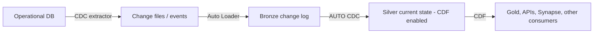

# 17 — CDF and CDC explained plainly, with use cases

[Learning path](README.md) · [04 — Delta and streaming](04_DELTA_AND_STREAMING.md) · [12 — Fake-table examples](12_PIPELINES_CDF_CDC_AUTO_LOADER_EXAMPLES.md) · [16 — Retail-table walkthrough](16_CDC_CDF_RETAIL_TABLE_WALKTHROUGH.md) · [11 — Lakeflow pipelines](11_LAKEFLOW_PIPELINES_AND_DLT_GUIDE.md)

Written 8 October 2026 as a plain-language entry point. Code is illustrative and was **not executed**; verify against current Databricks documentation. Read this first, then use lesson 12 (fake tables) and lesson 16 (your own retail table) for hands-on work.

## 1. The one-sentence versions

- **CDC (Change Data Capture)**: a *general idea*: record **what changed** in a source system (inserts, updates, deletes) instead of re-copying everything. It usually comes from a database log or a source feed.
- **CDF (Change Data Feed)**: a *specific Delta Lake feature*: a Delta table can keep a log of the row-level changes made to **that table**, so a downstream reader can ask "what changed since version N?"

Same spirit, different place. CDC is about getting changes **out of an operational source**. CDF is about getting changes **out of a Delta table**.

## 2. The problem both solve

A source table has 10 million rows and 5,000 change today. Copying all 10 million every night is slow and costly, and it misses deletes unless you compare snapshots. Passing only the 5,000 changes is cheaper, faster and lets downstream systems stay current.

## 3. A tiny story to hold in your head

Orders table, start of day:

| order_id | status | amount |
|---|---|---|
| 101 | placed | 90.00 |
| 102 | placed | 40.00 |

During the day: 101 is corrected to 110.00, 102 is cancelled and deleted, 103 is created.

**CDC feed** from the operational database (one line per event, with a key, an operation and an ordering value):

| order_id | operation | amount | sequence |
|---|---|---|---|
| 101 | UPDATE | 110.00 | 7 |
| 102 | DELETE | | 8 |
| 103 | INSERT | 55.00 | 9 |

**CDF output** for a Delta table (Databricks adds metadata columns):

| order_id | amount | `_change_type` | `_commit_version` | `_commit_timestamp` |
|---|---|---|---|---|
| 101 | 90.00 | update_preimage | 12 | … |
| 101 | 110.00 | update_postimage | 12 | … |
| 102 | 40.00 | delete | 12 | … |
| 103 | 55.00 | insert | 12 | … |

Both say "what happened". CDC arrives from outside and you must apply it correctly. CDF is produced by Delta itself from commits you made.

## 4. CDC in depth

**Where CDC records come from:** database transaction-log readers (for example Debezium, a managed connector, or ADF/Fivetran-style replication) or an application that emits events. Databricks does not discover a source database's log by itself. Something supported must capture and deliver the changes (files, Kafka/Event Hubs, a table).

**What a usable CDC record needs (the contract):**
1. A **key** to identify the row.
2. An **operation** (insert/update/delete, or upsert/delete).
3. An **ordering value** you can trust (log sequence number, version, commit time), because events arrive late and out of order.
4. Agreed handling of **deletes, duplicates and late data**.

**Applying CDC on Databricks:** use **AUTO CDC** in a Lakeflow pipeline (the newer name for what projects still call `APPLY CHANGES INTO` / `dlt.apply_changes`). You give it the key, the sequence column and the delete rule, and choose:
- **SCD Type 1**: keep only the latest value per key (current state).
- **SCD Type 2**: keep history, with start/end validity per version.

```sql
-- Illustrative pipeline SQL: maintain current orders from a CDC feed
CREATE OR REFRESH STREAMING TABLE orders_current;

CREATE FLOW orders_cdc AS AUTO CDC INTO orders_current
FROM STREAM(orders_cdc_feed)
KEYS (order_id)
APPLY AS DELETE WHEN operation = 'DELETE'
SEQUENCE BY sequence
STORED AS SCD TYPE 1;
```

Check the exact syntax for your runtime in [lesson 11](11_LAKEFLOW_PIPELINES_AND_DLT_GUIDE.md) and the AUTO CDC docs.

Without a proper sequence, a late "sequence 7 update" can overwrite a newer "sequence 9" change, or a replayed old insert can resurrect a deleted row. AUTO CDC handles the mechanics only if you supply a meaningful ordering.

### CDC use cases
| Use case | Why CDC fits |
|---|---|
| Replicate an operational database (orders, customers) into the lakehouse | Efficient, low load on the source, picks up deletes |
| Keep a Silver "current state" table accurate | AUTO CDC SCD1 applies updates/deletes by key |
| Track history, such as a customer's address over time | AUTO CDC SCD2 stores each version with validity dates |
| Near-real-time dashboards or search indexes | Apply small changes continuously instead of full reloads |
| Reduce load on a busy source system | Reads the log, not the live tables |

## 5. CDF in depth

**Turn it on** for a table. Changes made before enabling are not recorded.

```sql
CREATE TABLE silver.orders (order_id INT, status STRING, amount DECIMAL(10,2))
TBLPROPERTIES (delta.enableChangeDataFeed = true);

-- or on an existing table
ALTER TABLE silver.orders SET TBLPROPERTIES (delta.enableChangeDataFeed = true);
```

**Read changes (batch):**

```sql
SELECT * FROM table_changes('silver.orders', 5, 8);                    -- by version
SELECT * FROM table_changes('silver.orders', '2026-10-08 00:00:00');   -- from a timestamp
```

**Read changes (streaming):**

```python
changes = (spark.readStream
           .option("readChangeFeed", "true")
           .table("silver.orders"))
```

**Change types in `_change_type`:** `insert`, `update_preimage` (before), `update_postimage` (after), `delete`. Metadata columns: `_commit_version`, `_commit_timestamp`.

**Limits to remember:**
- It records changes only from the point it was enabled.
- History is finite and follows table retention/cleanup (such as `VACUUM`). It is **not** a permanent audit archive. If a consumer falls behind past retained history, re-bootstrap from a snapshot.
- It adds some storage and write overhead.
- It describes Delta table commits, not the original source system's events.

### CDF use cases
| Use case | Why CDF fits |
|---|---|
| Push only changed Silver rows to Gold, an API, Synapse or another system | Consumers read changes, not the whole table |
| Incrementally update downstream tables, including propagating deletes | Deletes arrive explicitly as `_change_type = 'delete'` |
| Audit "how did this order's value change?" | Pre/post images show before and after (within retention) |
| Feed search indexes, caches or reverse-ETL tools | Small, ordered change batches |
| Rebuild a downstream target after a failure | Replay from a known version |

## 6. CDC vs CDF at a glance

| | CDC | CDF |
|---|---|---|
| What is it | A pattern for capturing source changes | A Delta Lake feature on a table |
| Where changes originate | An operational database or app | Commits to a Delta table |
| Who produces the records | A connector/extractor you configure | Delta, automatically once enabled |
| Typical direction | Source → lakehouse (**in**) | Delta table → consumers (**out**) |
| Needs an ordering column you supply | Yes, critical | No: commit version/timestamp is built in |
| Applied with | AUTO CDC / `MERGE` | `table_changes`, `readChangeFeed`, then your upsert logic |
| Keeps history forever | Only if you store it | No, limited by retention |

**How they combine** (very common):



## 7. Which should I use?

1. **Do I need to ingest new files?** Auto Loader (not CDC or CDF).
2. **Do records in my source change or get deleted, and the lakehouse must match?** CDC feed + AUTO CDC.
3. **Does a Delta table change and something downstream must follow incrementally?** CDF.
4. **Is the source small and a full nightly snapshot fine?** Neither: full refresh or `MERGE` from the snapshot is simpler.

Repeated full extracts are not CDC, even if you run them frequently.

## 8. Common mistakes

- Treating CDF as a backup or permanent audit log.
- Forgetting to enable CDF before the changes you need, so there is nothing to read.
- No reliable sequence in a CDC feed, which leads to wrong "latest" values.
- Ignoring deletes, leaving stale rows downstream.
- Treating `update_preimage` rows as new data. Apply `insert`, `update_postimage` and `delete`.
- Letting a consumer stall longer than retention, then hitting missing-history errors.

## 9. Quick check questions

1. A customer address changes and you must keep every historical address. Which AUTO CDC mode?
2. Silver `orders` changed overnight and a Synapse job needs only what changed. Which feature?
3. A CDC event for sequence 7 arrives after sequence 9 for the same key. What stops the older value winning?
4. Why is CDF not a replacement for an audit table?

Answers: (1) SCD Type 2; (2) CDF; (3) `SEQUENCE BY` ordering in the apply step; (4) it is limited by retention/cleanup and only records changes after it was enabled.

Official references: [Delta Change Data Feed](https://learn.microsoft.com/en-us/azure/databricks/tables/features/change-data-feed) · [AUTO CDC](https://learn.microsoft.com/en-us/azure/databricks/ldp/cdc) · [table_changes](https://learn.microsoft.com/en-us/azure/databricks/sql/language-manual/functions/table_changes)
