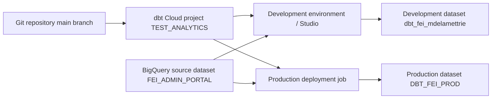

# dbt Cloud with BigQuery: setup and deployment field guide

Updated: 2026-09-29. This is a living guide; add later findings and verified fixes below.

## The four names that matter

| Layer | This project | Meaning |
| --- | --- | --- |
| Google Cloud project | `fei-website-f16b0` | BigQuery billing, jobs, and datasets |
| dbt Cloud project | `TEST_ANALYTICS` | Repository, connections, and environments |
| dbt project name | `fei_dbt` | `name:` in `dbt_project.yml`; also the key under `models:` |
| BigQuery dataset | `FEI_ADMIN_PORTAL`, `dbt_fei_mdelamettrie`, `DBT_FEI_PROD` | A dataset is what dbt calls a schema |

These names are examples from the 2026-09-29 setup. Check current values before copying them into another project.

## Architecture



Studio commands use development credentials. A production job clones a committed Git branch and uses its deployment environment credentials. A successful Studio run alone does not publish code or build production objects.

## 1. Prepare BigQuery and identity

1. Confirm the source dataset and table, here `fei-website-f16b0.FEI_ADMIN_PORTAL.FEI_TRAFFIC_NAMED`.
2. In BigQuery, open the source dataset **Details** and record its exact **Data location**. Here it is `australia-southeast1`.
3. Create or select separate development and production output datasets in that same location. Here the development dataset is `dbt_fei_mdelamettrie`; production is `DBT_FEI_PROD`. A BigQuery project cannot contain two datasets with the same ID in different locations.
4. An existing dedicated service account can be reused. The example account is `dbt-fei-sa@fei-website-f16b0.iam.gserviceaccount.com`. It needs permission to create BigQuery jobs, read the source, and write to the output datasets. A typical starting point is **BigQuery Job User** on the project and **BigQuery Data Editor** on the output datasets, with appropriate read access to sources. Scope permissions to the actual datasets where possible.
5. For **Service Account JSON** authentication, create a JSON key for that service account only if organizational policy permits it. Upload it to dbt Cloud credentials. Keep keys out of Git, screenshots, chat, and `profiles.yml`. Workload Identity Federation is an alternative enterprise setup involving an identity provider and Google workload identity pool; it is not interchangeable with simply selecting the dropdown option.

## 2. Configure dbt Cloud

1. Under **Settings → Connections**, create a **BigQuery** connection, choose **Service Account JSON** for deployment authentication, set project ID `fei-website-f16b0`, and upload the key. Set **Location** to the source dataset location where the connection or credential offers that field.
2. Under **Settings → Projects**, connect the Git repository and BigQuery connection.
3. Set **Project subdirectory** based on the Git repository layout, **not its repository name or how Studio labels its top folder**:

   | Path on the deployment branch | Project subdirectory |
   | --- | --- |
   | `dbt_project.yml` | Leave blank |
   | `dbt_cert/dbt_project.yml` | `dbt_cert` |

   In this case the private `dbt_cert` repository's `main` branch has `dbt_project.yml` at the root, so the field must be **blank**. Setting it to `dbt_cert` caused the deployment job's “valid dbt project was not found” error.
4. Under **Your profile → Credentials**, edit the development credentials for `TEST_ANALYTICS`. Use **Service Account JSON** and set **Dataset** to `dbt_fei_mdelamettrie`. Save and test the connection. Creating a dataset in BigQuery does not update this field automatically.
5. Configure a separate production deployment environment, here `dbt_Prod_FEI`, with a deployment credential whose **Dataset** is `DBT_FEI_PROD`. Confirm its branch and BigQuery location. The production output dataset must be in `australia-southeast1` to build views over the source.

dbt Cloud manages the connection profile for its hosted runs. A local `profiles.yml` is only needed for local command-line development; never commit credentials or service-account key material in it.

## 3. Define and test the source

In `models/Bronze/sources.yml`:

```yaml
version: 2

sources:
  - name: fei_sources
    database: fei-website-f16b0
    schema: FEI_ADMIN_PORTAL
    tables:
      - name: FEI_TRAFFIC_NAMED
```

In `models/Bronze/fei_source_test.sql`:

```sql
{{ config(materialized='view') }}

select *
from {{ source('fei_sources', 'FEI_TRAFFIC_NAMED') }}
```

The `{{ ... }}` is essential: without it, BigQuery receives `source(...)` as SQL and reports **“Table-valued function not found: source.”** The source and table arguments must match the YAML `name` values. `database` is the BigQuery project; `schema` is the BigQuery dataset.

In `dbt_project.yml`, the key below `models:` must match the project's `name:` exactly. Folder keys configure existing folders; they do not create scaffolding:

```yaml
name: fei_dbt

models:
  fei_dbt:
    Bronze:
      +materialized: view
    Silver:
      +materialized: view
    Gold:
      +materialized: view
```

Create the `models/Bronze`, `models/Silver`, and `models/Gold` folders yourself. Folder capitalization must match the configuration.

### Bronze, Silver, and Gold model layout

This project can use the medallion names instead of `staging`, `intermediate`, and `marts`. They describe the transformation stages; dbt only requires that model files live under `model-paths` and that folder-specific YAML configuration matches the actual paths.

```text
models/
├── Bronze/
│   ├── sources.yml
│   └── br_fei_traffic.sql
├── Silver/
│   └── sl_fei_traffic_clean.sql
└── Gold/
    └── gd_traffic_summary.sql
```

| Folder | Role | Reference pattern |
| --- | --- | --- |
| Bronze | One source-aligned model per raw table; basic renaming, casting, and source checks | `{{ source('fei_sources', 'FEI_TRAFFIC_NAMED') }}` |
| Silver | Clean, deduplicate, standardize, and combine Bronze models for reuse | `{{ ref('br_fei_traffic') }}` |
| Gold | Business-ready tables/views and aggregates for reporting | `{{ ref('sl_fei_traffic_clean') }}` |

The raw BigQuery table stays in `FEI_ADMIN_PORTAL`; a Bronze model is a dbt-built view or table over it. Folder names alone do **not** create separate BigQuery datasets. With the current settings, all three layers build into the target dataset for that environment: `dbt_fei_mdelamettrie` in development or `DBT_FEI_PROD` in production. If separate Bronze/Silver/Gold datasets are needed later, design explicit `+schema` settings and check dbt's default custom-schema naming behavior before deployment.

`fei_source_test.sql` is the current proof-of-connection model. It can be renamed to a descriptive Bronze model once downstream models use `ref()` to express dependencies. Folder names and model names need not match one another.

### The equivalent staging / intermediate / marts vocabulary

Keep both vocabularies in mind. They describe broadly similar progression, but are not rigid one-to-one translations:

| Medallion term | Common dbt term | Typical file names and purpose |
| --- | --- | --- |
| Bronze | `staging` | `stg_fei__traffic.sql`: source-aligned, mostly one model per source table; select, rename, cast, and document fields |
| Silver | `intermediate` | `int_traffic_enriched.sql`: deduplicate, join, and apply reusable business logic |
| Gold | `marts` | `dim_visitor.sql`, `fct_traffic.sql`: business entities, facts, dimensions, and reporting aggregates |

`stg_`, `int_`, `dim_`, and `fct_` are **model naming conventions**, not dbt commands. You can keep `Bronze/Silver/Gold` as the actual folders and use these prefixes where they clarify a model's role:

```text
models/
├── Bronze/stg_fei__traffic.sql
├── Silver/int_traffic_enriched.sql
└── Gold/
    ├── dim_visitor.sql
    └── fct_traffic.sql
```

For a small project, one Bronze source model and one Gold reporting model may be sufficient; add Silver when reusable cleaning or joins justify it. dbt's [project structure guidance](https://docs.getdbt.com/best-practices/how-we-structure/2-staging) uses staging as the source-facing layer.

In Studio, save the files and run:

```bash
dbt build --select fei_source_test
```

`dbt build` runs selected models and their tests. `dbt run --select fei_source_test` builds just the selected model.

## 4. Publish code, then run production

1. Test in the development environment and confirm the result in `dbt_fei_mdelamettrie`.
2. In **Studio → Version control**, commit and sync the project files. An **A** beside a file means it was added in the workspace; the production job cannot see it until it is committed to the branch it clones. If `main` is protected, commit to a new branch and merge a pull request into the production branch.
3. Open the connected Git repository on the production branch. Confirm that `dbt_project.yml`, `models/Bronze/sources.yml`, and the SQL model are present. Check the exact path of `dbt_project.yml` against the Project subdirectory setting.
4. In **Orchestration → Jobs**, configure a deploy job for `dbt_Prod_FEI` with command `dbt build` and select **Run now**. Schedule it only after an initial successful run.
5. Verify that the job completed and the view or table appeared in `DBT_FEI_PROD`.

The Studio **“Defer to: DEV”** selector affects dependency resolution during development. It does not switch the Studio command bar into the production environment.

## 5. Running production with dbt Core instead of dbt Cloud jobs

dbt Core executes transformations but does not host a scheduler or deployment environment. In a Core-only setup, Git distributes code, a `profiles.yml` target selects the BigQuery destination, and an external runner (for example, a CI pipeline or scheduled VM/container) invokes dbt. Pushing Git code and building BigQuery objects are separate operations.

**Choose commands for the environment where they run.** The `--target dev` and `--target prod` examples below apply only to an external dbt Core profile that actually defines outputs with those names. In dbt Cloud Studio, use the command bar **without** those flags; Studio uses its own generated profile and development credentials. On 2026-09-29, a Studio/Fusion `dbt seed --select actions --target dev` failed with `target 'dev' not found in profile 'user'`. The fix in Studio is `dbt seed --select actions`, not a change to the BigQuery dataset.

### Prepare the runner

1. Keep `dbt_project.yml` and models committed on the production branch. A local development run can use uncommitted files; a production runner should check out a specific commit from the approved branch.
2. Install compatible `dbt-core` and `dbt-bigquery` versions on the runner and keep them pinned together. Make sure the runner starts in the directory containing `dbt_project.yml` (the root of the current `dbt_cert` repository).
3. Give the runner an identity with permission to run BigQuery jobs, read `FEI_ADMIN_PORTAL`, and write to `DBT_FEI_PROD`. Supply credentials through the runner's secret store or workload identity. Never commit a JSON key. Keep the production BigQuery job location at `australia-southeast1`.
4. Configure a `profiles.yml` **outside the Git repository**. Its top-level key must match `profile:` in `dbt_project.yml`; this project currently says `profile: 'default'`. Example using an externally supplied key-file path:

```yaml
default:
  target: dev
  outputs:
    dev:
      type: bigquery
      method: service-account
      project: fei-website-f16b0
      dataset: dbt_fei_mdelamettrie
      keyfile: "{{ env_var('DBT_BIGQUERY_KEYFILE') }}"
      location: australia-southeast1
      threads: 4
    prod:
      type: bigquery
      method: service-account
      project: fei-website-f16b0
      dataset: DBT_FEI_PROD
      keyfile: "{{ env_var('DBT_BIGQUERY_KEYFILE') }}"
      location: australia-southeast1
      threads: 4
```

The example assumes `DBT_BIGQUERY_KEYFILE` points to a key file mounted outside the repository. Use separate development and production identities when available; the runner may inject different key paths for each environment. A keyless identity method needs its own adapter-specific profile settings.

### Promote and execute

1. On a development machine, work on a branch and run `dbt build --target dev --profiles-dir <secure-profile-directory>`.
2. Commit the tested code and merge it into the production branch. `git push` publishes code; it does not execute dbt.
3. Have the production runner check out the approved commit, provide its credentials and profile, then run these commands from the project root:

```bash
dbt deps --target prod --profiles-dir <secure-profile-directory>
dbt build --target prod --profiles-dir <secure-profile-directory>
```

4. Schedule or trigger that runner through your chosen orchestrator, preserve logs and artifacts, and alert on a nonzero exit code. Verify the model output in `DBT_FEI_PROD`.

The `--target prod` flag selects the `prod` output in `profiles.yml`; it is the critical switch between the development and production datasets. A manual `dbt build --target prod` is possible on a machine with production credentials, but routine production execution should use a controlled runner so code version, identity, schedule, logs, and retries are repeatable. See dbt's [profile and target documentation](https://docs.getdbt.com/docs/local/profiles.yml).

### Small reference lists as dbt Core seeds

For a short, relatively static action list, create `seeds/actions.csv` in the dbt project:

```csv
action
Vue Page
Vue Article
Download Doc
Lead Doc
Contact
Newsletter
Commentaire
Action
```

The first line is the **column header**; the last `Action` is a data value, matching the supplied list. If the last `Action` was accidental, remove that final line. Use a simple lowercase header to make BigQuery SQL easier to write.

In the **dbt Cloud Studio** command bar, run:

```bash
dbt seed --select actions
```

This uses the Studio development dataset from **Your profile → Credentials**. For **dbt Core on your own machine** with the external `dev` profile defined above, run from the directory containing `dbt_project.yml`:

```bash
dbt seed --select actions --target dev --profiles-dir <secure-profile-directory>
```

This creates a table named `actions` in the development target dataset. Check it in BigQuery:

```sql
select * from `fei-website-f16b0.dbt_fei_mdelamettrie.actions`;
```

In a model, use `{{ ref('actions') }}` rather than `source()` because the CSV is managed by dbt. For a production Core runner, commit the CSV, merge it to the production branch, and run `dbt seed --select actions --target prod` before models that depend on it. A production job that runs `dbt build --target prod` can also include selected seeds in the build graph; an explicit seed step makes the load order clear. Keep personal or sensitive event-level data out of Git-backed seeds. See dbt's [seed guide](https://docs.getdbt.com/docs/build/seeds) and [`dbt seed` command](https://docs.getdbt.com/reference/commands/seed).

To assert that the **model** `fei_source_test` has no null `action` values, add `models/Bronze/fei_source_test.yml`:

```yaml
version: 2

models:
  - name: fei_source_test
    columns:
      - name: action
        data_tests:
          - not_null
```

The `name:` under `models:` must match the SQL model's filename without `.sql`. The column name must match the output column; use `Action` if that is the actual name in the model. To test the **seed itself**, add a separate file such as `seeds/actions.yml`:

```yaml
version: 2

seeds:
  - name: actions
    columns:
      - name: action
        data_tests:
          - not_null
```

In **Studio**, use `dbt build --select fei_source_test` to build the model and run its tests, or `dbt test --select fei_source_test` to test an already built model. For the seed, use `dbt build --select actions` after creating the CSV. In **external dbt Core**, append `--target dev` or `--target prod` only when that target is defined in the external profile; add `--profiles-dir <secure-profile-directory>` when the profile is outside dbt's default search path. A `not_null` test only checks for SQL `NULL`; it does not reject an empty string. See dbt's [data test guide](https://docs.getdbt.com/docs/build/data-tests).

To combine `not_null` with `accepted_values` for the model, keep one `models:` block and indent `arguments:` under `accepted_values:`. This version allows all eight values supplied for the seed:

```yaml
version: 2

models:
  - name: fei_source_test
    columns:
      - name: action
        data_tests:
          - not_null
          - accepted_values:
              arguments:
                values:
                  - Vue Page
                  - Vue Article
                  - Download Doc
                  - Lead Doc
                  - Contact
                  - Newsletter
                  - Commentaire
                  - Action
```

If the model should contain **only** `Action` and `Contact`, set `values: ['Action', 'Contact']` instead. The test will fail on any of the other six listed actions, which may be exactly what a filtered model intends. The test is case sensitive for string values in BigQuery.

The `orders` example with two separately named tests uses `config.where` to limit rows by date. Only copy that pattern if this model has a real date column. For example, with a DATE column named `event_date`, a BigQuery filter for yesterday is `where: "event_date = DATE_SUB(CURRENT_DATE(), INTERVAL 1 DAY)"`. Replace `event_date` with the model's actual date column, and use `DATE(timestamp_column)` if the source field is a TIMESTAMP. The PostgreSQL expression `current_date - interval '1 day'` should not be copied into BigQuery-specific YAML.

### One model YAML or one folder YAML?

Both are valid. dbt discovers model property `.yml` files under the configured model path; the filename does not have to match the SQL filename. The `models: - name:` value must match the model name.

- For a small Bronze folder, one `models/Bronze/models.yml` containing a `models:` list for several models is easy to manage.
- As models gain descriptions, column tests, contracts, or versions, co-locate `fei_source_test.sql` and `fei_source_test.yml` (one YAML per model) to make reviews and ownership clearer.
- Keep `sources.yml` for source definitions and `seeds/actions.yml` for seed properties. Do not declare the same model in two different YAML files.

There is no performance benefit to either file layout. For this small project, start with one YAML file per folder if it remains short; split into per-model files when the folder file becomes hard to scan. dbt's [staging example](https://docs.getdbt.com/best-practices/how-we-structure/2-staging) shows co-located per-model YAML, while its [quickstart](https://docs.getdbt.com/guides/bigquery?step=1) shows multiple models in a shared `schema.yml`.

### First macro: count rows

Create `macros/count_macro.sql`:

```sql

    count(*)

```

Use it in a model query:

```sql
select {{ count_macro() }} as row_count
from {{ ref('fei_source_test') }}
```

The macro generates the SQL expression `count(*)`; the model supplies the table through `ref()`. A macro does not execute a query by itself. dbt Jinja block syntax uses `` and ``, while `{{ count_macro() }}` inserts its output into SQL. See dbt's [Jinja and macros guide](https://docs.getdbt.com/docs/build/jinja-macros).

## Troubleshooting from this setup

| Error or symptom | Cause | Check or fix |
| --- | --- | --- |
| `Table-valued function not found: source` | `source()` was sent to BigQuery as raw SQL | Use `{{ source('fei_sources', 'FEI_TRAFFIC_NAMED') }}` |
| `FEI_ADMIN_PORTAL was not found in location US` | BigQuery job ran in US while the source is in `australia-southeast1` | Set the BigQuery connection/job location to the source dataset's exact location |
| `dbt_mdelamettrie was not found in location australia-southeast1` | Development credential still targeted an old or differently located output dataset | Create/select an output dataset in `australia-southeast1`; set **Your profile → Credentials → Dataset** to its exact ID |
| `valid dbt project was not found` at `dbt deps` | Deployment could not find `dbt_project.yml` in the cloned branch at the configured path | Commit and sync the project; inspect the production branch; set Project subdirectory to the actual relative folder, or blank for a root file |
| Studio build succeeds but deployment does not | Studio uses workspace code and development credentials; deploy job uses committed code and production credentials | Check commit/branch/path first, then production BigQuery credentials and location |

The session established that the repository's `main` branch contained `dbt_project.yml` **at its root**. Clearing the mistaken `dbt_cert` Project subdirectory resolved the project-discovery issue, according to the user's report. A completed production `dbt build` and its BigQuery output have not yet been independently verified in this record.

## Further findings

Add dated entries here when new behavior is observed. For each entry, record the symptom, exact cause, fix, and how it was verified. Keep credentials and private key material out of this file.

## References

- [dbt and BigQuery quickstart](https://docs.getdbt.com/guides/bigquery?step=1)
- [dbt SQL models and hierarchical model configuration](https://docs.getdbt.com/docs/build/sql-models)
- [dbt deployment environments and jobs](https://docs.getdbt.com/docs/deploy/deployments)
- [dbt Studio interface and defer selector](https://docs.getdbt.com/docs/platform/studio-ide/ide-user-interface)
- [dbt BigQuery OAuth and Workload Identity Federation](https://docs.getdbt.com/docs/platform/manage-access/set-up-bigquery-oauth)
- [dbt profiles, targets, and production execution](https://docs.getdbt.com/docs/local/profiles.yml)
- [dbt staging structure and model naming](https://docs.getdbt.com/best-practices/how-we-structure/2-staging)
