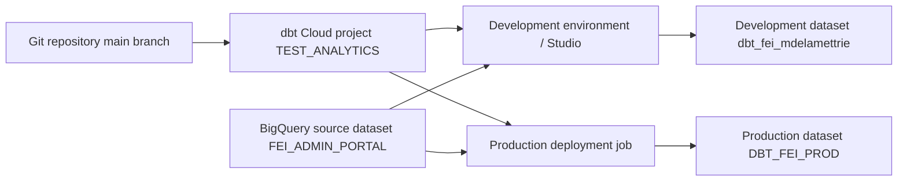

# dbt Cloud with BigQuery: setup and deployment field guide

Updated: 2026-09-29. This is a living guide; add later findings and verified fixes below.

## The four names that matter

| Layer | This project | Meaning |
| --- | --- | --- |
| Google Cloud project | `fei-website-f16b0` | BigQuery billing, jobs, and datasets |
| dbt Cloud project | `TEST_ANALYTICS` | Repository, connections, and environments |
| dbt project name | `fei_dbt` | `name:` in `dbt_project.yml`; also the key under `models:` |
| BigQuery dataset | `FEI_ADMIN_PORTAL`, `dbt_fei_mdelamettrie`, `DBT_FEI_PROD` | A dataset is what dbt calls a schema |

These names are examples from the 2026-09-29 setup. Check current values before copying them into another project.

## Architecture



Studio commands use development credentials. A production job clones a committed Git branch and uses its deployment environment credentials. A successful Studio run alone does not publish code or build production objects.

## 1. Prepare BigQuery and identity

1. Confirm the source dataset and table, here `fei-website-f16b0.FEI_ADMIN_PORTAL.FEI_TRAFFIC_NAMED`.
2. In BigQuery, open the source dataset **Details** and record its exact **Data location**. Here it is `australia-southeast1`.
3. Create or select separate development and production output datasets in that same location. Here the development dataset is `dbt_fei_mdelamettrie`; production is `DBT_FEI_PROD`. A BigQuery project cannot contain two datasets with the same ID in different locations.
4. An existing dedicated service account can be reused. The example account is `dbt-fei-sa@fei-website-f16b0.iam.gserviceaccount.com`. It needs permission to create BigQuery jobs, read the source, and write to the output datasets. A typical starting point is **BigQuery Job User** on the project and **BigQuery Data Editor** on the output datasets, with appropriate read access to sources. Scope permissions to the actual datasets where possible.
5. For **Service Account JSON** authentication, create a JSON key for that service account only if organizational policy permits it. Upload it to dbt Cloud credentials. Keep keys out of Git, screenshots, chat, and `profiles.yml`. Workload Identity Federation is an alternative enterprise setup involving an identity provider and Google workload identity pool; it is not interchangeable with simply selecting the dropdown option.

## 2. Configure dbt Cloud

1. Under **Settings → Connections**, create a **BigQuery** connection, choose **Service Account JSON** for deployment authentication, set project ID `fei-website-f16b0`, and upload the key. Set **Location** to the source dataset location where the connection or credential offers that field.
2. Under **Settings → Projects**, connect the Git repository and BigQuery connection.
3. Set **Project subdirectory** based on the Git repository layout, **not its repository name or how Studio labels its top folder**:

   | Path on the deployment branch | Project subdirectory |
   | --- | --- |
   | `dbt_project.yml` | Leave blank |
   | `dbt_cert/dbt_project.yml` | `dbt_cert` |

   In this case the private `dbt_cert` repository's `main` branch has `dbt_project.yml` at the root, so the field must be **blank**. Setting it to `dbt_cert` caused the deployment job's “valid dbt project was not found” error.
4. Under **Your profile → Credentials**, edit the development credentials for `TEST_ANALYTICS`. Use **Service Account JSON** and set **Dataset** to `dbt_fei_mdelamettrie`. Save and test the connection. Creating a dataset in BigQuery does not update this field automatically.
5. Configure a separate production deployment environment, here `dbt_Prod_FEI`, with a deployment credential whose **Dataset** is `DBT_FEI_PROD`. Confirm its branch and BigQuery location. The production output dataset must be in `australia-southeast1` to build views over the source.

dbt Cloud manages the connection profile for its hosted runs. A local `profiles.yml` is only needed for local command-line development; never commit credentials or service-account key material in it.

## 3. Define and test the source

In `models/Bronze/sources.yml`:

```yaml
version: 2

sources:
  - name: fei_sources
    database: fei-website-f16b0
    schema: FEI_ADMIN_PORTAL
    tables:
      - name: FEI_TRAFFIC_NAMED
```

In `models/Bronze/fei_source_test.sql`:

```sql
{{ config(materialized='view') }}

select *
from {{ source('fei_sources', 'FEI_TRAFFIC_NAMED') }}
```

The `{{ ... }}` is essential: without it, BigQuery receives `source(...)` as SQL and reports **“Table-valued function not found: source.”** The source and table arguments must match the YAML `name` values. `database` is the BigQuery project; `schema` is the BigQuery dataset.

In `dbt_project.yml`, the key below `models:` must match the project's `name:` exactly. Folder keys configure existing folders; they do not create scaffolding:

```yaml
name: fei_dbt

models:
  fei_dbt:
    Bronze:
      +materialized: view
    Silver:
      +materialized: view
    Gold:
      +materialized: view
```

Create the `models/Bronze`, `models/Silver`, and `models/Gold` folders yourself. Folder capitalization must match the configuration.

In Studio, save the files and run:

```bash
dbt build --select fei_source_test
```

`dbt build` runs selected models and their tests. `dbt run --select fei_source_test` builds just the selected model.

## 4. Publish code, then run production

1. Test in the development environment and confirm the result in `dbt_fei_mdelamettrie`.
2. In **Studio → Version control**, commit and sync the project files. An **A** beside a file means it was added in the workspace; the production job cannot see it until it is committed to the branch it clones. If `main` is protected, commit to a new branch and merge a pull request into the production branch.
3. Open the connected Git repository on the production branch. Confirm that `dbt_project.yml`, `models/Bronze/sources.yml`, and the SQL model are present. Check the exact path of `dbt_project.yml` against the Project subdirectory setting.
4. In **Orchestration → Jobs**, configure a deploy job for `dbt_Prod_FEI` with command `dbt build` and select **Run now**. Schedule it only after an initial successful run.
5. Verify that the job completed and the view or table appeared in `DBT_FEI_PROD`.

The Studio **“Defer to: DEV”** selector affects dependency resolution during development. It does not switch the Studio command bar into the production environment.

## Troubleshooting from this setup

| Error or symptom | Cause | Check or fix |
| --- | --- | --- |
| `Table-valued function not found: source` | `source()` was sent to BigQuery as raw SQL | Use `{{ source('fei_sources', 'FEI_TRAFFIC_NAMED') }}` |
| `FEI_ADMIN_PORTAL was not found in location US` | BigQuery job ran in US while the source is in `australia-southeast1` | Set the BigQuery connection/job location to the source dataset's exact location |
| `dbt_mdelamettrie was not found in location australia-southeast1` | Development credential still targeted an old or differently located output dataset | Create/select an output dataset in `australia-southeast1`; set **Your profile → Credentials → Dataset** to its exact ID |
| `valid dbt project was not found` at `dbt deps` | Deployment could not find `dbt_project.yml` in the cloned branch at the configured path | Commit and sync the project; inspect the production branch; set Project subdirectory to the actual relative folder, or blank for a root file |
| Studio build succeeds but deployment does not | Studio uses workspace code and development credentials; deploy job uses committed code and production credentials | Check commit/branch/path first, then production BigQuery credentials and location |

The session established that the repository's `main` branch contained `dbt_project.yml` **at its root**. Clearing the mistaken `dbt_cert` Project subdirectory resolved the project-discovery issue, according to the user's report. A completed production `dbt build` and its BigQuery output have not yet been independently verified in this record.

## Further findings

Add dated entries here when new behavior is observed. For each entry, record the symptom, exact cause, fix, and how it was verified. Keep credentials and private key material out of this file.

## References

- [dbt and BigQuery quickstart](https://docs.getdbt.com/guides/bigquery?step=1)
- [dbt SQL models and hierarchical model configuration](https://docs.getdbt.com/docs/build/sql-models)
- [dbt deployment environments and jobs](https://docs.getdbt.com/docs/deploy/deployments)
- [dbt Studio interface and defer selector](https://docs.getdbt.com/docs/platform/studio-ide/ide-user-interface)
- [dbt BigQuery OAuth and Workload Identity Federation](https://docs.getdbt.com/docs/platform/manage-access/set-up-bigquery-oauth)
