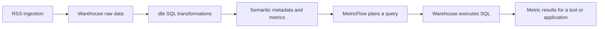
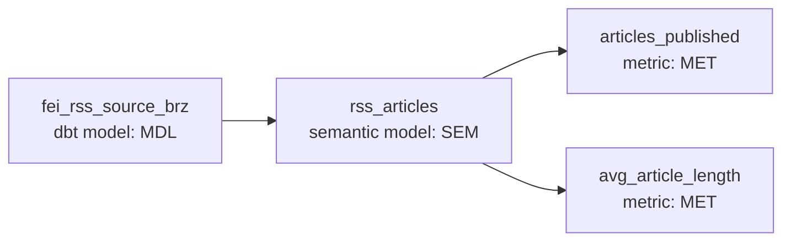
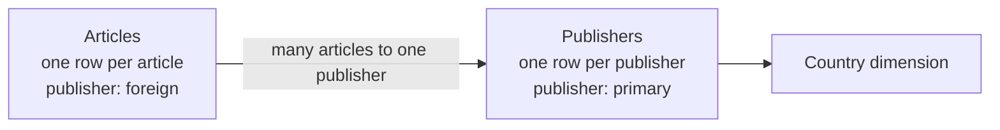

# 02 — dbt semantic models and metrics: a practical course

Prepared for Matthieu • 7 October 2026 • Beginner to practical implementation

[Numbered learning path](README.md) · Next hands-on step: [03 — BigQuery lab](03_SEMANTIC_MODELS_LAB/README.md).

**Start here:** a dbt SQL model prepares data; a semantic model explains what that data means; a metric defines the number a business wants to calculate. MetricFlow turns a request for those metrics and dimensions into warehouse SQL.

This course uses the FEI RSS example in your screenshot and BigQuery for the lab. You can learn the concepts without changing your existing project. The screenshot was inspected; its underlying YAML, warehouse data and account entitlements were not accessed. Example columns and data below are invented for teaching, not inferred from your database.

## Course route

Allow roughly 10–14 hours, at your own pace. Each lesson has a concrete outcome. You already have dbt project experience, so spend extra time on grain, aggregation and debugging.

| Session | Lessons | Suggested time | Deliverable |
|---|---|---|---|
| 1 | 1–4: concepts, screenshot, grain, components | 2 hours | Explain your lineage and write a metric contract |
| 2 | 5–7: syntax, SQL model, semantic YAML | 3 hours | Build and understand the RSS lab |
| 3 | 8–10: queries, metric types, time | 3 hours | Reconcile results with SQL |
| 4 | 11–13: joins, consumers, release | 2 hours | Design a safe extension and deployment |
| 5 | 14–16: troubleshooting, exercises, capstone | 2–4 hours | Diagnose failures and demonstrate mastery |

Navigation: [1. Meaning](#lesson-1--what-semantic-means) · [2. Screenshot](#lesson-2--read-your-screenshot) · [3. Grain](#lesson-3--define-the-grain-before-the-metric) · [4. Components](#lesson-4--entities-dimensions-measures-and-metrics) · [5. Versions](#lesson-5--choose-your-yaml-format) · [6. Lab](#lesson-6--build-a-small-bigquery-lab) · [7. YAML](#lesson-7--read-the-semantic-yaml-line-by-line) · [8. Queries](#lesson-8--query-and-reconcile-your-metrics) · [9. Types](#lesson-9--the-five-metric-types) · [10. Time](#lesson-10--time-grain-missing-days-and-freshness) · [11. Joins](#lesson-11--join-semantic-models-without-inflating-results) · [12. Consumption](#lesson-12--saved-queries-exports-and-bi-tools) · [13. Release](#lesson-13--test-govern-and-deploy) · [14. Debugging](#lesson-14--debugging-workbook) · [15. Practice](#lesson-15--practice-without-an-answer-key) · [16. Capstone](#lesson-16--fei-rss-capstone) · [References](#official-reference-library).

## Lesson 1 — What semantic means

“Semantic” means **meaning**. Imagine a library:

- Shelves hold books: the warehouse stores rows.
- A librarian cleans the catalogue: dbt SQL models standardize those rows.
- Catalogue rules explain “book”, “author” and “publication date”: semantic metadata gives columns business meaning.
- A question such as “How many books were published each month?” calls for a metric, a time grouping and possibly a filter.

For FEI, `article_url`, `published_date` and `article_length_chars` are columns. “Count unique articles by publication date” is a business definition. “Number of rows loaded today” is a different definition even if both are casually called “articles”.

Without shared definitions, one dashboard might count feed observations, another count distinct URLs, and a third exclude articles without a date. Each can display a different answer under the same label.

Central definitions make a shared calculation possible. They still need correct source data, agreed rules and consumers that actually use them. A dashboard that writes its own SQL can bypass the governed metric.



The semantic model is metadata, not a second copy of your table. A metric definition does not normally create a permanent table for every possible grouping. A query produces a result set; an explicitly configured export can persist one.

Source: [dbt Semantic Layer overview](https://docs.getdbt.com/docs/use-dbt-semantic-layer/dbt-sl), [MetricFlow introduction](https://docs.getdbt.com/docs/build/about-metricflow).

**Checkpoint:** explain the difference between storing `article_length_chars` and defining `avg_article_length`.

## Lesson 2 — Read your screenshot

Your screenshot shows the project `TEST_ANALYTICS`, with Production selected, and this chain:



| Visible object | What it means | What to inspect in code |
|---|---|---|
| `fei_rss_source_brz` | A dbt transformation model used by this semantic model | SQL output, materialization, row grain and tests |
| `rss_articles` | Business metadata associated with that model | Entities, dimensions, time and aggregation definitions |
| `articles_published` | A named metric depending on the semantic model | Count rows or distinct URLs? Which date? Which filters? |
| `avg_article_length` | Another named metric | Characters or words? Title, summary or full body? Null handling? |
| Entity `article`, type `primary` | The screenshot describes an article URL as the natural key and primary entity | Does each URL actually occur once? |

“Natural key” in the entity description is ordinary business language: a URL is an identifier originating in the data. The configured entity type shown is **primary**, not `natural`. Those terms should not be confused.

The graph establishes declared dependencies. It does not prove the metrics have been queried successfully, that URLs are unique, or that counts are correct. Metric names alone do not reveal formulas. The screenshot does not establish which YAML format is in use.

A semantic model can reference your Bronze model. For trusted reporting, inspect whether that model already resolves repeated RSS captures, inconsistent timestamps and text formatting. If it does not, prepare a Silver/Gold article model first. The folder name does not determine quality.

**Your immediate code-reading task:** locate `rss_articles`, then locate both metric names. Identify the underlying SQL model and list its output columns. Do this before replacing anything with a course example.

## Lesson 3 — Define the grain before the metric

**Grain means what one row represents.** Write it as a sentence.

Possible RSS grains:

| Grain | Example | Consequence |
|---|---|---|
| One row per canonical article URL | One article appears once | Counting rows can count articles |
| One row per article per scrape | An article is captured every six hours | Counting rows counts observations |
| One row per article per feed | The same article appears in two feeds | Counting rows counts feed memberships |
| One row per article version | A publisher updates a story | Requires a version policy |

Suppose `/story/a` appears on Monday and again on Tuesday after a scrape. There is one article and two observations. `count_distinct(article_url)` may fix the total count, but does not fix a biased average if that article's length is counted twice. Repair the grain upstream.

URL identity is itself a policy: tracking parameters, redirects, syndication and URL changes can alter the definition. Canonicalize only when you have a justified rule; do not assume removing every query parameter is safe.

Before building, complete this **metric contract**:

| Field | Example course decision |
|---|---|
| Name and owner | `articles_published`; FEI analytics owner |
| Question | How many canonical articles were published? |
| Grain | One row per canonical article |
| Formula | Count distinct article URL |
| Clock | Publisher publication date |
| Date policy | Calendar date in Australia/Sydney for the lab |
| Inclusion | All lab articles with valid URL and publication date |
| Dimensions | Publisher and language |
| Length unit | Characters in the supplied text field |
| Missing length | Excluded from the average; tracked separately |
| Freshness | Display source freshness separately from publication date |

If no full body is collected, “average article length” may really be “average RSS summary length”. Give the metric a label that communicates that limitation.

**Checkpoint:** identify the grain of `fei_rss_source_brz`; it is not available from the screenshot alone.

## Lesson 4 — Entities, dimensions, measures and metrics

| Component | Plain definition | FEI example |
|---|---|---|
| Entity | Identifies a business object; also describes join paths | Article, publisher |
| Categorical dimension | Attribute used for grouping/filtering | Language, publisher name |
| Time dimension | Date/time used for time analysis | Publication date |
| Measure in legacy YAML | Aggregation building block | Average of text length |
| Simple metric in latest YAML | Direct aggregation and reusable building block | Count distinct article URL |
| Metric | Governed calculation requested by name | Articles published, publication share |

These roles depend on meaning. A numeric postcode is usually a dimension, not a quantity to sum. A numeric customer ID identifies a customer. A character count is a quantity suitable for aggregation.

Entity types include `primary`, `unique`, `foreign` and `natural`. For the ordinary fact/dimension pattern, an article key is primary at article grain; a publisher key is foreign because many articles can share it; a publisher dimension has a primary publisher key. Advanced natural-key/SCD cases need explicit temporal modeling. An entity declaration describes the data; it does not deduplicate rows or create an enforced warehouse primary key. [Entities reference](https://docs.getdbt.com/docs/build/entities).

Dimensions have qualified names such as `article__language`. Read that as “the language attribute associated with article”. `metric_time` is the standard query-time axis mapped to the relevant metric's aggregation time dimension. It need not be a physical column named `metric_time`. [Dimensions reference](https://docs.getdbt.com/docs/build/dimensions).

### Aggregation is a business choice

- **Sum:** total characters across articles.
- **Average:** mean character count among articles with a known length.
- **Count distinct:** unique article identifiers.
- **Count:** non-null expression values; `count(1)` counts rows.
- **Min/max:** smallest/largest length, not total volume.

`count(column)` ignores nulls. `avg(column)` also ignores nulls. A missing article body is not automatically a zero-length article.

Two publishers illustrate why averages cannot simply be added or averaged:

| Publisher | Articles with lengths | Total characters | Mean |
|---|---|---|---|
| A | 1 | 1,000 | 1,000 |
| B | 9 | 900 | 100 |

Overall mean = `(1,000 + 900) / (1 + 9) = 190`. Averaging publisher means produces 550, which is wrong for an article-weighted mean. Re-query the underlying metric at the required grain or retain total and valid-length count.

Distinct counts are also non-additive: an article appearing in two categories can be counted once in each category but once overall. Ratios, averages and overlapping rolling windows need their own total logic.

## Lesson 5 — Choose your YAML format

The official migration page currently lists the latest spec for dbt platform v1 Latest, dbt v2 and dbt v1.12. Older examples use separate `semantic_models`, `measures` and `type_params`. Confirm your actual runtime/release track before copying code. A previous Fusion screenshot in your project history is not proof of the runtime or supported syntax today. [Specification and availability](https://docs.getdbt.com/docs/build/latest-metrics-spec).

| Concept | Legacy format | Latest format |
|---|---|---|
| Semantic model | Top-level `semantic_models:` | `models:` entry with `semantic_model:` |
| Underlying model | `model: ref('...')` | The containing model entry |
| Entities/dimensions | Separate lists | Annotations under `columns:` |
| Default time | `defaults.agg_time_dimension` | Model-level `agg_time_dimension` |
| Native time grain | `type_params.time_granularity` | Column-level `granularity` |
| Direct aggregation | Measure + simple metric reference | Simple metric with `agg` and `expr` |
| Advanced parameters | Nested in `type_params` | Direct metric keys |

Learn the legacy vocabulary because it appears in existing projects and training. Use the latest format when your environment supports it. Do not paste both versions into one project and define the same metric twice.

To select your path:

1. Inspect project environment/release-track settings and run `dbt --version` where available.
2. Read the existing semantic YAML.
3. Use `dbt sl --help` in platform development, or `mf --help` for a separately installed local MetricFlow environment.
4. Work in a development branch and isolated development dataset.
5. Parse and validate before assuming the format is accepted.

Platform `dbt sl` commands and self-hosted `mf` commands are distinct workflows. Local dbt Core installation alone does not supply the hosted Semantic Layer service. Downstream hosted access requires appropriate account entitlement and setup; current documentation lists Starter, Enterprise and Enterprise+. Check your account rather than assuming that seeing a graph grants access. [MetricFlow command environments](https://docs.getdbt.com/docs/build/metricflow-commands), [Semantic Layer administration](https://docs.getdbt.com/docs/use-dbt-semantic-layer/setup-sl).

## Lesson 6 — Build a small BigQuery lab

The accompanying [03 — lab files](03_SEMANTIC_MODELS_LAB/README.md) contain synthetic data, SQL, tests, a daily time spine and **two alternative semantic configurations**. They are study assets in this repository, not an installed dbt project. They do not alter your private `dbt_cert` project.

### A. Understand the data

| Article | Publication date | Publisher | Language | Characters |
|---|---|---|---|---:|
| a | 2026-10-01 | Alpha | en | 100 |
| b | 2026-10-01 | Alpha | fr | 300 |
| c | 2026-10-02 | Beta | en | 900 |
| d | 2026-10-02 | Beta | fr | missing |
| e | 2026-10-04 | Alpha | en | 200 |

The gap on 3 October is deliberate. Missing body length for d is deliberate.

Expected baseline across all five articles:

- `articles_published`: **5**.
- `total_article_characters`: **1,500**.
- `articles_with_length`: **4**.
- `avg_article_length`: **375**, because 1,500 / 4 = 375.
- `length_coverage`: **0.8**, which a display can format as 80%.

### B. Prepare the SQL model

The lab uses a seed and a Gold model. Your live equivalent can instead reference an existing cleaned Silver model. This is the key distinction: SQL defines the rows, while YAML describes their analytical use.

```sql
-- models/Gold/fct_rss_articles_lab.sql; BigQuery dialect
{{ config(materialized='table') }}

select
    cast(article_url as string) as article_url,
    cast(published_date as date) as published_date,
    cast(publisher as string) as publisher,
    cast(language as string) as language,
    cast(article_length_chars as int64) as article_length_chars
from {{ ref('rss_articles_lab') }}
```

In real RSS data, choose a canonical row upstream using a documented ranking (for example, latest ingestion timestamp with a deterministic tie-breaker). Keep article first-publication date separate from latest-capture time. Do not blindly insert `distinct` and assume all duplicates are solved.

### C. Load, build and check

Follow the lab README copy map. Then, in your actual dbt development project:

```shell
dbt seed --select rss_articles_lab
dbt build --select fct_rss_articles_lab time_spine_daily_lab
dbt parse
```

In dbt Studio, omit `--target dev` unless that target actually exists. Your earlier Studio profile had no `dev` target. With external dbt Core, choose an output defined in your own `profiles.yml`; the word `dev` is not universally available.

The seed gives you known inputs. Its successful load is not evidence that the live RSS source is correct.

## Lesson 7 — Read the semantic YAML line by line

### Latest format: your two screenshot metric names

This shortened example matches the lab's SQL model. The complete file adds supporting metrics and tests.

```yaml
version: 2
models:
  - name: fct_rss_articles_lab
    semantic_model:
      enabled: true
      name: rss_articles_lab
    agg_time_dimension: published_date
    columns:
      - name: article_url
        entity:
          name: article
          type: primary
      - name: published_date
        granularity: day
        dimension:
          type: time
      - name: publisher
        dimension:
          type: categorical
      - name: language
        dimension:
          type: categorical
    metrics:
      - name: articles_published
        label: Articles published
        type: simple
        agg: count_distinct
        expr: article_url
      - name: avg_article_length
        label: Average article length in characters
        type: simple
        agg: average
        expr: article_length_chars
```

Read it from the outside inward:

1. `name` under `models` matches the SQL filename without `.sql`.
2. `semantic_model.enabled` enables semantic metadata; the optional semantic name differs from the SQL model name here.
3. `article` identifies the business object represented by the URL.
4. `published_date` is the default analytical clock.
5. Publisher and language are permitted analytical groupings.
6. Each metric names an aggregation over the model's data.

Setting `type: primary` does not verify uniqueness. The associated `unique` and `not_null` tests verify the lab key separately. YAML syntax parsing alone also does not verify dbt schema compatibility. [Semantic model configuration](https://docs.getdbt.com/docs/build/semantic-models), [simple metric configuration](https://docs.getdbt.com/docs/build/simple).

### Legacy format: the same two calculations

```yaml
version: 2
semantic_models:
  - name: rss_articles_lab
    model: ref('fct_rss_articles_lab')
    defaults:
      agg_time_dimension: published_date
    entities:
      - name: article
        type: primary
        expr: article_url
    dimensions:
      - name: published_date
        type: time
        type_params:
          time_granularity: day
      - name: publisher
        type: categorical
      - name: language
        type: categorical
    measures:
      - name: article_count_measure
        agg: count_distinct
        expr: article_url
      - name: article_length_mean_measure
        agg: average
        expr: article_length_chars
metrics:
  - name: articles_published
    label: Articles published
    type: simple
    type_params:
      measure: article_count_measure
  - name: avg_article_length
    label: Average article length in characters
    type: simple
    type_params:
      measure: article_length_mean_measure
```

Here the metric references a measure, which defines the aggregation. The newest format combines that direct aggregation into a simple metric. The business result remains the same. [Legacy-to-latest comparison](https://docs.getdbt.com/blog/modernizing-the-semantic-layer-spec).

File names such as `semantic.yml`, `_gold.yml` or a per-model filename are organizational choices. Place them in configured model paths. Extend an existing model property entry instead of declaring that model twice.

### Worked example: your actual `rss_articles` definition

You later supplied the model YAML, which establishes the formulas that the screenshot alone could not reveal. Your underlying model is `fei_rss_source_brz`; the semantic name is `rss_articles`. Its physical columns include `URL`, `Date_Published`, `Categories` and the `Content` referenced by the length expression. Their live types and data have not been inspected.

For a simple metric, read **`agg(expr)`**: evaluate the expression on each relevant input row, then apply the aggregation for the requested group. MetricFlow constructs warehouse SQL when the metric is queried. The YAML defines the calculation; building the SQL model does not automatically store a new metric column.

| Your metric | YAML aggregation and expression | Equivalent basic SQL calculation |
|---|---|---|
| `articles_published` | `agg: count_distinct`, `expr: URL` | `COUNT(DISTINCT URL)` |
| `avg_article_length` | `agg: average`, `expr: length(Content)` | `AVG(LENGTH(Content))` |

The ungrouped query is equivalent in meaning to the following dbt SQL. MetricFlow's generated SQL may use subqueries and different aliases.

```sql
select
    count(distinct URL) as articles_published,
    avg(length(Content)) as avg_article_length
from {{ ref('fei_rss_source_brz') }}
```

In the BigQuery console, replace the Jinja `ref` with the actual fully qualified warehouse relation. In a dbt SQL preview, `ref` resolves that model's relation under the current environment.

**Count:** each distinct non-null URL contributes once. Repeated URLs do not increase this count; null URLs are excluded. No date filter in your metric means that, without a query filter, it covers all qualifying rows in that relation.

**Average:** calculate each row's content length, add the non-null lengths, and divide by their number. For BigQuery STRING content this measures characters, including stored spaces, punctuation and HTML markup. BYTES content measures bytes. It is not a word count or automatically a cleaned-body count. Null content is excluded from the mean; an empty string contributes a length of zero. [BigQuery LENGTH](https://docs.cloud.google.com/bigquery/docs/reference/standard-sql/string_functions#length), [BigQuery aggregate behavior](https://docs.cloud.google.com/bigquery/docs/reference/standard-sql/aggregate_functions#avg).

For three unique article rows with lengths **100**, **300** and **NULL**:

- Articles published = **3**.
- Average article length = `(100 + 300) / 2` = **200 characters**.

If an extra copy of the first row exists, the distinct article count stays **3**, while the average becomes `(100 + 300 + 100) / 3` = **166.67**. The average is over rows with content; it is not automatically deduplicated by the article entity. Declaring `article` primary does not clean the data. Your URL tests are commented out, so they currently do not check the assumed key grain. Verify one row per URL and consider enabling those tests.

#### Query the definitions

In a supported, configured platform development environment:

```shell
dbt parse
dbt sl query --metrics articles_published,avg_article_length
dbt sl query --metrics articles_published,avg_article_length --group-by metric_time__day
dbt sl query --metrics articles_published,avg_article_length --group-by article__categories
```

Your `agg_time_dimension: date_published` points to the semantic time dimension whose physical column is `Date_Published`. It tells MetricFlow which clock to use **when you request time grouping**. It does not itself group every query by day or restrict results to today. `granularity: day` gives the native time grain. [dbt time dimensions](https://docs.getdbt.com/docs/build/dimensions), [query commands](https://docs.getdbt.com/docs/build/metricflow-commands).

Assuming `Date_Published` is a DATE column, the daily query is equivalent to:

```sql
select
    Date_Published as publication_day,
    count(distinct URL) as articles_published,
    avg(length(Content)) as avg_article_length
from {{ ref('fei_rss_source_brz') }}
group by Date_Published
order by Date_Published
```

For a TIMESTAMP column, normalize to the agreed business date before grouping (see lesson 10); merely grouping a timestamp would keep distinct times separate. Query discovery and generated SQL remain the evidence for your runtime's exact behavior.

Your categories dimension groups the **whole stored string**. For example, `Finance,Property` is one category value; the YAML does not split it into separate Finance and Property memberships. Model individual categories and define overlap/counting rules if you need that behavior. For a daily-and-category breakdown, request `--group-by metric_time__day,article__categories`.

These explanations follow your supplied configuration and official documentation. They do not establish actual metric values in your warehouse; no live queries were run.

## Lesson 8 — Query and reconcile your metrics

### Discover before querying

Platform development commands:

```shell
dbt sl list metrics
dbt sl list dimensions --metrics articles_published
dbt sl validate
dbt sl query --metrics articles_published,avg_article_length
dbt sl query --metrics articles_published,avg_article_length --group-by metric_time__day
dbt sl query --metrics articles_published --group-by article__publisher
dbt sl query --metrics articles_published --group-by metric_time__month,article__language
```

Command availability and flags vary by runtime. Use that environment's help and discovered dimension names. For a separately configured self-hosted MetricFlow environment, use `mf list metrics`, `mf list dimensions --metrics articles_published`, `mf validate-configs` and `mf query ...` instead. Parse first when definitions change. [Command reference](https://docs.getdbt.com/docs/build/metricflow-commands).

The lab has a daily grain. Its default daily result with no time-spine filling should contain:

| Publication day | Articles | Average characters |
|---|---:|---:|
| 2026-10-01 | 2 | 200 |
| 2026-10-02 | 2 | 900 |
| 2026-10-04 | 1 | 200 |

Do not add the average column to obtain the overall average. Do not expect 3 October to appear before configuring appropriate time-spine filling.

### Filter by a dimension

```shell
dbt sl query --metrics articles_published --group-by metric_time__day --where "{{ Dimension('article__language') }} = 'fr'"
```

Expected French article count across all dates: **2**. The dimension reference is a semantic expression resolved by MetricFlow, not a physical SQL column containing double underscores.

### Compare against direct BigQuery SQL

Replace the relation below with the actual development relation shown by your dbt build. `PROJECT.DATASET` is a placeholder.

```sql
select
    published_date,
    count(distinct article_url) as articles_published,
    avg(article_length_chars) as avg_article_length
from `PROJECT.DATASET.fct_rss_articles_lab`
group by published_date
order by published_date
```

Reconcile using the same relation, filters, clock, grain and null policy. Inspect generated SQL with the supported `--compile` flag, or `--explain` on relevant v1/local workflows. Reconciliation SQL is in the lab folder.

The engine generates more elaborate SQL when joins, rolling windows or multiple metrics require it. Longer SQL is not itself evidence of a wrong calculation.

### Add business logic: last seven days and two publishers

Choose where the rule belongs:

| Need | Where to put it |
|---|---|
| The user chooses different dates/publishers each time | A query `--where` filter on the existing metric |
| The business wants a stable named definition for chosen publishers or a current-date KPI | A new simple metric with `filter` |
| A chart needs the trailing-seven-day value at every historical date | A cumulative metric with `window: 7 days` and a time spine |

Filters restrict input rows before the simple aggregation. Keep `articles_published` as the general metric, and add new names for fixed business rules. Do not replace the general definition just to answer one report question. [Simple metric filters](https://docs.getdbt.com/docs/build/simple).

#### Expose the publisher as a dimension

Your supplied YAML does not declare a publisher dimension. If the SQL model outputs a column named `Publisher`, add this entry under its existing `columns:` list:

```yaml
- name: Publisher
  dimension:
    name: publisher
    type: categorical
```

`Publisher` is an assumed physical column name, not a verified column. Replace it with your actual column. If publisher is absent, add a reliable publisher attribute upstream first. In the examples, `Publisher A` and `Publisher B` are placeholders for the exact stored values. Standardize inconsistent spelling/case upstream if necessary.

#### Define two reusable metrics

Add these entries to the existing model-level `metrics:` list in your latest-format YAML. They are additions, not a second declaration of `fei_rss_source_brz`.

```yaml
- name: articles_published_last_7_calendar_days
  label: Articles published in seven calendar days including today
  type: simple
  agg: count_distinct
  expr: URL
  filter: |
    {{ TimeDimension('article__date_published', 'day') }}
      >= DATE_SUB(CURRENT_DATE('Australia/Sydney'), INTERVAL 6 DAY)
    AND {{ TimeDimension('article__date_published', 'day') }}
      < DATE_ADD(CURRENT_DATE('Australia/Sydney'), INTERVAL 1 DAY)

- name: articles_published_selected_publishers
  label: Articles published by Publisher A or Publisher B
  type: simple
  agg: count_distinct
  expr: URL
  filter: |
    {{ Dimension('article__publisher') }} IN ('Publisher A', 'Publisher B')
```

These date predicates use BigQuery SQL and assume the semantic date reflects the intended Sydney business calendar. If `Date_Published` is a timestamp, model the agreed business date explicitly before relying on this interpretation. [Time dimension configuration](https://docs.getdbt.com/docs/build/dimensions), [BigQuery date functions](https://docs.cloud.google.com/bigquery/docs/reference/standard-sql/date_functions).

The first metric counts **today plus the preceding six calendar dates**. For example, when Sydney's current date is 7 October, it includes 1–7 October and excludes 30 September and 8 October. It excludes future calendar dates but does not impose a precise current-instant cutoff within today. It is a current-date KPI: grouping it by historical date yields daily counts only inside the current seven-date range, not a rolling series for all history.

If the requirement is the **previous seven completed calendar days**, use `>= DATE_SUB(CURRENT_DATE('Australia/Sydney'), INTERVAL 7 DAY)` and `< CURRENT_DATE('Australia/Sydney')`: on 7 October, that covers 30 September–6 October. An exact **last 168 hours** requires a timestamp clock and timestamp bounds, not this daily dimension. Do not use an inclusive lower bound of today minus seven days together with an inclusive today upper bound: that covers eight calendar dates.

The second metric includes articles from **either** chosen publisher, across all dates unless the query adds a time filter. `IN` expresses OR membership. `publisher = 'A' AND publisher = 'B'` would require the same single-valued column to equal both names and normally returns no rows. To count articles from those publishers in the last seven calendar days, combine the two predicates with `AND` in another named metric's `filter`, or filter the publisher metric at query time.

#### Apply the rules at query time instead

After declaring the publisher dimension and parsing, a one-off publisher request can keep the general metric:

```shell
dbt parse
dbt sl query --metrics articles_published --where "{{ Dimension('article__publisher') }} IN ('Publisher A', 'Publisher B')"
```

That returns their combined distinct count. Add `--group-by article__publisher` if you want one row per publisher. To combine the date and publisher rules without another metric:

```shell
dbt sl query --metrics articles_published --where "{{ TimeDimension('article__date_published', 'day') }} >= DATE_SUB(CURRENT_DATE('Australia/Sydney'), INTERVAL 6 DAY) AND {{ TimeDimension('article__date_published', 'day') }} < DATE_ADD(CURRENT_DATE('Australia/Sydney'), INTERVAL 1 DAY) AND {{ Dimension('article__publisher') }} IN ('Publisher A', 'Publisher B')"
```

Use the dimension names returned by discovery in your actual environment. These commands require supported platform setup; use the corresponding `mf` workflow for independently configured local MetricFlow. Dynamic current-date predicates evaluate when the warehouse query executes; an export or cached result can retain an earlier answer until refreshed. [Query filters and time-dimension syntax](https://docs.getdbt.com/docs/build/metricflow-commands).

For independent reconciliation, assuming `Date_Published` is DATE and `Publisher` exists:

```sql
select count(distinct URL) as articles_last_7_days_selected_publishers
from {{ ref('fei_rss_source_brz') }}
where Date_Published >= date_sub(current_date('Australia/Sydney'), interval 6 day)
  and Date_Published < date_add(current_date('Australia/Sydney'), interval 1 day)
  and Publisher in ('Publisher A', 'Publisher B')
```

#### For a historical rolling chart

Use the cumulative definition already explained in lesson 9 rather than a filter relative to today:

```yaml
metrics:
  - name: articles_published_rolling_7d
    label: Articles published over trailing seven days
    type: cumulative
    input_metric: articles_published
    window: 7 days
```

Configure and build an adequate time spine, query by `metric_time__day`, and inspect the generated SQL/window boundaries. Each returned date has its own trailing window. This YAML fragment uses a top-level advanced metric block. [Cumulative metrics](https://docs.getdbt.com/docs/build/cumulative).

Validate the new definitions with parse and semantic validation, then reconcile sample outputs with SQL. Publisher column/value names and timestamp interpretation need confirmation before live implementation; no warehouse or MetricFlow queries were executed for these examples.

## Lesson 9 — The five metric types

| Type | Question | FEI or general example |
|---|---|---|
| Simple | What is the direct aggregation? | Articles published; average length |
| Ratio | What is one metric divided by another? | Articles with known length / all articles |
| Derived | What arithmetic combines metrics? | Current publication count minus prior week |
| Cumulative | What is the value across a time window? | Articles published in the trailing seven days |
| Conversion | Did a base event lead to another event in a window? | Reader visits article, then subscribes within seven days |

### Ratio: length coverage

Latest format, at top-level `metrics`:

```yaml
metrics:
  - name: length_coverage
    label: Fraction of articles with known length
    type: ratio
    numerator: articles_with_length
    denominator: articles_published
```

The lab's `articles_with_length` counts non-null length values; it relies on the tested article grain. An average derived from total characters must divide by **articles with length**, not all articles. A ratio normally returns a fraction; format 0.8 as 80% in the consumer. Decide what an empty denominator means and verify the returned result; do not label “no articles” as 0% coverage by accident. [Ratio metrics](https://docs.getdbt.com/docs/build/ratio).

### Derived: change from the prior week

Latest format:

```yaml
metrics:
  - name: article_count_change_7d
    label: Article count change from seven days earlier
    type: derived
    expr: current_count - prior_count
    input_metrics:
      - name: articles_published
        alias: current_count
      - name: articles_published
        alias: prior_count
        offset_window: 7 days
```

Query with a time dimension and a populated time spine. This compares time-aligned values; it does not inherently compute the change between two trailing-seven-day totals. If that is your intended business question, offset a rolling metric instead and validate its semantics. Sparse dates and incomplete history may return null. [Derived metrics](https://docs.getdbt.com/docs/build/derived).

### Cumulative: rolling and period-to-date

Latest format:

```yaml
metrics:
  - name: articles_published_7d
    label: Articles published over seven days
    type: cumulative
    input_metric: articles_published
    window: 7 days
  - name: articles_published_mtd
    label: Articles published month to date
    type: cumulative
    input_metric: articles_published
    grain_to_date: month
```

These are optional lesson extensions, not in the baseline lab YAML. Build a time spine first. Choose `window` or `grain_to_date`, not both. Include `metric_time__day` when querying the rolling/MTD example. The baseline has unique articles with a single publication day, which makes reasoning about windows straightforward. Do not sum overlapping rolling values to calculate a monthly total. If rolling daily results are reported at a coarser grain, specify and validate the intended period aggregation, such as last value. [Cumulative metrics](https://docs.getdbt.com/docs/build/cumulative).

### Conversion: an advanced event problem

RSS publication rows cannot tell you whether a reader subscribed. That requires event data, a shared reader entity, base and conversion timestamps, an attribution window and an agreed counting rule. The semantic configuration must associate the events through an eligible entity and time relationship.

Before configuring conversion metrics, answer: Which visit qualifies? Can repeated visits produce repeated conversions? What happens when the same user subscribes twice? What late data is accepted? A subscriptions/visits ratio alone does not establish a sequence or attribution window. [Conversion metrics](https://docs.getdbt.com/docs/build/conversion).

Do not translate advanced examples to legacy format just by adding a `type_params` wrapper: cumulative input and time options also differ. Use the documentation matching your runtime.

## Lesson 10 — Time grain, missing days and freshness

Three separate choices matter:

1. **Row grain:** one row per article.
2. **Native time grain:** daily publication date in this lab.
3. **Query grain:** by day, week or month.

A daily date can be rolled up to a month. It cannot recover publication hour. Keep a timestamp if the business needs hourly reporting.

For real timestamps in BigQuery, an explicit local business date can be calculated upstream:

```sql
date(published_at, 'Australia/Sydney') as published_date
```

This example assumes `published_at` is a BigQuery TIMESTAMP. A timezone-free DATETIME needs its own interpretation. Sydney business-date logic and UTC business-date logic can put the same event on different days. Apply one agreed policy consistently.

### A time spine provides a complete calendar

```sql
-- models/Gold/time_spine_daily_lab.sql; BigQuery
{{ config(materialized='table') }}
select date_day
from unnest(generate_date_array(date('2026-01-01'), date('2026-12-31'))) as date_day
```

```yaml
version: 2
models:
  - name: time_spine_daily_lab
    time_spine:
      standard_granularity_column: date_day
    columns:
      - name: date_day
        granularity: day
        data_tests: [unique, not_null]
```

The fixed range makes the lab reproducible. Production must cover all relevant history and reporting dates. One row per date, no gaps, and a DATE column are essential for this daily example. Extend or rebuild it before its range becomes insufficient. [Time spine configuration](https://docs.getdbt.com/docs/build/metricflow-time-spine).

In a latest-format simple metric, `join_to_timespine: true` and `fill_nulls_with: 0` can support a zero-filled count series. Add them to the count metric as an extension, query a bounded period, and compare generated SQL. Filling nulls alone does not create missing dates. A calendar joined to dates also does not necessarily create every publisher/date combination.

An article count of zero can mean no qualifying articles. A missing average means no known length to average; setting it to zero can mislead. Always distinguish no activity from an ingestion failure.

### Publication time is not source freshness

`published_date` answers “When was the article published?” Ingestion time answers “When did this source row arrive?” A dbt processing timestamp answers “When did this transformation process the row?” Metrics do not replace source freshness checks.

If stale source data is rebuilt today, the metrics can still describe stale business data. Display an appropriate data-as-of signal separately. See the [existing freshness guide](../../guides/data-engineering/DATA_AND_DBT_CONCEPTS_GUIDE.md).

## Lesson 11 — Join semantic models without inflating results

Suppose article rows contain a stable `publisher_id`, and `dim_publishers` has one row per publisher with `country` and `publisher_name`.



Latest-format annotations for an extension:

```yaml
models:
  - name: fct_articles
    # Complete its article entity, time dimension and metrics as in lesson 7.
    semantic_model:
      enabled: true
    agg_time_dimension: published_date
    columns:
      - name: publisher_id
        entity:
          name: publisher
          type: foreign
  - name: dim_publishers
    semantic_model:
      enabled: true
    columns:
      - name: publisher_id
        entity:
          name: publisher
          type: primary
      - name: country
        dimension:
          type: categorical
```

This is a partial design illustration, not an additional baseline lab file. The article model must also retain its article primary entity and time definition. Matching entity names express the common business key even if physical column names differ. Compatible paths let you request publication count by `publisher__country`. Discover available dimensions instead of assuming every graph path is queryable. [MetricFlow graph and joins](https://docs.getdbt.com/docs/build/about-metricflow).

### The fanout problem

One article has length 100 and three tags. A raw join to article-tags produces three rows of length 100. A naive sum returns 300. A distinct article count may remain 1 while its average or total length becomes biased.

MetricFlow uses entity metadata to constrain join paths, but wrong cardinality declarations can still undermine correctness. Test dimension uniqueness and inspect generated joins. A many-to-many article/tag model requires an explicit allocation or overlap policy; a foreign-to-primary pattern does not describe every relationship.

Do not join two detailed fact tables and then aggregate blindly. For example, five articles and ten page views for one publisher can produce fifty joined rows. Build each metric at its intended grain and combine aligned aggregates through supported semantic paths.

An SCD publisher dimension with multiple historical rows also needs validity intervals and an as-of rule. Decide whether country means country **at publication time** or **current country**. An ordinary publisher key join cannot decide that for you.

## Lesson 12 — Saved queries, exports and BI tools

A **metric definition** says how to calculate a number. A **saved query** says which metrics, groupings and filters to request together. An **export** persists that query's result into a warehouse relation when executed.

Example saved query, using the lab metric and dimension:

```yaml
saved_queries:
  - name: rss_publication_by_publisher
    label: RSS publication metrics by publisher
    query_params:
      metrics:
        - articles_published
        - avg_article_length
      group_by:
        - "Dimension('article__publisher')"
```

Where supported, query it with `dbt sl query --saved-query rss_publication_by_publisher`. Add explicit time grouping and bounds for a production time series. An optional export configuration identifies the output relation and materialization; configuring it is separate from running it. [Saved queries and exports](https://docs.getdbt.com/docs/build/saved-queries).

There are several consumption patterns:

| Pattern | How it works | Tradeoff |
|---|---|---|
| Supported Semantic Layer integration | Tool requests named metrics | Preserves query-time semantics if integration supports the need |
| Application using Semantic Layer API | Backend requests metrics for a dashboard | Requires account setup, authentication and application design |
| Warehouse export | Tool reads a persisted metric result | Easy table access, but fixed grain and refresh schedule |
| Independent SQL/DAX calculations | Tool calculates numbers itself | Must separately maintain parity with dbt definitions |

A dbt semantic model and a Power BI semantic model are different artifacts. Power BI includes its own tabular relationships, DAX calculations, security and report behavior. Registering a dbt metric does not automatically replace DAX measures or configure Power BI. The current dbt integration catalogue lists Power BI; inspect its setup and limitations for your workflow, or publish carefully designed result tables. [Available integrations](https://docs.getdbt.com/docs/platform-integrations/avail-sl-integrations).

For a React dashboard, the browser can request governed results from an application backend that talks to the Semantic Layer. Keep service credentials server-side. The chart renders already-calculated results; it should not independently average publisher averages or sum rolling totals.

## Lesson 13 — Test, govern and deploy

Use three layers of evidence:

| Layer | Question | Check |
|---|---|---|
| Data | Are the modeled rows trustworthy? | Unique/non-null article key; valid date; length rules |
| Semantic definition | Are the nodes and references valid? | dbt parse plus platform/local semantic validation |
| Business result | Does the answer match the contract? | Known-input expectations and independent SQL reconciliation |

`dbt build` does not mean “every metric has been queried and its business meaning approved”. Passing configuration validation does not prove the count definition matches stakeholder intent.

A practical development-to-production workflow:

1. Agree the contract and confirm source columns/grain.
2. Build the cleaned model and data tests in development.
3. Add semantic definitions in the format your runtime supports.
4. Parse, discover dimensions, validate and run representative metric queries.
5. Compare totals, groupings, filters and null behavior with direct SQL.
6. Review code and metric meaning; merge through the project's Git workflow.
7. Build production dependencies and publish semantic artifacts using the configured deployment workflow.
8. Run production smoke queries through the intended consuming interface.
9. Monitor source freshness, query failures, costs and definition changes.

Hosted querying requires correctly configured warehouse credentials, access and the intended deployed environment. Showing Production in the catalogue does not prove your development edit has reached the serving layer. [Deployment reference](https://docs.getdbt.com/docs/use-dbt-semantic-layer/deploy-sl).

Record owner, unit, default time, exclusions and supported dimensions in descriptions. Treat a change from summary-character length to full-body word count as a business change, even if the YAML still parses. Introduce a new metric or communicate a deliberate breaking change rather than silently altering meaning.

Warehouse and service permissions must match the data policy. Metadata alone does not establish row-level security for each consumer. Verify how the chosen interface applies identity and access. [Administration reference](https://docs.getdbt.com/docs/use-dbt-semantic-layer/setup-sl).

For BigQuery cost, inspect bytes scanned and generated SQL for representative requests. Choose upstream partitioning/clustering from actual filters and workloads. A semantic definition does not remove warehouse query cost. Persist frequently reused bounded outputs when the loss of dynamic flexibility is acceptable.

## Lesson 14 — Debugging workbook

Start with the smallest failing query: one simple metric, no groupings. Add day, then one category, then joins or offsets. This identifies the first operation that breaks.

| Symptom | Likely area | Concrete next check |
|---|---|---|
| Unknown YAML property | Runtime/spec mismatch or indentation | Compare legacy/latest paths and environment version |
| Metric not listed | Unparsed edit, wrong environment or disabled node | Parse; confirm serving/development environment; inspect metric name |
| Missing column | Semantic expression differs from SQL output | Preview model output and compiled expression |
| Unsupported dimension | Wrong qualified name or invalid join path | List dimensions for this metric; inspect entity types |
| No aggregation time dimension | Missing/default name mismatch | Verify time dimension and exact `agg_time_dimension` name |
| Primary key duplicates | Wrong grain or dimension cardinality | Group by key and inspect duplicate rows |
| Count too high | Counting observations or join fanout | Compare row count, distinct URLs and pre/post-join row count |
| Mean too low | Missing length converted to zero | Compare `count(*)`, `count(length)` and null policy |
| Mean changes after joining tags | Article duplicated by tag membership | Check article frequency after join; redesign grain |
| Missing day | Sparse fact table or no spine join | Inspect spine range and filling configuration |
| Missing prior-week value | Insufficient history or sparse dates | Verify dates, offsets and time-spine coverage |
| Permission denied | Warehouse/service/environment credentials | Confirm relation and grants for the execution identity |
| Graph exists but queries fail | Catalogue is not query validation | Run semantic validation and smallest live query |
| Dev works, Prod differs | Source, code, schema, credentials or deployment | Compare deployed commit, relation and data-as-of time |
| `--target dev` fails in Studio | That output does not exist | Omit it and use Studio credentials |
| BI total differs | Consumer re-aggregates averages/ratios/distincts | Query total at requested grain; inspect report calculation |

Useful SQL probes, adapted to the real relation:

```sql
select article_url, count(*) as rows_per_article
from `PROJECT.DATASET.fct_rss_articles_lab`
group by article_url
having count(*) > 1
```

```sql
select
    count(*) as row_count,
    count(distinct article_url) as unique_articles,
    count(article_length_chars) as articles_with_length,
    sum(article_length_chars) as total_chars,
    avg(article_length_chars) as mean_chars
from `PROJECT.DATASET.fct_rss_articles_lab`
```

When debugging, save the command, exact error, runtime, code commit, environment, relation and expected result. Remove credentials before sharing logs.

## Lesson 15 — Practice without an answer key

Attempt these before requesting hints or answers, matching your existing debugging-study approach. Worked teaching examples above remain available; the exercise solutions are withheld.

1. Explain `fei_rss_source_brz`, `rss_articles` and `articles_published` to a colleague who knows Excel.
2. Write a grain sentence for each: raw RSS captures, canonical articles, publisher dimension.
3. The same URL is captured four times with different lengths. Why can distinct count be correct while mean length is wrong?
4. Write a contract for “French articles published this month”. Include clock, timezone and missing-date policy.
5. Read the latest YAML and identify the SQL model name, semantic model name, primary entity and two dimensions.
6. Translate the two basic screenshot metrics between latest and legacy YAML without changing meaning.
7. Predict count, average, total characters and coverage for the five-row dataset before running SQL.
8. Change d's missing length to zero. Which results change and why?
9. Add a duplicate row for a. Which tests should fail? Which aggregations may still look plausible?
10. A model exposes `publication_day`, but YAML references `published_date`. Locate and repair all affected references.
11. Publisher A has 2 articles averaging 200; B has 8 averaging 500. Calculate the correct overall mean.
12. Explain why monthly distinct readers cannot be calculated by adding daily distinct reader counts.
13. Add a daily time spine. What must be added to obtain zero-count missing days, and why should mean length remain null?
14. Define trailing-seven-day count and explain how it differs from a seven-day-offset difference.
15. Join publisher country to articles. What uniqueness and relationship evidence do you need?
16. An article has three tags. Diagnose why total characters triples after a raw join.
17. Source ingestion stopped two days ago, but dbt ran this morning. What should the report's freshness indicator say?
18. A developer updates YAML and only runs the SQL model. Describe why metric discovery might still show an old definition.
19. Explain what changes when a saved query is exported as a table.
20. Outline a parity check between a BI total and the dbt metric without averaging displayed subgroup means.

**Readiness evidence:** explain concepts in your own words; predict the lab baseline; find a deliberate duplicate; reconcile at least three groupings; explain one null-policy difference; diagnose a wrong dimension name; document one deployment boundary. Reading completion alone is not readiness.

## Lesson 16 — FEI RSS capstone

Build a publication-quality metric specification for your real RSS project. First use the lab; then adapt only after inspecting the real source.

### Required deliverables

- A verified article-grain SQL model with a documented canonical URL/version rule.
- Key, date and length tests, plus a source freshness signal suited to available ingestion metadata.
- A semantic model with article primary entity, publication time, publisher and language dimensions.
- `articles_published`, `avg_article_length`, total characters, known-length count and coverage.
- An optional rolling-seven-day count with an adequate time spine.
- Three query outputs: overall, by publication day, and by publisher/language.
- Independent SQL reconciliations and an explanation of null lengths and missing days.
- A Git-reviewed release plan and a consumer total policy.

### Marking rubric

| Criterion | Points |
|---|---:|
| Grain, identity, URL/version policy and correct upstream model | 20 |
| Meaning, units, clock, timezone and missing-value contract | 20 |
| Valid YAML for the actual runtime; entity/dimension correctness | 20 |
| Data tests and SQL/metric reconciliation | 20 |
| Deployment, consumption, ownership and debugging evidence | 20 |

Aim for at least 80/100, with no known grain or aggregation defect. The rubric is a course target, not a dbt certification score.

For tailoring the live implementation later, provide the existing semantic YAML, SQL output columns, current runtime/release track and metric-query error if any. Do not include secrets. These details are unnecessary to begin this course, but necessary before claiming the live project implements the lab correctly.

## One-page revision sheet

| Remember | Practical consequence |
|---|---|
| SQL model = prepared rows | Repair duplicates and types upstream |
| Semantic model = business metadata | Define identity, attributes and time |
| Metric = named calculation | Agree formula and unit before YAML |
| Entity = identity and join semantics | A declared primary key still needs tests |
| Dimension = analytical grouping/filter | Discover qualified names for queries |
| Measure = legacy aggregation building block | Latest simple metrics replace this layer |
| Grain determines correctness | Distinct count cannot rescue every bad model |
| Null is not zero | Count/average policies need explanation |
| Average and ratio are non-additive | Calculate totals at the requested grain |
| A time spine supplies dates | Filling nulls alone does not create rows |
| Publication time differs from freshness | Show both business time and data-as-of time |
| Graph visibility differs from execution | Validate and query actual metrics |
| Latest and legacy YAML differ | Choose one supported format |
| Consumers can bypass dbt metrics | Test integration and total behavior |

## Official reference library

Documentation checked on 7 October 2026. These are current official references, not a promise that every feature is enabled in your account. Use the version selector appropriate to your runtime. Some official examples contain transitional syntax; this course keeps the two formats separate.

1. [Semantic Layer overview](https://docs.getdbt.com/docs/use-dbt-semantic-layer/dbt-sl)
2. [Build metrics introduction](https://docs.getdbt.com/docs/build/build-metrics-intro)
3. [MetricFlow introduction](https://docs.getdbt.com/docs/build/about-metricflow)
4. [Semantic models](https://docs.getdbt.com/docs/build/semantic-models)
5. [Latest YAML specification and migration](https://docs.getdbt.com/docs/build/latest-metrics-spec)
6. [Modernizing the specification: legacy examples](https://docs.getdbt.com/blog/modernizing-the-semantic-layer-spec)
7. [Entities](https://docs.getdbt.com/docs/build/entities)
8. [Dimensions](https://docs.getdbt.com/docs/build/dimensions)
9. [Simple metrics](https://docs.getdbt.com/docs/build/simple)
10. [Ratio metrics](https://docs.getdbt.com/docs/build/ratio)
11. [Derived metrics](https://docs.getdbt.com/docs/build/derived)
12. [Cumulative metrics](https://docs.getdbt.com/docs/build/cumulative)
13. [Conversion metrics](https://docs.getdbt.com/docs/build/conversion)
14. [Time spine](https://docs.getdbt.com/docs/build/metricflow-time-spine)
15. [MetricFlow commands](https://docs.getdbt.com/docs/build/metricflow-commands)
16. [Saved queries](https://docs.getdbt.com/docs/build/saved-queries)
17. [Semantic Layer administration](https://docs.getdbt.com/docs/use-dbt-semantic-layer/setup-sl)
18. [Deploy metrics](https://docs.getdbt.com/docs/use-dbt-semantic-layer/deploy-sl)
19. [Available integrations](https://docs.getdbt.com/docs/platform-integrations/avail-sl-integrations)

### Validation scope

The course and accompanying files were reviewed against official documentation. Local checks verify YAML readability, file links, Markdown fences and synthetic-data arithmetic. They do **not** prove dbt semantic-schema acceptance, warehouse execution, hosted account access, production deployment or BI integration. No live dbt project or warehouse was changed. Complete the lab's parse/build/semantic-query checks in your supported development environment before using the definitions in production.
