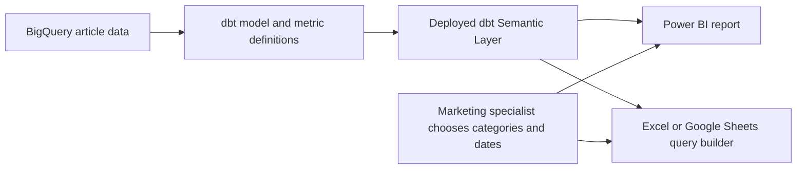
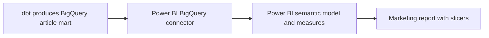

# 07 — Publish dbt metrics to business users

Checked against official documentation on 7 October 2026. Read after lesson 12 of the [semantic models and metrics course](02_SEMANTIC_MODELS_AND_METRICS_COURSE.md). This guide uses your `rss_articles` example and your chosen interfaces: Power BI and Excel/Google Sheets. It is a publication guide; no account, connector or report has been configured here.

## 1. What the marketing specialist receives

Publish an **RSS Content Performance** report or spreadsheet query template. You maintain the model and formulas; the marketer chooses categories and dates through visible controls.

| Control or visual | Suggested business-facing wording | Meaning |
|---|---|---|
| Category selector | Categories | Any modeled category values, with multiple selections |
| Date picker | Publication dates | The publication-day range, with a clearly stated timezone policy |
| Count card | Articles Published | Distinct non-null URLs after the chosen filters |
| Average card | Average Article Length (chars) | Average non-null body length after those filters |
| Trend chart | Articles by Publication Day | Article count by day |
| Breakdown | Articles by Category | Count for each selected category |

The specialist can select Investing and Shares, choose 1–7 October, then change to Property in September. Neither action requires YAML, Jinja or a dbt command. Start with those controls and a short definition beside each metric; keep implementation names out of the normal report flow.



This is the direct Semantic Layer route. Querying an ordinary BigQuery table uses a different route, described in section 6. [Supported integrations](https://docs.getdbt.com/docs/platform-integrations/avail-sl-integrations).

## 2. Prepare the definitions for flexible filtering

Keep `articles_published` unfiltered. Your metric named `articles_published_selected_categories` permanently restricts its result to Investing/Shares; selecting Property in a report cannot override that restriction.

Use the original general count and length metrics under the existing model's `metrics:` list:

```yaml
metrics:
  - name: articles_published
    label: Articles Published
    description: Distinct article URLs in the selected publication period and categories.
    type: simple
    agg: count_distinct
    expr: URL

  - name: avg_article_length
    label: Average Article Length (chars)
    description: Average body character length across the selected model rows with non-null Content.
    type: simple
    agg: average
    expr: length(Content)
```

Replace or reuse existing entries; do not paste a second `metrics:` key or redeclare existing metric names. Your dimension references remain `article__categories` and `article__date_published`. Your `agg_time_dimension: date_published` makes publication time the clock for these metrics; `metric_time` is the common metric clock in consuming queries.

“Whatever filter they want” means **any permitted, modeled dimension exposed by the chosen interface**. Your current model supports categories and publication dates. A publisher or campaign selector needs a real source field, its modeled dimension and a valid relationship to the metrics. A marketing report cannot infer campaign attribution from an article URL alone.

The primary-entity declaration does not remove duplicates. Before release, decide whether repeated URLs are valid source observations or need cleanup. Changing to one row per URL would change your current row-weighted average if duplicate rows exist; reconcile that change with the business definition.

### Offer a focused saved query

This top-level YAML example bundles compatible metrics and dimensions without fixing a category or date selection:

```yaml
saved_queries:
  - name: rss_marketing_overview
    label: RSS Marketing Overview
    description: Publication metrics by day and category for marketing exploration.
    query_params:
      metrics:
        - articles_published
        - avg_article_length
      group_by:
        - "TimeDimension('metric_time', 'day')"
        - "Dimension('article__categories')"
```

A saved query is a convenient curated starting point, not an access-control boundary. Include dimensions the marketer needs to slice. Validate this fragment in your runtime before adopting it. [Saved queries](https://docs.getdbt.com/docs/build/saved-queries).

## 3. Deploy the serving Semantic Layer

Publishing has two parts: deploy the dbt definitions, then distribute the consuming report or workbook.

1. In the actual dbt project, resolve the filter parse error and verify the general metrics. Run parse, semantic validation and representative queries; compare the category/date totals with direct SQL.
2. Commit and merge approved definitions through that project's workflow.
3. Build the required production relations. Run a successful deployment job generating current semantic artifacts. The current dbt deployment guide calls for `dbt parse`; for dbt v2 it additionally specifies `dbt docs generate`. Check the runtime used by your job. [Deploy metrics](https://docs.getdbt.com/docs/use-dbt-semantic-layer/deploy-sl).
4. In dbt project settings, configure the Semantic Layer against the intended deployment environment. Set up read access to its underlying models and an appropriate token/credential mapping. Record the host and Environment ID for BI setup. Confirm the account plan supports the chosen integration. [Administer the Semantic Layer](https://docs.getdbt.com/docs/use-dbt-semantic-layer/setup-sl).
5. Connect the consumer and test the published environment through that interface, including a marketing user account.

This memory repository stores instructions and examples. Pushing this guide does not deploy definitions to the separate `dbt_cert` project or publish a Power BI app. Similarly, a development command succeeding does not prove a report points to the same environment and code version.

## 4. Power BI: a published dashboard with slicers

Use this route when the marketer mainly wants to open a shared report and change filters.

### Connect to dbt metrics

The direct dbt connector is currently **preview**. It uses a custom connector plus ODBC driver, requires **DirectQuery**, and needs an **On-premises Data Gateway** for Power BI Service. Its limitations include unsupported custom DAX, table joins and custom columns.

1. Install the official connector/driver package on the author's computer.
2. In Desktop, choose Get data → dbt Semantic Layer; supply host, Environment ID and the configured token.
3. Select DirectQuery and choose the curated saved-query table or compatible fields from `METRICS.ALL`.
4. Install/configure the connector and driver on the gateway host for Service; map the published connection and require encryption.

dbt calculates the metrics; Power BI aggregation selections do not redefine them. Start with the small RSS query and test every desired visual before accepting this preview route. [Connector instructions and limits](https://docs.getdbt.com/docs/platform-integrations/semantic-layer/power-bi).

### Build the marketing page

Suggested authoring sequence:

1. Add count and average cards using the governed metric fields.
2. Add a category slicer, enable multiple selections and give it a clear title.
3. Add a publication-day/date-range slicer using the available date field. Test custom ranges and any relative-date option against the agreed date definition.
4. Add the daily trend and category breakdown.
5. Configure slicer interactions so both controls filter the intended cards and charts.
6. Test a combined total and every selected category separately. Make sure the total queries the metric at the total's grain rather than summing distinct counts or averaging displayed averages.

These are proposed report design steps. Power BI supplies list/dropdown/date filtering controls, but the connector's supported query shapes still constrain a given visual. [Power BI slicers](https://learn.microsoft.com/en-us/power-bi/visuals/power-bi-visualization-slicers).

### Publish and share the report

Publish to the intended Power BI workspace. Verify its gateway connection, then create a Power BI app containing the report and add the marketing audience. Distribute the app link with viewer access. Normal app consumers can filter and interact without editing the report. Confirm viewer licensing or qualifying capacity; viewing permissions and report-authoring permissions serve different needs. [Publish a Power BI app](https://learn.microsoft.com/en-us/power-bi/collaborate-share/service-create-distribute-apps).

The marketer opens the app, chooses categories and dates, and reads the results. They need neither Power BI Desktop nor dbt commands for this viewing workflow. If they later want to create their own pages and visuals, treat that as a separate authoring requirement.

## 5. Excel and Google Sheets: visual query builders

Use this route when the specialist prefers a workbook and wants to change a query's inputs.

### Excel

Install the official dbt Semantic Layer add-in from Microsoft AppSource for Desktop or Online. Configure host, Environment ID and an approved service or personal token. In its Query Builder:

1. Select Articles Published and optionally Average Article Length.
2. In Group By, select publication day and/or category if a breakdown is needed.
3. Set Time Range to the desired period.
4. In Where, select Categories and the desired values.
5. Run the query into the chosen worksheet cell and save the selection for reuse.

The main Time Range applies to `metric_time`; other time dimensions use Where. Saved selections are workbook-side query inputs, distinct from YAML saved queries. [Excel integration](https://docs.getdbt.com/docs/platform-integrations/semantic-layer/excel).

### Google Sheets

Install Semantic Layer for Sheets and open it from Extensions. Authenticate with the configured host, Environment ID and token. Its Query Builder similarly offers Metrics, Group By, Time Range and Where, with category values selectable from a list. Save a starter selection such as “Articles by day and category”; the specialist changes the period and categories, then reruns it. [Google Sheets integration](https://docs.getdbt.com/docs/platform-integrations/semantic-layer/gsheets).

A returned cell range is a query result. Filtering those cells or a pivot after the query is different from sending a new filter to dbt. For a new total or date/category selection, rerun the Semantic Layer query. Do not average averages in the spreadsheet or sum subgroup distinct counts unless their mathematical conditions are satisfied. The query interface should supply the requested total itself.

Provision approved connection identities; do not place a privileged token in a visible cell or the repository. Sharing workbook results can disclose data even when the recipient cannot authenticate to run another query. Review workbook sharing separately from connector access.

## 6. If the direct Power BI connector is unsuitable

There are two alternatives; both can offer the same visible category/date controls.

### A. Ordinary BigQuery article mart plus Power BI measures



The standard BigQuery connector supports Import and DirectQuery. Connect to a tested article relation, include its category and publication date, and use a numeric `article_length_chars` derived upstream from the same Content expression. [Microsoft BigQuery connector](https://learn.microsoft.com/en-us/power-query/connectors/google-bigquery).

Example measures for the ordinary Power BI model, assuming a table renamed `RSS Articles`:

```dax
Articles Published = DISTINCTCOUNTNOBLANK('RSS Articles'[URL])

Average Article Length (chars) = AVERAGE('RSS Articles'[article_length_chars])
```

`DISTINCTCOUNTNOBLANK` excludes BLANK; `AVERAGE` ignores blank numeric values but includes zero. Match row selection, text/null transformations and date behavior before claiming parity with your dbt metrics. Empty-result presentation also needs explicit agreement. [Distinct count without blanks](https://learn.microsoft.com/en-us/dax/distinctcountnoblank-function-dax), [DAX average](https://learn.microsoft.com/en-us/dax/average-function-dax).

This approach maintains calculations in Power BI. It does **not** invoke the dbt Semantic Layer merely because dbt built the underlying table. Use reconciled definitions and change control to prevent the two copies drifting. These DAX examples belong only to the ordinary BigQuery route, not to the constrained direct Semantic Layer connector.

### B. Export metric results to BigQuery

An export writes a defined metric query into a warehouse relation that ordinary BI tools can read. [Exports](https://docs.getdbt.com/docs/use-dbt-semantic-layer/exports).

Design the export around the intended dimensions, grain and refresh schedule. Exporting daily/category distinct counts and averages does not preserve enough information to recompute every arbitrary total. Average reconstruction needs the matching numerator and denominator; exact distinct-count reconstruction may require article-level identity. Therefore a preaggregated export is useful for a bounded report, but should not be promised as universal exploration.

## 7. Handoff and acceptance

For your chosen interfaces, my suggested starting point is a spreadsheet pilot of the governed metrics, plus a Power BI proof of concept if the organization accepts the connector preview and gateway requirements. If the production report requires normal Power BI relationships/custom DAX, assess the ordinary BigQuery route with explicit parity checks instead. This recommendation follows the requirements here; existing licenses, account entitlements and IT constraints have not been inspected.

Before releasing either interface, verify:

| Scenario | Evidence to capture |
|---|---|
| Investing/Shares, 1–7 October | Same filtered distinct-URL count as the engineer's SQL |
| Property, same period | Selection works on the unfiltered metric |
| Combined versus category totals | Correct non-additive total, including duplicate URLs across categories |
| Date boundary, null categories/content | Documented inclusion and empty-result policy |
| Published marketing identity | Correct access and same deployed definitions as the test |
| Data changes or deployment update | Confirmed freshness/refresh behavior and current definition |
| Connector or query failure | User-facing error and a named support owner |

A report filter or saved query is not row-level security. Confirm the effective warehouse/connector identity: a shared service credential does not automatically impersonate each report viewer. If access varies between people, implement and test the supported authorization path, including exports/caches if used.

Give the marketer the report/workbook link, definitions, date policy, a freshness explanation and a support contact. A live query reads the currently available modeled data; it does not trigger source ingestion or a dbt build. A successful Git push is publication of code or documentation, while release to the marketer additionally requires successful deployment, connector setup and sharing.

## Official references

The linked pages beside each step are the primary references. Begin with [Semantic Layer administration](https://docs.getdbt.com/docs/use-dbt-semantic-layer/setup-sl), [metric deployment](https://docs.getdbt.com/docs/use-dbt-semantic-layer/deploy-sl), and the connector page for [Power BI](https://docs.getdbt.com/docs/platform-integrations/semantic-layer/power-bi), [Excel](https://docs.getdbt.com/docs/platform-integrations/semantic-layer/excel), or [Google Sheets](https://docs.getdbt.com/docs/platform-integrations/semantic-layer/gsheets). Recheck preview status and runtime support before implementation.
