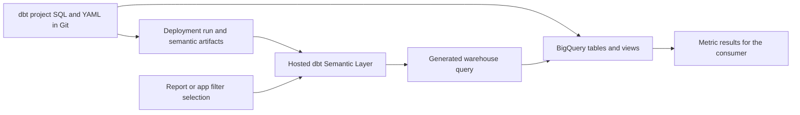
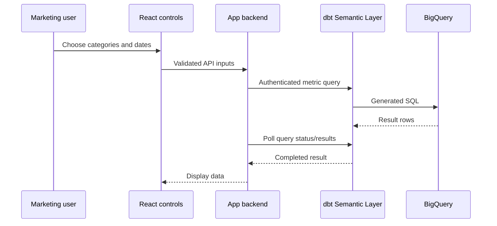

# 08 — Connect the dbt Semantic Layer to six interfaces

Checked on **7 October 2026**. Start with the common setup, then follow the section for your chosen interface. This extends [07 — Publish to business users](07_PUBLISH_TO_BUSINESS_USERS.md) with connection steps, storage locations, Tableau, Data Studio and a custom React/API example. No live account or connector has been configured by these materials.

Start with [storage locations](#a-where-are-the-model-and-metrics-saved) and [common setup](#b-common-setup-do-this-once), then choose [Power BI](#c-power-bi), [Excel](#d-excel), [Google Sheets](#e-google-sheets), [Tableau](#f-tableau), [Data Studio](#g-data-studio) or [React/API](#h-custom-website-react--backend--dbt-api).

## A. Where are the model and metrics saved?

Separate **definitions**, **deployed metadata**, **the serving service** and **data/results**:

| Item | Where it lives | Your RSS example |
|---|---|---|
| SQL model definition | `.sql` file in the actual dbt project, versioned in Git | `fei_rss_source_brz.sql` |
| Semantic model and metric definitions | YAML within the dbt project's configured model paths, versioned in Git | Entities/dimensions for `rss_articles`; `articles_published` and `avg_article_length` |
| Parsed semantic metadata | Generated dbt artifacts; locally in the configured target directory, and in deployment-run artifacts | `target/semantic_manifest.json`; `osi_document.json` where supported |
| Hosted Semantic Layer | dbt's service configured for your deployment environment | Receives metric requests and plans the warehouse queries |
| Physical model rows | Warehouse tables/views built by dbt | The resolved BigQuery relation for `fei_rss_source_brz` |
| Metric answer | A query result delivered to the consumer; optionally cached/exported | A count for a chosen category/date selection |
| Report or query selection | The consuming platform | Power BI report, Tableau workbook, spreadsheet selection or React controls |

`semantic_manifest.json` is generated metadata, not a table of article counts. From v1.12 the documentation also describes `osi_document.json` in the target directory. Treat artifacts as generated files: edit YAML, then regenerate/deploy; do not hand-edit the manifest. [Semantic manifest and Ossie artifact](https://docs.getdbt.com/reference/artifacts/sl-manifest).

The service uses deployed semantic metadata to generate SQL against warehouse relations. `rss_articles` does not automatically become a BigQuery table named `rss_articles`, and declaring a metric does not automatically save its computed values in a permanent warehouse table. Explicit exports can persist selected results. [Architecture](https://docs.getdbt.com/docs/use-dbt-semantic-layer/sl-architecture), [exports](https://docs.getdbt.com/docs/use-dbt-semantic-layer/exports).

For this project, the actual dbt YAML belongs in the separate connected **dbt project**, not merely in `MDLM_CODEX_MEMORY`. An illustrative co-located path is `models/Bronze/fei_rss_source_brz.yml`; the actual existing filename and physical BigQuery relation have not been inspected here. This repo contains your course and examples.



## B. Common setup: do this once

### Step 1 — Confirm the hosting and permissions

Use a dbt account supporting hosted Semantic Layer integrations, a supported runtime and an administrator able to configure the project. Confirm the consuming-tool licenses and connector installation permissions. These hosted connections are distinct from running local MetricFlow on an ordinary dbt Core project. [Hosted versus local components](https://docs.getdbt.com/docs/use-dbt-semantic-layer/sl-architecture).

### Step 2 — Save the general RSS definitions

Within your existing model YAML, reuse the declared `article` entity, `categories` categorical dimension, `date_published` time dimension and these unfiltered metrics:

```yaml
metrics:
  - name: articles_published
    label: Articles Published
    type: simple
    agg: count_distinct
    expr: URL

  - name: avg_article_length
    label: Average Article Length (chars)
    type: simple
    agg: average
    expr: length(Content)
```

Merge these into the existing `metrics:` list. Avoid duplicate names or a second list key. Keep the fixed Investing/Shares metric only as a separate specialized option. An arbitrary category selector needs the general metric.

### Step 3 — Validate the contract

Confirm publication-date type/timezone and whether each URL represents one article. Your commented-out URL tests do not establish uniqueness. Parse/validate and reconcile one date/category selection with SQL. For example:

```shell
dbt parse
dbt sl validate
dbt sl query --metrics articles_published,avg_article_length --where "{{ Dimension('article__categories') }} IN ('Investing', 'Shares') AND {{ TimeDimension('article__date_published', 'day') }} >= '2026-10-01' AND {{ TimeDimension('article__date_published', 'day') }} < '2026-10-08'"
```

Use your environment's available commands; this does not claim live validation. See [course lesson 8](02_SEMANTIC_MODELS_AND_METRICS_COURSE.md#lesson-8--query-and-reconcile-your-metrics) for grouping and date-boundary explanations.

### Step 4 — Deploy definitions and build dependencies

Commit/merge the actual dbt project changes. Use the intended deployment environment and run its job to generate current semantic artifacts; ensure underlying relations are built. The deployment guide specifies `dbt parse` and additionally `dbt docs generate` for dbt v2. A Git merge alone does not refresh the served metadata. [Metric deployment](https://docs.getdbt.com/docs/use-dbt-semantic-layer/deploy-sl).

### Step 5 — Configure the serving environment

In dbt: Account settings → Projects → your project → Semantic Layer → Configure Semantic Layer. Select the deployment environment, add an appropriate warehouse credential, and map an approved service token. The documented service-token permissions are Semantic Layer Only and Metadata Only; personal-token connections are another supported identity path. [Administration](https://docs.getdbt.com/docs/use-dbt-semantic-layer/setup-sl).

### Step 6 — Record the connection details

| Value | Use |
|---|---|
| Host | The connector host from project Semantic Layer settings |
| Environment ID | Identifies the served deployment environment, not the Git project ID |
| Token | Authentication secret stored in the connector/backend credential store |
| GraphQL URL | Full API endpoint for custom app calls, including `/api/graphql` |
| Warehouse relation | Resolved production data location for reconciliation |

Do not derive the dbt API region from BigQuery's location or your residence. Copy the account's actual connection details. Keep the token out of Git and browser code.

### Step 7 — Offer a curated query

The `rss_marketing_overview` saved query in [guide 07](07_PUBLISH_TO_BUSINESS_USERS.md#offer-a-focused-saved-query) bundles the two metrics with day/category dimensions. Deploy it if you want a focused entry point. A saved query limits the query shape, not the user's underlying permissions. [Saved-query configuration](https://docs.getdbt.com/docs/build/saved-queries).

## C. Power BI

For the sales/product model and detailed date/brand/category slicer steps, use [11 — Power BI connection and user slicers](11_POWER_BI_CONNECTION_AND_SLICERS.md).

For execution location and storage-mode tradeoffs, read [where calculations run: DirectQuery versus Import](07_PUBLISH_TO_BUSINESS_USERS.md#where-calculations-run-directquery-versus-import). The direct dbt route uses DirectQuery; importing article rows or exported results creates a different calculation/storage path. Current dbt Semantic Layer platform support excludes Fabric.

### Connect the authoring computer

1. Obtain the official installer from the [dbt connector page](https://docs.getdbt.com/docs/platform-integrations/semantic-layer/power-bi).
2. Install its ODBC driver and custom connector; verify both are registered.
3. Open Power BI Desktop → Get data → dbt Semantic Layer.
4. Enter Host and Environment ID; choose **DirectQuery** and authenticate with the approved token.
5. Select `rss_marketing_overview` or compatible fields from `METRICS.ALL`.

This connector is **preview**. Custom DAX, table joins and custom columns are unsupported; Import is not its native mode. Pilot required query shapes before choosing it for production. [Connector status and restrictions](https://docs.getdbt.com/docs/platform-integrations/semantic-layer/power-bi).

### Build the report

6. Add Articles Published and Average Article Length cards.
7. Add a multi-select category slicer and a publication-date range slicer.
8. Add a daily trend; set visual interactions so both slicers filter the cards/chart.
9. Compare total, daily and category results with the engineer's reference query. [Slicer controls](https://learn.microsoft.com/en-us/power-bi/visuals/power-bi-visualization-slicers).

### Publish

10. Have IT install the connector/driver on an On-premises Data Gateway and activate the custom connector.
11. Publish to the intended workspace. In Service, map the gateway connection with the same host/environment and enable encryption.
12. Publish a Power BI app for the marketing audience; verify viewer licensing/capacity and the final viewer experience. [Power BI app publication](https://learn.microsoft.com/en-us/power-bi/collaborate-share/service-create-distribute-apps).

If the gateway or preview restrictions do not fit your organization, use guide 07's ordinary BigQuery/Power BI alternative with separately maintained measures. It is a different calculation path.

## D. Excel

1. Confirm Excel Desktop or Online and permission to install the add-in.
2. Follow the AppSource link on the [official Excel integration page](https://docs.getdbt.com/docs/platform-integrations/semantic-layer/excel).
3. Open the add-in and configure Host, Environment ID and an approved token.
4. Choose a blank output cell in a dedicated worksheet.
5. In Metrics, choose Articles Published and Average Article Length.
6. Leave Group By empty for a combined total; select category or day for a breakdown.
7. Choose the publication period using Time Range, which applies to `metric_time`.
8. In Where, select Categories and choose Investing/Shares from the available values.
9. Run the query and compare it with the reference count.
10. Use Query & Save Selection to retain the inputs. Change them and rerun when needed.
11. Share the workbook with the marketing audience and provision permitted query access for people who need to refresh it.

The worksheet saves returned values; the add-in saves selections. Neither moves the metric's authoritative YAML definition into Excel. Do not obtain a new overall average by averaging the returned category averages. [Excel query-builder and saved-selection behavior](https://docs.getdbt.com/docs/platform-integrations/semantic-layer/excel).

## E. Google Sheets

1. Confirm the Google account can install add-ons.
2. Use the installation link from the [Google Sheets integration page](https://docs.getdbt.com/docs/platform-integrations/semantic-layer/gsheets).
3. Open Extensions → Semantic Layer for Sheets and configure the account's host, Environment ID and approved token.
4. Choose an output cell and open the Query Builder.
5. Select the two general metrics, optionally category/day groupings.
6. Set Time Range; use Where to select categories.
7. Run the query and compare it with the same reference query.
8. Save the selection so the marketer can reopen and change it.
9. Share the sheet with the intended audience; test a recipient who needs to query again.

The main Time Range acts on `metric_time`; use Where for another modeled time dimension. Filtering cells after a query does not send a new request to dbt. If IP allowlisting is used, follow the integration's Google-network requirements. [Google Sheets setup and filtering](https://docs.getdbt.com/docs/platform-integrations/semantic-layer/gsheets).

## F. Tableau

1. Confirm Tableau Desktop/Server/Cloud and the deployment identity.
2. Follow the [dbt Tableau connector instructions](https://docs.getdbt.com/docs/platform-integrations/semantic-layer/tableau) or [Tableau Exchange listing](https://exchange.tableau.com/products/1020).
3. For Desktop/Server, install the connector and JDBC driver in the documented folders; restart Tableau. Cloud's connector is managed by Tableau.
4. Select Semantic Layer by dbt Labs; enter the account host, Environment ID and approved token.
5. Select a saved-query source or `ALL`. Use a **live connection**; extracts are unsupported.
6. Open a worksheet; place the metric and publication-day/category dimensions on the view.
7. Add category and date filters, then show their controls in the dashboard.
8. Validate the resulting metric queries. Do not assume Tableau's displayed SUM label changes the YAML aggregation; dbt controls the formula.
9. Publish the workbook to Server/Cloud, configure permitted connection access and grant marketing viewers access. [Workbook publication](https://help.tableau.com/current/pro/desktop/en-us/publish_workbooks_howto.htm).

Check totals carefully for count-distinct/average metrics. The integration has restrictions on calculated fields, joins and time operations; use only supported query combinations. [Tableau limitations](https://docs.getdbt.com/docs/platform-integrations/semantic-layer/tableau).

## G. Data Studio

Google's current documentation says the product returned from Looker Studio to the name **Data Studio** in April 2026. Older Looker Studio URLs redirect. [Current name](https://docs.cloud.google.com/data-studio/welcome).

I did not find Data Studio in the current [dbt direct integration catalogue](https://docs.getdbt.com/docs/platform-integrations/avail-sl-integrations). Treat the following as a **BigQuery consumption route**, not a documented native dbt connector. A custom community connector is possible development work, discussed below.

### Route 1 — Article rows for flexible filtering

1. Build a tested BigQuery article relation with URL, Categories, a DATE publication field and numeric `article_length_chars` derived using the intended body-length expression.
2. Confirm its grain and preserve the intended duplicate/null behavior.
3. Give the connection identity data-read and query-job permission, with a configured billing project.
4. In Data Studio, Create → Report → Add data → BigQuery.
5. Choose project, dataset and relation; choose an appropriate owner/viewer/service-account credentials mode.
6. Add the data source. Check date and numeric field types. [BigQuery connection](https://docs.cloud.google.com/data-studio/connect-to-google-bigquery).
7. Define the report count with `COUNT_DISTINCT(URL)` and length with `AVG(article_length_chars)`; reconcile them with dbt. These are separately maintained report calculations, not a call to the YAML metrics. [Count-distinct reference](https://docs.cloud.google.com/data-studio/countdistinct).
8. Add a category dropdown, set its control field to Categories and enable the desired selections. [Dropdown controls](https://docs.cloud.google.com/data-studio/drop-down-list-and-fixed-size-list-control).
9. Add a date-range control and set the charts' date-range dimension to the publication date. [Date-range control](https://docs.cloud.google.com/data-studio/date-range-control).
10. Test the same date/category selection, then share the report with viewer access. State source freshness and report caching behavior.

This route permits exact distinct-URL calculations from the selected rows. It still requires parity checks for source transformations, null handling and dates.

### Route 2 — Export actual dbt metric results

For a bounded report, add a top-level saved query and export:

```yaml
saved_queries:
  - name: rss_marketing_daily_categories
    label: RSS Marketing Daily Categories
    description: Daily category metric results for a bounded exported report.
    query_params:
      metrics:
        - articles_published
        - avg_article_length
      group_by:
        - "TimeDimension('metric_time', 'day')"
        - "Dimension('article__categories')"
    exports:
      - name: rss_marketing_daily_categories_export
        config:
          export_as: table
          alias: rss_marketing_daily_categories
```

1. Validate and deploy the saved query in the actual dbt project.
2. In a supported platform workflow, run `dbt sl export --saved-query rss_marketing_daily_categories` and confirm its resolved BigQuery output location. Run `dbt sl export --help` for the installed runtime.
3. Configure export refresh after the source/model updates.
4. Connect Data Studio to that output relation using the BigQuery steps above. [Export execution](https://docs.getdbt.com/docs/use-dbt-semantic-layer/exports).

The exported daily/category answers are already aggregated. They can support those exact cells but **cannot automatically be reaggregated into arbitrary correct totals**. Averages need numerator/denominator support; distinct counts need an appropriate identity/disjointness contract. If the same URL appears in two exported groups, summing their counts overstates the combined distinct count. Do not publish an arbitrary-date total card on this export without redesigning/reconciling its aggregation. For unconstrained exploration, prefer the article-row route or a tested query-time integration.

### Optional custom community connector

A direct integration would require an Apps Script community connector implementing authentication, `getConfig`, `getSchema` and `getData`. It must translate requested fields/date ranges/filters into dbt API requests and return the expected schema/rows. Handling unsupported filter pushdown locally must preserve metric semantics; returning preaggregated numbers and letting the report freely recompute them is insufficient. This is a connector project, not a built-in setting. [Community connector development](https://developers.google.com/data-studio/connector/build).

## H. Custom website: React → backend → dbt API

### Step 1 — Use an API backend



The browser should know your application API, not the dbt service token. React handles controls/rendering; a Node, Next.js, Python or other backend handles authentication and metric requests. The accompanying example uses Node plus Vite/React.

### Step 2 — Confirm the GraphQL endpoint and schema

Copy the GraphQL URL from your dbt account settings. The documented multi-tenant APAC example is `https://semantic-layer.au.dbt.com/api/graphql`; it is not proof that your account uses that endpoint. Open the account's schema explorer and confirm `createQuery`, `query`, `MetricInput`, `GroupByInput` and `WhereInput` for the deployed service. Use a backend Authorization Bearer header plus the serving Environment ID. [GraphQL API](https://docs.getdbt.com/docs/dbt-apis/sl-graphql).

### Step 3 — Understand the query lifecycle

The backend creates a metric query, receives its query ID, polls until SUCCESSFUL/FAILED, and decodes result pages. The example uses unencoded table-oriented JSON for a small pilot; Arrow is the documented default and is preferable for larger integrations. It independently queries the combined total rather than deriving it from chart rows. [Query lifecycle and result formats](https://docs.getdbt.com/docs/dbt-apis/sl-graphql).

Example browser request to **your backend**:

```json
{
  "categories": ["Investing", "Shares"],
  "startDate": "2026-10-01",
  "endDate": "2026-10-07",
  "breakdown": "daily"
}
```

In this example `endDate` is inclusive; the backend converts it to an exclusive 8 October bound. An empty category list means all categories, including uncategorized rows if present. Only modeled publication-day semantics apply; this does not invent a timestamp timezone conversion.

### Step 4 — Run the backend locally

Use [the example folder](examples/rss-semantic-api/README.md). It contains a Node HTTP server, a dbt GraphQL client, a React component, Vite proxy configuration and offline tests. Node 24 was used for the local checks.

In that folder:

```powershell
Copy-Item .env.example .env.local
```

Edit the **backend-only** `.env.local` with your approved endpoint, Environment ID and token. The example ignores this file in Git. Then:

```powershell
node --env-file=.env.local server.mjs
```

The server binds only to `127.0.0.1:3001`. It validates date ranges/categories, restricts metric names and never accepts arbitrary SQL from the browser. It exposes GET `/api/categories` and POST `/api/rss-metrics`. The category list uses your supplied labels; update it from a controlled metadata/value query when the real category vocabulary changes.

### Step 5 — Create the React client

In a separate working folder, scaffold Vite React:

```shell
npm create vite@latest rss-marketing -- --template react
cd rss-marketing
npm install
```

Replace `src/App.jsx` with the example's [App.jsx](examples/rss-semantic-api/App.jsx), and the project-root Vite configuration with [vite.config.js](examples/rss-semantic-api/vite.config.js). It proxies `/api` to the local backend. Start it:

```shell
npm run dev
```

Open the local URL shown by Vite and choose categories/dates. The app renders count/average totals and either daily or category rows. It is a minimal functional teaching interface, not a finished production website. [Vite setup](https://vite.dev/guide/), [React state](https://react.dev/reference/react/useState).

### Step 6 — Verify behavior

Compare the page's combined total and breakdown against the command from common step 3. Then test Property, all categories, empty results and date boundaries. Offline tests exercise input rejection, polling, pagination and independent totals; they do not establish a successful dbt API connection.

### Step 7 — Prepare an actual deployment

Add your organization's user authentication and per-user/team authorization before exposing the backend. Put it behind HTTPS, store tokens in a server secret manager, constrain request concurrency/rates and review effective warehouse identity. Serve frontend/API under an approved origin; replace the development proxy/loopback setup with the actual routing.

The prototype allows at most 366 days and 400 result rows per query, with a bounded polling deadline. A timeout does not necessarily cancel an upstream warehouse query. Agree operational limits and recovery behavior before increasing them. Request updated metric results from dbt; do not introduce independent browser formulas for total averages/distinct counts.

## I. Checks after every connection

| Check | Passing evidence |
|---|---|
| Correct deployment | Host, Environment ID and deployed commit are the intended ones |
| Correct metric | General metric supports Property as well as Investing/Shares |
| Date semantics | 1–7 October matches the reference >= 1 October, < 8 October query |
| Combined totals | Metric queried at the requested grain, not added-up distincts/averages |
| Access | Intended marketing identity can query only permitted data |
| Freshness | Source ingestion, dbt build, export/report cache timings are explained separately |
| Errors | Query/connector failures have a support owner and useful sanitized diagnostics |

For a stale/missing metric, check the deployment job and environment before changing report calculations. For dbt1005 on Categories, use `article__categories`, not the physical column name. For unsupported fields, discover the metric's available dimensions; all fields in a catalogue are not necessarily compatible. A dropdown is a query filter, not row-level security.

## J. What has been verified here

Official references were checked for hosting/artifacts/deployment, all four direct connectors, Data Studio's BigQuery route and the GraphQL API. The supplied app has local offline checks; no live credentials were used. YAML fragments are examples to merge into the real project, not an automatically deployed production config. No dbt build/parse/API call, connector installation, cloud report/workbook publication, Apps Script connector or website deployment was performed.

Local verification passed six Node tests, backend/client syntax checks, Markdown links/fences and YAML/JSON example parsing with duplicate YAML keys rejected. The React source was reviewed; no frontend dependency installation or production build was performed.
