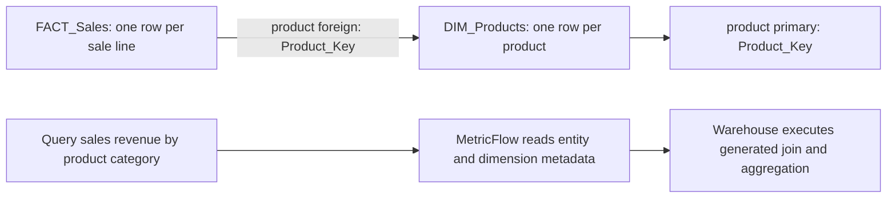

# 10 — Aggregations, entities and star schemas

Checked **8 October 2026**. This answers your Power BI comparison: you can keep fact and dimension relations separate and declare shared entities in YAML. MetricFlow can generate the join when a metric query requires a dimension attribute. Prejoining in SQL is another valid design; it is not a prerequisite for every metric. [dbt join logic](https://docs.getdbt.com/docs/build/join-logic).

Read with course [lesson 4, components](02_SEMANTIC_MODELS_AND_METRICS_COURSE.md#lesson-4--entities-dimensions-measures-and-metrics), [lesson 9, metric types](02_SEMANTIC_MODELS_AND_METRICS_COURSE.md#lesson-9--the-five-metric-types) and [lesson 11, joins](02_SEMANTIC_MODELS_AND_METRICS_COURSE.md#lesson-11--join-semantic-models-without-inflating-results).

## 1. Entity, dimension and metric

| Concept | Meaning | Product/sales example | RSS example |
|---|---|---|---|
| Entity | Business-object identity used to describe semantic join keys | `product` identified by Product_Key | `article` identified by URL |
| Dimension | Attribute used to group/filter a metric | Product_Name, Category, Sale_Date | Categories, Date_Published |
| Simple metric | An aggregation over a model expression | Sum of Sales_Amount | Distinct count of URL |
| Advanced metric | Calculation based on other metrics or events/time | Average order value, rolling sales | Category share, rolling publication count |

A **dimension table** is a relation containing keys and attributes. A **dbt semantic dimension** is an individual attribute. Thus DIM_Products normally contains one product entity and multiple semantic dimensions; it is not itself a single dimension attribute. Attributes can also live on a fact table. [Entities](https://docs.getdbt.com/docs/build/entities), [dimensions](https://docs.getdbt.com/docs/build/dimensions).

## 2. Entity types

| `entity.type` | Intended data contract | Typical use |
|---|---|---|
| `primary` | Unique, non-null key at the model's declared grain | Product_Key on DIM_Products; Sale_Line_Key on FACT_Sales |
| `foreign` | Reference to another object's key; may repeat and be null | Product_Key on FACT_Sales |
| `unique` | Non-null values are unique; nulls are permitted | Alternate unique join key |
| `natural` | Business key used with SCD Type II validity modeling | Product business ID repeated across historical versions |

`natural` has a specific SCD Type II role in dbt; it is not a general replacement for every business identifier. A current product table with one row per key typically declares `primary`. These annotations do not enforce warehouse constraints or deduplicate bad data. [Entity types](https://docs.getdbt.com/docs/build/entities).

## 3. Dimension types

| `dimension.type` | Meaning | Example |
|---|---|---|
| `categorical` | Discrete attributes for selection/grouping, including labels, flags and suitable numeric codes | Category, Product_Name, Region, Is_Return |
| `time` | Analytical dates/timestamps with a declared grain | Sale_Date at day grain |

Column SQL type and semantic role are separate. A numeric product key identifies a product; a numeric sales amount is typically an aggregation input. A postcode can be categorical even when stored numerically. A day-grain time dimension supports day and coarser periods; it cannot supply missing hourly detail. [Dimension types and grain](https://docs.getdbt.com/docs/build/dimensions).

## 4. Simple metric aggregations

The latest simple-metric reference lists these `agg` values:

| `agg` | Operation | Example expression/use |
|---|---|---|
| `sum` | Add values | `Sales_Amount`: total revenue |
| `average` | Mean of non-null values | `Sales_Amount`: average line revenue |
| `min` | Smallest non-null value | `Sales_Amount`: smallest line |
| `max` | Largest non-null value | `length(Content)`: longest stored body |
| `count` | Count non-null expression values | `expr: 1` for rows; `expr: URL` for non-null URL rows |
| `count_distinct` | Count distinct non-null expression values | `Order_Key`: distinct orders |
| `median` | Middle-value calculation | `Sales_Amount`: median line value |
| `percentile` | Selected percentile | 95th-percentile line value |
| `sum_boolean` | Sum Boolean values, counting true cases | A Boolean `Is_Return` expression |

Use the documented names (`average`, for example) and confirm aggregation support for the chosen runtime/warehouse. Expressions can contain row-level SQL such as `Quantity * Unit_Price` or `CASE WHEN ... THEN ... END`. An expression is evaluated before its aggregation; an advanced calculation between aggregated metrics belongs in a derived/ratio metric. [Simple metrics](https://docs.getdbt.com/docs/build/simple), [aggregation descriptions](https://docs.getdbt.com/docs/build/measures).

Latest-format percentile example, inside a model's metrics list:

```yaml
- name: demo_p95_sales_line_value
  label: 95th Percentile Sales Line Value
  type: simple
  agg: percentile
  expr: Sales_Amount
  percentile: 95
  percentile_type: continuous
```

This uses the latest 0–100 percentile field and continuous/discrete setting. Legacy measure syntax uses `agg_params` and a 0–1 fraction; do not mix the two formats. [Latest metric specification](https://docs.getdbt.com/docs/build/metrics-overview), [legacy measures](https://docs.getdbt.com/docs/build/measures).

NULL and grain rules matter: count/distinct count ignore null inputs; average is not automatically divided by distinct entities; SUM/AVG/MIN/MAX ignore null inputs rather than replacing them with zero. Duplicate rows can inflate additive/average metrics even when a distinct count looks correct. Percentiles and averages cannot simply be summed or averaged across groups to recover a total.

## 5. Metric types versus aggregation types

| `metric.type` | Calculation pattern | Example |
|---|---|---|
| `simple` | Aggregate a model expression, optionally filtered | Total sales: `agg: sum` |
| `ratio` | Divide two metric results | Average order value = revenue / distinct orders |
| `derived` | Expression over input metric results | Gross profit = revenue − cost |
| `cumulative` | Evaluate an input metric over a rolling/accumulating period | Rolling seven-day sales or sales year-to-date |
| `conversion` | Match a base event to a later conversion event for an entity | Visitors purchasing within seven days |

`simple` is a metric type; `sum` is its aggregation. Cumulative/conversion types are more than ordinary SUM or a general SQL filter: time spines, entity/event grain, periods and supported configuration must be designed. Your RSS table has article publication events; it does not by itself contain visitor/purchase events for a genuine conversion metric. [Metric types](https://docs.getdbt.com/docs/build/metrics-overview), [ratio](https://docs.getdbt.com/docs/build/ratio), [derived](https://docs.getdbt.com/docs/build/derived), [cumulative](https://docs.getdbt.com/docs/build/cumulative), [conversion](https://docs.getdbt.com/docs/build/conversion).

## 6. Map your Power BI star schema to dbt

| Power BI concept | dbt equivalent for this use case |
|---|---|
| Physical FACT_Sales and DIM_Products | Two dbt SQL models producing separate warehouse relations |
| DIM_Products[Product_Key] is the one side | `product` entity with `type: primary` on the dimension |
| FACT_Sales[Product_Key] is the many side | Same `product` entity name with `type: foreign` on the fact |
| Product/category fields on report axes/slicers | Semantic dimensions on the product model |
| A DAX measure such as SUM(Sales_Amount) | A simple metric defined against the fact model |
| Query-time relationship use | MetricFlow chooses a compatible path and generates warehouse SQL |

This is a useful mapping, not an assertion that dbt offers every DAX, bidirectional-filter or many-to-many relationship feature. dbt's semantic graph and join rules determine the available query paths. Its YAML supplies metadata; YAML does not itself store or execute the joined rows. [Semantic graph versus build DAG](https://docs.getdbt.com/docs/build/about-metricflow).



## 7. Keep facts and dimensions separate: complete YAML example

Assume the fact contains Sale_Line_Key, Order_Key, Product_Key, Sale_Date, Quantity and Sales_Amount. The dimension contains Product_Key, Product_Name, Category and Brand. The two SQL models must already produce these fields and compatible key types; they do not need to join to each other beforehand.

The standalone example uses suffixed names to avoid colliding with your real models. Its YAML is [sales_products.yml](examples/sales-products-star/sales_products.yml). Here is the complete semantic configuration:

```yaml
version: 2
models:
  - name: fct_sales_semantic_demo
    semantic_model:
      enabled: true
      name: sales_demo
    agg_time_dimension: sale_date
    columns:
      - name: Sale_Line_Key
        data_tests: [not_null, unique]
        entity:
          name: sale_line
          type: primary
      - name: Product_Key
        data_tests:
          - not_null
          - relationships:
              arguments:
                to: ref('dim_products_semantic_demo')
                field: Product_Key
        entity:
          name: product
          type: foreign
      - name: Sale_Date
        granularity: day
        dimension:
          name: sale_date
          type: time
    metrics:
      - name: demo_sales_revenue
        label: Sales Revenue
        type: simple
        agg: sum
        expr: Sales_Amount
      - name: demo_units_sold
        label: Units Sold
        type: simple
        agg: sum
        expr: Quantity
      - name: demo_distinct_sales_orders
        label: Sales Orders
        type: simple
        agg: count_distinct
        expr: Order_Key
      - name: demo_average_order_value
        label: Average Order Value
        type: ratio
        numerator: demo_sales_revenue
        denominator: demo_distinct_sales_orders

  - name: dim_products_semantic_demo
    semantic_model:
      enabled: true
      name: products_demo
    columns:
      - name: Product_Key
        data_tests: [not_null, unique]
        entity:
          name: product
          type: primary
      - name: Product_Name
        dimension:
          name: product_name
          type: categorical
      - name: Category
        dimension:
          name: category
          type: categorical
      - name: Brand
        dimension:
          name: brand
          type: categorical
```

Both keys share the **entity name `product`**. That is how the semantic graph recognizes the business relationship; matching physical column names alone is insufficient. The physical keys could have different names if each is mapped to the shared entity. The product relation has no metrics here, so it needs no invented sale-date default. [Semantic model specification](https://docs.getdbt.com/docs/build/semantic-models).

The `relationships` data test checks references; it does not define the semantic join. The entity declarations define semantic key roles. `primary`/`foreign` metadata alone does not verify actual data correctness.

Ask for sales by product category:

```shell
dbt sl query --metrics demo_sales_revenue,demo_units_sold,demo_distinct_sales_orders,demo_average_order_value --group-by product__category
```

For an ungrouped sales total, the product attributes are unnecessary. Requesting `product__category` makes the related product dimension relevant. One equivalent dbt SQL calculation is:

```sql
select
    p.Category,
    sum(s.Sales_Amount) as revenue,
    sum(s.Quantity) as units,
    count(distinct s.Order_Key) as orders,
    safe_divide(sum(s.Sales_Amount), count(distinct s.Order_Key)) as average_order_value
from {{ ref('fct_sales_semantic_demo') }} s
left join {{ ref('dim_products_semantic_demo') }} p
    on s.Product_Key = p.Product_Key
group by p.Category
```

This is reconciliation SQL for BigQuery. MetricFlow can produce more elaborate SQL; the semantic intent is the same. A ratio calculates from the aggregated numerator/denominator, not from a precomputed average of row prices.

### Dynamic date and brand filters in the command

Keep `demo_sales_revenue` as the general metric and supply selections with `--where`. These filters apply for that query; they do not rewrite the metric YAML. A query filter adds to any permanent metric filter rather than overriding it. The current platform command reference marks `--start-time`/`--end-time` unavailable for dbt platform/dbt v2, so these examples use `--where`. [MetricFlow commands](https://docs.getdbt.com/docs/build/metricflow-commands).

**1. Sales after 30 June 2026, grouped by product category:**

```bash
dbt sl query --metrics demo_sales_revenue --group-by product__category --where "{{ TimeDimension('sale_line__sale_date', 'day') }} > '2026-06-30'"
```

`Sale_Date` is a DATE at day grain here. Strictly after 30 June means 1 July onward. Use `>= '2026-06-30'` instead if you want to include 30 June. The `sale_line` prefix is the fact's primary entity; `sale_date` is the semantic alias, not the physical `Sale_Date` name.

**2. Sales for either Coca Cola or Pepsi, grouped by product category:**

```bash
dbt sl query --metrics demo_sales_revenue --group-by product__category --where "{{ Dimension('product__brand') }} IN ('Coca Cola', 'Pepsi')"
```

`IN` means either brand. One row's single Brand value cannot equal both names at once. `product__brand` uses the product entity and brand alias; Brand does not have to appear in `--group-by` to filter it. This is exact value membership: inspect whether your source stores `Coca Cola`, `Coca-Cola`, or another spelling/case, and use its actual value.

**3. Both selections: Coca Cola or Pepsi sales after 30 June:**

```bash
dbt sl query --metrics demo_sales_revenue --group-by product__category --where "{{ TimeDimension('sale_line__sale_date', 'day') }} > '2026-06-30' AND {{ Dimension('product__brand') }} IN ('Coca Cola', 'Pepsi')"
```

Conceptually the combined warehouse query includes `WHERE s.Sale_Date > '2026-06-30' AND p.Brand IN ('Coca Cola', 'Pepsi')` before aggregation. MetricFlow generates the product join because category/brand attributes are needed. Add `product__brand` to the output grouping to compare the brands separately:

```bash
dbt sl query --metrics demo_sales_revenue --group-by product__category,product__brand --where "{{ TimeDimension('sale_line__sale_date', 'day') }} > '2026-06-30' AND {{ Dimension('product__brand') }} IN ('Coca Cola', 'Pepsi')"
```

These single-line commands work in Bash without continuation escaping and can also be pasted into PowerShell. If you split a command over lines, Bash uses a trailing backslash; PowerShell uses a backtick.

**Prerequisite:** your product SQL model must output a real Brand column and declare it as the categorical `brand` dimension shown in the full YAML above. If Brand is absent from your source/model, supply it through the product transformation first. Rebuild the changed SQL model, parse the updated definitions and make the updated semantic metadata available to the environment you query. For the teaching fixture, run:

```bash
dbt build --select dim_products_semantic_demo fct_sales_semantic_demo
dbt parse
dbt sl list dimensions --metrics demo_sales_revenue
dbt sl list dimension-values --metrics demo_sales_revenue --dimension product__brand
```

The included fixture remains three technology products, now with invented Brand labels `Example Computing`, `Example Peripherals` and `Example Cables`. It contains no Coca Cola/Pepsi products, so beverage filters yield no matching sales; this does not indicate a broken join. Try its actual brand labels to check the example, then adapt the models to real beverage data. The date-only filter includes all four fixture sales lines and retains revenue 2280. No live dbt or warehouse query has been executed here.

## 8. The SQL-prejoined alternative

You may instead build a dbt model such as fct_sales_enriched that joins products and exposes Category/Product_Name on each sales row. Enable semantics on that model, declare its row identity/time/category dimensions and define the metrics there. This puts the enrichment join in the transformation/build layer.

For a conventional reusable star schema, starting with separate models keeps product attributes centrally defined and avoids embedding the same dimension joins in every fact. Use SQL preprocessing for cleaning, surrogate keys, business-rule joins, complex predicates or unsupported relationship shapes. Choose based on actual grain/query requirements; neither annotation nor SQL prejoining fixes a duplicate product key. The official FAQ discusses both star and denormalized designs. [Star versus denormalized models](https://docs.getdbt.com/docs/use-dbt-semantic-layer/sl-faqs).

Do not define two competing copies of the same metric name across the prejoined and separate designs. A dbt `ref` expresses a build dependency; an entity expresses a semantic relationship. They solve different problems.

## 9. Small synthetic example and safe join checks

[fct_sales_semantic_demo.sql](examples/sales-products-star/fct_sales_semantic_demo.sql) contains four invented sale lines across three orders. [dim_products_semantic_demo.sql](examples/sales-products-star/dim_products_semantic_demo.sql) contains three products. These are BigQuery teaching models with inline fixtures, not replacements for your actual source relations.

| Category | Revenue | Units | Distinct orders | Average order value |
|---|---:|---:|---:|---:|
| Electronics | 2250 | 4 | 2 | 1125 |
| Accessories | 30 | 1 | 1 | 30 |
| Overall, independently queried | 2280 | 5 | 3 | 760 |

The overall ratio is `2280 / 3`, not the average of 1125 and 30. In a real model, one order may include products in several categories, so summing category order counts need not recover the overall distinct-order count.

To try the fixture, copy its two SQL files and YAML into an isolated development model folder in the actual dbt project. Use the latest semantic format, run `dbt build --select fct_sales_semantic_demo dim_products_semantic_demo`, validate the semantic definitions and query. In Studio use the configured development target; do not invent `--target dev` if that output is absent. Names, metric names and development destination must not collide with existing resources.

Check the data before trusting the join: unique/non-null dimension key, unique/non-null fact row key, matching key types, expected foreign-key coverage, fact-grain preservation and reconciliation of totals/by-category. A foreign-to-primary join is a many-to-one lookup from the fact side. MetricFlow disallows fanout paths such as foreign-to-foreign; it is not a general arbitrary-join engine. Multi-fact metrics require compatible aggregation paths rather than a raw detailed-fact join. Historical SCD Type II attributes need validity/as-of rules. [Allowed join paths](https://docs.getdbt.com/docs/build/join-logic), [SCD time dimensions](https://docs.getdbt.com/docs/build/dimensions).

Local structure and synthetic arithmetic checks are described in the session record. No dbt build/parse/test, MetricFlow execution, live warehouse query, Power BI model or deployment has been performed for this example.
