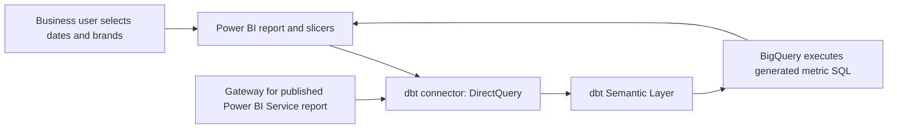

# 11 — Connect dbt metrics to Power BI and add user filters

Checked **8 October 2026**. Follow this after [10 — the separate sales/product models](10_AGGREGATIONS_ENTITIES_AND_STAR_SCHEMAS.md). The outcome is a **Sales Overview** report where business users choose a sales date range, one or several brands, and categories. This guide documents the setup; no live dbt environment, connector, gateway or Power BI report has been configured here.

## 1. Understand the connection you are building



The direct connector exposes **virtual metric tables**, rather than importing your physical fact and product tables. Their columns represent metrics and analytical attributes. The sales/product relationship remains in dbt's entity metadata; the report uses fields from the same virtual table. The published Power BI semantic model stores the connection/reporting metadata, while the authoritative metric definitions remain in dbt SQL/YAML and its deployed artifacts.

The current connector is **preview**, uses **DirectQuery**, and requires a custom connector/ODBC driver. Power BI Service needs an **On-premises Data Gateway**, even though BigQuery and dbt are cloud services. Custom DAX, custom columns, custom modeling and table joins are unsupported on this route. Treat this walkthrough as a proof of concept until the required query shapes pass in your environment. [Official dbt Power BI integration](https://docs.getdbt.com/docs/platform-integrations/semantic-layer/power-bi).

## 2. Prepare and deploy your dbt definitions

### Step 1 — Confirm the model fields

Use [the sales/product SQL and YAML](examples/sales-products-star/sales_products.yml), or adapt their contracts to real sales data:

| Report requirement | dbt definition | What it provides |
|---|---|---|
| Sales amount | `demo_sales_revenue`: sum of Sales_Amount | Governed revenue calculation |
| Sales date | `sale_date`, day grain, default aggregation time | `metric_time` represents Sale_Date for these metrics |
| Brand | `product__brand`, categorical | A brand selector |
| Category | `product__category`, categorical | A category selector/breakdown |
| Product lookup | `product` foreign entity on fact, primary on dimension | Compatible many-to-one semantic join |

Your SQL product model must output Brand; a YAML annotation cannot manufacture its values. Keep the general revenue metric free of permanent Coca Cola/Pepsi/date restrictions so users can change their selections. Permanent metric and saved-query filters still constrain what a slicer can return.

The included data is invented technology-product data with Example Computing/Peripherals/Cables brands. Coca Cola/Pepsi selections require real matching beverage data. The fixture does not imply that your FEI RSS table has brand or sales fields.

### Step 2 — Add a focused saved query

Copy [saved_queries.yml](examples/sales-products-star/saved_queries.yml) into a configured model path in the actual dbt project. It can be a separate YAML file; merge rather than duplicate an existing saved-query name. The declaration is:

```yaml
version: 2

saved_queries:
  - name: demo_sales_marketing
    label: Sales Marketing Overview
    description: Sales metrics with day, product brand and category controls.
    query_params:
      metrics:
        - demo_sales_revenue
        - demo_units_sold
        - demo_distinct_sales_orders
        - demo_average_order_value
      group_by:
        - "TimeDimension('metric_time', 'day')"
        - "Dimension('product__brand')"
        - "Dimension('product__category')"
```

There is no fixed date/brand filter and no export in this definition. It offers compatible fields to the connector; it is not an imported snapshot or an authorization boundary. Every slicer field must be exposed by the selected virtual table. [Saved queries](https://docs.getdbt.com/docs/build/saved-queries).

### Step 3 — Build, validate and reconcile

In the actual development project, run:

```bash
dbt build --select dim_products_semantic_demo fct_sales_semantic_demo
dbt parse
dbt sl validate
dbt sl query --saved-query demo_sales_marketing
dbt sl list dimensions --metrics demo_sales_revenue
dbt sl list dimension-values --metrics demo_sales_revenue --dimension product__brand
```

Use your configured development credentials. Replace demo model names if you adapted them. Reconcile the requested metrics with warehouse SQL and test key uniqueness/coverage. A successful query in development does not prove a production connector uses the same definitions. [Commands](https://docs.getdbt.com/docs/build/metricflow-commands).

### Step 4 — Deploy the serving version

Commit/merge the actual project definitions through its release workflow. Run the intended deployment job to build the serving relations and generate current semantic metadata. The current deployment guidance specifies `dbt parse`, plus `dbt docs generate` for dbt v2. Publishing this memory repository does not perform that deployment. [Deploy metrics](https://docs.getdbt.com/docs/use-dbt-semantic-layer/deploy-sl).

### Step 5 — Configure the hosted Semantic Layer

In dbt account settings, open Projects → your project → Semantic Layer → Configure Semantic Layer. Select the deployment environment and configure warehouse credentials with access to the serving relations. Map the approved connection identity/token as described by your account's setup. Confirm the account supports hosted integrations. Record **Host**, **Environment ID** and the approved **service or personal token**; copy the actual host rather than inferring a region from BigQuery. Store the token in the credential mechanism, never in this repo. [Administration](https://docs.getdbt.com/docs/use-dbt-semantic-layer/setup-sl).

## 3. Connect Power BI Desktop

### Step 6 — Install the connector

From the official [dbt Power BI page](https://docs.getdbt.com/docs/platform-integrations/semantic-layer/power-bi), follow its `.msi` download link and install the connector/driver package on the report author's Windows computer. Restart Desktop. If it is absent, check installation registration and your organization's custom-connector policy. This guide does not install software.

### Step 7 — Connect and select the fields

In Desktop, create a blank report, then Home → Get data → search **dbt Semantic Layer** → Connect. Enter Host/Environment ID, select **DirectQuery**, and authenticate with the approved token. In Navigator, load **Sales Marketing Overview** / `demo_sales_marketing` (the displayed label may vary). `METRICS.ALL` is an alternative, but only compatible combinations of its fields can be queried.

Inspect the loaded field names. Expect equivalents of Sales Revenue, Units Sold, Sales Orders, Average Order Value, Metric Time (Day), Brand and Category. Labels and connector-generated names may differ; identify them through their corresponding YAML definitions. Do not assume Brand's visible label is literally `product__brand`.

Use the day-level metric time field for date filtering. For these metrics its underlying clock is Sale_Date. No additional imported date/product table or Power BI relationship is required for the direct example.

## 4. Build the report and filters

### Step 8 — Add baseline visuals

Create these visuals from the selected virtual table:

| Visual | Fields | Business-facing title |
|---|---|---|
| Card | Sales Revenue | Sales Revenue |
| Card | Units Sold | Units Sold |
| Card | Sales Orders | Sales Orders |
| Card | Average Order Value | Average Order Value |
| Column chart | Category on axis; Sales Revenue as value | Revenue by Category |
| Line chart | Metric Time (Day) on axis; Sales Revenue as value | Daily Revenue |

Start with the revenue card/chart, then add the remaining metrics. Each visual must request the correct metric at its own grain. Do not calculate average order value by averaging grouped AOV cells, or sales orders by summing subgroup distinct counts. Keep the dbt metric's calculation; changing a Power BI field's aggregation does not redefine it through this connector.

### Step 9 — Add a date-range slicer

Select an empty canvas area → add the standard **Slicer** visual → drag the day-level date field into it. Use the **single date column**, not an automatic Date Hierarchy. In Format visual → Visual → Slicer settings → Options → Style, choose **Between**. Title it **Sales dates**. Enter a start/end date or move its range handles. Pane labels can vary with Desktop version and on-object interaction settings.

For strictly after 30 June 2026, set the start to **1 July 2026**, and the end to the chosen reporting cutoff. For example, 1 July–30 September includes those boundary days in this DATE/day-grain model. If no sales exist in the range, an empty result is expected. [Date/range slicer options](https://learn.microsoft.com/en-us/power-bi/visuals/power-bi-visualization-slicer-visual).

If the range style is absent, check that you chose the actual date field and day grain. Resolve upstream metadata/type issues rather than creating an unsupported calculated date column. Optional relative dates require a separate timezone decision: published Power BI relative-date filters use UTC and should not be assumed equivalent to your dbt Australia/Sydney rolling-date logic. [Relative-date restrictions](https://learn.microsoft.com/en-us/power-bi/visuals/desktop-slicer-filter-date-range).

### Step 10 — Add a multi-select brand slicer

Add another Slicer and drag Brand into it. Choose **Dropdown** or **Vertical list**. In its Selection/Selection controls settings, turn **Single select off** and **Multi-select with CTRL off**. Title it **Brands**. Select Coca Cola and Pepsi if those exact labels exist in your data; their selections mean either brand. Clearing the selection removes this brand restriction. Use the fixture's Example labels when testing its invented data.

### Step 11 — Add categories and optional filters

Repeat step 10 with Category, titled **Categories**. More selectors require real, compatible semantic dimensions and fields in the virtual table. A filter pane is another UI option: place a field under Filters on this visual, this page, or all pages according to the intended scope. Slicers make frequent selections visible to the marketing user. [Slicer overview and filter scope](https://learn.microsoft.com/en-us/power-bi/visuals/power-bi-visualization-slicers).

### Step 12 — Make the slicers affect the intended visuals

Select each slicer → Format ribbon → **Edit interactions**. Choose the **Filter** interaction on each card/chart that should follow it. Check other slicers too: one selection can narrow their available values. Clear selections when diagnosing a disappearing brand. For multiple pages use View → **Sync slicers**, then choose which pages share each filter and show its control. [Visual interactions](https://learn.microsoft.com/en-us/power-bi/create-reports/service-reports-visual-interactions), [sync slicers](https://learn.microsoft.com/en-us/power-bi/visuals/power-bi-visualization-slicers).

## 5. Understand and verify the selected answer

### Step 13 — Compare the UI with a dbt query

For the selections 1 July–30 September and Coca Cola/Pepsi, the semantic intent is:

```bash
dbt sl query --metrics demo_sales_revenue --group-by product__category --where "{{ TimeDimension('sale_line__sale_date', 'day') }} >= '2026-07-01' AND {{ TimeDimension('sale_line__sale_date', 'day') }} < '2026-10-01' AND {{ Dimension('product__brand') }} IN ('Coca Cola', 'Pepsi')"
```

This reproduces the category chart. Omit `--group-by product__category` to compare the overall revenue card. The exclusive upper bound expresses an inclusive final day without including 1 October. Power BI generates its own query syntax; the connector translates the requested fields, filters and grouping into dbt metric queries, and BigQuery calculates the result. A UI selection does not edit YAML or require business users to enter Jinja.

### Step 14 — Check the fixture and real data separately

For the included fixture, these expected results were checked locally, not through Power BI:

| UI selections | Revenue |
|---|---:|
| 1–2 October 2026; all brands/categories | 2280 |
| 1 October only; all brands/categories | 1050 |
| 2 October only; Example Computing | 1200 |
| 1–2 October; Example Computing and Example Peripherals | 2250 |
| 1–2 October; Accessories | 30 |
| Coca Cola/Pepsi, or July–September | No matching fixture sales |

With real data test date boundaries, one brand, two brands, category intersections, clearing filters, card totals and Service results. Do not replace no-data/null answers with zero unless that is the agreed business presentation. Confirm the serving data/environment, not just the query labels.

## 6. Publish to business users

### Step 15 — Configure the gateway

Have the gateway administrator install the connector/driver package on the gateway machine, configure its accessible custom-connector folder and enable the connector. Use the organization's standard/enterprise gateway for shared reports. The service account must be able to read that folder. In the gateway cluster's Service settings, enable custom connectors so its connection type is available. This is a one-time infrastructure setup, not something each marketing user installs. [Microsoft custom connectors on gateways](https://learn.microsoft.com/en-us/power-bi/connect-data/service-gateway-custom-connectors).

### Step 16 — Publish and map the connection

Save the report as `Sales Overview.pbix` and use Home → Publish to the intended workspace. In Power BI Service, open the published semantic model's Settings → Gateway and cloud connections. Map the installed gateway connector, with matching Host/Environment ID and credentials, and require encryption. Run the connection test, reopen the report in Service and repeat a known selection. A working Desktop report alone does not prove gateway publication works.

### Step 17 — Share a tested app

Publish/update a workspace app containing the report; add the marketing audience and verify their viewer access and licensing/capacity. A shared service-token connection executes under that configured identity; do not assume per-viewer dbt/warehouse identity or row-level permissions are passed through. Test the final viewer's permitted output. The user opens the app, chooses dates/brands/categories and reads the report without dbt or Desktop. [Power BI app distribution](https://learn.microsoft.com/en-us/power-bi/collaborate-share/service-create-distribute-apps).

### Step 18 — Hand over the usage instructions

Give users this short explanation: “Choose Sales dates, choose one or more Brands, optionally narrow Categories, and read the updated cards/charts. Clear a selection to broaden the result. Reported sales use Sale_Date.” Record who owns data freshness, definitions and connector support.

## 7. Troubleshooting and adapting to your RSS model

| Problem | Check next |
|---|---|
| Connector missing | Installation, Desktop compatibility and custom-connector policy |
| Unauthorized/connection failure | Actual host/environment, token mapping, warehouse access and gateway |
| Brand absent | Physical SQL output, categorical YAML declaration, deployment artifacts and selected virtual table |
| MetricFlow compilation error | Compatible metrics/dimensions; begin with the focused saved query |
| Date range style absent | Day-level date column rather than hierarchy/text |
| Slicer does not change card | Edit interactions, permanent/page/report filters and selected field/table |
| Beverage selection is empty | Actual stored brand labels and presence of matching sales; demo fixture contains none |
| Desktop works but Service fails | Gateway connector/driver, matching connection mapping and encryption |
| AOV/orders total differs from subgroup arithmetic | Query total at its own grain; averages/distinct counts are non-additive |

If the direct connector's preview restrictions do not fit your report, [guide 07's ordinary BigQuery route](07_PUBLISH_TO_BUSINESS_USERS.md#6-if-the-direct-power-bi-connector-is-unsuitable) uses a standard Power BI model with relationships/DAX. That route can provide slicers too, but does not invoke dbt metric YAML automatically.

For your existing RSS model, reuse the same connection/report steps with `rss_marketing_overview`, Articles Published, Average Article Length, publication-day metric time and Categories. Brand is unavailable until a real compatible brand/publisher attribute is modeled; do not invent one from URL. See [guide 07](07_PUBLISH_TO_BUSINESS_USERS.md) for its RSS saved query.

Validation here is limited to local documentation/definition consistency and synthetic arithmetic. Actual installation, semantic runtime validation, deployment, Power BI authoring, UI query translation and viewer access remain implementation checks.
