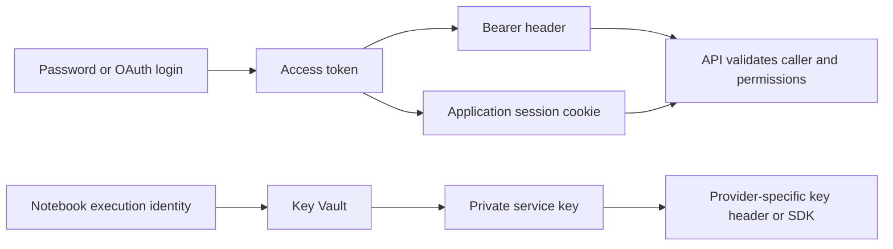
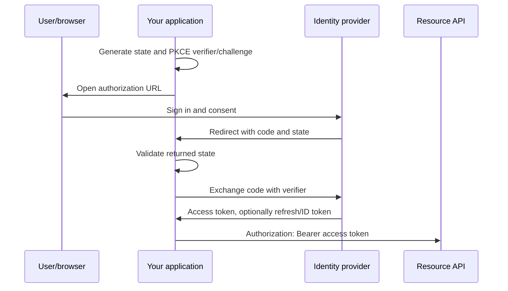
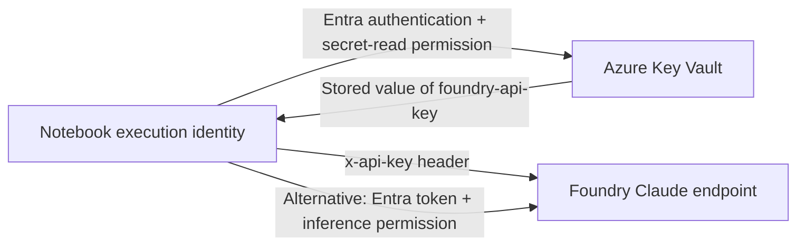

# API authentication study guide

Study reference · 2 October 2026 · Python, MyTurn/Supabase, Microsoft Fabric and Azure

Continue with [Part 2: step-by-step Azure Key Vault, service principal, GCP service account and OAuth setup](AZURE_GCP_IDENTITY_SETUP_GUIDE.md) for cloud-console configuration and connection checks.

All examples use environment variables or placeholders. The supplied password and private service keys are deliberately excluded. Rotate those exposed credentials, update their consumers, and invalidate affected sessions as appropriate. A Supabase **publishable** key is designed to be public; it is different from a private service key.

The code is educational and syntax-checked, not tested against live accounts. Install only the packages needed for a section: `requests`, `azure-identity`, `azure-keyvault-secrets`, or `azure-communication-email`. `notebookutils` belongs to the Fabric runtime.

## Contents

1. [The three questions](#1-the-three-questions)
2. [Comparison of connection methods](#2-comparison-of-connection-methods)
3. [Username/password and HTTP Basic](#3-usernamepassword-and-http-basic)
4. [API keys, Bearer tokens and JWTs](#4-api-keys-bearer-tokens-and-jwts)
5. [OAuth 2.0 and OpenID Connect](#5-oauth-20-and-openid-connect)
6. [MyTurn and Supabase: password → session → request](#6-myturn-and-supabase-password--session--request)
7. [Key Vault and secret resolution](#7-key-vault-and-secret-resolution)
8. [Azure Foundry, Azure OpenAI and ACS](#8-azure-foundry-azure-openai-and-acs)
9. [Choosing and troubleshooting a method](#9-choosing-and-troubleshooting-a-method)
10. [Practice questions and answers](#10-practice-questions-and-answers)
11. [Python helpers: os and sys](#11-python-helpers-os-and-sys)

## 1. The three questions

An API connection consists of an endpoint, an HTTP method, headers, optional parameters/body, and sometimes authentication. HTTPS protects the connection in transit. Authentication identifies the caller; authorization determines what that caller may do.

Keep three questions separate:

| Question | Examples from your notebooks |
|---|---|
| How do I obtain a credential? | Password login, OAuth code exchange, API-key provisioning, managed identity |
| How do I send it? | `Authorization: Bearer …`, `Authorization: Basic …`, `apikey`, `x-api-key`, cookie, signed request |
| Where do I keep a secret? | Key Vault, environment variable, development-only local file |

**Key Vault stores credentials. Bearer describes how a token is used. OAuth describes how authorization is obtained.** They can all appear in the same application.



A valid token for service A does not automatically work for service B. The receiving service must accept its issuer, intended audience and permissions, and the route must read the place where you sent it.

## 2. Comparison of connection methods

| Method | Credential and transmission | Typical use | Main thing to learn |
|---|---|---|---|
| No authentication | No credential | Public read API | Public access can still have quotas |
| HTTP Basic | Base64 of username/password in `Authorization` | APIs that explicitly support Basic | Encoding provides no secrecy; use HTTPS |
| Password login | Password sent to a login endpoint; session returned | Existing account login | Subsequent requests usually use a token/cookie |
| API key | Static secret in provider-defined header | Backend integrations | Header name, resource and rotation matter |
| Bearer token | `Authorization: Bearer <token>` | Protected API calls | Possession permits use; handle as a secret |
| Session cookie | Cookie jar sends session to matching host/path | Website routes and SSR | Cookie format and refresh are application-specific |
| OAuth code + PKCE | Browser authorization, code exchange, access token | User-delegated integrations | Scopes, redirect URI, state and PKCE |
| OAuth client credentials | App credential exchanged for access token | Background jobs | App permissions, no signed-in user |
| Managed identity | Hosting platform supplies identity; token obtained | Supported cloud runtimes | No stored app secret, but permissions still needed |
| Signed requests | Signature derived from secret over request data | Some cloud/storage APIs | Canonical request, timestamp and clock accuracy |
| Mutual TLS | Client certificate during TLS handshake | Partner/enterprise APIs | Private-key custody and certificate renewal |

HTTP Basic, Bearer and mutual-TLS behavior are defined in [RFC 7617](https://www.rfc-editor.org/rfc/rfc7617.html), [RFC 6750](https://www.rfc-editor.org/rfc/rfc6750.html) and [RFC 8705](https://www.rfc-editor.org/rfc/rfc8705.html). Consult the target API contract before choosing a method.

## 3. Username/password and HTTP Basic

### Basic: credentials accompany the request

```python
import os
import requests

r = requests.get(
    "https://api.example.com/private-records",
    auth=(os.environ["API_USERNAME"], os.environ["API_PASSWORD"]),
    timeout=30,
    allow_redirects=False,
)
r.raise_for_status()
```

Requests constructs the Basic header. Conceptually it is `Basic base64(username:password)`. Base64 is reversible encoding, not encryption. Never assume an email/password login implies Basic support. [Basic authentication specification](https://www.rfc-editor.org/rfc/rfc7617.html).

### Password login: credentials start a session

```text
POST /login       email + password → access token or Set-Cookie
GET /api/listings token or cookie  → authorized data
```

The password proves identity at login. The session credential proves it on later requests. Password changes, MFA, session expiry and refresh rules can affect automation. An OAuth client secret is an application's credential, not a human user's password.

## 4. API keys, Bearer tokens and JWTs

### API-key header names belong to the provider

```python
import os
import requests

r = requests.get(
    "https://api.example.com/records",
    headers={"X-API-Key": os.environ["EXAMPLE_API_KEY"]},
    timeout=30,
    allow_redirects=False,
)
r.raise_for_status()
```

This is a generic API that supports `X-API-Key`. Other APIs use `api-key`, `apikey`, or a documented Bearer-style key. These spellings are not interchangeable. A key's name in Key Vault, such as `foundry-api-key`, is a lookup label; the stored **value** is what authenticates.

### Bearer is a usage scheme; JWT is a token format

```python
headers = {"Authorization": f"Bearer {access_token}"}
```

Bearer tokens may be opaque strings or JWTs. An API key may also be transported as Bearer if the provider documents that convention. The header alone does not reveal how the credential was issued. Avoid putting tokens in URLs, logs or notebook outputs. [Bearer-token specification](https://www.rfc-editor.org/rfc/rfc6750.html).

Common JWT claims are `iss` (issuer), `aud` (audience), `exp` (expiry), `sub` (subject), and provider-specific scopes/roles. Decoding a JWT only reads its contents: it does not verify the signature or authorize a request. Receiving servers must validate it with the issuer's trusted keys and expected claims.

| Credential | Intended destination | Lifecycle |
|---|---|---|
| Access token | Resource API | Usually short-lived; inspect issuer-provided expiry |
| Refresh token | Identity provider's token endpoint | Sensitive; can obtain replacement access tokens |
| ID token | OIDC client application | Describes authentication; not a substitute for API access token |
| API key | The service that issued it | Often valid until revoked/rotated |

Supabase sessions contain an access JWT and a refresh token; use the provider's refresh behavior rather than assuming unlimited reuse. [Supabase sessions](https://supabase.com/docs/guides/auth/sessions).

## 5. OAuth 2.0 and OpenID Connect

OAuth 2.0 provides delegated authorization. OpenID Connect adds an identity layer for sign-in. Your application requests access to a resource; the authorization server issues a token; the resource server validates it.

### A. Authorization code with PKCE: a person authorizes access



Use this for integrations acting on a person's behalf, such as authorized access to their files. Register the exact redirect URI, request only necessary scopes and use the provider SDK for callback validation and token caching. PKCE binds code redemption to the client that initiated the flow. Do not embed a client secret in a browser or distributed desktop application. Modern OAuth security guidance rejects the resource-owner-password grant and discourages implicit token delivery. Supabase's existing password sign-in is shown later to explain your workflow, not as the design for a new delegated OAuth integration. [OAuth security best practices](https://www.rfc-editor.org/rfc/rfc9700.html).

### B. Client credentials: a background application acts as itself

This Entra example obtains a Microsoft Graph application token. It needs an app registration, configured application permissions and required administrator consent. It does not create a user session and does not use a refresh token; the app obtains another access token when needed. [Entra client credentials](https://learn.microsoft.com/en-us/entra/identity-platform/v2-oauth2-client-creds-grant-flow).

```python
import os
import requests

tenant_id = os.environ["AZURE_TENANT_ID"]
r = requests.post(
    f"https://login.microsoftonline.com/{tenant_id}/oauth2/v2.0/token",
    data={
        "client_id": os.environ["AZURE_CLIENT_ID"],
        "client_secret": os.environ["AZURE_CLIENT_SECRET"],
        "grant_type": "client_credentials",
        "scope": "https://graph.microsoft.com/.default",
    },
    timeout=30,
    allow_redirects=False,
)
r.raise_for_status()
access_token = r.json()["access_token"]  # Do not display it.
```

`data=` sends form fields; do not change this token exchange to `json=` unless the provider explicitly supports it. `.default` requests the resource's configured permissions; it does not grant permissions by itself. Change the scope for another API. Prefer a supported certificate, workload federation or managed identity to a stored client secret when possible.

### C. Managed identity: the host provides an application identity

On a supported Azure host with managed identity enabled:

```python
from azure.identity import ManagedIdentityCredential

credential = ManagedIdentityCredential()  # System-assigned identity.
token = credential.get_token("https://vault.azure.net/.default")
```

This Key Vault token is not a Foundry token. The identity still needs Key Vault permissions and network access. User-assigned identities require selecting the intended identity. `DefaultAzureCredential` tries available credential sources; successfully using it on your laptop does not prove the scheduled job uses managed identity. [Managed identity developer guidance](https://learn.microsoft.com/en-us/entra/identity/managed-identities-azure-resources/overview-for-developers).

## 6. MyTurn and Supabase: password → session → request

### Identify the two services

| URL | Purpose |
|---|---|
| `https://<project-ref>.supabase.co/auth/v1/token` | Supabase account login/token issuance |
| `https://myturn.property/api/listings` | MyTurn application route; its server decides accepted authentication |

Supabase's publishable key identifies the application component; a signed-in user's JWT identifies the user. The key belongs in `apikey`. The newer `sb_publishable_…` value is not a JWT and must not be substituted for a user access token in `Authorization: Bearer …`. Legacy `anon` and `service_role` keys are JWT-shaped, but have different privileges; prefix `eyJ` alone does not establish safety. Secret/service-role keys can bypass row-level security and must stay server-side. [Supabase API keys](https://supabase.com/docs/guides/getting-started/api-keys).

### CELL 1 — configuration

Set these variables outside the committed notebook. `SUPABASE_ANON_KEY` is retained from your code even when its value is a modern publishable key.

```python
import os
import json
import base64
from urllib.parse import urlparse
import requests

SUPABASE_URL = os.environ["SUPABASE_URL"].rstrip("/")
SUPABASE_ANON_KEY = os.environ["SUPABASE_ANON_KEY"]
MYTURN_EMAIL = os.environ["MYTURN_EMAIL"]
MYTURN_PASSWORD = os.environ["MYTURN_PASSWORD"]
MYTURN_BASE = "https://myturn.property"
```

### CELL 2 — obtain the session

```python
login = requests.post(
    f"{SUPABASE_URL}/auth/v1/token",
    params={"grant_type": "password"},
    headers={"apikey": SUPABASE_ANON_KEY, "Accept": "application/json"},
    json={"email": MYTURN_EMAIL, "password": MYTURN_PASSWORD},
    timeout=60,
    allow_redirects=False,
)
login.raise_for_status()
session = login.json()
if not session.get("access_token"):
    raise RuntimeError("Login response has no access token")
# Never print login.text, session, access_token, or refresh_token.
```

For a new application, prefer the supported SDK's password sign-in and session-management functions. The REST exchange above makes the steps in your existing notebook explicit. [Supabase password authentication](https://supabase.com/docs/guides/auth/passwords), [Auth REST implementation](https://supabase.github.io/auth/).

### CELL 3 — probe Bearer, then an application cookie

Only run this against the authorized account and site. This is a diagnostic adaptation of your example, not a universal cookie-authentication recipe.

```python
http = requests.Session()
http.headers.update({"Accept": "application/json"})

def probe(label):
    r = http.get(
        f"{MYTURN_BASE}/api/listings",
        params={"page": 1, "pageSize": 1},
        timeout=60,
        allow_redirects=False,
    )
    media_type = r.headers.get("content-type", "").split(";")[0].strip().lower()
    json_type = media_type == "application/json" or media_type.endswith("+json")
    # Do not print response bodies or raw redirect URLs (may contain data/tokens).
    print(f"{label}: HTTP {r.status_code}; type={media_type}; "
          f"redirect_present={bool(r.headers.get('location'))}")
    if r.status_code != 200 or not json_type:
        return False
    try:
        payload = r.json()
    except ValueError:
        return False
    # Also inspect the real listing schema before treating payload as listing data.
    return isinstance(payload, (dict, list))

http.headers["Authorization"] = f"Bearer {session['access_token']}"
ok = probe("bearer")

if not ok:
    http.headers.pop("Authorization", None)
    ref = urlparse(SUPABASE_URL).hostname.split(".")[0]
    cookie_host = urlparse(MYTURN_BASE).hostname
    value = "base64-" + base64.urlsafe_b64encode(
        json.dumps(session, separators=(",", ":")).encode("utf-8")
    ).decode("ascii").rstrip("=")
    http.cookies.set(
        f"sb-{ref}-auth-token", value,
        domain=cookie_host, path="/", secure=True,
    )
    ok = probe("cookie")

if not ok:
    raise RuntimeError("Neither tested transport returned valid JSON; inspect auth contract")
```

Why remove the Bearer header? It isolates the cookie attempt. Why disable redirects? Otherwise a login redirect can become HTTP 200 HTML, and `.json()` fails. `Accept: application/json` expresses a preference; it does not authenticate or guarantee JSON.

Supabase SSR stores sessions in cookies, but representation depends on package version and application configuration. The `base64-` convention appears in Supabase's SSR design, which also describes splitting large cookie values into chunks. Your single-cookie construction may fail if MyTurn expects another shape, multiple `.0`/`.1` chunks, a separate server session, or other checks. Use the supported application login/session mechanism when available. Base64 is not encryption; this cookie contains sensitive session material. Scope it to the intended HTTPS host and do not share the authenticated Session with unrelated services. [Supabase SSR](https://supabase.com/docs/guides/auth/server-side), [SSR cookie design](https://github.com/supabase/ssr/blob/main/docs/design.md).

**Evidence from earlier session notes:** Supabase password login was reported successful. A Bearer request to `/api/listings/filter-options` returned non-JSON, consistent with a login redirect. That does not prove the `/api/listings` route behaves identically. Cookie authentication remains unverified. This guide does not claim either route was newly tested.

### Refresh is another token exchange

```python
refresh = requests.post(
    f"{SUPABASE_URL}/auth/v1/token",
    params={"grant_type": "refresh_token"},
    headers={"apikey": SUPABASE_ANON_KEY},
    json={"refresh_token": session["refresh_token"]},
    timeout=60,
    allow_redirects=False,
)
refresh.raise_for_status()
session = refresh.json()
```

Replace the access token and any session cookie after refresh; coordinate refresh so multiple workers do not race. Prefer SDK session handling for sustained ingestion. [Supabase sessions](https://supabase.com/docs/guides/auth/sessions).

## 7. Key Vault and secret resolution

### Reading a key and using a key are separate operations



Being able to read `foundry-api-key` does not prove the identity can call Foundry using Entra. Conversely, inference permissions do not grant secret-read access. Vault networking and service networking are separate too.

### Fabric: retrieve a stored secret

```python
import notebookutils

KEYVAULT_URL = "https://<your-vault>.vault.azure.net/"
SECRET_FOUNDRY_KEY = "foundry-api-key"  # Secret NAME, safe to commit.
SECRET_ACS_KEY = "acs-key"             # Another NAME, not its value.

foundry_key = notebookutils.credentials.getSecret(KEYVAULT_URL, SECRET_FOUNDRY_KEY)
```

Microsoft documents `getSecret` using current user credentials. Confirm the actual identity for interactive, pipeline and scheduled execution; do not assume a schedule has no identity or automatically uses the workspace identity. The documented token helper currently lists `storage`, `pbi`, `keyvault` and `kusto`; none is a Foundry token. Microsoft also documents that Fabric notebooks do not directly support `DefaultAzureCredential`. Do not copy a local Azure SDK credential pattern into Spark executors without validating runtime support. Never rely on notebook redaction as a security boundary. [Fabric credential utilities](https://learn.microsoft.com/en-us/fabric/data-engineering/notebookutils/notebookutils-credentials).

### Local Python or a supported Azure host: Azure SDK

```python
import os
from azure.identity import DefaultAzureCredential
from azure.keyvault.secrets import SecretClient

client = SecretClient(
    vault_url=os.environ["KEYVAULT_URL"],
    credential=DefaultAzureCredential(),
)
foundry_key = client.get_secret("foundry-api-key").value
```

Use a permitted local developer identity or a configured host identity. Grant appropriate secret-read access, such as Key Vault Secrets User in an RBAC-configured vault; management-plane Contributor alone does not imply permission to read secrets. [Key Vault RBAC](https://learn.microsoft.com/en-us/azure/key-vault/general/rbac-guide).

### Understand the precedence in your original code

| Expression/path | Actual behavior |
|---|---|
| `FOUNDRY_KEY_INLINE or secret(SECRET_FOUNDRY_KEY)` | A nonempty inline value wins; Python never calls `secret()` |
| Inside your `secret()` | Key Vault → local `secrets.json` → default |
| `AUTH != "key"` | Key expression yields empty string; Entra token logic is still needed elsewhere |
| Catch all errors and return `""` | Optional services can be skipped, but required auth needs explicit validation |

Therefore your full precedence was **inline → Key Vault → file → default**, not simply Key Vault first. A pasted key can silently mask a broken vault and ignore later rotation. Logging exception text can reveal request details; printing only a key's length is safer than printing the key, but usually unnecessary.

### Safer study implementation: explicit fallback, required-secret validation

This helper allows a local fallback only when you explicitly enable it. Production defaults to failing if Key Vault fails. The local file must live outside Git; a shared Lakehouse `Resources` folder is not a secret store merely because the file is named `secrets.json`.

```python
import json
from pathlib import Path

def secret(name, *, vault_url="", secrets_file=None,
           allow_local=False, required=True, default=""):
    if not name:
        raise ValueError("Provide a secret name")
    if vault_url:
        try:
            import notebookutils
            value = notebookutils.credentials.getSecret(vault_url, name)
            if value:
                return value
        except Exception:
            if not allow_local:
                raise RuntimeError(f"Key Vault retrieval failed for {name!r}") from None
            print(f"Key Vault unavailable for {name!r}; local fallback explicitly enabled")
    if allow_local and secrets_file is not None:
        path = Path(secrets_file)
        if path.exists():
            try:
                data = json.loads(path.read_text(encoding="utf-8"))
                if not isinstance(data, dict):
                    raise ValueError("Expected JSON object")
                value = data.get(name)
                if value is not None and not isinstance(value, str):
                    raise ValueError("Expected secret string")
            except (OSError, ValueError):
                raise RuntimeError("Local secret file unreadable or invalid") from None
            if value:
                return value
    if required:
        raise RuntimeError(f"Required secret missing: {name!r}")
    return default
```

```python
PROVIDER = "claude"  # "claude", "aoai", or "" to skip
AUTH = "key"         # "key" or "entra"
if PROVIDER not in {"claude", "aoai", ""} or AUTH not in {"key", "entra"}:
    raise ValueError("Unsupported provider/auth configuration")

API_KEY = ""
if PROVIDER and AUTH == "key":
    key_name = "foundry-api-key" if PROVIDER == "claude" else "aoai-key"
    API_KEY = secret(key_name, vault_url=KEYVAULT_URL)
```

Environment variables are another delivery mechanism, not automatically a vault: avoid dumping process environments. Ignore `.env`, `secrets.json`, private-key files and notebook outputs containing credentials. If a secret reached Git history, deleting it from the current file does not revoke it or erase history; rotate first, then assess history cleanup separately.

## 8. Azure Foundry, Azure OpenAI and ACS

### Claude on Foundry: key authentication

Use the deployment's target URI. The following preserves your deployment-name example; its existence in your resource has not been inspected. Claude's protocol version is sent in `anthropic-version`, not Azure OpenAI's `api-version` query parameter. [Microsoft Claude REST examples](https://learn.microsoft.com/en-us/azure/foundry/foundry-models/how-to/use-foundry-models-claude).

```python
import os
import requests

CLAUDE_BASE = os.environ["CLAUDE_BASE"].rstrip("/")
# e.g. https://<resource>.services.ai.azure.com/anthropic
CLAUDE_DEPLOYMENT = "claude-opus-5-5"  # Replace if your deployment has another name.
CLAUDE_API_VERSION = "2023-06-01"

r = requests.post(
    f"{CLAUDE_BASE}/v1/messages",
    headers={"x-api-key": API_KEY, "anthropic-version": CLAUDE_API_VERSION},
    json={
        "model": CLAUDE_DEPLOYMENT,
        "max_tokens": 128,
        "messages": [{"role": "user", "content": "Explain API authentication briefly."}],
    },
    timeout=60,
    allow_redirects=False,
)
r.raise_for_status()
```

The key is for the Foundry resource, not a direct Anthropic account. Foundry supports `x-api-key` or `api-key` for compatible Claude deployments; use the documented method for your deployment. [Anthropic's Foundry authentication guide](https://platform.claude.com/docs/en/build-with-claude/claude-in-microsoft-foundry).

### Claude on Foundry: Entra alternative

On a supported Azure SDK host, replace the key header with a correctly scoped token. Current Claude-on-Foundry examples use `https://ai.azure.com/.default`. Other Azure AI endpoints can use other audiences; do not assume one scope works across providers.

```python
from azure.identity import DefaultAzureCredential, get_bearer_token_provider

token_provider = get_bearer_token_provider(
    DefaultAzureCredential(), "https://ai.azure.com/.default"
)
headers = {
    "Authorization": f"Bearer {token_provider()}",
    "anthropic-version": CLAUDE_API_VERSION,
}
# Use these headers in the same /v1/messages request instead of x-api-key.
```

Use an identity with the documented inference role, and call the token provider for subsequent requests so expired tokens can be renewed. In Fabric, first establish a supported execution-identity/token path. `AUTH = "entra"` alone does not acquire a token or assign a role. [Claude Entra authentication](https://platform.claude.com/docs/en/build-with-claude/claude-in-microsoft-foundry).

### Azure OpenAI: deployment-based example matching your configuration

The version below is retained from your supplied code. Check your deployment's supported API before use. Azure OpenAI uses `api-key` for key auth or a Bearer token for Entra; the classic deployment-based API includes `api-version`. [Azure OpenAI authentication and API shape](https://learn.microsoft.com/en-US/azure/cognitive-services/openai/reference).

```python
import os
import requests

AOAI_ENDPOINT = os.environ["AOAI_ENDPOINT"].rstrip("/")
AOAI_DEPLOYMENT = "gpt-4.1-mini"  # Your configured deployment name.
AOAI_API_VERSION = "2024-10-21"
aoai_key = secret("aoai-key", vault_url=KEYVAULT_URL)

r = requests.post(
    f"{AOAI_ENDPOINT}/openai/deployments/{AOAI_DEPLOYMENT}/chat/completions",
    params={"api-version": AOAI_API_VERSION},
    headers={"api-key": aoai_key},
    json={"messages": [{"role": "user", "content": "Explain API authentication briefly."}]},
    timeout=60,
    allow_redirects=False,
)
r.raise_for_status()
```

Do not reuse the Foundry Claude key against an unrelated Azure OpenAI resource. Endpoint and credential must belong together.

### ACS: let the SDK apply the service's authentication

For Azure Communication Services Email, the SDK can consume an access key through `AzureKeyCredential`. It handles the request authentication; do not invent `Authorization: Bearer <ACS key>`. ACS also supports Entra for supported service operations; choose the documented SDK/API path. [ACS authentication](https://learn.microsoft.com/en-us/azure/communication-services/concepts/authentication).

```python
import os
from azure.core.credentials import AzureKeyCredential
from azure.communication.email import EmailClient

acs_key = secret("acs-key", vault_url=KEYVAULT_URL)
email_client = EmailClient(
    endpoint=os.environ["ACS_ENDPOINT"],
    credential=AzureKeyCredential(acs_key),
)
# Client construction only; this example sends no email.
```

| Supplied setting | Meaning |
|---|---|
| `PROVIDER` | Selects endpoint/protocol, not identity |
| `AUTH` | Selects key or Entra credential path |
| `SECRET_FOUNDRY_KEY` / `SECRET_ACS_KEY` | Vault lookup names |
| `API_KEY` | Sensitive retrieved value |
| `CLAUDE_DEPLOYMENT` / `AOAI_DEPLOYMENT` | Routing names, not authentication credentials |
| `CLAUDE_API_VERSION` | Anthropic protocol version header |
| `AOAI_API_VERSION` | Azure OpenAI API-version query parameter in this API shape |

## 9. Choosing and troubleshooting a method

### A practical decision sequence

1. Read the target route's authentication contract, including accepted headers/cookies.
2. Decide whether the caller is a person or an application.
3. For delegated user access, use a supported OAuth code + PKCE flow.
4. For scheduled applications, prefer supported managed identity/federation; otherwise use a permitted app credential or service key stored in a vault.
5. For an existing password-backed site, use its supported account/session flow and refresh rules.
6. Validate the actual interactive and scheduled identities, permissions and networking separately.

### Diagnose the layer that failed

| Symptom | Likely areas to inspect | Next check |
|---|---|---|
| DNS/connection timeout | Endpoint, firewall, proxy, private link | Network reachability before credential changes |
| TLS validation error | Hostname, trust chain, interception | Fix trust; do not disable certificate verification |
| 301/302/303/307/308 | Login redirect or changed URL | Inspect sanitized destination privately |
| 200 with HTML | Login page or web page route | Disable redirects; verify route and content type |
| 200 with JSON error/empty rows | Application error, query filter, RLS | Validate schema and permissions; 200 alone is insufficient |
| 400 | Body format, API version, OAuth grant | Check contract and sanitized error code |
| 401 | Missing/invalid credential, wrong issuer/audience, expiry | Reacquire correct credential and inspect expected transport |
| 403 | Role/scope/consent, policy or firewall restrictions | Check execution principal and data-plane permissions |
| 404 | Wrong route, resource or deployment; sometimes concealed access | Verify endpoint and deployment before replacing keys |
| 429 | Quota/rate limit | Honor Retry-After; use bounded backoff |
| Key Vault fails but inline key works | Different credential source masked the failure | Remove inline precedence; verify vault identity/network |
| Interactive succeeds, scheduled fails | Different principal, token source or network | Inspect actual scheduled execution context |

These are diagnostic clues, not guarantees; some services use status codes differently. Log status, content type and sanitized service error/request IDs. Avoid raw bodies, headers, cookies, exception dumps and redirect query strings. Retry transient failures with limits; repeatedly retrying a bad password or permission error does not fix it. For writes, understand idempotency before retrying.

## 10. Practice questions and answers

Try these without looking at the answers:

1. Is Bearer an alternative to OAuth?
2. Does base64 make a Basic header or Supabase cookie secret?
3. Why can Supabase login succeed while MyTurn rejects a request?
4. What is the difference between `foundry-api-key` and `API_KEY`?
5. What wins in `FOUNDRY_KEY_INLINE or secret(...)`?
6. Does a 200 response prove authentication succeeded?
7. Can a refresh token be sent to `/api/listings` as Bearer?
8. Does `AUTH = "entra"` enable managed identity?
9. Can a Key Vault token call Foundry?
10. Why might manual and scheduled Fabric runs behave differently?
11. Is a JWT starting with `eyJ` necessarily a public anon key?
12. You remove a committed password from the file. Is the incident resolved?

<details>
<summary>Reveal answers</summary>

1. No. OAuth can issue an access token that you then send using Bearer.
2. No. Base64 is reversible encoding; HTTPS protects transport.
3. Login and listings belong to separate services/routes; MyTurn must accept the token and its transport.
4. The first is a secret lookup name; the second holds the sensitive value.
5. Any nonempty inline value wins, and the helper is not called.
6. No. It may be HTML, an application error or unrelated JSON. Check type, schema and intended data.
7. No. Use it at the issuer's refresh endpoint to obtain an access token.
8. No. You still need a supported credential source, token acquisition and permissions.
9. No. Obtain the token for the target API's audience.
10. Execution identity, available credentials and network context can differ.
11. No. That prefix does not establish role or privileges.
12. No. Rotate/revoke it and assess sessions, logs and history separately.

</details>

### Small study labs

- **Transport:** draw your password → Supabase token → Bearer/cookie → MyTurn flow and label each receiving host.
- **Precedence:** evaluate the original inline/vault/file expression on paper for empty and nonempty inline values.
- **Troubleshooting:** explain why 302 login, 200 HTML and 403 JSON require different next checks.
- **Identity:** draw both vault-read and inference permissions for a scheduled notebook; identify which principal needs each.
- **Refresh:** explain what must be updated after replacing a Supabase session and why sharing refresh work across executors can race.

Completion target: explain each layer, select a documented authentication method, keep its secrets outside source control, and distinguish login success from successful authorized API access.

## 11. Python helpers: os and sys

Both modules come with Python's standard library: use `import os` and `import sys`; no `pip install` is needed. In this guide they support configuration and runtime diagnostics. `requests` sends the HTTP requests.

| Module | Role | Useful examples |
|---|---|---|
| `os` | Interface to the operating-system environment | Read configuration with `os.environ` / `os.getenv`; inspect working directory with `os.getcwd()` |
| `os.path` | File-path operations | Join folders, test existence; do not use it to construct API URLs |
| `sys` | Interface to the running Python interpreter | Interpreter location/version, script arguments, import search paths, exit status |

### os: supply configuration from the environment

```python
import os

SUPABASE_URL = os.environ["SUPABASE_URL"]  # Missing variable raises KeyError.
PROVIDER = os.getenv("PROVIDER", "claude")  # Default when absent.
API_KEY = os.getenv("FOUNDRY_API_KEY")      # None when absent.
if not API_KEY:
    raise RuntimeError("FOUNDRY_API_KEY is missing or empty")
```

Environment values are strings. A present empty variable does not activate `getenv`'s default. Convert numbers explicitly, e.g. `timeout = int(os.getenv("API_TIMEOUT", "60"))`. Never use `bool("false")` to parse a setting: a nonempty string is truthy. Reading a variable neither contacts Key Vault nor authenticates a request. [Python os documentation](https://docs.python.org/3/library/os.html).

For a nonsecret local PowerShell example, set configuration **before** launching Python:

```powershell
$env:PROVIDER = "claude"
python ingest.py
```

The launched process inherits that configuration. Your existing Fabric notebook is a separate runtime; setting a variable in local PowerShell does not configure it. Environment variables can contain secrets but are not a vault. Avoid printing `os.environ` or entering real keys into saved example commands.

### File paths: what does RESOURCES mean?

`RESOURCES` in your original `SECRETS_FILE = f"{RESOURCES}/secrets.json"` is a variable that earlier code must define. It is not built into Python. Relative file paths resolve from the working directory, which may differ between a terminal and notebook.

```python
import os

resources = os.environ["RESOURCES"]
secrets_file = os.path.join(resources, "secrets.json")
file_exists = os.path.isfile(secrets_file)  # Boolean; does not read the secret.
working_directory = os.getcwd()
```

`os.path.join` follows the host's file-path conventions. It does not establish that a file is readable, trusted or safely stored. [Python os.path documentation](https://docs.python.org/3/library/os.path.html).

The guide's helper instead uses `pathlib`, which offers path objects:

```python
from pathlib import Path

secrets_file = Path(resources) / "secrets.json"
```

For an ordinary saved `.py` script, `Path(__file__).resolve().parent` locates its folder. Notebooks usually do not define `__file__`; use an explicitly configured runtime path there. A Fabric resource may require its documented mount/filesystem interface rather than a local Windows path. [Python pathlib documentation](https://docs.python.org/3/library/pathlib.html).

### sys: diagnose the interpreter and script execution

```python
import sys

print("Python version:", sys.version.split()[0])
print("Interpreter:", sys.executable)
print("Platform:", sys.platform)
```

`sys.executable` helps explain why a package installed for one Python is missing in another. `sys.path` controls module lookup; it differs from the operating system's `PATH`. Prefer installing into the correct environment over appending arbitrary folders to `sys.path`.

For `python ingest.py claude`, `sys.argv[0]` is the script name and `sys.argv[1]` is `claude`. Notebook arguments may belong to the kernel launcher. Do not pass passwords/tokens as command-line arguments or print the complete argument list. In a CLI, `sys.exit(1)` signals failure; it raises `SystemExit`. In a notebook, use a normal exception for configuration failure. [Python sys documentation](https://docs.python.org/3/library/sys.html).

Use `argparse` when your script needs named options and validation:

```python
import argparse
import os

parser = argparse.ArgumentParser()
parser.add_argument("--provider", choices=["claude", "aoai"], default="claude")
args = parser.parse_args()  # CLI script, not a notebook cell.
provider = args.provider
key_name = "FOUNDRY_API_KEY" if provider == "claude" else "AOAI_API_KEY"
api_key = os.getenv(key_name)
if not api_key:
    parser.error(f"Set {key_name} through your configured secret delivery mechanism")
```

Run with `python ingest.py --provider claude`. This reads configuration only; it makes no API call. [Python argparse documentation](https://docs.python.org/3/library/argparse.html).

### Quick self-check

- Does `import os` install a package? **No; it loads a standard-library module.**
- Why does `os.environ["API_KEY"]` fail before the request? **The required variable is absent.**
- Why does the API still return 401 when the variable exists? **Existence does not prove the value is valid or sent correctly.**
- What does `sys.executable` reveal? **Which Python interpreter is running.**
- Is `sys.path` where secrets belong? **No; it is the module import search path.**
