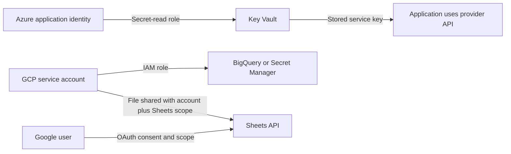

# Step-by-step Azure and GCP identity setup

Part 2 of the [API authentication study guide](API_AUTHENTICATION_STUDY_GUIDE.md) · checked 2 October 2026

This guide takes you from cloud-console setup to a small connection check. It covers Azure Key Vault, Entra service principals and managed identity, GCP service accounts, and user OAuth. All names and identifiers below are examples. Commands are instructions for you to run after replacing placeholders; no cloud resources, roles, keys or OAuth clients were created during preparation of this guide.

## Contents

1. [Choose the identity](#1-choose-the-identity)
2. [Azure: create Key Vault and store a secret](#2-azure-create-key-vault-and-store-a-secret)
3. [Azure: connect as your local developer account](#3-azure-connect-as-your-local-developer-account)
4. [Azure: create an application service principal](#4-azure-create-an-application-service-principal)
5. [Azure: use managed identity for a hosted application](#5-azure-use-managed-identity-for-a-hosted-application)
6. [Fabric: adapt the vault connection](#6-fabric-adapt-the-vault-connection)
7. [GCP: create a service account and grant access](#7-gcp-create-a-service-account-and-grant-access)
8. [GCP: connect without a downloaded private key](#8-gcp-connect-without-a-downloaded-private-key)
9. [GCP: service-account JSON key when required](#9-gcp-service-account-json-key-when-required)
10. [GCP: configure OAuth for a user and read Google Sheets](#10-gcp-configure-oauth-for-a-user-and-read-google-sheets)
11. [GCP: store third-party secrets in Secret Manager](#11-gcp-store-third-party-secrets-in-secret-manager)
12. [Verify and troubleshoot](#12-verify-and-troubleshoot)

## 1. Choose the identity

A service account is an application identity, not a person with an email inbox. Azure normally calls this a **service principal**; GCP calls it a **service account**. OAuth is an authorization protocol, not another kind of secret store. Both application and user authentication can involve OAuth tokens.

| Your task | Recommended setup path in this guide |
|---|---|
| Read a Key Vault secret while developing locally | Azure CLI developer login → Key Vault Secrets User → SDK |
| Run on a supported Azure host | Managed identity → scoped Azure role → SDK |
| Run outside Azure when federation is unavailable | Entra app/service principal → certificate or controlled client secret |
| Run a GCP-hosted data job | Attached service account → scoped IAM permissions → ADC |
| Test locally as the GCP job's identity | Service-account impersonation → ADC |
| Run a supported external CI job against GCP | Workload Identity Federation → short-lived credentials |
| Access a user's Google Sheets/files with consent | OAuth client → user consent → scoped access/refresh tokens |
| Let an app read one specific Google Sheet | Share that file with the service-account email; use supported service-account credentials |



Record nonsecret setup facts: tenant/project ID, runtime, application identity ID/email, resource name, assigned role and scope. Record secret **names**, never values, in repository documentation. A project's display name can differ from its unique ID; select the intended ID throughout.

## 2. Azure: create Key Vault and store a secret

### Step 1 — choose the subscription, tenant and administrator

Open the [Azure portal](https://portal.azure.com). Confirm the directory and subscription. You need permission to create the vault and permission to assign the roles used below; these are separate capabilities. If IAM's Add role assignment is unavailable, a resource administrator with the appropriate role-assignment permissions must perform that step. [Azure role assignment prerequisites](https://learn.microsoft.com/en-us/azure/role-based-access-control/role-assignments-portal).

### Step 2 — create the vault

1. Search **Key vaults**, select **Create**.
2. Select the intended subscription and an application/environment resource group, e.g. `rg-api-study-dev`.
3. Enter a globally unique vault name, e.g. `kv-api-study-<unique-suffix>`.
4. Choose a suitable region and the Standard tier for this secrets exercise.
5. Review recovery settings. Retain soft delete and enable purge protection if appropriate for the environment; once enabled, purge protection cannot be switched off.
6. Create the vault and save its **Vault URI**, e.g. `https://kv-api-study-<unique-suffix>.vault.azure.net/`.

Create a dedicated study vault rather than altering an existing production vault. [Create a vault in the portal](https://learn.microsoft.com/en-us/azure/key-vault/general/quick-create-portal).

### Step 3 — select Azure RBAC and grant secret access

Use the **Azure role-based access control** permission model under Access configuration. The roles below apply to that model, not the legacy Access policies model. Changing an existing vault's permission model can disrupt access; this exercise starts with a new vault.

| Principal | Role for this exercise | Scope |
|---|---|---|
| Person adding/updating study secrets | Key Vault Secrets Officer | Study vault |
| Person/application only reading values | Key Vault Secrets User | Study vault |
| Administrator managing the vault resource | Key Vault Contributor, as needed | Resource management; does not grant secret-value reads |

On the vault, open **Access control (IAM) → Add → Add role assignment**. Select the role, choose the intended user/group/service principal or managed identity, then Review + assign. Use reader permission for the application. Allow time for assignments to propagate. [Key Vault RBAC roles](https://learn.microsoft.com/en-us/azure/key-vault/general/rbac-guide).

### Step 4 — establish a network path

Configure Networking for the actual caller. A local development test can use the public endpoint with an appropriate network restriction permitting the developer's public IP. A private endpoint requires the runtime to have the intended private network/DNS path. The portal also needs connectivity for secret operations. Do not assume the trusted-services exception includes every Azure or Fabric workload. IAM permission does not bypass the firewall. [Key Vault network security](https://learn.microsoft.com/en-us/azure/key-vault/general/network-security).

### Step 5 — add a secret

1. Open **Objects → Secrets → Generate/Import**.
2. Select Manual and name a harmless test secret `study-connection-test`.
3. Supply a disposable test string as its value; Create.
4. After testing, repeat for actual required keys such as `foundry-api-key`, `acs-key` or `myturn-password`, entering values only in the protected secret-entry interface.
5. Record the names and vault URI in configuration. Enable expiry reminders/rotation procedures suited to the actual provider.

A new vault does not import or revoke keys held elsewhere. Adding a new secret version updates stored data; it does not rotate the upstream provider's key by itself. [Add a vault secret](https://learn.microsoft.com/en-us/azure/key-vault/secrets/quick-create-portal).

## 3. Azure: connect as your local developer account

### Step 1 — prepare local tools

Install Python and [Azure CLI for Windows](https://learn.microsoft.com/en-us/cli/azure/install-azure-cli-windows). Use a Python environment dedicated to the exercise:

```powershell
python -m venv .venv
.\.venv\Scripts\python.exe -m pip install azure-identity azure-keyvault-secrets
az login --tenant "<tenant-id>"
az account set --subscription "<subscription-id>"
$env:KEYVAULT_URL = "https://<vault-name>.vault.azure.net/"
```

### Step 2 — verify a read without revealing the value

Save as `verify_azure_vault.py`. Run it with the environment's Python. [`AzureCliCredential`](https://learn.microsoft.com/en-us/python/api/azure-identity/azure.identity.azureclicredential?view=azure-python) makes this test explicitly use the CLI login instead of another credential source discovered on the machine.

```python
import os
from azure.identity import AzureCliCredential
from azure.keyvault.secrets import SecretClient

client = SecretClient(
    vault_url=os.environ["KEYVAULT_URL"],
    credential=AzureCliCredential(),
)
secret = client.get_secret("study-connection-test")
if not secret.value:
    raise RuntimeError("Test secret was empty")
print("Key Vault read succeeded; value not displayed")
```

```powershell
.\.venv\Scripts\python.exe verify_azure_vault.py
```

Success proves this user's secret-read access through this network path. It does not prove a service principal, scheduled notebook or downstream Foundry endpoint works. For application code, choose the runtime's intended credential explicitly or configure `DefaultAzureCredential` appropriately. [Python Key Vault client setup](https://learn.microsoft.com/en-us/azure/key-vault/secrets/quick-create-python).

## 4. Azure: create an application service principal

### Step 1 — register the application

1. Open **Microsoft Entra ID → App registrations → New registration**.
2. Name it, e.g. `api-study-worker-dev`.
3. Choose single tenant for this internal background-job exercise.
4. Leave Redirect URI blank for app-only client-credentials use; there is no browser callback.
5. Register. Save Directory (tenant) ID and Application (client) ID.
6. Find the corresponding identity under **Enterprise applications**; record its service-principal Object ID when needed for role assignment.

Client ID selects the application during authentication. The enterprise application's Object ID identifies the tenant principal; it differs from the app registration's Object ID. [Create an Entra application and service principal](https://learn.microsoft.com/en-us/entra/identity-platform/howto-create-service-principal-portal).

### Step 2 — choose its credential

Prefer supported federation or a certificate for automation. For this exercise, **Certificates & secrets → Client secrets → New client secret** creates a time-limited credential. Capture its **Value**, not Secret ID; store it through protected runtime configuration, with an expiry/replacement plan. Never put it in source, Git or saved commands. [Entra application credential options](https://learn.microsoft.com/en-us/entra/identity-platform/howto-create-service-principal-portal).

### Step 3 — grant the application access to this vault

Repeat the vault IAM assignment from section 2, selecting this service principal and **Key Vault Secrets User** at vault scope. Registering an app does not grant vault access. For RBAC-based vault access, do not add broad Microsoft Graph API permissions just to read secrets.

### Step 4 — deliver configuration and test app-only authentication

Set `AZURE_TENANT_ID`, `AZURE_CLIENT_ID`, `AZURE_CLIENT_SECRET` and `KEYVAULT_URL` through the local/runtime secret-delivery system. The first two and the vault URI are identifiers; the client-secret value is sensitive. Run this separately from the developer test, using [`ClientSecretCredential`](https://learn.microsoft.com/en-us/python/api/azure-identity/azure.identity.clientsecretcredential?view=azure-python):

```python
import os
from azure.identity import ClientSecretCredential
from azure.keyvault.secrets import SecretClient

credential = ClientSecretCredential(
    tenant_id=os.environ["AZURE_TENANT_ID"],
    client_id=os.environ["AZURE_CLIENT_ID"],
    client_secret=os.environ["AZURE_CLIENT_SECRET"],
)
client = SecretClient(vault_url=os.environ["KEYVAULT_URL"], credential=credential)
test_secret = client.get_secret("study-connection-test")
if not test_secret.value:
    raise RuntimeError("Test secret was empty")
print("Service-principal Key Vault read succeeded")
```

The SDK obtains an app-only token for Key Vault. A client secret stored inside the same vault cannot be the application's only bootstrap credential for reading that vault: it needs another permitted way to authenticate first. [Entra client credentials](https://learn.microsoft.com/en-us/entra/identity-platform/v2-oauth2-client-creds-grant-flow).

## 5. Azure: use managed identity for a hosted application

For an existing Azure App Service used as the exercise host:

1. Open the App Service's **Identity → System assigned**.
2. Enable it and save; record the identity's principal ID.
3. On the vault, assign **Key Vault Secrets User** to that managed identity.
4. Set the nonsecret vault URI in the application's configuration.
5. Confirm the App Service's network can reach the vault.
6. Execute the read check **on that host**, using `ManagedIdentityCredential()` instead of `ClientSecretCredential`.

```python
import os
from azure.identity import ManagedIdentityCredential
from azure.keyvault.secrets import SecretClient

client = SecretClient(
    vault_url=os.environ["KEYVAULT_URL"],
    credential=ManagedIdentityCredential(),
)
test_secret = client.get_secret("study-connection-test")
if not test_secret.value:
    raise RuntimeError("Test secret was empty")
print("Hosted managed-identity Key Vault read succeeded")
```

No application client secret is required. This system-assigned identity belongs to the host; deleting/recreating the host can change it. For user-assigned identities, attach and explicitly select the intended identity. [App Service managed identity](https://learn.microsoft.com/en-us/azure/app-service/overview-managed-identity).

## 6. Fabric: adapt the vault connection

1. Confirm the vault permission model and secret name.
2. Identify the actual principal used by your interactive notebook.
3. Grant that principal secret-read access and verify the network path.
4. Test on the notebook driver:

```python
import notebookutils

KEYVAULT_URL = "https://<vault-name>.vault.azure.net/"
value = notebookutils.credentials.getSecret(KEYVAULT_URL, "study-connection-test")
if not value:
    raise RuntimeError("Test secret was empty")
print("Fabric vault read succeeded; value not displayed")
```

5. Repeat the small check through the intended pipeline/schedule and confirm its execution identity. Interactive success is insufficient.
6. Only then replace the test-secret name with the required production secret name.

Fabric documents `getSecret` with current-user credentials and does not directly support `DefaultAzureCredential` in notebooks. Enabling an identity on an unrelated Azure host does not configure your Fabric notebook. Avoid fetching secrets inside distributed worker functions or broadcasting them unnecessarily. [Fabric credential utilities](https://learn.microsoft.com/en-us/fabric/data-engineering/notebookutils/notebookutils-credentials).

## 7. GCP: create a service account and grant access

### Step 1 — select the project and enable required APIs

Open [Google Cloud Console](https://console.cloud.google.com) and choose the intended **project ID**. Under APIs & Services, enable the APIs for your task: BigQuery for queries; Sheets for spreadsheet reads; IAM Service Account Credentials for impersonation; Secret Manager for secret reads. Organization policy can restrict account/key creation and API enablement. Billing may be required for the services you use.

### Step 2 — create the identity

1. Open **IAM & Admin → Service Accounts → Create service account**.
2. Use a descriptive name, e.g. `api-study-worker-dev`.
3. Save the generated email `api-study-worker-dev@<project-id>.iam.gserviceaccount.com`.
4. Grant only task-required resource access; skip broad project access if the task only needs a specific shared Sheet.
5. Skip optional user-access grants until you know who must attach or impersonate the account.

Creating it requires suitable service-account creation permission, commonly Service Account Creator. Role-granting permission is separate. [Create a service account](https://docs.cloud.google.com/iam/docs/service-accounts-create).

### Step 3 — grant roles to the account at the right resource

For a **read-only BigQuery query** against an existing dataset:

| Resource | Principal | Role |
|---|---|---|
| Project where query jobs execute | Service-account email | BigQuery Job User (`roles/bigquery.jobUser`) |
| Dataset containing readable tables | Service-account email | BigQuery Data Viewer (`roles/bigquery.dataViewer`) |

Use project IAM for Job User and the dataset's sharing/permissions controls for Data Viewer. A query can read a dataset in another project while executing/billing in the job project. Region compatibility still matters. A write job needs appropriately scoped write permissions; do not promote everything to Owner to resolve an error. [BigQuery roles](https://docs.cloud.google.com/bigquery/docs/access-control).

### Step 4 — if the task is Google Sheets, share the file

Open the intended Sheet's **Share** dialog, add the service-account email and grant Viewer for reads. Google Cloud project IAM does not share a Drive file. The service account also needs an access token with an accepted Sheets scope. Workspace sharing rules may prevent sharing; consult the organization's administrator if blocked. Sharing one file normally avoids domain-wide delegation. Sheets read scope applies to spreadsheets, not an individual tab. [Sheets scopes](https://developers.google.com/workspace/sheets/api/scopes).

Domain-wide delegation is a separate Workspace administrator-controlled design for acting on behalf of domain users; it is not automatically enabled by creating a service account, and is not needed for this shared-file exercise.

## 8. GCP: connect without a downloaded private key

### Route A — local development through impersonation

1. Install [Google Cloud CLI](https://docs.cloud.google.com/sdk/docs/install-sdk) and Python.
2. An administrator grants your developer user **Service Account Token Creator** on this specific service account, not on every account in the project.
3. Enable IAM Service Account Credentials API in the service account's project.
4. Authenticate the CLI and create impersonated local Application Default Credentials (ADC):

```powershell
gcloud auth login
gcloud config set project "<project-id>"
gcloud auth application-default login --impersonate-service-account="api-study-worker-dev@<project-id>.iam.gserviceaccount.com"
```

Your user may mint short-lived tokens as this account; the **account's** resource roles control the resulting API access. `gcloud auth login` and ADC login configure different credential consumers. Python uses ADC, not merely whichever account appears in the CLI. Impersonated local ADC is supported by Python client libraries. [Local ADC setup](https://docs.cloud.google.com/docs/authentication/set-up-adc-local-dev-environment), [service-account impersonation](https://docs.cloud.google.com/iam/docs/service-account-impersonation).

### Route B — attach the service account to a GCP host

For a Cloud Run service, select the account under the service revision's runtime security/service-account setting, then deploy that revision. The deployer needs permission to act as the account, commonly **Service Account User**; the account needs its own resource roles. For a Cloud Run Job, configure the job's service account equivalently. Code on the host obtains short-lived credentials through ADC; do not add a downloaded JSON key. [Cloud Run service identity](https://docs.cloud.google.com/run/docs/configuring/services/service-identity).

| Permission concept | Common role | Allows |
|---|---|---|
| Attach an account to a workload | Service Account User | Act as account for supported resource configuration |
| Mint tokens as an account | Service Account Token Creator | Impersonation/token creation |
| Query/read target data | BigQuery roles or other service roles | Resource access by the account |

These roles are not substitutes for each other. [Service-account IAM roles](https://docs.cloud.google.com/iam/docs/roles-permissions/iam).

### Verify the account can start a BigQuery job

```powershell
python -m pip install google-cloud-bigquery
$env:GOOGLE_CLOUD_PROJECT = "<job-project-id>"
```

```python
import os
from google.cloud import bigquery

client = bigquery.Client(project=os.environ["GOOGLE_CLOUD_PROJECT"])
row = next(iter(client.query("SELECT 1 AS connection_ok").result()))
if row.connection_ok != 1:
    raise RuntimeError("Unexpected test result")
print("BigQuery job succeeded")
```

This proves job execution, not access to your real dataset. Then query a known authorized table, e.g. a limited count, in its actual location and confirm the expected result. Never use successful `SELECT 1` to claim the dataset IAM setup is complete. [BigQuery Python client exercise](https://docs.cloud.google.com/bigquery/docs/quickstarts/quickstart-client-libraries).

ADC can select credentials from `GOOGLE_APPLICATION_CREDENTIALS`, a local ADC file, or a hosted metadata identity. A leftover environment-variable path can override your intended local/host credentials. Inspect configuration without printing credential files or tokens. [ADC search order](https://docs.cloud.google.com/docs/authentication/application-default-credentials).

### Route C — external automation with Workload Identity Federation

For a supported GitHub Actions integration:

1. Create a workload identity pool/provider in the intended GCP project; enable required IAM/STS APIs.
2. Configure GitHub's OIDC issuer and map subject/repository claims.
3. Restrict the provider to your numeric repository/owner IDs and intended branch/environment.
4. Grant the matching external principal `roles/iam.workloadIdentityUser` on the target service account when using impersonation.
5. Grant the service account only required target-resource roles.
6. Configure the workflow's OIDC token permission and supported Google authentication action using the provider resource name and service-account email.
7. Run the same small API check and inspect audit identity.

No persistent Google private key is downloaded. Trust configuration is provider-specific; follow the full official instructions for your runner rather than copying a provider for another repository. [Federation for deployment pipelines](https://docs.cloud.google.com/iam/docs/workload-identity-federation-with-deployment-pipelines).

## 9. GCP: service-account JSON key when required

Some third-party connectors only accept a JSON key. Use this route only when the supported keyless options do not fit the integration.

1. Open the intended **Service Account → Keys → Add key → Create new key**.
2. Choose JSON; the file downloads once and contains a private key.
3. Move it to a protected location outside every Git repository; do not put it in browser code.
4. Record the account/key ID and owner/rotation procedure, not its private value.
5. Provide the file to the connector's protected credential mechanism or set its path for a local process:

```powershell
$env:GOOGLE_APPLICATION_CREDENTIALS = "C:\secure\outside-repo\api-study-service-account.json"
```

ADC clients can use that file. If key creation is disabled by organization policy, use an allowed identity path or involve the administrator; do not assume a new project resolves the policy. [Create service-account keys](https://docs.cloud.google.com/iam/docs/keys-create-delete).

For a connector, use exactly its required input: some expect JSON contents, others a file path. A downloaded key is an application credential, not an OAuth client configuration. Grant minimal account permissions, monitor usage, replace before revoking an old key, and verify the consumer switched successfully. Deleting a local copy does not revoke the server-side key. [Service-account key practices](https://docs.cloud.google.com/iam/docs/best-practices-for-managing-service-account-keys).

## 10. GCP: configure OAuth for a user and read Google Sheets

Use this when a person authorizes your application to access their Google data. Your GCP service account's IAM roles do not grant access to that user's private files.

### Step 1 — enable the target API

Select the app's GCP project, open **APIs & Services → Library**, and enable **Google Sheets API**. Enable Drive API only if your application also calls Drive.

### Step 2 — configure the Google Auth platform

1. Open **Google Auth platform → Branding** and start setup if needed.
2. Set app name, support email and developer contact.
3. Set Audience: Internal for eligible organization-only use, External for personal Gmail or outside users.
4. For an External app in Testing, add the exact Google account you will authorize under Test users.
5. Under Data Access, add the required scope. This exercise uses `https://www.googleapis.com/auth/spreadsheets.readonly`.
6. Save and review whether verification is required before broader publication. Publishing and verification are separate decisions.

Read-only Sheets access is a sensitive scope. Do not request broad Drive access simply to read Sheet values. [Consent configuration](https://developers.google.com/workspace/guides/configure-oauth-consent), [Sheets scope classification](https://developers.google.com/workspace/sheets/api/scopes).

### Step 3 — create the appropriate OAuth client

For this local exercise, open **Google Auth platform → Clients → Create client**, select **Desktop app**, name it and download its JSON configuration. Store it outside Git. Desktop and web clients are different; client type must match your flow. For a deployed web app, select Web application and register its exact callback under Authorized redirect URIs. [Create OAuth credentials](https://developers.google.com/workspace/guides/create-credentials).

### Step 4 — install the Python packages and configure file paths

```powershell
python -m pip install google-api-python-client google-auth-httplib2 google-auth-oauthlib
$env:GOOGLE_OAUTH_CLIENT_FILE = "C:\secure\outside-repo\oauth-desktop-client.json"
$env:GOOGLE_OAUTH_TOKEN_FILE = "C:\secure\outside-repo\sheets-user-token.json"
$env:GOOGLE_SHEET_ID = "<spreadsheet-id-from-url>"
```

The spreadsheet ID is the portion between `/d/` and `/edit` in a normal Sheet URL. The client file configures the app; the token file will contain the user's authorization, including any refresh token. Give the token file appropriate local access protection.

### Step 5 — authorize once on a local desktop

Save this as `verify_google_sheets_oauth.py` and run with Python on your local machine:

```python
import os
from pathlib import Path
from google.auth.transport.requests import Request
from google.oauth2.credentials import Credentials
from google_auth_oauthlib.flow import InstalledAppFlow
from googleapiclient.discovery import build

SCOPES = ["https://www.googleapis.com/auth/spreadsheets.readonly"]
token_path = Path(os.environ["GOOGLE_OAUTH_TOKEN_FILE"])
client_path = Path(os.environ["GOOGLE_OAUTH_CLIENT_FILE"])
creds = None
if token_path.exists():
    creds = Credentials.from_authorized_user_file(str(token_path), SCOPES)
if not creds or not creds.valid:
    if creds and creds.expired and creds.refresh_token:
        creds.refresh(Request())
    else:
        flow = InstalledAppFlow.from_client_secrets_file(str(client_path), SCOPES)
        creds = flow.run_local_server(port=0)
    token_path.parent.mkdir(parents=True, exist_ok=True)
    token_path.write_text(creds.to_json(), encoding="utf-8")

sheets = build("sheets", "v4", credentials=creds)
result = sheets.spreadsheets().values().get(
    spreadsheetId=os.environ["GOOGLE_SHEET_ID"],
    range="A1:B3",
).execute()
print("Sheets read succeeded; returned rows:", len(result.get("values", [])))
```

A browser opens for sign-in/consent; choose the test user with access to the Sheet. The code caches authorization and uses refresh when available. It prints a row count, not cell values or tokens. This is a local desktop flow; a loopback callback is not an unattended notebook or deployed web-server setup. [Sheets Python quickstart](https://developers.google.com/workspace/sheets/api/quickstart/python), [desktop OAuth](https://developers.google.com/identity/protocols/oauth2/native-app).

If you change scopes, reauthorize intentionally; passing a new scope string when loading a cache does not expand existing consent. If refresh fails with `invalid_grant`, investigate revoked/expired consent or mismatched client instead of repeatedly rerunning a schedule. Keep separate caches for different users/apps. [Google OAuth lifecycle](https://developers.google.com/identity/protocols/oauth2).

### Step 6 — understand refresh-token limits before scheduling

External apps in Testing generally receive refresh tokens that expire after seven days, with exceptions for limited basic identity scopes. Sheets access falls outside those exceptions. Tokens can also be revoked or invalidated for other reasons; a refresh token is not permanent authorization. A production user-delegated job needs a suitable published/verified app as applicable, secure token storage, refresh handling and a recovery path for reauthorization. [Google refresh-token expiration](https://developers.google.com/identity/protocols/oauth2#expiration).

### Step 7 — if this becomes a web application

Use a Web application OAuth client and an exact registered callback. Redirect to Google's authorization endpoint, validate returned state, exchange the authorization code on the backend, and store user tokens server-side. Request offline access when needed and use the supported library's flow. Client secrets and refresh tokens belong on the backend; an ID token is not a Sheets access token. [Web-server OAuth](https://developers.google.com/identity/protocols/oauth2/web-server).

## 11. GCP: store third-party secrets in Secret Manager

Secret Manager plays a role similar to Key Vault for application secrets. It does not automatically create the service account that reads it or grant that account access.

1. Enable **Secret Manager API** in the intended project.
2. Open **Security → Secret Manager → Create secret**.
3. Name a disposable test secret `study-connection-test`; supply a harmless test value.
4. Choose replication settings appropriate for the environment and create it.
5. Grant the runtime service account **Secret Manager Secret Accessor** (`roles/secretmanager.secretAccessor`) on that secret.
6. Use the same ADC identity established earlier for the read check.

[Create and access secrets](https://docs.cloud.google.com/secret-manager/docs/creating-and-accessing-secrets).

```powershell
python -m pip install google-cloud-secret-manager
$env:GOOGLE_CLOUD_PROJECT = "<secret-project-id>"
```

```python
import os
from google.cloud import secretmanager

client = secretmanager.SecretManagerServiceClient()
name = f"projects/{os.environ['GOOGLE_CLOUD_PROJECT']}/secrets/study-connection-test/versions/latest"
response = client.access_secret_version(request={"name": name})
if not response.payload.data:
    raise RuntimeError("Test secret was empty")
print("Secret Manager read succeeded; value not displayed")
```

Use returned bytes only in the consuming application, decoding to text when required. On Compute Engine, token access scopes can constrain access in addition to IAM; the documented Secret Manager scope is `cloud-platform`. Do not store a service-account key here as a substitute for selecting the runtime's identity. [Secret Manager API access](https://docs.cloud.google.com/secret-manager/docs/accessing-the-api).

## 12. Verify and troubleshoot

### Keep the three Google JSON files straight

| File | What it represents | How it is used |
|---|---|---|
| Service-account JSON | Application identity with private key | Key-based service-account authentication / ADC |
| Desktop/web OAuth client JSON | Registered app's OAuth configuration | Starts the matching user-consent flow |
| OAuth user token JSON | User authorization/access and refresh credentials | Subsequent user API calls and refresh |

Do not swap these files because they all have a `.json` extension. All credential-bearing files belong outside Git. Your generic `secrets.json` is a separate custom dictionary, not one of these standard formats.

### Diagnose by identity, resource, permission and network

| Failure | Check |
|---|---|
| Azure secret list/read forbidden | Correct tenant/principal, RBAC model, data-plane role, propagation and network |
| Azure client authentication fails | Client-secret Value rather than Secret ID, expiry, tenant/client IDs |
| Azure manual test works, job fails | Job's actual identity and network; separate role assignment |
| Fabric cannot retrieve the secret | Runtime-supported auth path, executing identity and vault reachability |
| GCP ADC not found | ADC setup for Python; CLI login alone is insufficient |
| GCP uses an unexpected account | Stale GOOGLE_APPLICATION_CREDENTIALS or local ADC; host account selection |
| Impersonation forbidden | Token Creator on target account, IAM Credentials API, caller policy |
| BigQuery SELECT 1 works but table query fails | Dataset/table role, project IDs, job location and actual table |
| Sheets permission denied/not found | Sheet shared with correct user/account, accepted scope, Sheet ID and enabled API |
| OAuth access_denied | Correct test user, app audience, Workspace policy and consent |
| OAuth redirect_uri_mismatch | Correct client type and exact registered web callback |
| OAuth invalid_grant after days/weeks | Testing expiry, revocation, client mismatch, refresh lifecycle |
| Service-account key creation blocked | Organization policy; supported keyless path rather than bypass |

### Completion checks

- [ ] Resource and identity identifiers are recorded without secret values.
- [ ] Application has only required role(s) at the intended scope.
- [ ] Small read/job check passes under the actual runtime identity.
- [ ] Real authorized resource check passes; empty output is interpreted correctly.
- [ ] Scheduled execution is checked separately where applicable.
- [ ] Credential/token files and notebook outputs are excluded from Git.
- [ ] Expiry, rotation and reauthorization have an owner and procedure.

When finished with a study environment, remove only its disposable resources/permissions and revoke credentials you intentionally created for the exercise. Do not delete shared resource groups or projects to clean up one test.

For the underlying token/header/cookie concepts and your original examples, return to [Part 1](API_AUTHENTICATION_STUDY_GUIDE.md).
