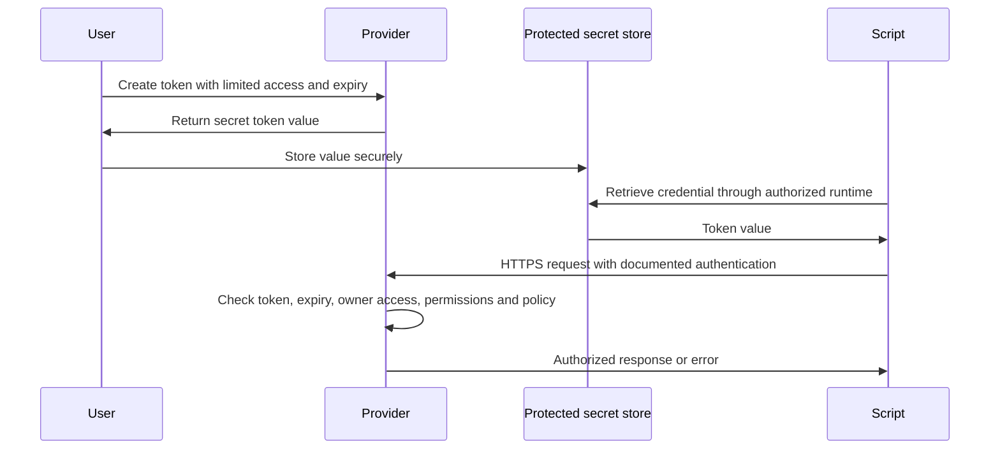

# Personal Access Tokens (PATs): what, how and why

Part 3 of the API connection study series · checked 2 October 2026

Related: [Part 1 — API authentication concepts](API_AUTHENTICATION_STUDY_GUIDE.md) · [Part 2 — Azure/GCP identity setup](AZURE_GCP_IDENTITY_SETUP_GUIDE.md)

**PAT usually stands for Personal Access Token.** You use it for programmatic access, which explains the name in your question, but “Programmatic Access Token” is not the standard expansion used by GitHub, GitLab or Azure DevOps. Consult the issuing product's terminology.

This guide explains the concept and provides read-only example requests. Tokens must come from your protected configuration, never from committed source. The examples were checked offline; no PAT was created, read, tested or revoked in writing this guide.

## Contents

1. [What a PAT is](#1-what-a-pat-is)
2. [How it works](#2-how-it-works)
3. [Why use one and when to choose something else](#3-why-use-one-and-when-to-choose-something-else)
4. [Step-by-step GitHub example](#4-step-by-step-github-example)
5. [Azure DevOps, GitLab and Databricks examples](#5-azure-devops-gitlab-and-databricks-examples)
6. [Store, rotate and revoke](#6-store-rotate-and-revoke)
7. [Troubleshooting and study questions](#7-troubleshooting-and-study-questions)

## 1. What a PAT is

A PAT is a secret credential issued by a service for API calls, command-line tools or supported integrations. A person typically creates it in account settings, names its purpose, chooses allowed permissions/resources and sets expiry.

It acts on behalf of its owning identity. For GitHub, a token cannot grant permissions its owner lacks; its own permissions narrow the owner's access further. It is not your account password, not automatically a JWT, and not a universal token for other providers. [GitHub PAT overview](https://docs.github.com/en/authentication/keeping-your-account-and-data-secure/managing-your-personal-access-tokens).

Think of a password as a general account credential, and a restricted PAT as a separately revocable credential for a particular integration. Narrowing it depends on the provider: classic, fine-grained and workspace-scoped tokens have different capabilities. Some products also issue PATs to application identities; do not assume every token called PAT belongs to a human.

| Property | Example meaning |
|---|---|
| Issuer | GitHub, Azure DevOps, GitLab or a Databricks workspace |
| Owner | Identity whose permissions the request uses |
| Allowed resources | Selected repositories, organization or workspace |
| Scopes/permissions | Read code, read builds, update issues, etc. |
| Expiration | Date after which new authenticated requests are rejected |
| Revocation | Issuer disables the credential before its expiry |

The token string is the sensitive value. Its display name, such as `study-read-repo`, is a label, not the credential.

## 2. How it works



This is a conceptual flow, not a claim about how the provider stores or validates token internals. The script usually presents the PAT directly; it does not perform a browser-consent exchange for every request.

**PAT describes the credential. Bearer or Basic describes how you send it.** A PAT can be used in a Bearer header, as the password in Basic authentication, or in another provider-defined header. The request contract determines which.

There is usually no companion OAuth refresh token in a manually created PAT workflow. Replacement, renewal and regeneration follow the issuer's rules. “Expires in 30 days” means you must plan replacement; it does not imply the script can silently refresh it forever.

| Credential/pattern | How it is obtained | How it is used |
|---|---|---|
| PAT | Issued through provider's token settings/API | Direct credential for that provider's supported operations |
| OAuth access token | Authorization-code, app or other supported grant | Resource API call until expiry |
| OAuth refresh token | Returned by a supported authorization flow | Token endpoint to obtain new access tokens |
| API key | Provisioned for the service/application | Provider-defined key authentication |
| Managed/workload identity | Runtime identity and configured trust | Acquires service-specific short-lived credentials |
| Key Vault/Secret Manager | Stores a secret value | Authorized code retrieves the stored PAT/key |

These are overlapping concepts, not mutually exclusive boxes: a PAT can be stored in Key Vault and sent as Bearer. [GitHub REST authentication](https://docs.github.com/en/rest/authentication/authenticating-to-the-rest-api), [Azure DevOps PAT transport](https://learn.microsoft.com/en-us/azure/devops/organizations/accounts/use-personal-access-tokens-to-authenticate?view=azure-devops).

## 3. Why use one and when to choose something else

### Useful reasons

- A personal script needs access to a private repository or supported API without storing the account password.
- A connector explicitly accepts a PAT and does not support the desired identity flow.
- You want separate credentials for separate integrations, each with limited access and expiry.
- You want to revoke one integration's credential without changing the general login password.

Example: a learning script reads files in one repository. A read-only token scoped to that repository makes the intended access clearer than sharing a broad account credential.

### Tradeoffs and alternatives

| Situation | Consider |
|---|---|
| Local GitHub CLI/Git work | GitHub CLI or Git Credential Manager; avoid manually managing a PAT when supported login suffices |
| GitHub Actions accessing its own repository | Built-in `GITHUB_TOKEN` with explicit minimal permissions |
| Durable GitHub organization integration | GitHub App with scoped installation permissions |
| Azure DevOps application automation | Supported Entra service principal/managed identity |
| User-delegated application serving many users | OAuth rather than asking users to paste PATs |
| GCP-hosted data job | Attached service account/ADC; a GitHub PAT has no GCP IAM authority |

GitHub Apps can provide an application identity rather than tying all access to one employee. Installation access tokens expire after one hour and can be narrowed to repositories/permissions; issuance still requires secure app authentication. [GitHub Apps](https://docs.github.com/en/apps/creating-github-apps/about-creating-github-apps/about-creating-github-apps), [installation access tokens](https://docs.github.com/en/apps/creating-github-apps/authenticating-with-a-github-app/generating-an-installation-access-token-for-a-github-app).

`GITHUB_TOKEN` is automatically provided to a workflow job and uses repository permissions you configure. It is distinct from your manually generated PAT. [Workflow token authentication](https://docs.github.com/en/actions/tutorials/authenticate-with-github_token).

Microsoft recommends Entra-based authentication for supported Azure DevOps integrations; use PATs for constrained cases such as local prototypes or unsupported tools. Choose the identity lifecycle the integration needs. [Azure DevOps authentication choices](https://learn.microsoft.com/en-us/azure/devops/integrate/get-started/authentication/authentication-guidance?view=azure-devops).

## 4. Step-by-step GitHub example

### Step 1 — define the smallest operation

For this exercise: read `README.md` in `MatthieudeLaMettrie/MDLM_CODEX_MEMORY` through the REST API. Do not grant write access for a read exercise.

### Step 2 — create a fine-grained PAT

1. GitHub profile → **Settings → Developer settings → Personal access tokens → Fine-grained tokens**.
2. Generate a token named for the exercise, with a short expiry.
3. Select the resource owner and **Only select repositories**; choose `MDLM_CODEX_MEMORY`.
4. Set **Contents: Read-only**. Keep unrelated permissions disabled.
5. Generate and put the value into protected credential storage. Organization-owned resources may require approval/policy checks.

Fine-grained tokens are preferable where supported; some features still require another credential type. [Create/manage GitHub PATs](https://docs.github.com/en/authentication/keeping-your-account-and-data-secure/managing-your-personal-access-tokens).

### Step 3 — deliver the value to your script

Populate `GITHUB_PAT` through your authorized secret-delivery mechanism. For Key Vault, a stored secret can be named `github-read-pat`; its retrieved value supplies the header below. The vault's identity is not automatically the GitHub identity. Refer to [Part 2](AZURE_GCP_IDENTITY_SETUP_GUIDE.md) for authorized vault reads.

### Step 4 — make a read-only request

```python
import os
import requests

pat = os.environ["GITHUB_PAT"]
if not pat:
    raise RuntimeError("GITHUB_PAT is empty")

r = requests.get(
    "https://api.github.com/repos/MatthieudeLaMettrie/MDLM_CODEX_MEMORY/contents/README.md",
    headers={
        "Authorization": f"Bearer {pat}",
        "Accept": "application/vnd.github+json",
        "X-GitHub-Api-Version": "2026-03-10",
    },
    timeout=30,
    allow_redirects=False,
)
print("GitHub HTTP status:", r.status_code)
r.raise_for_status()
data = r.json()
if data.get("type") != "file":
    raise RuntimeError("Expected a file response")
print("Repository file read succeeded; token and file contents not displayed")
```

The contents endpoint requires Contents read permission for a fine-grained token when accessing private resources. Public resources may be readable without authentication; success there alone does not demonstrate private-repository access. Verify the intended private resource if that is your actual goal. Version shown matches the official reference checked for this guide. [GitHub repository contents API](https://docs.github.com/en/rest/repos/contents#get-repository-content).

### Step 5 — distinguish REST from Git authentication

For Git **over HTTPS**, use a supported credential manager. If a tool explicitly requests a username/password, a GitHub PAT may serve as the password. Do not place it in a clone URL, remote configuration or command argument. Git **over SSH** uses SSH keys; it does not use a PAT password. Never infer that REST and Git clients take the same input just because they access the same repository. [GitHub credential management](https://docs.github.com/en/get-started/git-basics/caching-your-github-credentials-in-git).

## 5. Azure DevOps, GitLab and Databricks examples

### Azure DevOps: PAT as the Basic-auth password

For a build-read prototype, create an organization-scoped PAT in Azure DevOps user settings, select **Build: Read** and a short expiry. Deliver its value as `AZURE_DEVOPS_PAT`.

```python
import os
from urllib.parse import quote
import requests

organization = quote(os.environ["AZURE_DEVOPS_ORG"], safe="")
project = quote(os.environ["AZURE_DEVOPS_PROJECT"], safe="")
r = requests.get(
    f"https://dev.azure.com/{organization}/{project}/_apis/build/builds",
    params={"api-version": "7.1", "$top": 1},
    auth=("", os.environ["AZURE_DEVOPS_PAT"]),
    timeout=30,
    allow_redirects=False,
)
r.raise_for_status()
print("Azure DevOps build-read request succeeded")
```

Requests constructs `Authorization: Basic base64(:PAT)`. Base64 is encoding, not encryption; use HTTPS. This Azure DevOps PAT does not authenticate Azure Key Vault. A PAT scope also cannot grant build access its owning user lacks. [Azure DevOps PAT usage](https://learn.microsoft.com/en-us/azure/devops/organizations/accounts/use-personal-access-tokens-to-authenticate?view=azure-devops).

### GitLab: PRIVATE-TOKEN header

GitLab PATs can authenticate API calls and supported Git-over-HTTPS operations. Observe the instance's expiry/policy settings. [GitLab personal tokens](https://docs.gitlab.com/user/profile/personal_access_tokens/).

Choose only the scope needed: `read_api` allows read API use; `read_repository` serves repository reads and is not interchangeable with all API access. For the `/user` example below, `read_user` provides the required profile read access. [GitLab token scopes](https://docs.gitlab.com/security/tokens/access_token_scopes/).

```python
import os
import requests

r = requests.get(
    "https://gitlab.com/api/v4/user",
    headers={"PRIVATE-TOKEN": os.environ["GITLAB_PAT"]},
    timeout=30,
    allow_redirects=False,
)
r.raise_for_status()
print("GitLab user API request succeeded; profile not displayed")
```

For self-managed GitLab, use that instance's URL and token. GitLab also supports OAuth and other token types with different capabilities. [GitLab REST authentication](https://docs.gitlab.com/api/rest/authentication/).

### Azure Databricks: workspace credential, with OAuth preferred

Azure Databricks PATs authenticate workspace-level APIs; they are not a universal account-level credential or an Azure subscription token. The current documentation describes scoped tokens and workspace administrator controls, and recommends OAuth where possible. Service-principal PAT support is provider-specific, so the word “personal” does not establish a universal rule that every PAT must be human-owned.

For a supported existing PAT integration, use the target workspace host and documented token transport (commonly Bearer for REST); required API scope and resource permissions still apply. For new automation, evaluate Databricks OAuth/service-principal authentication before selecting a PAT. [Azure Databricks PAT authentication](https://learn.microsoft.com/en-us/azure/databricks/dev-tools/auth/pat).

## 6. Store, rotate and revoke

### Storage

Use Key Vault, Secret Manager or the connector's protected credential store. Deliver the value only to code that needs it. Keep one token per purpose/environment when practical, so replacement and revocation have a clear owner.

Do not put a PAT in source, notebook outputs, `.env` files tracked by Git, browser bundles, Git remote URLs, screenshots or raw HTTP logs. Environment variables are a delivery option, not a vault; never dump the process environment. Store nonsecret inventory such as provider, purpose, permissions, expiry and consumer locations. [API credential protection](https://docs.github.com/en/rest/authentication/keeping-your-api-credentials-secure).

### Routine replacement

1. Identify every consumer and the exact required permissions.
2. Create a replacement credential under the applicable policy.
3. Update protected storage and restart/reload consumers that cache values.
4. Test the actual operation under the intended runtime.
5. Revoke the old credential after consumers switch, where overlapping credentials are supported.
6. Update the nonsecret inventory and next review/expiry date.

Regeneration may immediately invalidate the old value; check your issuer before assuming overlap. If a token is exposed, prioritize revocation and incident review rather than waiting for a seamless migration. Removing the string from the latest Git file does not revoke it or remove earlier history.

A stored PAT still acts as its issuing identity. Putting a person's GitHub PAT in an application vault does not convert it into an independent service-account credential. Changes to that user's access can break the integration.

## 7. Troubleshooting and study questions

| Symptom | Check |
|---|---|
| 401 | Expired/revoked credential, wrong provider/host, missing or wrong authentication format |
| 403 | Required permission, organization policy/approval, owner access, rate limits; inspect sanitized service error |
| 404 for private repository | Repository path and token resource selection/access; providers may conceal private resources |
| API works but Git fails | HTTPS versus SSH, credential-manager cache and repository access |
| File reads work but writes fail | Read-only token, branch protection or missing write/workflow permission |
| Works manually but scheduled job fails | Different secret source, stale cached token, absent variable or different network |
| Suddenly fails after account changes | Token owner lost membership/resource access, account disabled or policy changed |
| Rotation appears ineffective | Inline value or cached credential still overrides the vault's replacement |

Status codes are clues, not a diagnosis. Log status and sanitized request/error identifiers; avoid exposing response bodies, tokens or credentials while debugging.

Try these before revealing the answers:

1. What does PAT normally stand for?
2. Is a PAT always sent as Bearer?
3. Can a read-only token give its user access to a repository they cannot otherwise read?
4. Does putting a PAT in Key Vault turn it into managed identity?
5. Does a PAT necessarily have an OAuth refresh token?
6. Why might a service-owned integration prefer a GitHub App?
7. Does a public README read prove private-repository permission?
8. Does deleting a token from a notebook revoke it?

<details>
<summary>Reveal answers</summary>

1. Personal Access Token; it is used for programmatic access.
2. No. Transport follows the provider contract: Bearer, Basic or a documented token header.
3. No. The owner's access and token permissions both matter.
4. No. Storage and identity are separate layers.
5. No. Manual PAT issuance normally has issuer-specific replacement rules instead.
6. Application identity, installation/resource permissions and a lifecycle independent of a person's account.
7. No. Public resources may allow unauthenticated reads.
8. No. Revoke it at the issuer and assess any exposure separately.

</details>

Study lab: choose one read operation, identify its provider/owner/resource/permission/transport, draw the secret-delivery path, and write a replacement plan before creating any token.
