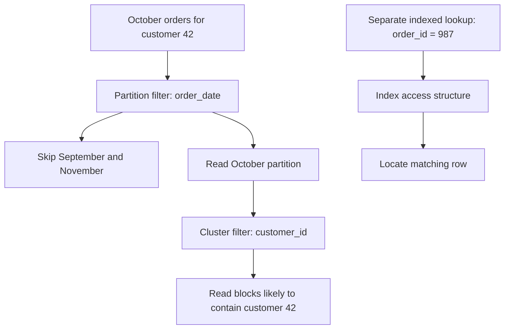
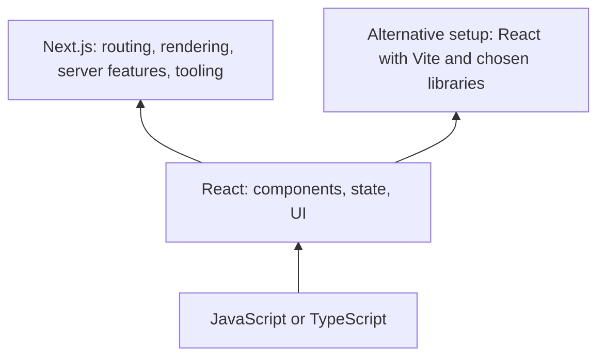
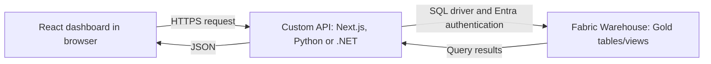
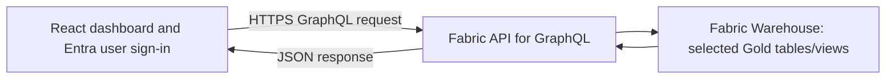
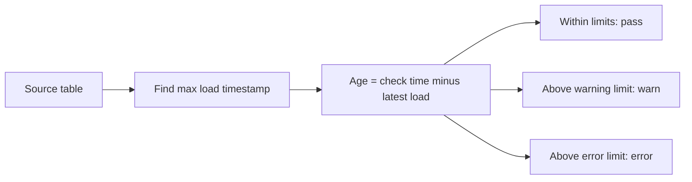

# Data, web development and dbt: practical concepts

Checked against official documentation on 6 October 2026. Examples are educational and have not been executed against a warehouse. SQL dialects and dbt adapter/version support differ.

## 1. Indexing, partitioning and clustering

Consider an `orders` table with `order_id`, `customer_id`, `order_date`, `country`, `status`, `updated_at` and `_loaded_at`.

| Technique | What it does | Candidate columns and use case |
| --- | --- | --- |
| Indexing | Creates an access structure that helps locate rows without scanning the whole table. A conventional B-tree secondary index is the example here. | `order_id` for one order; `customer_id` for a customer's orders; `(customer_id, order_date)` for a customer's orders within a date range. |
| Partitioning | Splits one logical table into separately managed segments. A qualifying filter can skip entire segments. | `order_date` by day/month when reporting and retention use dates. Some databases also support list partitions such as region and hash partitions such as customer buckets. |
| Clustering | Organizes related values near each other in physical storage, helping the engine skip irrelevant blocks. Exact meaning varies by engine. | In BigQuery, partition by `order_date` and cluster by `customer_id` if queries filter by date and customer. On Snowflake, consider date expressions and frequently filtered business dimensions for large tables. |

These can coexist where the engine supports them. Select columns from actual query patterns, data size and maintenance cost, rather than automatically using the primary key for every technique. [PostgreSQL indexes](https://www.postgresql.org/docs/current/indexes.html), [BigQuery partitioning](https://docs.cloud.google.com/bigquery/docs/partitioned-tables), [BigQuery clustering](https://docs.cloud.google.com/bigquery/docs/clustered-tables).



**Index example — PostgreSQL:**

```sql
create index idx_orders_customer_date
on orders (customer_id, order_date);

select *
from orders
where customer_id = 42
  and order_date >= date '2026-10-01'
  and order_date < date '2026-11-01';
```

The customer equality filter followed by a date range makes this a useful composite B-tree candidate. Leading columns generally matter; optimizers may have additional techniques. Indexes consume storage and add write maintenance. A low-selectivity filter such as `status = 'completed'` matching 95% of rows may benefit little from a simple index. [Composite indexes](https://www.postgresql.org/docs/current/indexes-multicolumn.html).

**Partition and cluster example — BigQuery:**

```sql
create table analytics.orders
partition by order_date
cluster by customer_id, country
as select * from raw.orders;
```

Here `order_date` is a DATE. Partitioning bounds the date segments scanned; clustering can reduce blocks scanned inside them. Cluster column order matters: choose `customer_id` first when customer filtering dominates, or reconsider the order when country filtering dominates. Avoid creating huge numbers of tiny partitions. [BigQuery partitioning](https://docs.cloud.google.com/bigquery/docs/partitioned-tables), [cluster ordering](https://docs.cloud.google.com/bigquery/docs/clustered-tables).

**Platform distinction:** Snowflake standard analytical tables use automatic micro-partitions; you do not normally create traditional B-tree indexes or manually declare daily partitions for them. A clustering key influences organization across micro-partitions. A raw unique ID or nanosecond timestamp is not automatically a good key: an expression such as `to_date(order_timestamp)` may be more useful. Explicit clustering has a maintenance cost. Other engines use “clustered index” or “CLUSTER” with different semantics; warehouse clustering is not automatically the same feature. [Snowflake clustering keys](https://docs.snowflake.com/en/user-guide/tables-clustering-keys).

## 2. FULL OUTER JOIN versus CROSS JOIN

`FULL JOIN` normally means `FULL OUTER JOIN`: match rows using a condition, retain unmatched rows from both inputs, and fill missing-side columns with NULL. `CROSS JOIN` produces every possible pair, without a matching condition. [SQL join definitions](https://www.postgresql.org/docs/current/queries-table-expressions.html).

Suppose CRM has customer IDs **1, 2** and billing has **2, 3**, each unique.

```sql
select c.customer_id as crm_id, b.customer_id as billing_id
from crm_customers c
full outer join billing_customers b
  on c.customer_id = b.customer_id;
```

| crm_id | billing_id | Interpretation |
| --- | --- | --- |
| 1 | NULL | CRM only |
| 2 | 2 | Match |
| NULL | 3 | Billing only |

Use this to reconcile two systems. It is not simply concatenation: matching records share a result row.

```sql
select c.customer_id as crm_id, b.customer_id as billing_id
from crm_customers c
cross join billing_customers b;
```

| crm_id | billing_id |
| --- | --- |
| 1 | 2 |
| 1 | 3 |
| 2 | 2 |
| 2 | 3 |

Use a cross join for deliberate combinations: 100 products × 30 calendar dates = 3,000 product/date rows, then left join actual sales to show zero-sale days.

Cross join cardinality is N × M. Full join cardinality depends on the condition and duplicates: three left rows and two right rows sharing one key produce six matched rows. Result order is unspecified without `ORDER BY`. [SQL join definitions](https://www.postgresql.org/docs/current/queries-table-expressions.html).

## 3. React versus Next.js

React is a library for building interfaces from components. Next.js is a framework built on React, adding application structure, routing, server capabilities and tooling. A Next.js page still contains React components. [React introduction](https://react.dev/learn), [Next.js introduction](https://nextjs.org/docs).

### What they are, why use them, and five simple examples each

Both are free software tools developers use when writing website code. JavaScript is a programming language; React is a collection of ready-made code tools (a library); Next.js is a larger application toolkit (a framework) built around React. Neither automatically creates a finished website.

**React helps you build what people see and interact with on a page.** Developers write small reusable pieces called components, such as buttons, menus and question cards. React helps keep the display consistent when information changes. Use it when a site has many interactive or repeated pieces; a simple static page may need only HTML and CSS. [React introduction](https://react.dev/learn).

Five simple React examples:

1. **Like button:** click a heart and the count changes from 4 to 5.
2. **Shopping basket:** add a $10 toy and the displayed total increases by $10.
3. **Quiz:** select an answer and the page displays “Correct!” or “Try again.”
4. **Searchable list:** type “cat” and a local list shows only items containing “cat”.
5. **Repeated product cards:** write one product-card component and reuse it for 20 products, each with its own name, picture and price.

**Next.js helps you assemble and run a whole website using React.** It supplies conventions and tools for page addresses, shared page layouts, preparing content and running server code. Use it when you want these website-level tools together rather than assembling the surrounding stack yourself. [Next.js introduction](https://nextjs.org/docs).

Five simple Next.js examples:

1. **Pages with addresses:** organise Home at `/`, About at `/about` and Contact at `/contact`.
2. **Individual product pages:** use one page design to show a teddy bear at `/products/teddy` and a toy car at `/products/car`.
3. **A shared header:** put the same logo and menu above every page using a shared layout; React builds that header.
4. **A prepared blog page:** prepare an article's content before delivering it to the visitor, so the initial page already contains the article text.
5. **A contact form with server handling:** React builds the form; a Next.js server handler runs the developer's code to accept its submitted message and send it to storage or an email service. The developer still implements storage/email and validation.

The examples overlap deliberately: every Next.js application uses React for its interface. These are jobs that each tool helps with, not exclusive capabilities. Other libraries/frameworks can supply comparable website features.

For an exam site, React builds answer buttons and the changing score; Next.js connects that interface to `/courses` and `/practice` pages and the server code. You choose either **React with other supporting tools** or **React through Next.js**. React can build a complete interface, not merely isolated buttons, and is not limited to browser rendering.

### Explain it like I am 10

**Kitchen analogy:** React is the set of reusable recipes and tools for assembling the dishes customers see. A recipe is like a component: you can reuse it with different ingredients, just as one product-card component can display different products. When the order changes, React helps update the dish you present.

Next.js is an organised restaurant kitchen built around those React recipes and tools. It adds systems for directing orders to the right station (page routing), preparing parts of a meal before delivery (server/static rendering), and running work behind the counter (server code). You still use React to assemble the dishes. The developer is the cook who writes the recipes and decides what happens; neither tool automatically creates the finished restaurant.

For a pizza shop: React builds the pizza customiser and updates the displayed price when you add cheese. Next.js organises `/menu` and `/order`, can prepare the menu page before delivery, and runs the server code you write to receive the order. These are roles in the analogy, not exclusive capabilities.

Imagine building a LEGO toy shop.

**React is your box of reusable building pieces.** You make a product card, a search box and an “Add to basket” button. These are called components. React helps the pieces react to your actions: click the button and the basket number changes.

**Next.js is a building kit that uses those React pieces and includes extra equipment and instructions.** It helps arrange the shop into pages, gives each page an address such as `/toys` or `/basket`, and can prepare page content on a server before sending it to the visitor. A server is another computer doing work for the website. [Next.js overview](https://nextjs.org/docs).

You can build with React and choose the other equipment yourself, or use Next.js to get more of it together. Learning Next.js still involves learning React.

For an exam-practice website, React makes the question card, answer buttons and changing score. Next.js can organise the `/courses`, `/practice` and `/results` pages and prepare public course information before someone opens it. Both approaches can build the site; the choice concerns the surrounding application tools.

**Preparing a page:** client rendering is like receiving pieces and building the display on your computer. Server rendering is like receiving a display already assembled by another computer; browser code can then make it interactive. Next.js supports several combinations of server, static and client rendering. React also has server-rendering capabilities. [Server and Client Components](https://nextjs.org/docs/app/getting-started/server-and-client-components).

The [linked freeCodeCamp article](https://www.freecodecamp.org/news/next-vs-react/) dates from 3 April 2023. Its library/framework comparison is useful, but several claims need qualification: Next.js is a full-stack React framework, React is not inherently limited to client rendering, server rendering is not always faster, and authentication still needs an implementation or an authentication library/provider. [Next.js overview](https://nextjs.org/docs), [authentication guide](https://nextjs.org/docs/app/guides/authentication).



| Need | React library | Next.js framework |
| --- | --- | --- |
| Buttons, forms, interactive tables | Components, state and hooks | Uses the same React concepts |
| `/products/42` page routing | Add a router or framework | File-based routing |
| Server rendering / static pages | React provides primitives; assemble an appropriate stack | Integrated rendering options |
| Server endpoints | Requires an accompanying backend/framework | Route handlers and server features |
| Build tooling | Select tooling, e.g. Vite | Integrated tools and conventions |

**Use case — internal dashboard:** React with Vite and an existing API can be a straightforward choice when the backend already exists and public search indexing is unimportant.

**Use case — public catalogue or learning site:** Next.js is useful when public pages, metadata, server data access and interactive React components belong in one application. It offers more integrated features and more framework conventions to learn. Server rendering can help deliver usable initial content, but does not guarantee SEO rankings.

In the Next.js App Router, pages/layouts are Server Components by default. Interactive pieces use Client Components, typically marked with `'use client'`. Client Components can also be prerendered on the server and then hydrated in the browser; “client” does not mean browser-only initial rendering. React is not inherently restricted to browser rendering. [Next.js Server and Client Components](https://nextjs.org/docs/app/getting-started/server-and-client-components).

### React dashboard with Fabric Gold data

Yes: React can build a dashboard whose data comes from the Gold layer in a Fabric Warehouse. The Warehouse is the analytical data store. An API/service supplies the application backend that accepts browser requests, checks access and returns data.

Two useful architectures are:





**Custom API:** React requests a business endpoint such as `/api/sales?month=2026-10`. A Next.js route handler, Python FastAPI service or .NET API validates the user and filter, queries a curated Gold view, and returns a small JSON result. The server connects through Fabric's SQL/TDS endpoint using a compatible SQL driver and Microsoft Entra authentication. That server-to-warehouse connection is SQL, whereas browser-to-server traffic is HTTPS. Fabric supports Entra user and service-principal identities; SQL username/password authentication is not supported. [Warehouse connectivity](https://learn.microsoft.com/en-us/fabric/data-warehouse/connectivity).

For example, a parameterized server query might select daily totals:

```sql
select sale_date, sum(revenue) as revenue
from gold.sales_daily
where sale_date >= @start_date
  and sale_date < @end_date
group by sale_date
order by sale_date;
```

The illustrative `gold.sales_daily` is an authored Gold table/view, not a built-in Fabric object. The API turns the result into an array such as `[{"date":"2026-10-01","revenue":12500}]`. React uses those values to draw the chart. Use driver parameters, not concatenated user input, and keep query scope bounded.

**Fabric API for GraphQL:** create a GraphQL API item, expose selected Gold objects, register the React application in Microsoft Entra, configure SPA user sign-in, and grant API/data access. Fabric generates the data API, so you can avoid writing a custom CRUD service for supported objects. Microsoft provides a React integration walkthrough. With SSO, callers require both GraphQL execution permission and appropriate data-source permissions. Browser sign-in uses an appropriate SPA flow such as PKCE, without a client secret. [GraphQL overview](https://learn.microsoft.com/en-us/fabric/data-engineering/api-graphql-overview), [React connection walkthrough](https://learn.microsoft.com/en-us/fabric/data-engineering/connect-apps-api-graphql).

**Where Next.js fits:** it can host the React dashboard and its custom server API in one application. Next.js is optional: React can call a separately hosted Python/.NET/Node service, or the managed GraphQL API. Calling Fabric's GraphQL API directly from the browser still uses a backend service; Fabric provides it.

**Access control:** keep service-principal secrets and database tokens used by the server out of React bundles. A browser can hold its signed-in user's short-lived access token for an authorized API call, but must not contain an application client secret. Grant only necessary Gold data access. If a custom API queries as one shared service principal, Fabric sees that identity rather than automatically seeing each dashboard user; enforce user/tenant data access in the API or design delegated access. Hiding rows in a React chart is not authorization. [Fabric Warehouse security](https://learn.microsoft.com/en-us/fabric/data-warehouse/security), [GraphQL application authentication](https://learn.microsoft.com/en-us/fabric/data-engineering/connect-apps-api-graphql).

**Another option:** embed a Power BI report inside React, backed by a semantic model over Gold data, if Power BI already supplies the desired charts, measures and interactions. This has its own authentication and capacity/licensing requirements. [Power BI embedding](https://learn.microsoft.com/en-us/power-bi/developer/embedded/embed-sample-for-customers).

For a read-only internal dashboard, evaluate managed GraphQL first if its generated schema and permitted query patterns fit. Choose a custom API for tailored metrics, caching or application-specific access rules; use Gold aggregates/views to avoid returning millions of detail rows. Warehouse is an analytical source, so benchmark realistic query load, add caching where useful, and display data-as-of time. No universal response-time or live-data guarantee follows from using an API.

Kitchen continuation: React displays the menu and order status; the API is the waiter carrying requests and results; Fabric Gold is the pantry of prepared, curated data. Next.js can supply both the React interface framework and the server that handles the requests.

## 4. Incremental options in dbt

Incremental models preserve an existing table and process selected data on later runs, reducing repeated transformation work. They are useful when rebuilding all history is expensive; a small table may be simpler to rebuild.

There are two decisions: **which input rows to process**, and **how to write their results into the target**. Selecting `merge` does not itself find every changed source row. First creation normally processes the full model query; `is_incremental()` becomes true when the target exists as a table, materialization is incremental, and full refresh is not requested. [Incremental model configuration](https://docs.getdbt.com/docs/build/incremental-models).

| Strategy | Write behaviour | Use case |
| --- | --- | --- |
| `append` | Insert selected rows; retain existing rows. | Immutable events with reliable selection of unseen records. Reprocessing rows creates duplicates. |
| `merge` | Match by `unique_key`; update matches and insert new keys. | Orders changing from pending to shipped; maintain current state. |
| `delete+insert` | Delete target rows for incoming keys, then insert their replacement rows. | Replace a complete group, e.g. all lines for each affected order. Supply the whole replacement group. |
| `insert_overwrite` | On BigQuery/Spark-style partition implementations, replace selected partitions. | Rebuild the last three days of sales when late data changes totals. Supply complete partitions. |
| `microbatch` | Process time windows as separate batches. | Large event histories needing bounded reruns and backfills. |

Availability depends on adapter/version. Custom strategies are also possible on supported adapters. A strategy name does not guarantee identical warehouse behaviour. [dbt strategy reference](https://docs.getdbt.com/docs/build/incremental-strategy).

**Before/after example:** target has `101: pending`, `102: shipped`; incoming data has `101: shipped`, `103: pending`.

- Append leaves both versions of 101 and inserts 103.
- Merge with `unique_key='order_id'` updates 101, retains 102, and inserts 103.
- Delete+insert with that key replaces 101, retains 102, and inserts 103.
- Partition overwrite replaces whole selected dates, including rows absent from the incoming result. It needs complete date contents, not just changed orders.

**Snowflake exception:** `insert_overwrite` replaces the entire table, rather than selected date partitions. Applying a three-day input filter would discard older target data. [Snowflake adapter behaviour](https://docs.getdbt.com/reference/resource-configs/snowflake-configs), [BigQuery partition overwrite](https://docs.getdbt.com/reference/resource-configs/bigquery-configs).

**Merge model — Snowflake SQL example:**

```sql
{{ config(
    materialized='incremental',
    incremental_strategy='merge',
    unique_key='order_id'
) }}

select order_id, customer_id, order_date, status, updated_at
from {{ source('raw', 'orders') }}


where updated_at >= (
    select dateadd(
        day, -3,
        coalesce(max(updated_at), '1900-01-01'::timestamp)
    )
    from {{ this }}
)

```

`updated_at` detects changes; `order_id` identifies the row to update. The three-day overlap is an illustrative late-arrival allowance, not a guarantee. Ensure incoming keys are unique and non-null; `unique_key` config does not create or test a database uniqueness constraint. Deduplicate deterministically if necessary. [Unique key configuration](https://docs.getdbt.com/reference/resource-configs/unique_key).

The source timestamp must change for every relevant update. Late records outside the overlap are missed; null/future timestamps need handling. A change in a joined customer table may require reprocessing affected orders even when their `updated_at` did not change. Normal upsert merge does not automatically delete target rows whose source record disappears: use tombstones/CDC and explicit deletion logic. Use snapshots when you need SCD2 history rather than just current values.

**Microbatch model — illustrative Snowflake configuration:**

```sql
{{ config(
    materialized='incremental',
    incremental_strategy='microbatch',
    event_time='event_at',
    begin='2026-01-01',
    batch_size='day',
    lookback=3
) }}

select event_id, event_at, customer_id
from {{ source('raw', 'events') }}
```

Configure `event_time` on upstream sources/models that should be automatically filtered. `lookback` reprocesses prior batches for late arrivals. Other adapters may require `partition_by` or `unique_key`; the batch write implementation is adapter-specific. [Microbatch configuration](https://docs.getdbt.com/docs/build/incremental-microbatch).

## 5. Data freshness in dbt

Freshness measures whether the newest available data exceeds an allowed age. It detects staleness; it does not ingest or repair data. For conventional source checks, dbt evaluates a latest timestamp against the warehouse current time and applies warning/error thresholds. [Sources and freshness](https://docs.getdbt.com/docs/build/sources).



**Source configuration — dbt v1.10+ syntax:**

```yaml
version: 2

sources:
  - name: raw
    database: raw
    schema: commerce
    tables:
      - name: orders
        config:
          loaded_at_field: _loaded_at
          freshness:
            warn_after: {count: 2, period: hour}
            error_after: {count: 4, period: hour}
```

`version: 2` is the YAML schema version, not the installed dbt version. `loaded_at_field` selects the column/expression; `freshness` defines limits. Freshness moved under `config` in v1.9 and `loaded_at_field` in v1.10. [Freshness configuration](https://docs.getdbt.com/reference/resource-configs/freshness).

For dbt v1:

```bash
dbt source freshness --select source:raw.orders
```

The conceptual query is `select max(_loaded_at), current_timestamp from raw.commerce.orders`. At 12:00, a latest load at 11:00 passes, 09:00 warns and 07:00 errors with the example thresholds. Schedule the command and explicitly gate downstream builds if failures should stop the pipeline; ordinary v1 `dbt build` does not implicitly run source freshness. [Source command](https://docs.getdbt.com/reference/commands/source).

**Version distinction:** current docs describe dbt v2 `dbt freshness` for configured sources and models, including model-level freshness config. `dbt source freshness` remains supported for sources. Use the command/config supported by your installed version. [dbt v2 upgrade notes](https://docs.getdbt.com/docs/dbt-versions/dbt-upgrade/upgrading-to-v2).

**Which field should measure freshness?** Choose it according to the question being asked:

| Column | Meaning | Practical interpretation |
| --- | --- | --- |
| `_loaded_at` / ingestion timestamp | Arrival in the warehouse | Best signal for “is new data reaching this table?” |
| `updated_at` | Change in the source application | Useful only if that change clock is the intended SLA; a healthy sync can bring no changes. |
| `created_at` / `event_at` | Creation/business event time | Measures newest event age; can appear stale during quiet periods and fresh even if other deliveries are delayed. |
| `order_date` | Business day | Coarse daily signal; cast to timestamp if needed, and use daily thresholds. |

Use a consistent timezone, normally UTC. Do not manufacture freshness by setting `current_timestamp` in a view: that proves the view was queried, not that data arrived.

**If the table has no timestamp:**

1. Add an ingestion timestamp at load time if you control the loader.
2. Use adapter-supported warehouse metadata by omitting `loaded_at_field`. Check what it measures: Snowflake's `LAST_ALTERED` can advance on DDL and background maintenance, so it is weaker evidence of new data delivery. [Snowflake freshness limitation](https://docs.getdbt.com/reference/resource-configs/snowflake-configs).
3. If a loader records successful per-table delivery, use v1.10+ `loaded_at_query` to obtain that timestamp:

```yaml
        config:
          loaded_at_query: |
            select max(completed_at)
            from ops.load_audit
            where table_name = 'orders'
              and status = 'success'
          freshness:
            warn_after: {count: 2, period: hour}
            error_after: {count: 4, period: hour}
```

This replaces `loaded_at_field`; do not configure both. Ensure “success” means a completed delivery for the exact database/schema/table, not merely a job starting or succeeding without loading it. [Freshness configuration](https://docs.getdbt.com/reference/resource-configs/freshness).

4. With no row timestamp, usable metadata or audit record, there is no reliable temporal signal. Add instrumentation. Counts/checksums can detect some changes but cannot prove how recent data is. An unchanged reference table may be healthy; monitor successful synchronizations or adjust its SLA rather than requiring new rows every hour.

A recent maximum timestamp proves only that at least one recent value exists. It does not prove complete delivery for every store, partition or business day. Pair freshness with completeness/volume checks when that matters. Source results are available in `sources.json`; configured checks must actually be scheduled. [Freshness artifact](https://docs.getdbt.com/reference/artifacts/sources-json).

### Does dbt create a timestamp automatically?

**Freshness checks do not add a timestamp column to the source. A source table does not always need its own timestamp column, but the check needs a meaningful time signal.** It can come from a column/expression, adapter-supported metadata or a custom audit query. [Freshness configuration](https://docs.getdbt.com/reference/resource-configs/freshness).

You can explicitly write a dbt model that adds a column:

```sql
-- BigQuery example: models/Bronze/orders.sql
{{ config(materialized='table') }}

select
    order_id,
    status,
    current_timestamp() as dbt_processed_at
from {{ source('raw', 'orders') }}
```

When materialized as a table, the timestamp is stored in the model output. It does not alter the original source table. Rebuilding this table restamps every output row; an incremental model stamps the rows processed according to its selection and write strategy. A view evaluates `current_timestamp()` when queried instead of preserving a build-time stamp. [Materializations](https://docs.getdbt.com/docs/build/materializations).

**Example:** the source stopped receiving orders on Monday. You run the model on Friday. The generated `dbt_processed_at` says Friday, even though the source data is still from Monday. That timestamp can measure transformation processing; it cannot establish source arrival freshness. This is a consequence of the SQL above, not a mechanism for recovering an unknown original load time.

Choose the clock deliberately:

| Question | Appropriate signal |
| --- | --- |
| When did these rows arrive in the warehouse? | An ingestion timestamp captured by the loader |
| When did dbt process these rows? | An explicitly generated and materialized `dbt_processed_at` |
| When did the last successful source synchronization complete, even with no changed rows? | A trustworthy loader audit/heartbeat timestamp |

For a source without any timestamp, prefer a loader timestamp or successful-load audit. Metadata can be an alternative where supported; Snowflake's `LAST_ALTERED` can move for reasons other than new data. Neither configuring `loaded_at_field: _loaded_at` nor running a freshness check creates that column. Without a column, usable metadata or audit signal, dbt cannot infer the original arrival date. [Freshness configuration](https://docs.getdbt.com/reference/resource-configs/freshness), [Snowflake metadata limitation](https://docs.getdbt.com/reference/resource-configs/snowflake-configs).

### Where freshness configuration lives

**Distinguish the resource from the file:** a source is an existing raw table declared under `sources:`; a model is a transformation defined by SQL and documented under `models:`. A source declaration can live in the same YAML as model properties, but the `sources:` and `models:` keys still target different resources. Merely calling `source()` from a SQL model does not put that source's freshness policy on the model. [Source declarations](https://docs.getdbt.com/docs/build/sources).

| Resource and engine | Property YAML | dbt_project.yml | Model SQL config() |
| --- | --- | --- | --- |
| Source freshness, current syntax | Yes, under sources/source/table config | Yes, under sources with + configs and correct resource path | No; a model SQL config applies to the model |
| Model age checks in dbt v2 | Yes, under models/model config | Yes, under models with + configs | Yes |
| Conventional dbt v1 source freshness | Yes | Yes with supported source config syntax | Does not add built-in model-age checks |

The currently documented source/model age-check feature uses `dbt freshness` in v2. Conventional v1 uses `dbt source freshness` for sources; use a custom/package data test if you need model-age validation there. `freshness.build_after`, used in eligible dbt platform orchestration, is a scheduling setting and should not be confused with warning/error age thresholds. A reported Fusion/version label alone should not be treated as proof that every current v2 feature is enabled. [Freshness command](https://docs.getdbt.com/reference/commands/freshness), [v2 upgrade](https://docs.getdbt.com/docs/dbt-versions/dbt-upgrade/upgrading-to-v2).

**Source YAML example — v1.10+ syntax, also used in current v2:**

```yaml
# models/staging/commerce/_commerce_sources.yml
version: 2

sources:
  - name: commerce
    schema: raw_commerce
    config:
      loaded_at_field: _loaded_at
      freshness:
        warn_after: {count: 2, period: hour}
        error_after: {count: 4, period: hour}
    tables:
      - name: customers
      - name: orders
        config:
          freshness:
            warn_after: {count: 1, period: hour}
            error_after: {count: 2, period: hour}
```

Both tables inherit the load column. Customers use the source-level thresholds; orders override them with stricter thresholds. Use common source-level settings only when they actually fit every inherited table. Set `freshness: null` for a table intentionally excluded. Freshness moved under `config` in v1.9, and `loaded_at_field` in v1.10; older tutorials have different nesting. [Freshness reference](https://docs.getdbt.com/reference/resource-configs/freshness).

**Project defaults example:**

```yaml
# dbt_project.yml (fragment; demo is the project's actual name)
sources:
  demo:
    +freshness:
      warn_after: {count: 12, period: hour}
      error_after: {count: 24, period: hour}
```

This sets defaults for sources in `demo`; it does not declare the sources themselves. Resource paths can narrow the scope; include relevant subfolders when required by the source's YAML location. [Source configurations](https://docs.getdbt.com/reference/source-configs).

**Model property YAML example — dbt v2 age checks:**

```yaml
# models/marts/fct_orders.yml
version: 2

models:
  - name: fct_orders
    config:
      loaded_at_field: _loaded_at
      freshness:
        warn_after: {count: 3, period: hour}
        error_after: {count: 6, period: hour}
```

Here `_loaded_at` must be in the output of `fct_orders`. A source can be fresh while a materialized mart is stale because its dbt job did not run. Check the source before transformations and critical outputs after transformations. [Freshness command](https://docs.getdbt.com/reference/commands/freshness).

**Equivalent model SQL configuration — dbt v2:**

```sql
-- models/marts/fct_orders.sql
{{ config(
    materialized='table',
    loaded_at_field='_loaded_at',
    freshness={
        'warn_after': {'count': 3, 'period': 'hour'},
        'error_after': {'count': 6, 'period': 'hour'}
    }
) }}

select order_id, _loaded_at
from {{ ref('stg_commerce__orders') }}
```

This is an alternative to setting the same model freshness rule in YAML. Model config precedence is SQL `config()` over model YAML `config` over project defaults; avoid duplicating a rule across locations. Most-specific folder/model paths win within the project configuration. [Model configurations](https://docs.getdbt.com/reference/model-configs).

Model defaults can also go under `models: demo: marts:` in `dbt_project.yml`, with `+loaded_at_field` and `+freshness`. Apply a shared field only when every affected model outputs it. In v2, views/external models need a field or query, ephemeral models do not support freshness, and eligible materialized models can use supported adapter metadata when a field/query is absent. [Freshness reference](https://docs.getdbt.com/reference/resource-configs/freshness).

### What loaded_at_field actually means

It is the name of an existing timestamp column, or a SQL expression yielding timestamps, in the resource being checked. dbt normally takes its MAX, not the age of each individual row. It is not the name of the YAML file, the model name, a new column definition, or an instruction to create a timestamp.

If raw data has `_loaded_at` and staging renames it `ingested_at`, source freshness uses `_loaded_at`; model freshness on staging uses `ingested_at`. The name must exist at the checked layer. For example, at 12:00, row load times of 08:00, 09:00 and 11:30 give a latest load of 11:30 and age of 30 minutes. This can pass even though many older rows remain, which is normal for historical data.

Prefer the loader's accurate arrival/synchronization timestamp when the SLA concerns ingestion. Use application `updated_at` or event time only when their business clock is what you intend to measure. A BigQuery DATE can be expressed as `CAST(order_date AS TIMESTAMP)`, but midnight precision cannot support meaningful minute-level arrival monitoring. Check timestamp type, timezone and null/future values. An ingestion clock measures row arrival, while a successful synchronization audit can establish that a healthy no-change sync occurred. Do not set `loaded_at_field` to `current_timestamp()` just to pass. [Source configurations](https://docs.getdbt.com/reference/source-configs), [Sources](https://docs.getdbt.com/docs/build/sources).

### One YAML per model or per stage?

Both are valid. The YAML filename is organisational; `models: - name:` links the declaration to the SQL model name. A file called `staging.yml` can document several models. One model's property declaration should not be duplicated across several YAML files. These are property files containing tests/descriptions as well as configs, rather than only configuration files. [Model properties](https://docs.getdbt.com/reference/model-properties), [Configs and properties](https://docs.getdbt.com/reference/configs-and-properties).

For a small learning project, the existing short folder-level files remain reasonable. For growth, prefer a hybrid:

- Source declarations/freshness: one source YAML per source system, listing its tables.
- Shared settings such as staging-as-view: `dbt_project.yml` folder defaults.
- Model tests/descriptions and individual freshness overrides: YAML beside the corresponding SQL, especially for substantial models and marts.
- Small, closely related models can stay together when that is clearer; avoid one enormous YAML for an entire growing stage.

```text
dbt_project.yml
models/
  staging/
    commerce/
      _commerce_sources.yml
      stg_commerce__orders.sql
      stg_commerce__orders.yml
      stg_commerce__customers.sql
      stg_commerce__customers.yml
  intermediate/
    int_orders_enriched.sql
    int_orders_enriched.yml
  marts/
    fct_orders.sql
    fct_orders.yml
```

Per-model files keep code and documentation together and reduce unrelated edits/conflicts. Grouped files are convenient when short. Neither layout changes query performance or makes freshness checks automatic. The current dbt staging guide illustrates per-model YAML and a shared source file; this recommendation is an organisational choice, not a mandatory dbt rule. [dbt staging structure](https://docs.getdbt.com/best-practices/how-we-structure/2-staging).

## 6. dbt layers versus Bronze, Silver and Gold

Using Bronze/Silver/Gold is valid. There is no universally best folder vocabulary. dbt recommends staging/intermediate/marts as a starting point, while explicitly allowing documented, consistent alternatives. For a new dbt project, my recommendation is to use that vocabulary inside the codebase and document how its outputs fit the wider medallion architecture. This is advice, not a requirement to rename the user's existing project. [dbt structure overview](https://docs.getdbt.com/best-practices/how-we-structure/1-guide-overview).

The two patterns describe overlapping concerns:

- **Medallion layers** describe data becoming progressively more usable across the platform: raw Bronze, cleaned/conformed Silver, business-ready Gold. Ingestion into Bronze may happen before dbt starts. [Fabric medallion architecture](https://learn.microsoft.com/en-us/fabric/onelake/onelake-medallion-lakehouse-architecture).
- **dbt layers** describe transformation responsibilities: staging standardizes individual sources, intermediate breaks complicated transformations into understandable steps, and marts publish business entities for consumers. [dbt staging](https://docs.getdbt.com/best-practices/how-we-structure/2-staging), [dbt intermediate](https://docs.getdbt.com/best-practices/how-we-structure/3-intermediate), [dbt marts](https://docs.getdbt.com/best-practices/how-we-structure/4-marts).

### A useful mapping, not an exact equivalence

| Pipeline part | Responsibility and example | Typical medallion placement |
| --- | --- | --- |
| Raw ingested source | Preserve source orders for traceability/reprocessing; ingestion is commonly outside dbt | Bronze |
| Staging | Rename `OrderID` to `order_id`, cast dates, standardize status; generally one staging model per source table | Usually Silver |
| Intermediate | Sum payments to order grain, combine reusable transformations | Often Silver; placement depends on whether outputs are preparation steps or published business products |
| Marts | Publish `fct_orders` and `dim_customers` for reporting | Usually Gold |

This mapping is an architectural interpretation, not a mandatory dbt mapping. In particular, **staging is not automatically Bronze**: renaming and casting source data already transforms it. A project can name a source wrapper `Bronze`, but should explain whether it preserves raw data or represents the first dbt transformation step.

### One simple orders example

An ingestion tool lands unchanged orders in Bronze. A dbt source declaration points to that existing table; it does not create or load it. `stg_shop__orders` standardizes names/types. `int_payments_summed_to_orders` prepares one payment total per order. `fct_orders` joins these into a tested, consumer-facing model with one row per order.

```text
Raw orders and payments [Bronze; ingestion]
  -> stg_shop__orders / stg_shop__payments [Silver; dbt staging]
  -> int_payments_summed_to_orders [Silver; dbt intermediate]
  -> fct_orders [Gold; dbt mart]
  -> dashboard
```

Gold does not have to be aggregated: an order-level fact table can be Gold if it is ready for consumers. Likewise, an intermediate aggregation does not become Gold just because it groups rows. Its purpose, grain, quality guarantees and intended consumers determine placement.

### Recommended starting structure

```text
models/
  staging/
    shop/
      _shop_sources.yml
      stg_shop__orders.sql
      stg_shop__orders.yml
  intermediate/
    sales/
      int_payments_summed_to_orders.sql
      int_payments_summed_to_orders.yml
  marts/
    sales/
      fct_orders.sql
      fct_orders.yml
      dim_customers.sql
      dim_customers.yml
```

Organize staging by source system and downstream models by business domain as the project grows. Use intermediate models when complexity or reuse justifies them; a simple staging-to-mart flow is valid, and not every path needs three transformations. [dbt intermediate guidance](https://docs.getdbt.com/best-practices/how-we-structure/3-intermediate).

For the existing small Bronze/Silver/Gold learning project, keep the naming if it helps, document each folder's responsibilities, and retain informative `stg_`, `int_`, `fct_` and `dim_` prefixes where appropriate. Folder names alone do not configure warehouse schemas, access control, materialization or data quality. Choose those explicitly. Avoid duplicating the same model under both naming systems simply to satisfy a diagram.

The practices that matter most are clear model responsibilities and row grain, reusable definitions, dependable tests/documentation/freshness, traceable raw inputs, and a consistent dependency flow. Choose views, tables or incremental materializations according to workload; the layer name alone should not dictate them.

## How the column choices fit together

For an orders pipeline, these can legitimately differ:

| Purpose | Example column |
| --- | --- |
| Indexed lookup in a transactional database | `order_id` |
| Partition for reporting/retention | `order_date` |
| Cluster for customer-filtered analytical queries | `customer_id` |
| Match rows for incremental merge | `order_id` |
| Detect modified input rows | `updated_at` |
| Place events in microbatches | `event_at` |
| Measure ingestion freshness | `_loaded_at` |

Physical layout, incremental selection, row matching and freshness answer different questions. Choose each field deliberately.
