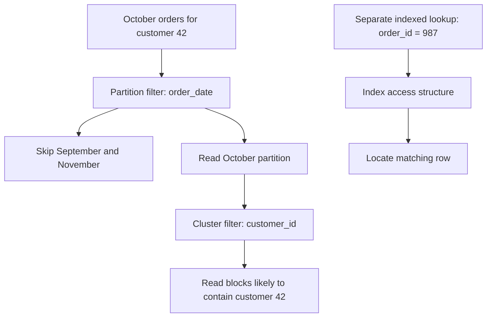
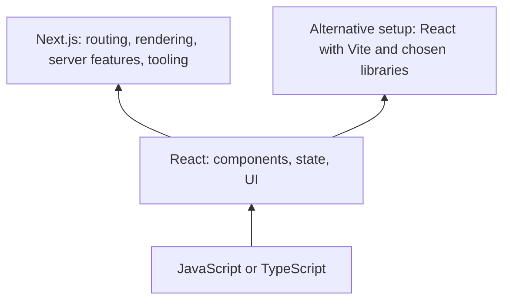
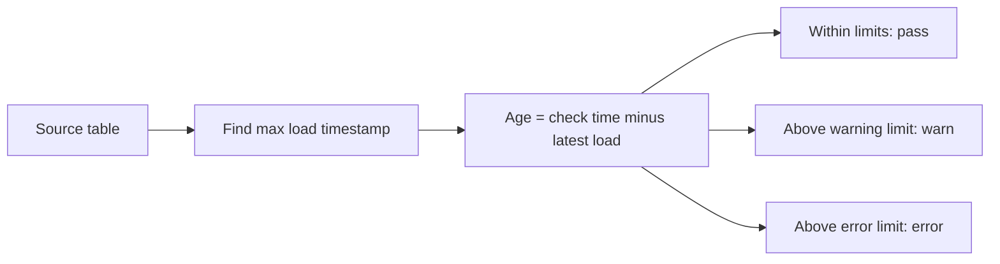

# Data, web development and dbt: practical concepts

Checked against official documentation on 6 October 2026. Examples are educational and have not been executed against a warehouse. SQL dialects and dbt adapter/version support differ.

## 1. Indexing, partitioning and clustering

Consider an `orders` table with `order_id`, `customer_id`, `order_date`, `country`, `status`, `updated_at` and `_loaded_at`.

| Technique | What it does | Candidate columns and use case |
| --- | --- | --- |
| Indexing | Creates an access structure that helps locate rows without scanning the whole table. A conventional B-tree secondary index is the example here. | `order_id` for one order; `customer_id` for a customer's orders; `(customer_id, order_date)` for a customer's orders within a date range. |
| Partitioning | Splits one logical table into separately managed segments. A qualifying filter can skip entire segments. | `order_date` by day/month when reporting and retention use dates. Some databases also support list partitions such as region and hash partitions such as customer buckets. |
| Clustering | Organizes related values near each other in physical storage, helping the engine skip irrelevant blocks. Exact meaning varies by engine. | In BigQuery, partition by `order_date` and cluster by `customer_id` if queries filter by date and customer. On Snowflake, consider date expressions and frequently filtered business dimensions for large tables. |

These can coexist where the engine supports them. Select columns from actual query patterns, data size and maintenance cost, rather than automatically using the primary key for every technique. [PostgreSQL indexes](https://www.postgresql.org/docs/current/indexes.html), [BigQuery partitioning](https://docs.cloud.google.com/bigquery/docs/partitioned-tables), [BigQuery clustering](https://docs.cloud.google.com/bigquery/docs/clustered-tables).



**Index example — PostgreSQL:**

```sql
create index idx_orders_customer_date
on orders (customer_id, order_date);

select *
from orders
where customer_id = 42
  and order_date >= date '2026-10-01'
  and order_date < date '2026-11-01';
```

The customer equality filter followed by a date range makes this a useful composite B-tree candidate. Leading columns generally matter; optimizers may have additional techniques. Indexes consume storage and add write maintenance. A low-selectivity filter such as `status = 'completed'` matching 95% of rows may benefit little from a simple index. [Composite indexes](https://www.postgresql.org/docs/current/indexes-multicolumn.html).

**Partition and cluster example — BigQuery:**

```sql
create table analytics.orders
partition by order_date
cluster by customer_id, country
as select * from raw.orders;
```

Here `order_date` is a DATE. Partitioning bounds the date segments scanned; clustering can reduce blocks scanned inside them. Cluster column order matters: choose `customer_id` first when customer filtering dominates, or reconsider the order when country filtering dominates. Avoid creating huge numbers of tiny partitions. [BigQuery partitioning](https://docs.cloud.google.com/bigquery/docs/partitioned-tables), [cluster ordering](https://docs.cloud.google.com/bigquery/docs/clustered-tables).

**Platform distinction:** Snowflake standard analytical tables use automatic micro-partitions; you do not normally create traditional B-tree indexes or manually declare daily partitions for them. A clustering key influences organization across micro-partitions. A raw unique ID or nanosecond timestamp is not automatically a good key: an expression such as `to_date(order_timestamp)` may be more useful. Explicit clustering has a maintenance cost. Other engines use “clustered index” or “CLUSTER” with different semantics; warehouse clustering is not automatically the same feature. [Snowflake clustering keys](https://docs.snowflake.com/en/user-guide/tables-clustering-keys).

## 2. FULL OUTER JOIN versus CROSS JOIN

`FULL JOIN` normally means `FULL OUTER JOIN`: match rows using a condition, retain unmatched rows from both inputs, and fill missing-side columns with NULL. `CROSS JOIN` produces every possible pair, without a matching condition. [SQL join definitions](https://www.postgresql.org/docs/current/queries-table-expressions.html).

Suppose CRM has customer IDs **1, 2** and billing has **2, 3**, each unique.

```sql
select c.customer_id as crm_id, b.customer_id as billing_id
from crm_customers c
full outer join billing_customers b
  on c.customer_id = b.customer_id;
```

| crm_id | billing_id | Interpretation |
| --- | --- | --- |
| 1 | NULL | CRM only |
| 2 | 2 | Match |
| NULL | 3 | Billing only |

Use this to reconcile two systems. It is not simply concatenation: matching records share a result row.

```sql
select c.customer_id as crm_id, b.customer_id as billing_id
from crm_customers c
cross join billing_customers b;
```

| crm_id | billing_id |
| --- | --- |
| 1 | 2 |
| 1 | 3 |
| 2 | 2 |
| 2 | 3 |

Use a cross join for deliberate combinations: 100 products × 30 calendar dates = 3,000 product/date rows, then left join actual sales to show zero-sale days.

Cross join cardinality is N × M. Full join cardinality depends on the condition and duplicates: three left rows and two right rows sharing one key produce six matched rows. Result order is unspecified without `ORDER BY`. [SQL join definitions](https://www.postgresql.org/docs/current/queries-table-expressions.html).

## 3. React versus Next.js

React is a library for building interfaces from components. Next.js is a framework built on React, adding application structure, routing, server capabilities and tooling. A Next.js page still contains React components. [React introduction](https://react.dev/learn), [Next.js introduction](https://nextjs.org/docs).

### Explain it like I am 10

Imagine building a LEGO toy shop.

**React is your box of reusable building pieces.** You make a product card, a search box and an “Add to basket” button. These are called components. React helps the pieces react to your actions: click the button and the basket number changes.

**Next.js is a building kit that uses those React pieces and includes extra equipment and instructions.** It helps arrange the shop into pages, gives each page an address such as `/toys` or `/basket`, and can prepare page content on a server before sending it to the visitor. A server is another computer doing work for the website. [Next.js overview](https://nextjs.org/docs).

You can build with React and choose the other equipment yourself, or use Next.js to get more of it together. Learning Next.js still involves learning React.

For an exam-practice website, React makes the question card, answer buttons and changing score. Next.js can organise the `/courses`, `/practice` and `/results` pages and prepare public course information before someone opens it. Both approaches can build the site; the choice concerns the surrounding application tools.

**Preparing a page:** client rendering is like receiving pieces and building the display on your computer. Server rendering is like receiving a display already assembled by another computer; browser code can then make it interactive. Next.js supports several combinations of server, static and client rendering. React also has server-rendering capabilities. [Server and Client Components](https://nextjs.org/docs/app/getting-started/server-and-client-components).

The [linked freeCodeCamp article](https://www.freecodecamp.org/news/next-vs-react/) dates from 3 April 2023. Its library/framework comparison is useful, but several claims need qualification: Next.js is a full-stack React framework, React is not inherently limited to client rendering, server rendering is not always faster, and authentication still needs an implementation or an authentication library/provider. [Next.js overview](https://nextjs.org/docs), [authentication guide](https://nextjs.org/docs/app/guides/authentication).



| Need | React library | Next.js framework |
| --- | --- | --- |
| Buttons, forms, interactive tables | Components, state and hooks | Uses the same React concepts |
| `/products/42` page routing | Add a router or framework | File-based routing |
| Server rendering / static pages | React provides primitives; assemble an appropriate stack | Integrated rendering options |
| Server endpoints | Requires an accompanying backend/framework | Route handlers and server features |
| Build tooling | Select tooling, e.g. Vite | Integrated tools and conventions |

**Use case — internal dashboard:** React with Vite and an existing API can be a straightforward choice when the backend already exists and public search indexing is unimportant.

**Use case — public catalogue or learning site:** Next.js is useful when public pages, metadata, server data access and interactive React components belong in one application. It offers more integrated features and more framework conventions to learn. Server rendering can help deliver usable initial content, but does not guarantee SEO rankings.

In the Next.js App Router, pages/layouts are Server Components by default. Interactive pieces use Client Components, typically marked with `'use client'`. Client Components can also be prerendered on the server and then hydrated in the browser; “client” does not mean browser-only initial rendering. React is not inherently restricted to browser rendering. [Next.js Server and Client Components](https://nextjs.org/docs/app/getting-started/server-and-client-components).

## 4. Incremental options in dbt

Incremental models preserve an existing table and process selected data on later runs, reducing repeated transformation work. They are useful when rebuilding all history is expensive; a small table may be simpler to rebuild.

There are two decisions: **which input rows to process**, and **how to write their results into the target**. Selecting `merge` does not itself find every changed source row. First creation normally processes the full model query; `is_incremental()` becomes true when the target exists as a table, materialization is incremental, and full refresh is not requested. [Incremental model configuration](https://docs.getdbt.com/docs/build/incremental-models).

| Strategy | Write behaviour | Use case |
| --- | --- | --- |
| `append` | Insert selected rows; retain existing rows. | Immutable events with reliable selection of unseen records. Reprocessing rows creates duplicates. |
| `merge` | Match by `unique_key`; update matches and insert new keys. | Orders changing from pending to shipped; maintain current state. |
| `delete+insert` | Delete target rows for incoming keys, then insert their replacement rows. | Replace a complete group, e.g. all lines for each affected order. Supply the whole replacement group. |
| `insert_overwrite` | On BigQuery/Spark-style partition implementations, replace selected partitions. | Rebuild the last three days of sales when late data changes totals. Supply complete partitions. |
| `microbatch` | Process time windows as separate batches. | Large event histories needing bounded reruns and backfills. |

Availability depends on adapter/version. Custom strategies are also possible on supported adapters. A strategy name does not guarantee identical warehouse behaviour. [dbt strategy reference](https://docs.getdbt.com/docs/build/incremental-strategy).

**Before/after example:** target has `101: pending`, `102: shipped`; incoming data has `101: shipped`, `103: pending`.

- Append leaves both versions of 101 and inserts 103.
- Merge with `unique_key='order_id'` updates 101, retains 102, and inserts 103.
- Delete+insert with that key replaces 101, retains 102, and inserts 103.
- Partition overwrite replaces whole selected dates, including rows absent from the incoming result. It needs complete date contents, not just changed orders.

**Snowflake exception:** `insert_overwrite` replaces the entire table, rather than selected date partitions. Applying a three-day input filter would discard older target data. [Snowflake adapter behaviour](https://docs.getdbt.com/reference/resource-configs/snowflake-configs), [BigQuery partition overwrite](https://docs.getdbt.com/reference/resource-configs/bigquery-configs).

**Merge model — Snowflake SQL example:**

```sql
{{ config(
    materialized='incremental',
    incremental_strategy='merge',
    unique_key='order_id'
) }}

select order_id, customer_id, order_date, status, updated_at
from {{ source('raw', 'orders') }}


where updated_at >= (
    select dateadd(
        day, -3,
        coalesce(max(updated_at), '1900-01-01'::timestamp)
    )
    from {{ this }}
)

```

`updated_at` detects changes; `order_id` identifies the row to update. The three-day overlap is an illustrative late-arrival allowance, not a guarantee. Ensure incoming keys are unique and non-null; `unique_key` config does not create or test a database uniqueness constraint. Deduplicate deterministically if necessary. [Unique key configuration](https://docs.getdbt.com/reference/resource-configs/unique_key).

The source timestamp must change for every relevant update. Late records outside the overlap are missed; null/future timestamps need handling. A change in a joined customer table may require reprocessing affected orders even when their `updated_at` did not change. Normal upsert merge does not automatically delete target rows whose source record disappears: use tombstones/CDC and explicit deletion logic. Use snapshots when you need SCD2 history rather than just current values.

**Microbatch model — illustrative Snowflake configuration:**

```sql
{{ config(
    materialized='incremental',
    incremental_strategy='microbatch',
    event_time='event_at',
    begin='2026-01-01',
    batch_size='day',
    lookback=3
) }}

select event_id, event_at, customer_id
from {{ source('raw', 'events') }}
```

Configure `event_time` on upstream sources/models that should be automatically filtered. `lookback` reprocesses prior batches for late arrivals. Other adapters may require `partition_by` or `unique_key`; the batch write implementation is adapter-specific. [Microbatch configuration](https://docs.getdbt.com/docs/build/incremental-microbatch).

## 5. Data freshness in dbt

Freshness measures whether the newest available data exceeds an allowed age. It detects staleness; it does not ingest or repair data. For conventional source checks, dbt evaluates a latest timestamp against the warehouse current time and applies warning/error thresholds. [Sources and freshness](https://docs.getdbt.com/docs/build/sources).



**Source configuration — dbt v1.10+ syntax:**

```yaml
version: 2

sources:
  - name: raw
    database: raw
    schema: commerce
    tables:
      - name: orders
        config:
          loaded_at_field: _loaded_at
          freshness:
            warn_after: {count: 2, period: hour}
            error_after: {count: 4, period: hour}
```

`version: 2` is the YAML schema version, not the installed dbt version. `loaded_at_field` selects the column/expression; `freshness` defines limits. Freshness moved under `config` in v1.9 and `loaded_at_field` in v1.10. [Freshness configuration](https://docs.getdbt.com/reference/resource-configs/freshness).

For dbt v1:

```bash
dbt source freshness --select source:raw.orders
```

The conceptual query is `select max(_loaded_at), current_timestamp from raw.commerce.orders`. At 12:00, a latest load at 11:00 passes, 09:00 warns and 07:00 errors with the example thresholds. Schedule the command and explicitly gate downstream builds if failures should stop the pipeline; ordinary v1 `dbt build` does not implicitly run source freshness. [Source command](https://docs.getdbt.com/reference/commands/source).

**Version distinction:** current docs describe dbt v2 `dbt freshness` for configured sources and models, including model-level freshness config. `dbt source freshness` remains supported for sources. Use the command/config supported by your installed version. [dbt v2 upgrade notes](https://docs.getdbt.com/docs/dbt-versions/dbt-upgrade/upgrading-to-v2).

**Which field should measure freshness?** Choose it according to the question being asked:

| Column | Meaning | Practical interpretation |
| --- | --- | --- |
| `_loaded_at` / ingestion timestamp | Arrival in the warehouse | Best signal for “is new data reaching this table?” |
| `updated_at` | Change in the source application | Useful only if that change clock is the intended SLA; a healthy sync can bring no changes. |
| `created_at` / `event_at` | Creation/business event time | Measures newest event age; can appear stale during quiet periods and fresh even if other deliveries are delayed. |
| `order_date` | Business day | Coarse daily signal; cast to timestamp if needed, and use daily thresholds. |

Use a consistent timezone, normally UTC. Do not manufacture freshness by setting `current_timestamp` in a view: that proves the view was queried, not that data arrived.

**If the table has no timestamp:**

1. Add an ingestion timestamp at load time if you control the loader.
2. Use adapter-supported warehouse metadata by omitting `loaded_at_field`. Check what it measures: Snowflake's `LAST_ALTERED` can advance on DDL and background maintenance, so it is weaker evidence of new data delivery. [Snowflake freshness limitation](https://docs.getdbt.com/reference/resource-configs/snowflake-configs).
3. If a loader records successful per-table delivery, use v1.10+ `loaded_at_query` to obtain that timestamp:

```yaml
        config:
          loaded_at_query: |
            select max(completed_at)
            from ops.load_audit
            where table_name = 'orders'
              and status = 'success'
          freshness:
            warn_after: {count: 2, period: hour}
            error_after: {count: 4, period: hour}
```

This replaces `loaded_at_field`; do not configure both. Ensure “success” means a completed delivery for the exact database/schema/table, not merely a job starting or succeeding without loading it. [Freshness configuration](https://docs.getdbt.com/reference/resource-configs/freshness).

4. With no row timestamp, usable metadata or audit record, there is no reliable temporal signal. Add instrumentation. Counts/checksums can detect some changes but cannot prove how recent data is. An unchanged reference table may be healthy; monitor successful synchronizations or adjust its SLA rather than requiring new rows every hour.

A recent maximum timestamp proves only that at least one recent value exists. It does not prove complete delivery for every store, partition or business day. Pair freshness with completeness/volume checks when that matters. Source results are available in `sources.json`; configured checks must actually be scheduled. [Freshness artifact](https://docs.getdbt.com/reference/artifacts/sources-json).

### Does dbt create a timestamp automatically?

**Freshness checks do not add a timestamp column to the source. A source table does not always need its own timestamp column, but the check needs a meaningful time signal.** It can come from a column/expression, adapter-supported metadata or a custom audit query. [Freshness configuration](https://docs.getdbt.com/reference/resource-configs/freshness).

You can explicitly write a dbt model that adds a column:

```sql
-- BigQuery example: models/Bronze/orders.sql
{{ config(materialized='table') }}

select
    order_id,
    status,
    current_timestamp() as dbt_processed_at
from {{ source('raw', 'orders') }}
```

When materialized as a table, the timestamp is stored in the model output. It does not alter the original source table. Rebuilding this table restamps every output row; an incremental model stamps the rows processed according to its selection and write strategy. A view evaluates `current_timestamp()` when queried instead of preserving a build-time stamp. [Materializations](https://docs.getdbt.com/docs/build/materializations).

**Example:** the source stopped receiving orders on Monday. You run the model on Friday. The generated `dbt_processed_at` says Friday, even though the source data is still from Monday. That timestamp can measure transformation processing; it cannot establish source arrival freshness. This is a consequence of the SQL above, not a mechanism for recovering an unknown original load time.

Choose the clock deliberately:

| Question | Appropriate signal |
| --- | --- |
| When did these rows arrive in the warehouse? | An ingestion timestamp captured by the loader |
| When did dbt process these rows? | An explicitly generated and materialized `dbt_processed_at` |
| When did the last successful source synchronization complete, even with no changed rows? | A trustworthy loader audit/heartbeat timestamp |

For a source without any timestamp, prefer a loader timestamp or successful-load audit. Metadata can be an alternative where supported; Snowflake's `LAST_ALTERED` can move for reasons other than new data. Neither configuring `loaded_at_field: _loaded_at` nor running a freshness check creates that column. Without a column, usable metadata or audit signal, dbt cannot infer the original arrival date. [Freshness configuration](https://docs.getdbt.com/reference/resource-configs/freshness), [Snowflake metadata limitation](https://docs.getdbt.com/reference/resource-configs/snowflake-configs).

## How the column choices fit together

For an orders pipeline, these can legitimately differ:

| Purpose | Example column |
| --- | --- |
| Indexed lookup in a transactional database | `order_id` |
| Partition for reporting/retention | `order_date` |
| Cluster for customer-filtered analytical queries | `customer_id` |
| Match rows for incremental merge | `order_id` |
| Detect modified input rows | `updated_at` |
| Place events in microbatches | `event_at` |
| Measure ingestion freshness | `_loaded_at` |

Physical layout, incremental selection, row matching and freshness answer different questions. Choose each field deliberately.
