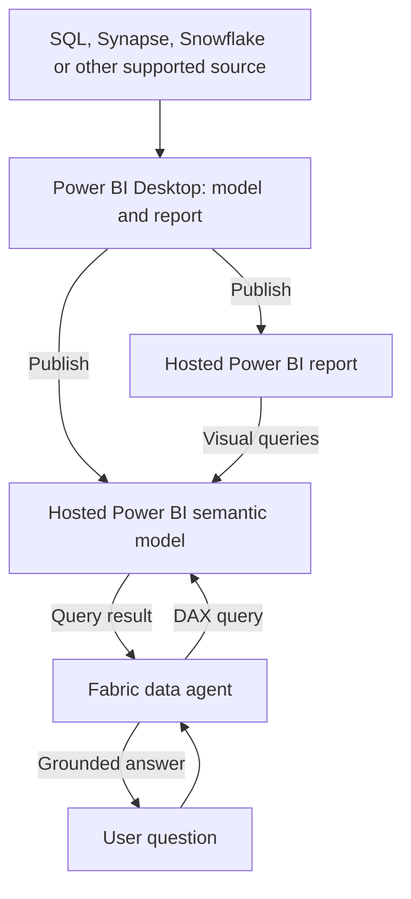
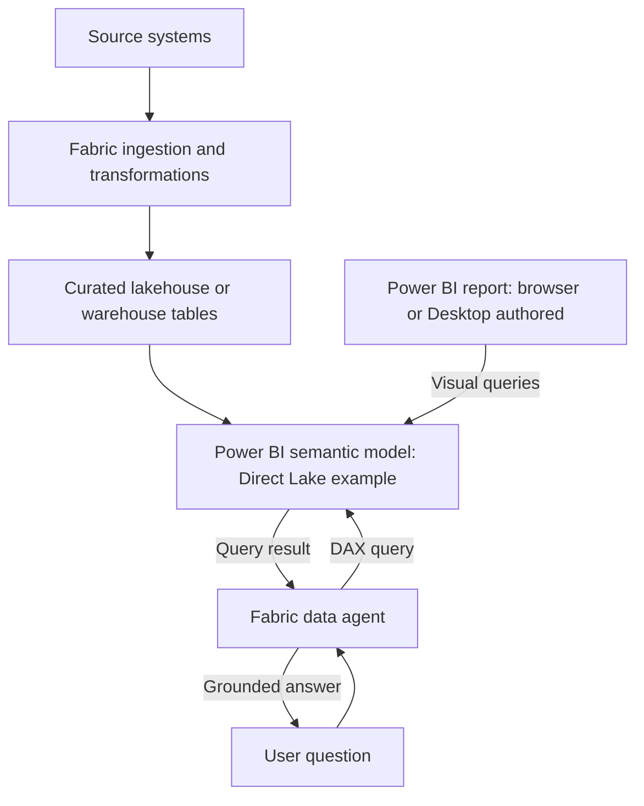
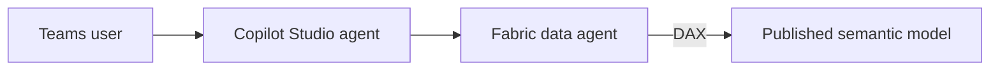
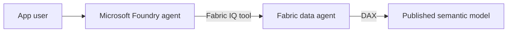

# Agents over Power BI semantic models

Checked against Microsoft documentation: 2026-10-07.

You can build a semantic model and report in Power BI Desktop, publish them to the Power BI service, and connect an agent to the published model. You can also create the model in Fabric. The important distinction is where the model runs when users ask questions, rather than where you authored the report.

This guide describes two authoring paths that converge on a Fabric data agent. Copilot Studio or Microsoft Foundry can optionally call that data agent. The steps are documentation-based and have not been run in the user's tenant. The example names and business rules are illustrative, not a record of a NSW Government deployment.

## 1. What the components do

| Component | Purpose |
| --- | --- |
| Power BI Desktop | Author tables, relationships, DAX measures and report visuals locally. |
| Power BI semantic model | Defines reusable business metrics, relationships and model security; runs in the service after publication. |
| Power BI report | Presents visuals that query the model. Reports and agents can use the same model. |
| Fabric data agent | Turns a question into a source-native query; for a semantic model, that is DAX. |
| Copilot Studio agent | Adds a conversational application, tools and channels such as Teams. |
| Foundry agent | Provides agent orchestration and tools for a custom AI application. |

Publishing a PBIX containing a model uploads the model and report as separate service items. A thin report connected to an existing service model continues to use that model; do not assume it publishes another independent model. See [Desktop publication](https://learn.microsoft.com/en-us/power-bi/create-reports/desktop-upload-desktop-files) and [shared models and live connections](https://learn.microsoft.com/en-us/power-bi/connect-data/desktop-report-lifecycle-datasets).

For the hosted patterns below, the agent connects to the published semantic model, not an unpublished PBIX on your laptop. Report visual metadata can help query interpretation, but the agent executes against the model. A separate chat must be given the relevant date/LGA filters; do not assume it inherits a report's current slicers. See [semantic model guidance](https://learn.microsoft.com/en-us/fabric/data-science/semantic-model-best-practices).

## 2. Prerequisites for both paths

1. Use an organizational Microsoft Entra account and a development workspace where you can create the required items.
2. Have the capacity administrator assign the workspace to a paid Fabric F2-or-higher capacity, or Power BI Premium P1-or-higher with Fabric enabled. This guide places the model and data agent in that same workspace to simplify region and permission setup. A Power BI Pro license alone does not provide this Fabric capacity.
3. Have permission to author/publish Power BI content and edit the model. Power BI user licensing is a separate consideration from the Fabric capacity requirement.
4. In Fabric Admin portal > Tenant settings, the admin must enable the relevant Copilot/Azure OpenAI settings for your user or group. For capacities outside the US/EU boundary, configure both required cross-geo processing and storage settings. Australian capacity deployments therefore need the applicable settings; tenant settings can take up to an hour to apply.
5. Give consumers access to the published data agent and its semantic model. For agent-driven model queries, Microsoft currently documents model Read permission as sufficient; Build is not required for that interaction. Editing the model/Prep for AI requires author permissions.
6. Keep the model and data agent in the same capacity region. Different workspaces can be used when supported, but different-region capacity sources cannot be queried by this data agent.

Sources: [create a data agent](https://learn.microsoft.com/en-us/fabric/data-science/how-to-create-data-agent), [tenant settings](https://learn.microsoft.com/en-us/fabric/data-science/data-agent-tenant-settings), [sharing and permissions](https://learn.microsoft.com/en-us/fabric/data-science/data-agent-sharing), [concepts and limitations](https://learn.microsoft.com/en-us/fabric/data-science/concept-data-agent).

## 3. Path A — author in Power BI Desktop



The source does not have to be migrated into a Fabric warehouse to use this pattern. An Import model contains a refreshed copy of source data; DirectQuery queries the configured source. Actual support, source connectivity and capacity must be checked for your model. See [refresh and storage modes](https://learn.microsoft.com/en-us/power-bi/connect-data/refresh-data).

1. Open Power BI Desktop and select Get data. Connect to the actual reporting source. For a small learning exercise, Import is a straightforward starting point.
2. In Power Query, correct types and clean the data. For the illustrative revenue use case, prepare `FactRevenue`, `DimDate` and `DimLGA` at a documented grain.
3. In Model view, relate date and geography dimensions to the fact table with appropriate one-to-many relationships. Create a continuous date dimension for time comparisons.
4. Add explicit measures for revenue and year-on-year comparisons. Define the metric exactly: currency, exclusions, date basis and whether a comparison covers a full year or comparable year-to-date period. Add business-friendly names and descriptions.
5. Build a validation report: LGA, revenue and growth in a table, plus an explicit date/year filter. Reconcile its results to the source before adding AI.
6. Define RLS roles if users need restricted access. Publish roles with the model; assign users/groups in the service afterward.
7. Save the PBIX, select Home > Publish and choose the capacity-backed development workspace. Open the workspace and verify both the Semantic model and Report items exist.
8. In the hosted model settings, configure data connections/credentials and any required gateway. For Import, run Refresh now, then configure the required schedule. Verify refresh history and the report in the browser.
9. Follow the common model preparation and data-agent steps below. You can prepare the AI settings in Desktop before publishing, or in the service after publishing.

Publication and refresh sources: [publish from Desktop](https://learn.microsoft.com/en-us/power-bi/create-reports/desktop-upload-desktop-files), [data refresh](https://learn.microsoft.com/en-us/power-bi/connect-data/refresh-data). RLS source: [Power BI RLS](https://learn.microsoft.com/en-us/fabric/security/service-admin-row-level-security).

## 4. Path B — create the model in Fabric



This path chooses Direct Lake over curated Fabric tables. It still uses a Power BI semantic model. You can author the report in a browser or in Desktop against that existing model.

1. In the capacity-backed development workspace, create or open the lakehouse/warehouse containing your curated reporting tables. If it is new, ingest data with an appropriate pipeline, Dataflow Gen2, notebook or SQL process.
2. Prepare the fact/date/LGA tables, checking grain, keys, types and totals. Medallion layers are useful for a larger platform; all three layers are not necessary for a tiny learning demo.
3. Open the lakehouse and choose New Power BI semantic model, or open the warehouse/SQL analytics endpoint and choose New semantic model. Name it `Revenue_Model` and select the required tables/workspace when prompted.
4. Open the new model using Open data model. Review and configure relationships; create the approved measures and descriptions. Configure supported RLS for the model as required.
5. From the model select New report to build browser visuals, or connect Desktop to the existing semantic model and build a thin report. Use the report to reconcile totals and filters.
6. Confirm data freshness and the source identity/permissions used by the model. Direct Lake still has model refresh/framing and source-security considerations; do not treat it as a guarantee of immediately current data.
7. Follow the common steps below to prepare the model and attach the data agent.

Fabric no longer automatically creates default semantic models for newly created lakehouses/warehouses. Create one explicitly when it does not exist. Sources: [create a semantic model](https://learn.microsoft.com/en-us/fabric/data-warehouse/create-semantic-model), [lakehouse model/report tutorial](https://learn.microsoft.com/en-us/fabric/data-engineering/tutorial-lakehouse-build-report).

## 5. Prepare the model for either path

1. Open the model with edit permission, in Desktop or the service, and select Home/ribbon > Prep data for AI.
2. On Simplify data schema, select the relevant facts, dimensions, measures and their dependencies. Apply the selection. This focuses AI context; security must still be enforced through actual permissions/RLS/OLS.
3. For common questions, configure Verified answers using suitable report visuals. Fabric data agent uses their question/visual metadata to guide DAX rather than returning the visual itself.
4. Test baseline questions, then use Add AI instructions for unresolved terminology or metric/date ambiguity. Apply the changes and save/publish as appropriate.

Illustrative instructions, to adapt to actual object names and business rules:

```text
LGA means Local Government Area and refers to DimLGA[LGAName].
Revenue means the approved [Revenue] measure and is reported in AUD.
Use DimDate for revenue date filtering.
If the user asks for a year comparison without a year or date range,
ask which period they want. Distinguish a full year from year-to-date.
Use [Revenue YoY %] for percentage growth once the period is specified.
```

Business logic belongs in real measures. Instructions help interpret the model but do not reliably enforce calculations or access rules. For semantic-model DAX generation, data-agent-level instructions are ignored: put model-specific guidance in Prep for AI. Power BI semantic models do not support the data agent's separate sample question/query configuration.

If Prep for AI tabs are disabled, check current model Q&A enablement and tenant Copilot settings. Microsoft's October 2026 documentation still uses Q&A for this setup; Q&A retirement is announced for December 2026, so recheck the replacement setting if following these steps later.

Sources: [AI data schema setup](https://learn.microsoft.com/en-us/power-bi/create-reports/copilot-prepare-data-ai-data-schema), [AI instructions setup](https://learn.microsoft.com/en-us/power-bi/create-reports/copilot-prepare-data-ai-instructions), [data-agent semantic model guidance](https://learn.microsoft.com/en-us/fabric/data-science/semantic-model-best-practices).

## 6. Create and validate the Fabric data agent

1. In the workspace, select + New item, search for Fabric data agent and create `Revenue_Reporting_Agent`.
2. In the OneLake catalog/add-source picker, choose the published Power BI semantic model. Add it and select the relevant tables, aligned with your AI schema.
3. Use data-agent instructions for source routing and answer presentation, for example: use Revenue_Model for revenue/LGA questions; identify the period and currency in the reply. Keep DAX-specific business guidance in the model.
4. Ask explicit questions such as: "Show revenue by LGA for calendar year 2025 and its percentage change from calendar year 2024."
5. Expand the generated steps/DAX. Compare the answer against the report using the same measures, filters and user identity. The LLM should retrieve computed measures, rather than invent numbers.
6. Test missing dates, unknown LGAs, blank/zero prior-year results and a restricted consumer account. Power BI RLS does not restrict workspace Admin/Member/Contributor roles, so the maker's successful test alone is insufficient.
7. Publish the data agent with a description of its sources, scope and available metrics. Share it and give consumers the required model Read permission and RLS role membership.
8. Ask the test questions again through the published version. Later draft edits must be republished to reach consumers.

Sources: [data-agent creation](https://learn.microsoft.com/en-us/fabric/data-science/how-to-create-data-agent), [sharing](https://learn.microsoft.com/en-us/fabric/data-science/data-agent-sharing), [RLS testing](https://learn.microsoft.com/en-us/fabric/security/service-admin-row-level-security).

At this point you have a working conversational data agent. Copilot Studio and Foundry are optional extensions.

## 7. Optional Copilot Studio connection



For the documented tool-based experience:

1. Use the same tenant/account and a published Fabric data agent. The Microsoft integration page lists a Microsoft 365 Copilot license and a user license for each person building/managing agents; confirm the applicable tenant licensing and permissions with the administrator.
2. In Copilot Studio choose the environment. Use the arrow next to New agent > Agent under Optimize your business processes (the GitHub Copilot harness experience).
3. On Build, choose Tools > +, search Fabric and select Fabric IQ Data MCP. Create/select its connection.
4. Select your published data agent in the OneLake catalog. Add a clear description of its reporting scope.
5. Choose User authentication so each consumer's permissions govern the data call. Maker authentication instead uses the maker's access for all consumers, so it changes the effective data boundary.
6. Add routing instructions, save, test in Preview, evaluate a set of questions, then publish and enable the required channel such as Teams.

If your agent uses the standard harness and has the older interface, the alternative is Agents > Add an agent > Microsoft Fabric > connection > published data agent. Configure User authentication and generative orchestration, test and publish. Microsoft still labels this connected-agent integration preview; its older guide validates Teams and states limitations for Microsoft 365 Copilot. Do not apply the new harness's channel capabilities to that older route.

Sources: [tool-based setup](https://learn.microsoft.com/en-us/fabric/data-science/data-agent-microsoft-copilot-studio-tool), [standard-harness connection](https://learn.microsoft.com/en-us/microsoft-copilot-studio/add-agent-fabric-data-agent), [older connected-agent setup and channel limits](https://learn.microsoft.com/en-us/fabric/data-science/data-agent-microsoft-copilot-studio).

## 8. Optional Foundry connection



Use the current Fabric IQ catalog integration where available:

1. Have a Foundry project with a deployed model, in the same tenant. Builders need the documented Foundry User role; creating the Fabric IQ connection requires Foundry Project Manager. Arrange delegated user authentication and access to the data agent/model.
2. In the Foundry project choose Build > New agent arrow > Build an agent. Name it and open Playground.
3. Under Tools select Add > Browse all tools > Configured > Fabric IQ (OneLake Catalog) > Add tool.
4. Filter Type to Data agent. Select your published agent and Add.
5. Add instructions to use this tool for revenue/LGA questions, retrieve figures before answering, and ask for ambiguous periods. Save.
6. Test in Playground and inspect tool traces. For a deployed application, implement user sign-in/delegation and verify the real user's permissions; a playground test alone is not an application deployment.

This Fabric IQ integration is preview. An alternative native Fabric tool connection uses the published data agent's workspace/artifact IDs; current native-tool docs also identify preview limitations and require user identity rather than service principal authentication. Avoid mixing classic threads/runs examples with the newer agent SDKs.

Sources: [Fabric IQ portal setup](https://learn.microsoft.com/en-us/fabric/data-science/data-agent-foundry-fabric-iq), [current native Fabric tool](https://learn.microsoft.com/en-us/azure/foundry/agents/how-to/tools/fabric).

## 9. How to describe the work accurately

Building a model in Desktop and publishing it is a valid starting point for enterprise agent work. A precise description could be: "I built and published Power BI semantic models, connected a Fabric data agent for natural-language reporting, and validated its DAX responses against existing reports." Add Copilot Studio or Foundry only if you also implemented that respective agent connection. Production, pilot and prototype status must reflect the actual rollout and users.

For an existing Desktop report, the shortest learning route is: publish to an appropriately configured workspace, prepare the model, create/test/publish the Fabric data agent, then add the outer agent if needed. A lakehouse/warehouse migration is not a prerequisite for a model-backed agent.

## 10. What Fabric IQ means in this architecture

Fabric IQ provides business context over enterprise data: what entities such as Customer, Campaign and Order mean, how they relate, and how trusted business metrics are defined. Microsoft's framework combines OneLake data, Power BI semantic models for analytics, and ontologies for broader operational context. An ontology describes entity types, properties, relationships and rules bound to business data. The IQ workload and ontology are currently documented as preview.

For example, a semantic model can define Net Revenue by Campaign and Month. An ontology can describe how Customer places Order, Order relates to Campaign, and Campaign belongs to Marketing Channel. Ontology is useful for richer cross-domain relationships; it is not a required extra step for this guide's agent querying a Power BI semantic model.

Fabric IQ is broader than a connector. The similarly named integration tools expose Fabric capabilities to an outer agent:

- Foundry: Fabric IQ (OneLake Catalog), through which you select the published Fabric data agent.
- Copilot Studio's documented tool-based experience: Fabric IQ Data MCP, through which you select the published data agent.
- MCP is the tool-calling protocol in these integrations. It does not replace your semantic model, its measures or its access controls.

Your reporting path remains: outer agent -> Fabric tool -> Fabric data agent -> DAX query against hosted semantic model -> results returned to the user. Grounding gives the agent access to model context and query results; publishing this model does not train or fine-tune an LLM.

Sources: [Fabric IQ overview](https://learn.microsoft.com/en-us/fabric/iq/overview), [ontology overview](https://learn.microsoft.com/en-us/fabric/iq/ontology/overview), [Foundry data-agent connection](https://learn.microsoft.com/en-us/fabric/data-science/data-agent-foundry-fabric-iq), [Copilot Studio tool connection](https://learn.microsoft.com/en-us/fabric/data-science/data-agent-microsoft-copilot-studio-tool).

## 11. Confirmed workflow, with the missing publishing step

The user's proposed sequence is broadly correct. Use this expanded sequence:

1. Build the semantic model in Fabric, or build it in Power BI Desktop and publish it to the cloud workspace. The agent uses the hosted model. A report is useful for comparison but not mandatory for querying the model.
2. Prepare business definitions: relationships, date logic, explicit measures, meaningful descriptions, model Prep for AI and permissions. Implement KPI calculations in measures rather than relying on a persona prompt to invent them.
3. Create the Fabric data agent, attach the semantic model and select the relevant tables.
4. Configure instructions at the appropriate layers described below. Test the data agent directly and reconcile its generated DAX/results with trusted reporting.
5. Publish the Fabric data agent and arrange consumer access. The catalog integrations discover published agents, not an unpublished draft.
6. Optionally attach it to either Foundry or Copilot Studio using the applicable Fabric IQ tool. Configure the outer agent to route business-data questions to this tool and configure user authentication.
7. Test the complete experience, including tool selection, query correctness, ambiguous requests, restricted users and response formatting. Publish the Copilot Studio agent/channel, or configure the Foundry agent's active version and endpoint/application with sign-in and delegated access. Section 14 distinguishes the current Foundry endpoint model from the legacy Agent Application model.

Neither an ontology nor both orchestration products are required for this particular reporting scenario. Sections 2-8 contain the detailed setup and prerequisite checks.

## 12. Marketing and sales instructions: three different locations

These examples are illustrative templates. Replace names, currencies, time conventions and available metrics with those actually implemented in your model. A role instruction guides behavior; it does not provide missing data, define a calculation reliably or grant access.

### A. Semantic model: business definitions and DAX guidance

Put model-specific guidance in Prep for AI, with suitable descriptions and verified answers. The Fabric data agent's DAX generation uses this model context and ignores agent-level instructions for DAX generation. Agent-level model-specific source instructions and sample question/query pairs are not supported for semantic-model sources.

```text
This model covers marketing campaign performance and sales.
Use the model's approved measures for Net Revenue, Attributed Revenue,
Ad Spend and ROAS; do not substitute a different formula.

Net Revenue excludes tax and reflects returns as defined by its measure.
ROAS is Attributed Revenue divided by Ad Spend at the requested filter
context. Do not average campaign-level ROAS to get total ROAS.
If spend is zero, use the measure's blank/undefined behavior.

Unless the user specifies otherwise, interpret dates using the model's
Calendar Date and calendar months. Monetary values are in AUD.
Campaign-attributed revenue and total sales revenue are different metrics.
Do not interpret missing attribution as zero total sales.
```

First implement and validate those measures and conventions. The text documents them. If the actual model uses fiscal months, order date or a different revenue definition, change this example accordingly.

Source: [semantic-model best practices for Fabric data agents](https://learn.microsoft.com/en-us/fabric/data-science/semantic-model-best-practices).

### B. Fabric data agent: scope, source routing and presentation

```text
Answer marketing and sales reporting questions using the available sources.
Route revenue, campaign performance and advertising-spend questions to
Marketing_Sales_Model.
Identify the metric, reporting period, applied filters and currency in
the answer. Present comparisons in a concise table when appropriate.
State when a requested metric or breakdown is unavailable.
```

Keep calculation guidance in the model. These agent instructions guide source selection and presentation around the query.

### C. Foundry or Copilot Studio: role and tool use

```text
You assist marketing and sales analysts.
For questions about our actual performance, call the connected
Marketing_Sales_Data_Agent before giving numerical answers.
Use its returned results and retain their metric definitions, units,
time periods and filters. Do not invent figures or silently change scope.

Ask for clarification when the requested period or meaning of revenue
is ambiguous. If the tool cannot answer, explain the missing data or access.
Summarize the main result, then provide the supporting comparison.
Separate measured changes from possible explanations; do not claim a
causal effect of a campaign solely from a change in revenue.
```

The routing description on the tool also matters. For example: "Queries approved marketing and sales metrics by campaign, channel and calendar period from the published semantic model." Only list dimensions and measures the tool actually supports.

Sources: [agent instructions](https://learn.microsoft.com/en-us/fabric/data-science/how-to-create-data-agent), [Foundry connection](https://learn.microsoft.com/en-us/fabric/data-science/data-agent-foundry-fabric-iq), [Copilot Studio connection](https://learn.microsoft.com/en-us/fabric/data-science/data-agent-microsoft-copilot-studio-tool).

### Validate more than fluent wording

Maintain a small set of questions with independently checked expected results. Examples:

- Net Revenue by campaign for September 2026: compare each campaign and the total against the same model measure with identical filters.
- September versus August 2026: verify both periods, absolute change and percentage change, including a blank/zero comparison period.
- ROAS by channel: verify attribution, spend and the measure's aggregation behavior, not an average of row-level ratios.
- "Which campaign performed best?": verify that the agent asks whether best means revenue, ROAS or another available measure.
- Restricted consumer: verify row-level access through the final app/channel, not only through a maker account.
- "Why did sales fall?": verify that observed movement is separated from hypotheses that need additional evidence.

These are proposed acceptance cases, not tests executed against the user's tenant.

## 13. Closest functional equivalents in GCP, Snowflake and Databricks

This is a comparison by function, not a claim that each vendor has one exact equivalent of the whole Fabric IQ workload. Product names and integrations below were checked against official documentation on 2026-10-07.

| Platform | Governed business definitions | Data-question agent | Connection to a wider agent/app |
| --- | --- | --- | --- |
| Microsoft | Power BI semantic model; optionally Fabric IQ ontology for broader entity relationships | Fabric data agent | Fabric IQ catalog/MCP tools in Foundry or Copilot Studio |
| Google Cloud | Looker LookML models/Explores over warehouse data, such as BigQuery | Conversational Analytics data agents, powered by Gemini; the API also supports direct BigQuery sources | Conversational Analytics API; A2A endpoints and ADK integrations for orchestration |
| Snowflake | Semantic views containing business entities, dimensions, facts, metrics and relationships | Cortex Analyst generates SQL; Cortex Agents orchestrate tools and execute the reporting workflow | Cortex Agents REST API or a Snowflake-managed MCP server exposing the agent |
| Databricks | Unity Catalog semantics, including metric views; broader business context through Genie Ontology | Genie Agents, formerly Genie Spaces | Genie Conversation API or managed MCP tools exposing a Genie Agent |

Google Cloud's closest match to your specific Power BI-model workflow is LookML -> Conversational Analytics data agent -> API/outer agent. Looker is the semantic-model product here. Direct BigQuery grounding is another path, but it does not automatically create the governed metric definitions of a LookML model.

Sources: [Looker Conversational Analytics](https://docs.cloud.google.com/looker/docs/conversational-analytics-overview), [Conversational Analytics API](https://docs.cloud.google.com/gemini/data-agents/conversational-analytics-api/overview), [ADK integration examples](https://docs.cloud.google.com/gemini/data-agents/conversational-analytics-api/tutorials-demos-and-tools).

Snowflake's comparable workflow is semantic view -> Cortex Agent with a Cortex Analyst tool -> chat/app or MCP client. Cortex Analyst on its own returns generated SQL; an agent or application handles execution and answer delivery. Snowflake recommends exposing Cortex Agents as the client-facing MCP tool for governed business questions. Its managed MCP Cortex Analyst tool supports semantic views rather than legacy staged semantic-model YAML files.

Sources: [Cortex Analyst](https://docs.snowflake.com/en/user-guide/snowflake-cortex/cortex-analyst), [Cortex Agents](https://docs.snowflake.com/en/user-guide/snowflake-cortex/cortex-agents), [managed MCP server](https://docs.snowflake.com/en/user-guide/snowflake-cortex/cortex-agents-mcp).

Databricks' comparable workflow is curated Unity Catalog data and metric definitions -> Genie Agent with selected datasets, example SQL and instructions -> chat/API/MCP. Current documentation calls these Genie Agents; older material calls them Genie Spaces. Unity Catalog semantics includes the human-authored business layer used within Genie Ontology. Managed MCP integration is documented as preview. Avoid treating an arbitrary LLM over raw tables as equivalent to this curated workflow.

Sources: [Unity Catalog semantics](https://docs.databricks.com/aws/en/uc-semantics/), [metric views](https://docs.databricks.com/aws/en/uc-semantics/metric-views), [Genie Agents](https://docs.databricks.com/aws/en/genie-agents/), [managed MCP tools](https://docs.databricks.com/aws/en/agents/mcp-tools/managed-mcp).

No cloud resources, agents or permissions were changed for this documentation update. The examples do not establish which components the user historically implemented or whether those implementations reached production.

## 14. Deployment to production: where do you publish the agent?

Choose where users will interact with the agent. The Fabric data agent remains a Fabric workspace item. Publishing it creates the version consumers and integrations query. A user-facing channel or application is a separate distribution choice; Fabric IQ itself is not the final user interface.

| Desired user experience | What you release | Where users access it |
| --- | --- | --- |
| Analysts chat in Fabric | Publish and share the Fabric data agent in the production workspace | Shared Fabric data-agent item/link |
| Users ask data questions directly in Microsoft 365 Copilot | Publish the Fabric data agent and enable Publish to Agent Store | Microsoft 365 Copilot Agent Store, including the documented Teams experience; this direct integration is documented as preview |
| A tailored business assistant with multiple tools | Publish the Copilot Studio outer agent and configure a supported channel | Teams, Microsoft 365 Copilot or a website, according to harness/channel/tool support and authentication |
| A Foundry agent used in a custom application | Select a tested version behind its stable agent endpoint; configure access; release the application that calls it | An authenticated internal website, portal or application |
| A Foundry agent used in Teams/Microsoft 365 Copilot | Publish the Foundry agent to Teams and Microsoft Copilot | Agent/app catalogs and the selected organization's distribution scope |

Sources: [Fabric publishing and ALM](https://learn.microsoft.com/en-us/fabric/data-science/how-to-create-data-agent), [Fabric sharing](https://learn.microsoft.com/en-us/fabric/data-science/data-agent-sharing), [direct Microsoft 365 consumption](https://learn.microsoft.com/en-us/fabric/data-science/data-agent-microsoft-365-copilot), [Copilot Studio publishing](https://learn.microsoft.com/en-us/microsoft-copilot-studio/agents-experience/publication-fundamentals-publish-channels), [Foundry endpoint model](https://learn.microsoft.com/en-us/azure/foundry/agents/how-to/migrate-agent-applications), [Foundry channel publishing](https://learn.microsoft.com/en-us/azure/foundry/agents/how-to/publish-copilot).

### A. Publish the production Fabric data agent

1. Use an appropriately configured production workspace with the intended hosted semantic model, refresh connections and capacity. Development/test/production workspaces are an environment-separation pattern, not three names created automatically by Publish.
2. Promote the tested model and agent configuration. Fabric documents Git integration and deployment-pipeline support for data agents. Verify supported dependencies and target source bindings; do not assume promotion copied credentials, refreshed data or granted consumer permissions.
3. Open the data agent in production. Confirm its selected semantic model and tables point to the intended production items. Repeat the agreed questions against production data with a consumer account.
4. Select Publish, enter a purpose/capabilities description and complete publishing. Confirm the Published version works. Draft edits are separate and need republishing to reach consumers.
5. Grant users/groups access to the agent and the required model Read permission/RLS membership. Share the item link for users consuming it in Fabric, or select this production published agent in the outer agent's tool configuration.
6. If direct Microsoft 365 Copilot consumption is the chosen route, enable Publish to Agent Store during publication and verify discovery/use in Copilot. Confirm tenant settings, licensing and source permissions. This route can avoid a custom Copilot Studio or Foundry outer agent.

Sources: [publish and deployment support](https://learn.microsoft.com/en-us/fabric/data-science/how-to-create-data-agent), [sharing and permissions](https://learn.microsoft.com/en-us/fabric/data-science/data-agent-sharing), [Microsoft 365 Copilot route](https://learn.microsoft.com/en-us/fabric/data-science/data-agent-microsoft-365-copilot).

### B. Release through Copilot Studio

1. Use the intended production Power Platform environment and agent. Reconfigure/verify the Fabric IQ tool connection so it selects the published production data agent, with User authentication for this reporting pattern.
2. Save and test the complete draft, including the production tool call.
3. Select Publish and wait for a successful/live state.
4. Configure the desired channel, such as Teams and Microsoft 365 Copilot. Make the agent available to the intended audience, following the channel's sharing/catalog and administrator approval process for organization-wide distribution.
5. Install/open the agent from that channel as an ordinary consumer and verify the data results and access restrictions. A publishing success message alone does not establish channel discovery or working data authentication.
6. For updates, test the draft and publish it again. Preserve a known-good configuration/version as the release recovery point.

Copilot Studio publishing supports multiple channel choices, but the particular harness, Fabric integration and user authentication must support the chosen destination. Section 7 explains why older connected-agent channel limitations should not be generalized to the newer tool route. An anonymous website deployment does not provide the delegated user identity required by this enterprise reporting pattern.

Sources: [current harness publication](https://learn.microsoft.com/en-us/microsoft-copilot-studio/agents-experience/publication-fundamentals-publish-channels), [standard harness publication and authentication](https://learn.microsoft.com/en-us/microsoft-copilot-studio/publication-fundamentals-publish-channels), [Fabric tool integration](https://learn.microsoft.com/en-us/fabric/data-science/data-agent-microsoft-copilot-studio-tool).

### C. Release through Foundry

Foundry's publishing model is changing. In the current agent object model, a new agent gets its own identity and stable endpoint when created. You select the agent version that endpoint serves; there is no extra Agent Application creation step to obtain the endpoint. Older agents can still use the legacy Agent Application/deployment publishing experience. Check which experience your agent uses before following an older tutorial.

For a custom application:

1. In the production Foundry project, configure the outer agent with the production Fabric data agent/tool and test it.
2. Pin the stable endpoint's Active version to a tested version for a controlled release. Always use latest can instead cause new versions to receive traffic automatically.
3. Configure permitted callers and the applicable authentication. For Fabric calls, retain the delegated user's data identity; authorization to call the outer agent does not grant access to the underlying semantic model.
4. Connect the application backend/client flow to the stable agent endpoint using the documented authentication and SDK/API for that agent model. Deploy the actual web/API application to its hosting platform. Creating an agent endpoint does not create a website for users.
5. Validate the real application with authorized and restricted accounts, review traces/failures and establish monitoring. For updates or rollback, change the active version to the validated release/previous version.

For Teams/Microsoft 365 Copilot:

1. Confirm the tested Active version in the agent's Details tab.
2. Select Publish > Teams and Microsoft Copilot. Complete name, version and descriptions; the flow creates/configures the required Azure Bot Service resource and app package.
3. Choose Direct publish and the intended audience. Just you supports initial testing; People in your organization submits the agent for Microsoft 365 administrator approval and tenant distribution.
4. After approval/installation, test from Teams/Copilot with normal consumers. Check tool authentication and source permissions independently from channel access.
5. In the current endpoint model, changing the Active version updates which agent version serves users without republishing its Teams/M365 metadata. Republish display properties when changing catalog name/description or other app metadata.

Sources: [new versus legacy publishing model](https://learn.microsoft.com/en-us/azure/foundry/agents/how-to/migrate-agent-applications), [active version and channel publication](https://learn.microsoft.com/en-us/azure/foundry/agents/how-to/publish-copilot), [legacy Agent Applications](https://learn.microsoft.com/en-us/azure/foundry/agents/how-to/agent-applications), [Fabric delegated authentication](https://learn.microsoft.com/en-us/fabric/data-science/data-agent-foundry-fabric-iq).

### D. A concrete production example

For an internal Marketing and Sales assistant, a reasonable proposed route is:

1. Production Fabric workspace: published `Marketing_Sales_Model` and published `Marketing_Sales_Data_Agent`.
2. Production Copilot Studio environment: outer assistant connected to that published agent through Fabric IQ Data MCP.
3. Teams: published assistant available to the intended marketing/sales users.
4. Each user's data query: authorized against the model with that user's effective access and RLS.

If users only need data Q&A in Microsoft 365 Copilot, consider the direct Fabric-to-Agent-Store route instead. If the assistant requires a custom application and coded integrations, use the Foundry endpoint route. These are deployment choices, not evidence of the user's historical production deployments.

For all routes, production operation includes reliable refresh/source connectivity, the validated question set, consumer access tests, an owner, monitoring/feedback and a recoverable release. Publishing is one release action; it does not automatically supply all those operational arrangements. Preview integrations retain their documented limitations when used with production data.
