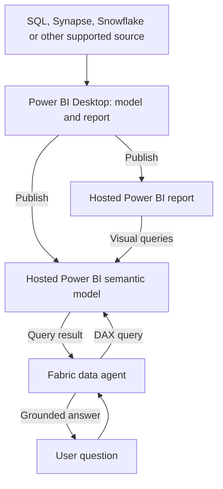
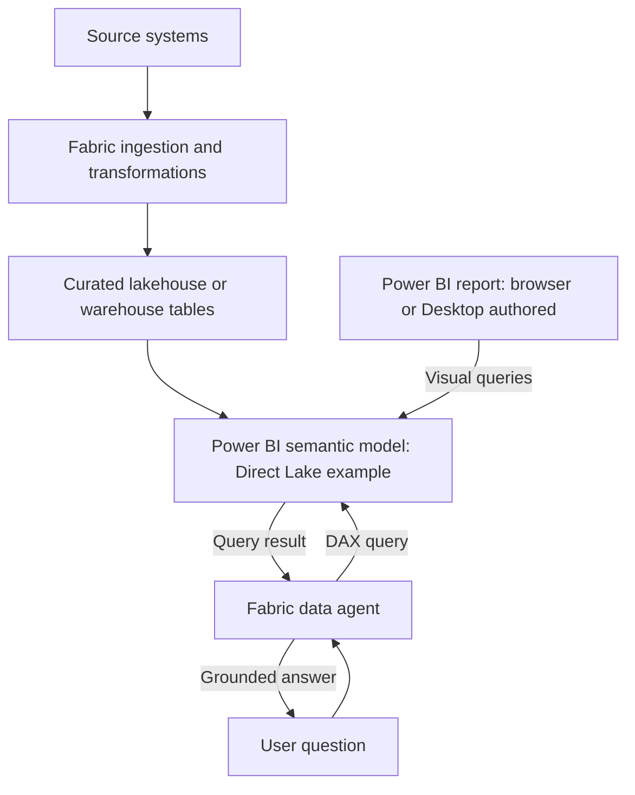
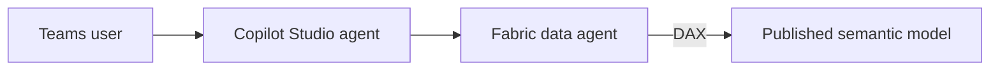
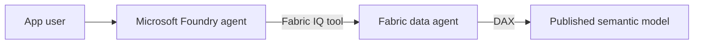

# Agents over Power BI semantic models

Checked against Microsoft documentation: 2026-10-07.

You can build a semantic model and report in Power BI Desktop, publish them to the Power BI service, and connect an agent to the published model. You can also create the model in Fabric. The important distinction is where the model runs when users ask questions, rather than where you authored the report.

This guide describes two authoring paths that converge on a Fabric data agent. Copilot Studio or Microsoft Foundry can optionally call that data agent. The steps are documentation-based and have not been run in the user's tenant. The example names and business rules are illustrative, not a record of a NSW Government deployment.

## 1. What the components do

| Component | Purpose |
| --- | --- |
| Power BI Desktop | Author tables, relationships, DAX measures and report visuals locally. |
| Power BI semantic model | Defines reusable business metrics, relationships and model security; runs in the service after publication. |
| Power BI report | Presents visuals that query the model. Reports and agents can use the same model. |
| Fabric data agent | Turns a question into a source-native query; for a semantic model, that is DAX. |
| Copilot Studio agent | Adds a conversational application, tools and channels such as Teams. |
| Foundry agent | Provides agent orchestration and tools for a custom AI application. |

Publishing a PBIX containing a model uploads the model and report as separate service items. A thin report connected to an existing service model continues to use that model; do not assume it publishes another independent model. See [Desktop publication](https://learn.microsoft.com/en-us/power-bi/create-reports/desktop-upload-desktop-files) and [shared models and live connections](https://learn.microsoft.com/en-us/power-bi/connect-data/desktop-report-lifecycle-datasets).

For the hosted patterns below, the agent connects to the published semantic model, not an unpublished PBIX on your laptop. Report visual metadata can help query interpretation, but the agent executes against the model. A separate chat must be given the relevant date/LGA filters; do not assume it inherits a report's current slicers. See [semantic model guidance](https://learn.microsoft.com/en-us/fabric/data-science/semantic-model-best-practices).

## 2. Prerequisites for both paths

1. Use an organizational Microsoft Entra account and a development workspace where you can create the required items.
2. Have the capacity administrator assign the workspace to a paid Fabric F2-or-higher capacity, or Power BI Premium P1-or-higher with Fabric enabled. This guide places the model and data agent in that same workspace to simplify region and permission setup. A Power BI Pro license alone does not provide this Fabric capacity.
3. Have permission to author/publish Power BI content and edit the model. Power BI user licensing is a separate consideration from the Fabric capacity requirement.
4. In Fabric Admin portal > Tenant settings, the admin must enable the relevant Copilot/Azure OpenAI settings for your user or group. For capacities outside the US/EU boundary, configure both required cross-geo processing and storage settings. Australian capacity deployments therefore need the applicable settings; tenant settings can take up to an hour to apply.
5. Give consumers access to the published data agent and its semantic model. For agent-driven model queries, Microsoft currently documents model Read permission as sufficient; Build is not required for that interaction. Editing the model/Prep for AI requires author permissions.
6. Keep the model and data agent in the same capacity region. Different workspaces can be used when supported, but different-region capacity sources cannot be queried by this data agent.

Sources: [create a data agent](https://learn.microsoft.com/en-us/fabric/data-science/how-to-create-data-agent), [tenant settings](https://learn.microsoft.com/en-us/fabric/data-science/data-agent-tenant-settings), [sharing and permissions](https://learn.microsoft.com/en-us/fabric/data-science/data-agent-sharing), [concepts and limitations](https://learn.microsoft.com/en-us/fabric/data-science/concept-data-agent).

## 3. Path A — author in Power BI Desktop



The source does not have to be migrated into a Fabric warehouse to use this pattern. An Import model contains a refreshed copy of source data; DirectQuery queries the configured source. Actual support, source connectivity and capacity must be checked for your model. See [refresh and storage modes](https://learn.microsoft.com/en-us/power-bi/connect-data/refresh-data).

1. Open Power BI Desktop and select Get data. Connect to the actual reporting source. For a small learning exercise, Import is a straightforward starting point.
2. In Power Query, correct types and clean the data. For the illustrative revenue use case, prepare `FactRevenue`, `DimDate` and `DimLGA` at a documented grain.
3. In Model view, relate date and geography dimensions to the fact table with appropriate one-to-many relationships. Create a continuous date dimension for time comparisons.
4. Add explicit measures for revenue and year-on-year comparisons. Define the metric exactly: currency, exclusions, date basis and whether a comparison covers a full year or comparable year-to-date period. Add business-friendly names and descriptions.
5. Build a validation report: LGA, revenue and growth in a table, plus an explicit date/year filter. Reconcile its results to the source before adding AI.
6. Define RLS roles if users need restricted access. Publish roles with the model; assign users/groups in the service afterward.
7. Save the PBIX, select Home > Publish and choose the capacity-backed development workspace. Open the workspace and verify both the Semantic model and Report items exist.
8. In the hosted model settings, configure data connections/credentials and any required gateway. For Import, run Refresh now, then configure the required schedule. Verify refresh history and the report in the browser.
9. Follow the common model preparation and data-agent steps below. You can prepare the AI settings in Desktop before publishing, or in the service after publishing.

Publication and refresh sources: [publish from Desktop](https://learn.microsoft.com/en-us/power-bi/create-reports/desktop-upload-desktop-files), [data refresh](https://learn.microsoft.com/en-us/power-bi/connect-data/refresh-data). RLS source: [Power BI RLS](https://learn.microsoft.com/en-us/fabric/security/service-admin-row-level-security).

## 4. Path B — create the model in Fabric



This path chooses Direct Lake over curated Fabric tables. It still uses a Power BI semantic model. You can author the report in a browser or in Desktop against that existing model.

1. In the capacity-backed development workspace, create or open the lakehouse/warehouse containing your curated reporting tables. If it is new, ingest data with an appropriate pipeline, Dataflow Gen2, notebook or SQL process.
2. Prepare the fact/date/LGA tables, checking grain, keys, types and totals. Medallion layers are useful for a larger platform; all three layers are not necessary for a tiny learning demo.
3. Open the lakehouse and choose New Power BI semantic model, or open the warehouse/SQL analytics endpoint and choose New semantic model. Name it `Revenue_Model` and select the required tables/workspace when prompted.
4. Open the new model using Open data model. Review and configure relationships; create the approved measures and descriptions. Configure supported RLS for the model as required.
5. From the model select New report to build browser visuals, or connect Desktop to the existing semantic model and build a thin report. Use the report to reconcile totals and filters.
6. Confirm data freshness and the source identity/permissions used by the model. Direct Lake still has model refresh/framing and source-security considerations; do not treat it as a guarantee of immediately current data.
7. Follow the common steps below to prepare the model and attach the data agent.

Fabric no longer automatically creates default semantic models for newly created lakehouses/warehouses. Create one explicitly when it does not exist. Sources: [create a semantic model](https://learn.microsoft.com/en-us/fabric/data-warehouse/create-semantic-model), [lakehouse model/report tutorial](https://learn.microsoft.com/en-us/fabric/data-engineering/tutorial-lakehouse-build-report).

## 5. Prepare the model for either path

1. Open the model with edit permission, in Desktop or the service, and select Home/ribbon > Prep data for AI.
2. On Simplify data schema, select the relevant facts, dimensions, measures and their dependencies. Apply the selection. This focuses AI context; security must still be enforced through actual permissions/RLS/OLS.
3. For common questions, configure Verified answers using suitable report visuals. Fabric data agent uses their question/visual metadata to guide DAX rather than returning the visual itself.
4. Test baseline questions, then use Add AI instructions for unresolved terminology or metric/date ambiguity. Apply the changes and save/publish as appropriate.

Illustrative instructions, to adapt to actual object names and business rules:

```text
LGA means Local Government Area and refers to DimLGA[LGAName].
Revenue means the approved [Revenue] measure and is reported in AUD.
Use DimDate for revenue date filtering.
If the user asks for a year comparison without a year or date range,
ask which period they want. Distinguish a full year from year-to-date.
Use [Revenue YoY %] for percentage growth once the period is specified.
```

Business logic belongs in real measures. Instructions help interpret the model but do not reliably enforce calculations or access rules. For semantic-model DAX generation, data-agent-level instructions are ignored: put model-specific guidance in Prep for AI. Power BI semantic models do not support the data agent's separate sample question/query configuration.

If Prep for AI tabs are disabled, check current model Q&A enablement and tenant Copilot settings. Microsoft's October 2026 documentation still uses Q&A for this setup; Q&A retirement is announced for December 2026, so recheck the replacement setting if following these steps later.

Sources: [AI data schema setup](https://learn.microsoft.com/en-us/power-bi/create-reports/copilot-prepare-data-ai-data-schema), [AI instructions setup](https://learn.microsoft.com/en-us/power-bi/create-reports/copilot-prepare-data-ai-instructions), [data-agent semantic model guidance](https://learn.microsoft.com/en-us/fabric/data-science/semantic-model-best-practices).

## 6. Create and validate the Fabric data agent

1. In the workspace, select + New item, search for Fabric data agent and create `Revenue_Reporting_Agent`.
2. In the OneLake catalog/add-source picker, choose the published Power BI semantic model. Add it and select the relevant tables, aligned with your AI schema.
3. Use data-agent instructions for source routing and answer presentation, for example: use Revenue_Model for revenue/LGA questions; identify the period and currency in the reply. Keep DAX-specific business guidance in the model.
4. Ask explicit questions such as: "Show revenue by LGA for calendar year 2025 and its percentage change from calendar year 2024."
5. Expand the generated steps/DAX. Compare the answer against the report using the same measures, filters and user identity. The LLM should retrieve computed measures, rather than invent numbers.
6. Test missing dates, unknown LGAs, blank/zero prior-year results and a restricted consumer account. Power BI RLS does not restrict workspace Admin/Member/Contributor roles, so the maker's successful test alone is insufficient.
7. Publish the data agent with a description of its sources, scope and available metrics. Share it and give consumers the required model Read permission and RLS role membership.
8. Ask the test questions again through the published version. Later draft edits must be republished to reach consumers.

Sources: [data-agent creation](https://learn.microsoft.com/en-us/fabric/data-science/how-to-create-data-agent), [sharing](https://learn.microsoft.com/en-us/fabric/data-science/data-agent-sharing), [RLS testing](https://learn.microsoft.com/en-us/fabric/security/service-admin-row-level-security).

At this point you have a working conversational data agent. Copilot Studio and Foundry are optional extensions.

## 7. Optional Copilot Studio connection



For the documented tool-based experience:

1. Use the same tenant/account and a published Fabric data agent. The Microsoft integration page lists a Microsoft 365 Copilot license and a user license for each person building/managing agents; confirm the applicable tenant licensing and permissions with the administrator.
2. In Copilot Studio choose the environment. Use the arrow next to New agent > Agent under Optimize your business processes (the GitHub Copilot harness experience).
3. On Build, choose Tools > +, search Fabric and select Fabric IQ Data MCP. Create/select its connection.
4. Select your published data agent in the OneLake catalog. Add a clear description of its reporting scope.
5. Choose User authentication so each consumer's permissions govern the data call. Maker authentication instead uses the maker's access for all consumers, so it changes the effective data boundary.
6. Add routing instructions, save, test in Preview, evaluate a set of questions, then publish and enable the required channel such as Teams.

If your agent uses the standard harness and has the older interface, the alternative is Agents > Add an agent > Microsoft Fabric > connection > published data agent. Configure User authentication and generative orchestration, test and publish. Microsoft still labels this connected-agent integration preview; its older guide validates Teams and states limitations for Microsoft 365 Copilot. Do not apply the new harness's channel capabilities to that older route.

Sources: [tool-based setup](https://learn.microsoft.com/en-us/fabric/data-science/data-agent-microsoft-copilot-studio-tool), [standard-harness connection](https://learn.microsoft.com/en-us/microsoft-copilot-studio/add-agent-fabric-data-agent), [older connected-agent setup and channel limits](https://learn.microsoft.com/en-us/fabric/data-science/data-agent-microsoft-copilot-studio).

## 8. Optional Foundry connection



Use the current Fabric IQ catalog integration where available:

1. Have a Foundry project with a deployed model, in the same tenant. Builders need the documented Foundry User role; creating the Fabric IQ connection requires Foundry Project Manager. Arrange delegated user authentication and access to the data agent/model.
2. In the Foundry project choose Build > New agent arrow > Build an agent. Name it and open Playground.
3. Under Tools select Add > Browse all tools > Configured > Fabric IQ (OneLake Catalog) > Add tool.
4. Filter Type to Data agent. Select your published agent and Add.
5. Add instructions to use this tool for revenue/LGA questions, retrieve figures before answering, and ask for ambiguous periods. Save.
6. Test in Playground and inspect tool traces. For a deployed application, implement user sign-in/delegation and verify the real user's permissions; a playground test alone is not an application deployment.

This Fabric IQ integration is preview. An alternative native Fabric tool connection uses the published data agent's workspace/artifact IDs; current native-tool docs also identify preview limitations and require user identity rather than service principal authentication. Avoid mixing classic threads/runs examples with the newer agent SDKs.

Sources: [Fabric IQ portal setup](https://learn.microsoft.com/en-us/fabric/data-science/data-agent-foundry-fabric-iq), [current native Fabric tool](https://learn.microsoft.com/en-us/azure/foundry/agents/how-to/tools/fabric).

## 9. How to describe the work accurately

Building a model in Desktop and publishing it is a valid starting point for enterprise agent work. A precise description could be: "I built and published Power BI semantic models, connected a Fabric data agent for natural-language reporting, and validated its DAX responses against existing reports." Add Copilot Studio or Foundry only if you also implemented that respective agent connection. Production, pilot and prototype status must reflect the actual rollout and users.

For an existing Desktop report, the shortest learning route is: publish to an appropriately configured workspace, prepare the model, create/test/publish the Fabric data agent, then add the outer agent if needed. A lakehouse/warehouse migration is not a prerequisite for a model-backed agent.
