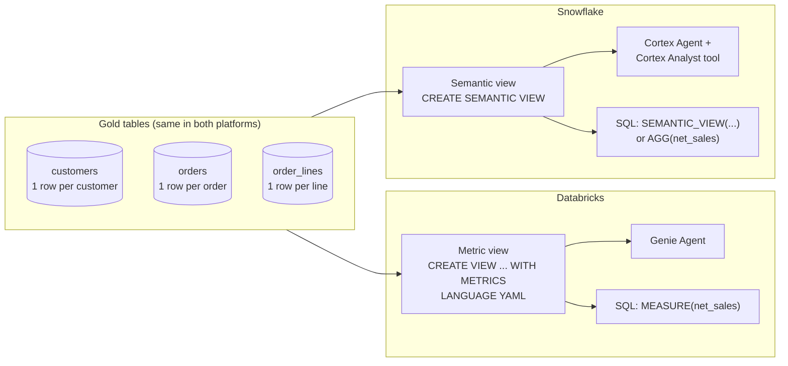

# Building semantic layers in Databricks and Snowflake

Checked against official Databricks and Snowflake documentation on 2026-10-09. This guide is hands-on: it builds **the same semantic model twice** over one synthetic star schema, once as a **Databricks Unity Catalog metric view** and once as a **Snowflake semantic view**. You can then compare the results number by number. **None of the SQL has been run in a Databricks workspace or a Snowflake account.** The expected results come from running the fixture locally in SQLite.

Related material in this repository:

- [Snowflake semantic views deep dive (SnowPro 08)](../../snowpro-genai/08_SEMANTIC_LAYER.md): the full Snowflake reference, with privileges, verified queries, Autopilot, materializations and exam traps. This guide uses the **same fixture**, so the answers match.
- [dbt semantic models and metrics course](../../dbt/dbt-study-guide/02_SEMANTIC_MODELS_AND_METRICS_COURSE.md) and [entities and star schemas](../../dbt/dbt-study-guide/10_AGGREGATIONS_ENTITIES_AND_STAR_SCHEMAS.md): the warehouse-agnostic dbt/MetricFlow option.
- [Power BI semantic-model agents guide](POWER_BI_SEMANTIC_MODEL_AGENTS_GUIDE.md), section 13: how the semantic model feeds an agent in each cloud.

## 1. What you are building

A semantic layer stores business definitions **once**: which tables make up an entity, how they join, and how each metric is aggregated. Every consumer reuses those definitions: SQL users, dashboards, BI tools and AI agents.



### Vocabulary map

| Idea | Databricks metric view | Snowflake semantic view | dbt MetricFlow |
| --- | --- | --- | --- |
| Object | View with `WITH METRICS`, a Unity Catalog securable | `SEMANTIC VIEW`, a schema-level object | `semantic_models:` + `metrics:` YAML in a dbt project |
| Authoring format | YAML inside `$$ ... $$` (spec `version: 1.1`) | SQL DDL **or** YAML (`SYSTEM$CREATE_SEMANTIC_VIEW_FROM_YAML`) | YAML |
| Starting table | One `source` (the fact), plus `joins` | Several `TABLES` with primary keys, plus `RELATIONSHIPS` | One model per semantic model, joined by entities |
| Group/filter attribute | `fields` (`dimensions` still accepted) | `DIMENSIONS` | `dimensions` |
| Row-level helper | Inline expression in a measure | `FACTS` | `measures` (legacy) / expression |
| KPI | `measures` | `METRICS` | `metrics` |
| Ratio of KPIs | `MEASURE(a) / MEASURE(b)` in a measure | Derived metric without a table prefix | `ratio` metric |
| Always-on filter | Top-level `filter` | Filter dimension (`LABELS = (FILTER)`) or base-table policy | `filter:` on a metric |
| Conditional KPI | `SUM(x) FILTER (WHERE ...)` | `SUM(...)` over a `CASE`, or a filtered fact | metric `filter:` |
| Query syntax | `SELECT dim, MEASURE(m) ... GROUP BY ALL` | `SEMANTIC_VIEW(... DIMENSIONS ... METRICS ...)` or `AGG(m)` | `dbt sl query --metrics ... --group-by ...` |
| Natural language | Genie Agent (formerly Genie Space) | Cortex Agent with a Cortex Analyst tool | dbt Semantic Layer integrations |
| Grain protection | **Your responsibility** (use `COUNT(DISTINCT ...)`, or `one_to_many` joins) | **Enforced**: a too-fine dimension for a metric is rejected | Enforced through entities |

The last row is the most important practical difference. Section 5 demonstrates it.

## 2. The shared fixture

Use the same three tables on both platforms. The grain is one row per customer, one per order, and one per order line (key `order_id, line_no`). Lines → orders → customers are many-to-one.

| order | customer (region) | date | status | lines (qty × price × (1 − discount)) | net |
| --- | --- | --- | --- | --- | --- |
| O1 | C1 Acme (East) | 2026-01-10 | COMPLETE | Widget 2×50 = 100; Gadget 1×200×0.9 = 180 | 280 |
| O2 | C2 Birch (West) | 2026-01-20 | COMPLETE | Widget 4×50 = 200 | 200 |
| O3 | C1 Acme (East) | 2026-02-05 | RETURNED | Gadget 1×200 = 200 | 200 |
| O4 | C3 Cedar (East) | 2026-02-14 | COMPLETE | Widget 3×50×0.8 = 120; Gizmo 1×80 = 80 | 200 |

### Expected answers (both platforms must reproduce these)

| Question | Answer |
| --- | --- |
| Total net sales / gross sales / orders / AOV | **880.00 / 930.00 / 4 / 220.00** |
| By region | East 680.00, 3 orders, AOV 226.67 · West 200.00, 1 order, AOV 200.00 |
| By month (all orders) | 2026-01: 480.00, 2 orders · 2026-02: 400.00, 2 orders |
| By month, completed orders only | 2026-01: 480.00 · 2026-02: 200.00 |
| Net sales by product | Widget 420.00 · Gadget 380.00 · Gizmo 80.00 |
| Completed net sales (all time) | 680.00 |
| **Trap:** `COUNT(order_id)` at line grain | 6, which is **wrong**; the true order count is 4 |
| Distinct orders per product | Widget 3, Gadget 2, Gizmo 1. These sum to 6, not 4, because an order can contain several products. |

If a platform gives a different number, check the grain and the joins before you blame the tool.

## 3. Modeling decisions to make before writing any YAML

1. **Pick one domain.** For example "Sales performance", not "everything in the gold schema". Both vendors advise starting small: Snowflake suggests 5–10 tables, and Genie works best with a focused set of datasets.
2. **Write down the grain of every table** and the key that proves it. Test key uniqueness before modeling (section 7).
3. **Name the fact table.** Databricks needs a single `source`, which should be your finest-grain fact (`order_lines`). Snowflake takes every table as a peer and infers direction from the primary keys.
4. **List the 5–15 business questions** the model must answer. Each becomes a dimension, a metric or a benchmark test.
5. **Decide each metric's formula, grain and null behavior in plain words first.** For example: "Net sales = sum of quantity × unit price × (1 − discount) per line. Returned orders are included unless filtered."
6. **Write descriptions and synonyms for humans and agents.** Descriptions are the strongest accuracy lever in both platforms' AI features.

## 4. Build it in Databricks: Unity Catalog metric view

### Requirements

- A Unity Catalog-enabled workspace. Creating a metric view needs **Databricks Runtime 16.4+**. The YAML 1.1 agent metadata used below (`display_name`, `synonyms`, `format`) and snowflake (nested) joins need **17.3+**. Use a current SQL warehouse, which updates automatically. [Feature availability](https://docs.databricks.com/aws/en/uc-semantics/metric-views/feature-availability)
- Privileges: `USE CATALOG`, `USE SCHEMA` and `CREATE TABLE` on the target schema, `SELECT` on every source and join table, and `CAN USE` on the compute. [Create a metric view](https://docs.databricks.com/aws/en/uc-semantics/metric-views/create)
- Status: Databricks announced metric views as **generally available** within Unity Catalog Business Semantics. The point-and-click Catalog Explorer editor was announced as Public Preview. Recheck this in your workspace. [GA announcement](https://www.databricks.com/blog/redefining-semantics-data-layer-future-bi-and-ai)

### Step 1: create the tables

These steps use your trial catalog `mdlm_db_trial` and a throwaway `semantic_lab` schema. Change the names if needed.

```sql
CREATE SCHEMA IF NOT EXISTS mdlm_db_trial.semantic_lab;
USE mdlm_db_trial.semantic_lab;

CREATE OR REPLACE TABLE customers (customer_id STRING, customer_name STRING, region STRING);
INSERT INTO customers VALUES ('C1','Acme','East'), ('C2','Birch','West'), ('C3','Cedar','East');

CREATE OR REPLACE TABLE orders (order_id STRING, customer_id STRING, order_date DATE, order_status STRING);
INSERT INTO orders VALUES
  ('O1','C1',DATE'2026-01-10','COMPLETE'), ('O2','C2',DATE'2026-01-20','COMPLETE'),
  ('O3','C1',DATE'2026-02-05','RETURNED'), ('O4','C3',DATE'2026-02-14','COMPLETE');

CREATE OR REPLACE TABLE order_lines (
  order_id STRING, line_no INT, product STRING,
  quantity INT, unit_price DECIMAL(10,2), discount DECIMAL(4,2));
INSERT INTO order_lines VALUES
  ('O1',1,'Widget',2,50,0.00), ('O1',2,'Gadget',1,200,0.10), ('O2',1,'Widget',4,50,0.00),
  ('O3',1,'Gadget',1,200,0.00), ('O4',1,'Widget',3,50,0.20), ('O4',2,'Gizmo',1,80,0.00);

-- Informational constraints document the grain. Unity Catalog does not enforce them.
ALTER TABLE customers ALTER COLUMN customer_id SET NOT NULL;
ALTER TABLE customers ADD CONSTRAINT customers_pk PRIMARY KEY (customer_id);
ALTER TABLE orders ALTER COLUMN order_id SET NOT NULL;
ALTER TABLE orders ADD CONSTRAINT orders_pk PRIMARY KEY (order_id);
```

### Step 2: create the metric view

```sql
CREATE OR REPLACE VIEW mdlm_db_trial.semantic_lab.sales_metrics
WITH METRICS LANGUAGE YAML AS
$$
version: 1.1
comment: "Sales performance over order lines. One source row = one order line."
source: mdlm_db_trial.semantic_lab.order_lines

joins:
  - name: orders
    source: mdlm_db_trial.semantic_lab.orders
    on: source.order_id = orders.order_id
    joins:
      - name: customers
        source: mdlm_db_trial.semantic_lab.customers
        on: orders.customer_id = customers.customer_id

fields:
  - name: region
    expr: orders.customers.region
    comment: "Sales region of the customer (East or West)."
    display_name: "Region"
  - name: customer_name
    expr: orders.customers.customer_name
    display_name: "Customer"
  - name: order_date
    expr: orders.order_date
    display_name: "Order date"
  - name: order_month
    expr: DATE_TRUNC('MONTH', orders.order_date)
    display_name: "Order month"
  - name: order_status
    expr: orders.order_status
    comment: "COMPLETE or RETURNED."
  - name: product
    expr: product
    comment: "Product on the order line."

measures:
  - name: net_sales
    expr: SUM(quantity * unit_price * (1 - discount))
    comment: "Revenue after line discounts. Includes returned orders unless filtered."
    display_name: "Net sales"
    synonyms: ["revenue", "net revenue"]
    format:
      type: currency
      currency_code: USD
      decimal_places:
        type: exact
        places: 2
  - name: gross_sales
    expr: SUM(quantity * unit_price)
    display_name: "Gross sales"
  - name: order_count
    expr: COUNT(DISTINCT orders.order_id)
    comment: "Number of distinct orders. DISTINCT is required because the source is at line grain."
    display_name: "Orders"
  - name: avg_order_value
    expr: MEASURE(net_sales) / MEASURE(order_count)
    display_name: "Average order value"
    synonyms: ["AOV"]
  - name: completed_net_sales
    expr: SUM(quantity * unit_price * (1 - discount)) FILTER (WHERE orders.order_status = 'COMPLETE')
    display_name: "Completed net sales"
$$;
```

What to notice:

- **One source.** The finest-grain table is the `source`. Everything else hangs off it through `joins`, and `customers` is **nested** under `orders` (a snowflake join). Nested columns are referenced by their full path: `orders.customers.region`.
- **`source.`** refers to the source table in `on` clauses. Unprefixed columns in `fields` and `measures` (`product`, `quantity`) also come from the source.
- **Joins default to `many_to_one`.** That is correct here, because each line has one order and each order has one customer. A `one_to_many` join (Runtime 18.1+) lets you aggregate a table as a separate fact source.
- **`COUNT(DISTINCT orders.order_id)`.** A metric view **does not** stop you from counting at the wrong grain. `COUNT(orders.order_id)` would return 6.
- **Composed measure.** `avg_order_value` references other measures with `MEASURE()`. Both inputs are re-aggregated at whatever dimensions the query asks for, so AOV by region is correct, not an average of averages.
- **Measure-level filter.** `FILTER (WHERE ...)` creates a conditional KPI. A top-level `filter:` key would apply to **every** query instead.
- **The format block** follows the YAML reference's `format` map. If your runtime rejects it, delete the block; it is presentation metadata only. [YAML reference](https://docs.databricks.com/aws/en/uc-semantics/metric-views/yaml-reference)

### Step 3: inspect it

```sql
DESCRIBE TABLE EXTENDED mdlm_db_trial.semantic_lab.sales_metrics;   -- shows the YAML and the measures
SHOW VIEWS IN mdlm_db_trial.semantic_lab;
```

In Catalog Explorer, open the view: the **Overview** tab shows fields and measures, and the **Lineage** tab shows the three source tables.

### Step 4: query it

Every measure must be wrapped in `MEASURE()`. Runtime 18.1+ also accepts `agg`. `SELECT *` is not allowed, and a metric view cannot be joined directly to another table; wrap it in a CTE first. [Query metric views](https://docs.databricks.com/aws/en/uc-semantics/metric-views/query)

```sql
-- A. By region: East 680.00 / 3 / 226.67, West 200.00 / 1 / 200.00
SELECT region, MEASURE(net_sales), MEASURE(order_count), MEASURE(avg_order_value)
FROM mdlm_db_trial.semantic_lab.sales_metrics
GROUP BY ALL ORDER BY region;

-- B. Completed orders by month: 2026-01-01 480.00, 2026-02-01 200.00
SELECT order_month, MEASURE(net_sales)
FROM mdlm_db_trial.semantic_lab.sales_metrics
WHERE order_status = 'COMPLETE'
GROUP BY ALL ORDER BY order_month;

-- C. Grand totals: 880.00 / 930.00 / 4 / 220.00 / 680.00
SELECT MEASURE(net_sales), MEASURE(gross_sales), MEASURE(order_count),
       MEASURE(avg_order_value), MEASURE(completed_net_sales)
FROM mdlm_db_trial.semantic_lab.sales_metrics;

-- D. Join to something else via a CTE
WITH by_region AS (
  SELECT region, MEASURE(net_sales) AS net_sales
  FROM mdlm_db_trial.semantic_lab.sales_metrics GROUP BY ALL)
SELECT r.*, t.target, r.net_sales - t.target AS gap
FROM by_region r JOIN (VALUES ('East', 700), ('West', 250)) AS t(region, target) USING (region);
```

### Step 5: give it to people and agents

- **Grant access:** `GRANT SELECT ON VIEW mdlm_db_trial.semantic_lab.sales_metrics TO \`sales-analysts\`;` [Manage metric views](https://docs.databricks.com/aws/en/uc-semantics/metric-views/manage)
- **Test with a non-owner.** The official pages checked do not state clearly whether a consumer also needs `SELECT` on the source tables, and secondary sources disagree. Grant only the metric view to a test group and run query A as a member. Record whether it succeeds, and whether row filters or column masks on the source tables still apply.
- **AI/BI dashboard:** add the metric view as a dataset. `MEASURE()` is applied automatically, and display names and formats show in the UI.
- **Genie Agent:** create a Genie Agent (older UI: Genie Space) over `sales_metrics`. Add instructions such as "Revenue means net_sales. Exclude RETURNED orders only when the user says completed." Add example SQL for the top questions, then ask the benchmark questions in section 8. [Genie Agents](https://docs.databricks.com/aws/en/genie-agents/)
- **External BI:** Power BI, Tableau and Sigma can connect. See [BI tools](https://docs.databricks.com/aws/en/uc-semantics/metric-views/bi-tools) for supported modes.

### Step 6: change it safely

- `ALTER VIEW ... AS $$ <complete YAML> $$` **replaces the whole definition**, so always send the full YAML. Comments set only in Unity Catalog can be lost unless they are in the YAML.
- Keep the YAML in Git. Deploy it with a SQL task in a Declarative Automation Bundle job or a CI step that runs the `CREATE OR REPLACE VIEW` statement. Run the section 7 checks after each deploy. See [Bundles and orchestration](../../databricks/06_BUNDLES_AND_ORCHESTRATION.md).
- Later options: **materialization** (17.3+) pre-aggregates results that the engine can use automatically; **window measures** support trailing, cumulative and period-over-period calculations; **parameters** (18.2+) bind values at query time.

## 5. Grain behavior: the key difference

Run these on each platform:

```sql
-- Databricks: order count by product
SELECT product, MEASURE(order_count) FROM mdlm_db_trial.semantic_lab.sales_metrics GROUP BY ALL;
-- Returns Widget 3, Gadget 2, Gizmo 1. Correct per product, but the rows sum to 6, not 4.
```

```sql
-- Snowflake: same question
SELECT * FROM SEMANTIC_VIEW(SALES_SV DIMENSIONS order_lines.product METRICS orders.order_count);
-- Rejected: product (line grain) is finer than order_count's table (orders).
```

| | Databricks metric view | Snowflake semantic view |
| --- | --- | --- |
| How the grain is known | From the single `source` and your join cardinality | From each logical table's `PRIMARY KEY` and the relationships |
| Wrong-grain metric | Allowed. `COUNT(orders.order_id)` silently returns 6. | The metric lives on the `orders` table, so it counts 4 by construction. |
| Too-fine dimension | Allowed. Distinct-count answers are correct per row but **not additive**. | Rejected with a granularity error. |
| What you must do | Use `DISTINCT` or `one_to_many` joins, document non-additive measures, and test totals | Declare keys correctly. Use `SHOW SEMANTIC DIMENSIONS IN SALES_SV FOR METRIC order_count` to list valid dimensions. |

Neither behavior is "better". Databricks is more flexible and puts responsibility on the modeler. Snowflake is stricter, so some legitimate questions need a different metric, such as a line-level `orders_containing_product` metric.

## 6. Build it in Snowflake: semantic view

The full walkthrough, with privileges, verified queries, custom instructions, Autopilot and governance, is in [SnowPro 08, section 4](../../snowpro-genai/08_SEMANTIC_LAYER.md#4-build-one-lab-with-known-answers). Summary:

1. **Privileges:** `CREATE SEMANTIC VIEW` on the schema, `USAGE` on the database and schema, and `SELECT` on the base tables.
2. **Tables:** the same three tables, with the Snowflake DDL in SnowPro 08, step 1 (`SV_CUSTOMERS`, `SV_ORDERS`, `SV_ORDER_LINES`).
3. **Definition:** a compact version without the AI clauses:

```sql
CREATE OR REPLACE SEMANTIC VIEW GENAI_LAB.PUBLIC.SALES_SV
  TABLES (
    customers   AS GENAI_LAB.PUBLIC.SV_CUSTOMERS   PRIMARY KEY (customer_id) COMMENT = 'One row per customer.',
    orders      AS GENAI_LAB.PUBLIC.SV_ORDERS      PRIMARY KEY (order_id)    COMMENT = 'One row per order.',
    order_lines AS GENAI_LAB.PUBLIC.SV_ORDER_LINES PRIMARY KEY (order_id, line_no) COMMENT = 'One row per line.'
  )
  RELATIONSHIPS (
    orders_to_customers AS orders (customer_id) REFERENCES customers,
    lines_to_orders     AS order_lines (order_id) REFERENCES orders
  )
  FACTS (
    order_lines.line_net_amount   AS quantity * unit_price * (1 - discount),
    order_lines.line_gross_amount AS quantity * unit_price
  )
  DIMENSIONS (
    customers.region   AS region COMMENT = 'Sales region.',
    orders.order_month AS DATE_TRUNC('MONTH', order_date),
    orders.order_status AS order_status,
    orders.is_completed LABELS = (FILTER) AS order_status = 'COMPLETE',
    order_lines.product AS product
  )
  METRICS (
    order_lines.net_sales   AS SUM(order_lines.line_net_amount) WITH SYNONYMS = ('revenue'),
    order_lines.gross_sales AS SUM(order_lines.line_gross_amount),
    orders.order_count      AS COUNT(orders.order_id),
    avg_order_value         AS order_lines.net_sales / orders.order_count
  )
  COMMENT = 'Sales performance: same fixture as the Databricks metric view.';
```

4. **Query** with either form and compare against section 2:

```sql
SELECT * FROM SEMANTIC_VIEW(SALES_SV DIMENSIONS customers.region
         METRICS order_lines.net_sales, orders.order_count, avg_order_value) ORDER BY region;

SELECT order_month, AGG(net_sales) FROM SALES_SV WHERE is_completed GROUP BY order_month ORDER BY 1;
```

5. **Natural language:** create a Cortex Agent with `SALES_SV` as a Cortex Analyst tool. Agent users also need access to the base tables, because generated SQL runs against the physical tables.
6. **Change it safely:** keep the DDL or YAML in Git. `CREATE OR ALTER SEMANTIC VIEW` makes in-place changes; `OR REPLACE` drops explicit grants unless you add `COPY GRANTS`. Export with `SYSTEM$READ_YAML_FROM_SEMANTIC_VIEW`. If dbt owns your pipeline, the `dbt_semantic_view` package materializes semantic views from a dbt model.

### Where the two definitions differ line by line

| Concept | Databricks | Snowflake |
| --- | --- | --- |
| Order count | `COUNT(DISTINCT orders.order_id)` on the line-grain source | `orders.order_count AS COUNT(orders.order_id)` on the orders table |
| Customer region | `orders.customers.region` (nested join path) | `customers.region` (direct; relationships provide the path) |
| AOV | `MEASURE(net_sales) / MEASURE(order_count)` | Derived metric `avg_order_value` without a table prefix |
| "Completed" | `completed_net_sales` measure with `FILTER (WHERE ...)`, or `WHERE order_status = 'COMPLETE'` | `is_completed` filter dimension |
| Line amount | Inline inside the measure | Named `FACTS` reused by metrics |

## 7. Tests to run after every deploy (both platforms)

Treat the semantic layer like code: write assertions with known answers.

```sql
-- 1. Grain/uniqueness of each base table: expect 0 rows
SELECT order_id, COUNT(*) FROM orders GROUP BY order_id HAVING COUNT(*) > 1;
SELECT order_id, line_no, COUNT(*) FROM order_lines GROUP BY ALL HAVING COUNT(*) > 1;

-- 2. Orphans: lines without an order, orders without a customer. Expect 0.
SELECT COUNT(*) FROM order_lines l LEFT JOIN orders o USING (order_id) WHERE o.order_id IS NULL;

-- 3. Reconciliation: the semantic total must equal the raw total (880.00)
SELECT SUM(quantity * unit_price * (1 - discount)) FROM order_lines;
-- Databricks: SELECT MEASURE(net_sales) FROM sales_metrics;
-- Snowflake:  SELECT * FROM SEMANTIC_VIEW(SALES_SV METRICS order_lines.net_sales);

-- 4. Additivity: the sum over regions must equal the grand total for additive measures
--    (net_sales yes; order_count yes by region; order_count by product NO, see section 5)
```

Why these matter: an orphaned line silently disappears from region totals with an inner join. A duplicated order row doubles every measure that is joined through it.

## 8. Natural-language benchmark (Genie or Cortex Agent)

Ask each question, **read the generated SQL**, and score it pass or fail against section 2:

| # | Question | Expected |
| --- | --- | --- |
| 1 | What is total revenue? | 880.00 (revenue → net_sales) |
| 2 | Revenue by region | East 680, West 200 |
| 3 | Average order value by region | East 226.67, West 200.00 (not an average of line values) |
| 4 | Completed sales by month | Jan 480, Feb 200 |
| 5 | How many orders were there? | 4, not 6 |
| 6 | Order count by product | Databricks: 3/2/1, with a note that it is non-additive. Snowflake: refusal or clarification is acceptable. |
| 7 | Gross vs net sales | 930 vs 880 |
| 8 | Customer email addresses | Decline: not in the model |

Add any failing question to the instructions or to example/verified SQL, then re-run the whole set. Never fix only the one question.

## 9. Choosing between the options

| Situation | Recommendation |
| --- | --- |
| Data lives in Databricks, consumers are Databricks SQL, dashboards and Genie | Metric views |
| Data lives in Snowflake, consumers are Cortex Agents / Snowflake Intelligence or BI partners | Semantic views |
| You need one definition across warehouses, or you already run dbt | dbt Semantic Layer (MetricFlow). Check that your consumers support it; see dbt guides 07–08. |
| Power BI is the main consumer | A Power BI semantic model, or the platform's Power BI integration. Compare with the [Power BI guide](POWER_BI_SEMANTIC_MODEL_AGENTS_GUIDE.md). |
| You are tempted to maintain both natively | Only do it with a single source of truth and the section 7 reconciliation tests, or the definitions will drift. |

## 10. Common mistakes

| Mistake | Effect | Fix |
| --- | --- | --- |
| `COUNT(order_id)` on a line-grain Databricks source | Order count 6 instead of 4 | `COUNT(DISTINCT ...)` or a `one_to_many` join |
| Averaging a pre-computed ratio column | Wrong AOV by region | Compose ratios from base measures (`MEASURE(a)/MEASURE(b)`, derived metric) |
| A missing Snowflake relationship | The Agent cannot join; region questions fail | Define every needed relationship to a declared key |
| `ALTER VIEW` with partial YAML (Databricks) | The definition is replaced by the fragment | Always deploy the full YAML from Git |
| `CREATE OR REPLACE` without `COPY GRANTS` (Snowflake) | Consumers lose access | `CREATE OR ALTER`, or add `COPY GRANTS` |
| A whole-warehouse model | Slow, inaccurate agents | One domain per view; split by audience |
| Real customer values in sample values or synonyms | Metadata leaks unmasked | Use representative, non-sensitive examples |
| Instructions used as security | The model can still be asked anything | Use grants, row filters/policies and masks on base tables |

## 11. Exercises

1. Add a `units_sold` measure to both definitions. What is the total, and the total for Widget?
2. Add `customer_count`. In Databricks, why must it be `COUNT(DISTINCT orders.customers.customer_id)`? What does it return by region?
3. On both platforms, create a measure for net sales excluding returns **without** using a query-time `WHERE`.
4. In Databricks, add a top-level `filter: orders.order_status = 'COMPLETE'`. Which section 2 answers change, and why is this risky?
5. Write the Snowflake metric `orders_containing_product`, which answers "orders by product" without violating the grain rule.
6. Explain why `AVG(quantity * unit_price * (1 - discount))` is not average order value.

<details>
<summary>Answers</summary>

1. `SUM(quantity)`: 2+1+4+1+3+1 = **12**; Widget 2+4+3 = **9**.
2. The source is at line grain, so C1 appears on 3 lines and C3 on 2. A plain count would give 6. Distinct customers: **East 2 (C1, C3), West 1**, total 3.
3. Databricks: `SUM(...) FILTER (WHERE orders.order_status = 'COMPLETE')` (the `completed_net_sales` measure above, 680.00). Snowflake: `order_lines.completed_net_sales AS SUM(CASE WHEN orders.order_status = 'COMPLETE' THEN order_lines.line_net_amount END)`. A line-grain expression may reference its many-to-one parent; check the validation rules in SnowPro 08 if it is rejected. An alternative is a fact for completed amounts.
4. Everything now excludes O3: total 680.00, 3 orders, AOV 226.67; East 480.00; Feb 200.00. It is risky because users can no longer see returns at all, and "total revenue" silently means "completed revenue".
5. `order_lines.orders_containing_product AS COUNT(DISTINCT order_lines.order_id)`. It lives on the line table, so `product` is a valid dimension and returns Widget 3, Gadget 2, Gizmo 1.
6. It averages **lines** (880 / 6 = 146.67), not orders (880 / 4 = 220.00).

</details>

## Sources and limits

Checked 2026-10-09:

- Databricks: [Unity Catalog semantics](https://docs.databricks.com/aws/en/uc-semantics/) · [Metric views](https://docs.databricks.com/aws/en/uc-semantics/metric-views/) · [Create](https://docs.databricks.com/aws/en/uc-semantics/metric-views/create) · [YAML reference](https://docs.databricks.com/aws/en/uc-semantics/metric-views/yaml-reference) · [Query](https://docs.databricks.com/aws/en/uc-semantics/metric-views/query) · [Manage](https://docs.databricks.com/aws/en/uc-semantics/metric-views/manage) · [Feature availability](https://docs.databricks.com/aws/en/uc-semantics/metric-views/feature-availability) · [TPC-H tutorial](https://docs.databricks.com/aws/en/uc-semantics/metric-views/tpch-example) · [BI tools](https://docs.databricks.com/aws/en/uc-semantics/metric-views/bi-tools) · [Genie Agents](https://docs.databricks.com/aws/en/genie-agents/) · [GA announcement](https://www.databricks.com/blog/redefining-semantics-data-layer-future-bi-and-ai)
- Snowflake: see the source list in [SnowPro 08](../../snowpro-genai/08_SEMANTIC_LAYER.md#sources-and-limits) (checked 2026-10-08).

Limits:

- No SQL in this guide has been executed on Databricks or Snowflake. Expected values were computed by running the fixture locally in SQLite.
- The Databricks `format` block shape, and whether metric-view consumers need source-table `SELECT`, should be confirmed in a live workspace (section 4, step 5).
- Databricks documentation pages exist under several URL families (`uc-semantics/`, `metric-views/`, `business-semantics/`) with older `dimensions`/`version 0.1` examples. This guide follows the current `uc-semantics` YAML reference (`fields`, `version: 1.1`).
