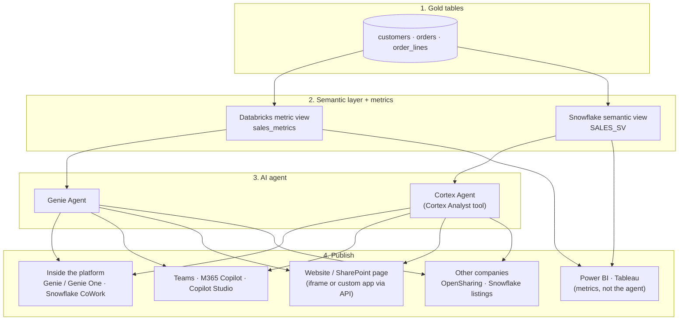

# From semantic layer to AI agent to users: Databricks and Snowflake

Checked against official Databricks, Snowflake and Microsoft documentation on 2026-10-09. **Nothing here has been executed in a workspace or account.** Features marked *preview* or *beta* can change, so recheck them before you rely on them in production.

**Short answer:** yes. On both platforms you can:

1. build a governed semantic layer;
2. define metrics in it;
3. put a natural-language AI agent on top;
4. publish the agent inside the platform, to Microsoft Teams and Microsoft 365 Copilot, into SharePoint pages or a website, and alongside Power BI and Tableau.

This guide continues the [semantic layers guide](SEMANTIC_LAYERS_DATABRICKS_SNOWFLAKE_GUIDE.md) and reuses its objects: the Databricks metric view `mdlm_db_trial.semantic_lab.sales_metrics` and the Snowflake semantic view `GENAI_LAB.PUBLIC.SALES_SV`.

## 1. The end-to-end picture



**Key idea:** BI tools consume the **semantic layer**, meaning the metrics. Chat surfaces consume the **agent**. Both read the same definitions, so "revenue" means the same thing in a Power BI visual and in a Teams chat answer.

| Layer | Databricks | Snowflake |
| --- | --- | --- |
| Semantic layer + metrics | Unity Catalog **metric view** | **Semantic view** |
| AI agent | **Genie Agent** (formerly Genie Space) | **Cortex Agent** with a **Cortex Analyst** tool |
| In-platform chat for business users | Genie Agent UI, **Genie One** | **Snowflake CoWork** (web and iOS) |
| Programmatic access | Genie Conversation API, managed MCP | Agent `:run` REST API, Snowflake-managed MCP server |
| Microsoft 365 | Databricks Genie app for Teams and M365 Copilot; Genie in Copilot Studio (preview) | Cortex Agents app for Teams and M365 Copilot |
| Embed in a page | Genie **iframe embed** (admin allow-list) | No documented iframe embed of CoWork; build an app over the REST API |
| Cross-organization sharing | OpenSharing | Shares and Marketplace listings (*preview* for agents) |

## 2. Prerequisites checklist

| | Databricks | Snowflake |
| --- | --- | --- |
| Platform features | Unity Catalog; **Partner-powered AI features** enabled by the account admin; Databricks SQL entitlement | Cortex available in your region (or cross-region inference enabled); `SNOWFLAKE.CORTEX_USER` or `CORTEX_AGENT_USER` database role |
| Compute | **Pro or serverless** SQL warehouse (serverless recommended), with `CAN USE` | Warehouse with `USAGE`, set as each user's **default** warehouse |
| Author privileges | `SELECT` on the data; `CAN EDIT`/`CAN MANAGE` on the agent | `CREATE AGENT` on the schema; access to the semantic view and its tables |
| End-user privileges | `CAN RUN`/`CAN VIEW` on the agent **plus their own `SELECT`** on the data | `USAGE` on the agent, database, schema and warehouse, plus access to the semantic view's objects, all **through their default role** |
| Identity for M365 | Entra ID; on Azure Databricks, the Power Platform connection for Copilot Studio | Entra ID tenant admin consent + an `EXTERNAL_OAUTH` security integration; Private Link not supported |

**Governance rule shared by both platforms:** the agent answers with **each user's own data permissions**, not the author's. Genie evaluates data access with the end user's Unity Catalog permissions; only warehouse compute uses the author's embedded credential. Cortex Agents use the querying user's **default role**, not the session role. Row filters, column masks and masking policies therefore apply per user. That is also why agents are usually published to **known, signed-in users**, not anonymous web visitors (section 6.3).

## 3. Step 1: build the semantic layer and metrics

Follow the [semantic layers guide](SEMANTIC_LAYERS_DATABRICKS_SNOWFLAKE_GUIDE.md):

- Databricks: section 4, or the one-shot script [`semantic-layers-lab/databricks_metric_view_lab.sql`](semantic-layers-lab/databricks_metric_view_lab.sql), which builds `sales_metrics` with `net_sales`, `gross_sales`, `order_count`, `avg_order_value` and `completed_net_sales`.
- Snowflake: section 6, or [SnowPro 08 section 4](../../snowpro-genai/08_SEMANTIC_LAYER.md#4-build-one-lab-with-known-answers), which builds `SALES_SV` with the same metrics, a `completed` filter, custom instructions and a verified query.

Before adding any agent, **prove the metrics with SQL** against the expected answers: total net sales 880.00, 4 orders, AOV 220.00, East 680.00. An agent cannot be more correct than the layer underneath it.

Agent-readiness additions for the semantic layer:

| Add | Databricks metric view | Snowflake semantic view |
| --- | --- | --- |
| Business descriptions on every field and metric | `comment:` | `COMMENT =` |
| Business vocabulary | `synonyms:` (YAML 1.1) | `WITH SYNONYMS` (use sparingly) |
| Display names and formats | `display_name:`, `format:` | Descriptions; formatting via instructions |
| Value hints for categorical fields | Genie *knowledge store* / example values | `SAMPLE_VALUES`, `IS_ENUM`; a Cortex Search service on high-cardinality text |
| Gold questions | Genie example SQL and benchmarks | `AI_VERIFIED_QUERIES` |

## 4. Step 2A: Databricks Genie Agent over the metric view

[Create and manage a Genie Agent](https://docs.databricks.com/aws/en/genie-agents/set-up)

1. **Create.** Sidebar → **Genie Agents** → **New**. Select `mdlm_db_trial.semantic_lab.sales_metrics` as the data source, then **Create**. An agent uses only the sources attached to it, with a maximum of 50. Prefer the metric view over raw tables so that Genie reuses your measure definitions.
2. **Settings.** **Configure → Settings**:
   - **Title:** "Sales performance".
   - **Description:** state what the agent covers and what it does not.
   - **Default warehouse:** a serverless SQL warehouse.
   - **Common questions:** "What is revenue by region?", "Average order value by month", "Completed sales by month".
3. **Instructions.** **Configure → Instructions**, text block:
   ```text
   - "Revenue" or "sales" means the net_sales measure. "Gross" means gross_sales.
   - "Completed" means order_status = 'COMPLETE'. Do not exclude returns unless the user asks.
   - Order counts by product are not additive; say so if the user asks for a total.
   - Round currency to 2 decimals. If no date range is given, use all available dates and say so.
   - This agent has no customer contact details; decline such questions.
   ```
4. **Example SQL.** Add 3–5 trusted queries, each paired with its question:
   ```sql
   -- "Net sales by month for completed orders"
   SELECT order_month, MEASURE(net_sales) AS net_sales
   FROM mdlm_db_trial.semantic_lab.sales_metrics
   WHERE order_status = 'COMPLETE'
   GROUP BY ALL ORDER BY order_month;
   ```
5. **Review suggested queries** if Genie offers them. Accept only those that match your definitions.
6. **Test and benchmark.** Use [Test and monitor](https://docs.databricks.com/aws/en/genie-agents/monitor):
   - Add the eight benchmark questions from [the semantic layers guide, section 8](SEMANTIC_LAYERS_DATABRICKS_SNOWFLAKE_GUIDE.md#8-natural-language-benchmark-genie-or-cortex-agent) with their expected SQL.
   - Run the benchmark, then open **Show code** on each answer and compare it with section 2 of that guide.
   - Improve instructions and examples, then re-run the **whole** benchmark, not just the failing question.
7. **Share.** **Share** → add a group with **CAN RUN**, or **CAN VIEW** for read-only. Copy the link.
   - Members also need `SELECT` on the metric view and its source objects: `GRANT SELECT ON TABLE mdlm_db_trial.semantic_lab.sales_metrics TO \`sales-users\`;` and the same for the three tables, or grant at schema level.
   - Use Unity Catalog **row filters and column masks** when users must see different rows.

Shortcut: **Genie Code** can draft the agent from a description of the domain and its questions. Review the draft before sharing it.

## 5. Step 2B: Snowflake Cortex Agent over the semantic view

[Create and manage agents](https://docs.snowflake.com/en/user-guide/snowflake-cortex/cortex-agents-manage) · [Access control](https://docs.snowflake.com/en/user-guide/snowflake-cortex/cortex-agents-setup)

1. **Grant the author role:**
   ```sql
   GRANT CREATE AGENT ON SCHEMA GENAI_LAB.PUBLIC TO ROLE GENAI_SV_LAB;
   ```
2. **Create the agent.** Either use **Snowsight → AI & ML → Agents → Create agent** (object name plus display name), then **Edit → Tools → add Cortex Analyst** → choose `SALES_SV` and a warehouse; or use SQL:
   ```sql
   CREATE OR REPLACE AGENT GENAI_LAB.PUBLIC.SALES_AGENT
     COMMENT = 'Sales performance agent over SALES_SV'
     PROFILE = '{"display_name": "Sales Assistant"}'
     FROM SPECIFICATION
     $$
     models:
       orchestration: auto
     instructions:
       orchestration: "Use the SalesAnalyst tool for any question about revenue, orders, regions, products or months."
       response: "Answer concisely. Round currency to 2 decimals. State any filter you applied. Order counts by product are not additive."
     tools:
       - tool_spec:
           type: "cortex_analyst_text_to_sql"
           name: "SalesAnalyst"
           description: "Governed sales metrics: net_sales, gross_sales, order_count, avg_order_value by region, month, status and product."
     tool_resources:
       SalesAnalyst:
         semantic_view: "GENAI_LAB.PUBLIC.SALES_SV"
         execution_environment:
           type: "warehouse"
           warehouse: "GENAI_WH"
     $$;
   ```
   The SQL keys follow the documented specification shape. `execution_environment` appears in the documented REST example; if `CREATE AGENT` rejects it, configure the warehouse in Snowsight instead.
3. **Test.** Use the agent playground in Snowsight. Ask the eight benchmark questions and read each generated SQL statement. Put definition fixes into the **semantic view** (descriptions, filters, verified queries, `AI_SQL_GENERATION`). Use agent instructions only for tone and tool routing.
4. **Grant users.** Remember that the **default role** is what counts:
   ```sql
   CREATE ROLE IF NOT EXISTS SALES_AGENT_USER;
   GRANT DATABASE ROLE SNOWFLAKE.CORTEX_AGENT_USER TO ROLE SALES_AGENT_USER;
   GRANT USAGE ON DATABASE GENAI_LAB TO ROLE SALES_AGENT_USER;
   GRANT USAGE ON SCHEMA GENAI_LAB.PUBLIC TO ROLE SALES_AGENT_USER;
   GRANT USAGE ON AGENT GENAI_LAB.PUBLIC.SALES_AGENT TO ROLE SALES_AGENT_USER;
   GRANT USAGE ON WAREHOUSE GENAI_WH TO ROLE SALES_AGENT_USER;
   GRANT SELECT ON SEMANTIC VIEW GENAI_LAB.PUBLIC.SALES_SV TO ROLE SALES_AGENT_USER;
   GRANT SELECT ON TABLE GENAI_LAB.PUBLIC.SV_CUSTOMERS TO ROLE SALES_AGENT_USER;  -- and SV_ORDERS, SV_ORDER_LINES
   GRANT ROLE SALES_AGENT_USER TO USER <business_user>;
   ALTER USER <business_user> SET DEFAULT_ROLE = SALES_AGENT_USER DEFAULT_WAREHOUSE = GENAI_WH;
   ```
5. **Monitor.** Grant `MONITOR` on the agent to reviewers so they can read threads, traces and user feedback. Run [agent evaluations](https://docs.snowflake.com/en/user-guide/snowflake-cortex/cortex-agents-evaluations). Cap spend with an orchestration budget, resource budgets or per-user quotas: orchestration and Analyst are billed per token, plus warehouse time.

## 6. Step 3: publish

### 6.1 Inside the platform (simplest, start here)

| | Databricks | Snowflake |
| --- | --- | --- |
| Where users go | Genie Agent link, or **Genie One** for one chat across agents, dashboards and apps | **Snowflake CoWork**, Snowflake's chat app for business users (web and iOS) |
| What you do | Share the agent (CAN RUN) and grant data access | Grant `USAGE` on the agent to their default role. The agent then appears for them. |
| Who can use it | Workspace users | Snowflake users in the account |
| Effort | Minutes | Minutes |

### 6.2 Microsoft Teams and Microsoft 365 Copilot

**Databricks.** Microsoft documents this for **Azure Databricks**; check availability for AWS or GCP workspaces.

- **Recommended: the Databricks Genie app in Teams.** Install it from the Teams store after completing its prerequisites. It uses Genie rather than an individual agent, so setup is simpler and latency is lower. In M365 Copilot, users open **More agents → Databricks Genie** or type `@Databricks`. [Genie on M365 Copilot](https://learn.microsoft.com/en-us/azure/databricks/integrations/msft-m365-copilot)
- **Specific agent: Copilot Studio** (*Public Preview*). Steps:
  1. Enable the **Managed MCP Servers** preview in the workspace.
  2. Create an **Azure Databricks connection** in Power Platform.
  3. In Copilot Studio → **Tools**, add **Azure Databricks Genie** (or Model Context Protocol) and pick your Genie Agent.
  4. Add an instruction to keep polling until Genie responds.
  5. Publish the Copilot Studio agent to **Teams and Microsoft 365 Copilot**.

  [Copilot Studio integration](https://learn.microsoft.com/en-us/azure/databricks/integrations/msft-power-platform/copilot-studio)
- **Foundry**: connect the Genie Agent as an MCP tool of a Foundry agent (*preview*). See the existing [Foundry guides](../../power-platform-copilot-studio/README.md).

**Snowflake.** The [Cortex Agents app for Teams and M365 Copilot](https://docs.snowflake.com/en/user-guide/snowflake-cortex/cortex-agents-teams-integration):

1. **Entra admin** grants tenant-wide consent to the two Snowflake apps: *Cortex Agents Bot OAuth Resource* and *Cortex Agents Bot Snowflake OAuth Client*.
2. **ACCOUNTADMIN** creates the security integration:
   ```sql
   CREATE SECURITY INTEGRATION ENTRA_CORTEX_AGENTS
     TYPE = EXTERNAL_OAUTH
     ENABLED = TRUE
     EXTERNAL_OAUTH_TYPE = AZURE
     EXTERNAL_OAUTH_ISSUER = 'https://login.microsoftonline.com/<tenant-id>/v2.0'
     EXTERNAL_OAUTH_JWS_KEYS_URL = 'https://login.microsoftonline.com/<tenant-id>/discovery/v2.0/keys'
     EXTERNAL_OAUTH_AUDIENCE_LIST = ('<resource-app-id-from-the-snowflake-doc>')
     EXTERNAL_OAUTH_TOKEN_USER_MAPPING_CLAIM = 'upn'
     EXTERNAL_OAUTH_SNOWFLAKE_USER_MAPPING_ATTRIBUTE = 'login_name';
   ```
   Copy the exact values from the Snowflake page. Each Entra user must map to exactly one Snowflake user.
3. **Install** the *Cortex Agents* app from the Teams store; a Teams admin may need to approve it. The first person to connect is an ACCOUNTADMIN or SECURITYADMIN. Admin roles cannot be the default role, so use secondary roles or a dedicated role. Enter the account URL in the wizard.
4. **Users** sign in once with their corporate identity. Questions then run under their Snowflake user, with RBAC and masking applied.

Limits:

- Entra ID is required.
- No Private Link and no sovereign regions.
- Accounts outside Azure East US 2 accept a pass-through processing notice.
- Feedback buttons work in Teams only.

### 6.3 A website or a SharePoint page

Choose by **who the audience is**:

| Audience | Databricks | Snowflake |
| --- | --- | --- |
| **Signed-in employees** on an intranet page or SharePoint | **Iframe embed**, steps below | Teams/M365 Copilot (6.2), or a Copilot Studio agent that calls the Cortex Agent and is surfaced in SharePoint/Teams. Snowflake documents no iframe for CoWork. |
| Employees in a **custom app** | **Databricks App**, or your own backend calling the Genie Conversation API with OAuth **U2M** (per-user) | **Streamlit in Snowflake** app, or your own backend calling the agent `:run` API with per-user **OAuth** |
| **External or anonymous visitors** | Possible only through your own backend with a **service principal** (M2M) | Possible only through your own backend with a **service user** (PAT or key pair) |

**Databricks iframe embed** ([Embed a Genie Agent](https://docs.databricks.com/aws/en/genie-agents/embed)):

1. A **workspace admin** adds your site's domain, for example `https://<tenant>.sharepoint.com`, to the allowed embedding surfaces (*Manage dashboard and Genie Agent embedding*).
2. The **agent owner** (CAN MANAGE) opens **Share → Embed space** and copies the iframe code.
3. Paste it into the page and add `allow="clipboard-write"`.
   - **SharePoint:** use the **Embed** web part. A SharePoint admin may need to allow the Databricks domain in **HTML Field Security** for that site.
   - **Website:** put it in your HTML.
4. Viewers who are not signed in to Databricks are prompted to authenticate. They need access to the agent **and** to the data, and they cannot edit the agent.

**Custom app over the API.** Use this for your own website, your own chat UI or a Databricks App.

```python
# Databricks Genie Conversation API: outline only. Check field names against the API reference.
# Auth: OAuth U2M (per user) or M2M (service principal). Never put tokens in browser code.
import time, requests
H = {"Authorization": f"Bearer {token}"}
base = f"https://{host}/api/2.0/genie/spaces/{space_id}"
r = requests.post(f"{base}/start-conversation", headers=H, json={"content": "Revenue by region"}).json()
conv, msg = r["conversation_id"], r["message_id"]
while True:  # poll every 1-5 s, back off, give up after ~10 min
    m = requests.get(f"{base}/conversations/{conv}/messages/{msg}", headers=H).json()
    if m["status"] in ("COMPLETED", "FAILED", "CANCELLED"):
        break
    time.sleep(3)
# Results: GET .../messages/{msg}/attachments/{attachment_id}/query-result
```

[Genie Conversation API](https://docs.databricks.com/aws/en/genie-agents/conversation-api): start a new conversation per session, and add your own retries, since the API does not retry.

```bash
# Snowflake Cortex Agent run (server side). Streams SSE events: response.text.delta, response.table, response ...
curl -N -X POST "https://<account>.snowflakecomputing.com/api/v2/databases/GENAI_LAB/schemas/PUBLIC/agents/SALES_AGENT:run" \
  -H "Authorization: Bearer $SNOWFLAKE_TOKEN" -H "Content-Type: application/json" -H "Accept: text/event-stream" \
  -d '{"messages":[{"role":"user","content":[{"type":"text","text":"Revenue by region"}]}]}'
```

[Agent run API](https://docs.snowflake.com/en/user-guide/snowflake-cortex/cortex-agents-run): for follow-ups, pass `thread_id` and `parent_message_id`. The first message uses `parent_message_id: 0`.

**Security for anything public-facing:**

- With a service principal or service user, every visitor sees **that identity's** data. Give it a dedicated role limited to non-sensitive, aggregated objects.
- Rate-limit requests and set a spend cap: a Snowflake per-user quota, or a Databricks budget policy.
- Keep tokens in a server-side secret store (Key Vault), never in the browser. See the [API authentication guide](../api/API_AUTHENTICATION_STUDY_GUIDE.md).
- Log questions and answers, show "AI-generated, verify before acting", and review the benchmark regularly.

### 6.4 Power BI and Tableau

BI tools read the **semantic layer**. They do not host the Genie or Cortex agent. Use them for dashboards with the same metric definitions, and point users to the agent for ad-hoc questions. Power BI's own Copilot or a Fabric data agent is a separate agent over a Power BI model; see the [Power BI agents guide](POWER_BI_SEMANTIC_MODEL_AGENTS_GUIDE.md).

| Tool | Databricks metric view | Snowflake semantic view |
| --- | --- | --- |
| **Power BI** | Databricks connector, **DirectQuery** with a **native query** using `MEASURE()`. Alternatively, build a **wrapper view** per dimension combination. The connector no longer offers "BI compatibility mode". [BI tools](https://docs.databricks.com/aws/en/uc-semantics/metric-views/bi-tools) | No documented live semantic-view connector was found. Options: a Snowflake-connector native query using `SEMANTIC_VIEW(...)`/`AGG()` (test it first), or a standard view or table of exported metrics. **Autopilot ingestion of .pbix/.pbit (GA 2026-08-18)** goes the *other* way: it builds a semantic view **from** a Power BI model. |
| **Tableau** | **Custom SQL** with `MEASURE()`, or **BI compatibility mode** enabled in **Initial SQL** so Tableau's generated SUM/COUNT is rewritten into the measure logic | **Export a TDS file**: `SYSTEM$EXPORT_TDS_FROM_SEMANTIC_VIEW` (*preview*). Metrics arrive wrapped in `AGG()`; **live connection only**, and Tableau calculated fields do not sync back. |
| **Sigma / others** | Sigma custom SQL dataset; any JDBC/ODBC tool's pass-through SQL with `MEASURE()` | Sigma, Omni, Hex, ThoughtSpot partner integrations |

Embedding the **dashboard** in SharePoint or a website is then each BI tool's own feature: the Power BI web part or "Publish to web", or Tableau embedding. The agent stays in Teams or the iframe described above.

### 6.5 Other companies

- **Databricks:** share the Genie Agent through **OpenSharing**; see the *Share a Genie Agent using OpenSharing* page.
- **Snowflake (*preview*):**
  - `GRANT USAGE ON AGENT SALES_AGENT TO SHARE s;`, plus the semantic view (and its objects) on the same share.
  - Linked objects must be in the agent's database. Agents that use procedures, skills or MCP connectors cannot be shared.
  - The consumer pays its own tokens and compute, and can add the agent to CoWork.
  - [Sharing agents](https://docs.snowflake.com/en/user-guide/snowflake-cortex/cortex-agents-sharing)

## 7. Recommended rollout order

1. **Metrics proven in SQL**: the 23-check script and the Snowflake section 6 queries.
2. **Agent built and benchmarked** with 8–20 real questions. Target ≥ 90% correct SQL before any wider audience.
3. **Pilot inside the platform** (Genie link / CoWork) with 3–5 business users. Collect feedback and fold good questions into examples or verified queries.
4. **Teams / M365 Copilot** for the broader internal audience, since it meets users where they already work.
5. **SharePoint or intranet embed** if a page-based experience is wanted.
6. **BI dashboards** on the same semantic layer for recurring reporting.
7. **External/public app** last, and only with a dedicated restricted identity, rate limits and spend caps.

Version everything in Git: metric view YAML, semantic view DDL/YAML, agent specification (`CREATE AGENT` and Genie instructions/examples), and the benchmark questions. Promote dev → prod with the same tests. See [Bundles and orchestration](../../databricks/06_BUNDLES_AND_ORCHESTRATION.md) and the [Power BI guide, section 14](POWER_BI_SEMANTIC_MODEL_AGENTS_GUIDE.md) for production-release patterns.

## 8. Troubleshooting

| Symptom | Likely cause | Fix |
| --- | --- | --- |
| Agent answers but a user sees "no data" or a permission error | The user lacks data access: Genie uses the user's UC permissions, Cortex the user's **default role** | Grant `SELECT` and `USAGE` to the user's group or default role, not just to the agent |
| "Revenue" computed differently from the dashboard | The agent queries raw tables instead of the metric or semantic view | Attach only the metric view (Genie) or semantic view (Analyst); add instructions mapping vocabulary to metrics |
| Teams bot connects but answers fail (Snowflake) | No default warehouse, or the admin role is set as default | Set `DEFAULT_WAREHOUSE` and a non-admin `DEFAULT_ROLE` |
| Copilot Studio says "still processing" (Databricks) | Genie answers asynchronously | Add the documented instruction to keep polling; prefer the Genie Teams app |
| Iframe is blank in SharePoint | Domain not allow-listed in Databricks, or blocked by SharePoint HTML Field Security | Add the SharePoint origin to the embedding surfaces and allow the Databricks domain in the site |
| Power BI cannot see measures | Metric views need `MEASURE()` and do not support `SELECT *` | Native query with `MEASURE()`, or wrapper views |
| Costs climb unexpectedly | Long agent chats, large semantic views, public traffic | Budgets and quotas, smaller domain-scoped views, rate limits |

## Sources and limits

Checked 2026-10-09:

- Databricks: [Genie Agents](https://docs.databricks.com/aws/en/genie-agents/) · [Create and manage](https://docs.databricks.com/aws/en/genie-agents/set-up) · [Embed](https://docs.databricks.com/aws/en/genie-agents/embed) · [Conversation API](https://docs.databricks.com/aws/en/genie-agents/conversation-api) · [Metric views in BI tools](https://docs.databricks.com/aws/en/uc-semantics/metric-views/bi-tools) · [Genie on M365 Copilot](https://learn.microsoft.com/en-us/azure/databricks/integrations/msft-m365-copilot) · [Copilot Studio](https://learn.microsoft.com/en-us/azure/databricks/integrations/msft-power-platform/copilot-studio) · [Access Genie everywhere (blog)](https://www.databricks.com/en/blog/access-genie-everywhere)
- Snowflake: [Cortex Agents](https://docs.snowflake.com/en/user-guide/snowflake-cortex/cortex-agents) · [Manage agents](https://docs.snowflake.com/en/user-guide/snowflake-cortex/cortex-agents-manage) · [Access control](https://docs.snowflake.com/en/user-guide/snowflake-cortex/cortex-agents-setup) · [Agent run](https://docs.snowflake.com/en/user-guide/snowflake-cortex/cortex-agents-run) · [Teams and M365 Copilot](https://docs.snowflake.com/en/user-guide/snowflake-cortex/cortex-agents-teams-integration) · [Sharing agents](https://docs.snowflake.com/en/user-guide/snowflake-cortex/cortex-agents-sharing) · [Snowflake CoWork](https://docs.snowflake.com/en/user-guide/snowflake-cortex/snowflake-cowork) · [TDS export (release note)](https://docs.snowflake.com/en/release-notes/2026/other/2026-03-05-semantic-views-tableau-tds) · [Power BI ingestion GA (release note)](https://docs.snowflake.com/en/release-notes/2026/other/2026-08-18-semantic-views-power-bi-ingestion-ga) · [Semantic views in Tableau (blog)](https://www.snowflake.com/en/blog/engineering/semantic-views-tableau/)

Limits and unverified points:

- No workspace, account, tenant, Teams app, iframe or API call was configured or tested.
- The Genie Conversation API sketch uses endpoint names from memory plus the documented polling guidance. Check field names against the API reference.
- In the `CREATE AGENT` example, the `execution_environment` placement comes from the REST example.
- The Snowflake security-integration values must come from the Snowflake Teams page.
- **SharePoint specifics** (the Embed web part and HTML Field Security) are general SharePoint behavior, not stated in the Databricks or Snowflake docs.
- **Power BI live querying of Snowflake semantic views** was not found in official docs; test it before you promise it.
- The Snowflake CoWork page does not state that CoWork replaced "Snowflake Intelligence", though links suggest it. Older material uses the Intelligence name.
- The Databricks Teams/M365 integration is documented on Microsoft Learn for Azure Databricks. Availability for AWS or GCP workspaces is unconfirmed.
