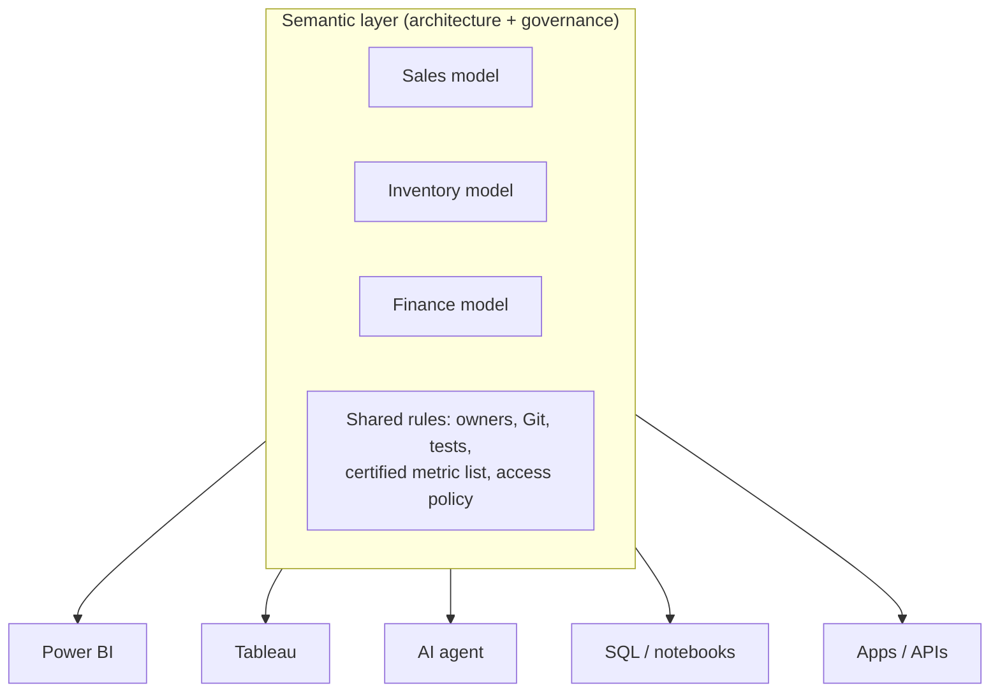

# Semantic layer vs semantic model: real-life scenarios

Companion to the [semantic layers guide](SEMANTIC_LAYERS_DATABRICKS_SNOWFLAKE_GUIDE.md), section 1. Scenarios 1–8 are **illustrative composites** of common industry situations, not descriptions of specific companies. Scenario 9 uses your own FEI RSS project as recorded in this repository.

## The one-line distinction

- **Semantic layer:** the *decision* and *architecture* that business definitions live in **one governed place** and every consumer reuses them. The question it answers is "Where does the truth about 'net revenue' live?"
- **Semantic model:** a *specific object* that implements definitions for one domain or audience, such as a Power BI semantic model, a Tableau data source, a dbt `semantic_model`, a Databricks metric view or a Snowflake semantic view. The question it answers is "Which file or object defines it, with which joins and formulas?"

A layer is made of models, plus the rules around them: ownership, Git, tests, certification and access. You can have **many semantic models and still no semantic layer**. That happens when each model redefines the same metric its own way.

## Scenario 1: retail chain with two versions of "net sales"

**Situation.** A 300-store retailer has a Finance team using Power BI and a Marketing team using Tableau. Each built its own model on the Snowflake gold tables.

**Problem.** At the monthly review, Finance reports net sales of $41.2M and Marketing reports $43.0M. Finance subtracts returns and gift-card redemptions; Marketing does not. Two days are lost reconciling the figures.

| | Before | After |
| --- | --- | --- |
| Semantic models | Power BI model (Finance) and Tableau data source (Marketing), each with its own formula | Snowflake semantic views `SALES_SV`, `INVENTORY_SV`; Power BI and Tableau models become **thin** consumers |
| Semantic layer | **None.** There are two models but no single source of truth. | The semantic views in Snowflake, owned by the data team, with `net_sales` defined once and certified |
| How Tableau consumes | Its own calculated field | TDS export from the semantic view, with metrics wrapped in `AGG()` |
| How Power BI consumes | Its own DAX measure | A view or native query over the semantic view, with DAX limited to formatting and layout |

**Lesson.** Building models is easy. The **layer** is the organizational decision that the Finance definition wins, written once and reused.

## Scenario 2: bank regulatory reporting on Databricks

**Situation.** A mid-size bank computes "non-performing loan ratio" for regulators, the risk committee and a new Genie chat agent for analysts.

**Approach.**

- **Models:** three Unity Catalog metric views: `loan_book_metrics` (balances, NPL ratio), `deposits_metrics` and `capital_metrics`. Each has one fact source and its dimension joins.
- **Layer:** the governance around them:
  - metric views marked **certified** in Unity Catalog;
  - YAML in Git, changed only through pull requests reviewed by Risk;
  - a reconciliation job that compares the metric-view NPL ratio with the regulatory return every month-end;
  - row filters so branch managers see only their own branch.
- **Consumers:** the regulatory Power BI report (DirectQuery `MEASURE()`), a Genie Agent over `loan_book_metrics`, and notebooks.

**Lesson.** Certification, tests and ownership make it a *layer*. Without them, the three metric views would be just three more views.

## Scenario 3: SaaS company using the dbt Semantic Layer

**Situation.** A subscription software company, with dbt on BigQuery, needs MRR, churn rate and net revenue retention in Hex, Google Sheets and its customer-facing admin portal.

| Term | Here it is |
| --- | --- |
| Semantic models | dbt YAML `semantic_models`: `subscriptions` (entity `subscription`, measures `mrr`), `accounts` (entity `account`), `invoices` |
| Metrics | `mrr` (simple), `churn_rate` (ratio), `nrr` (derived), `mrr_cumulative` (cumulative) |
| Semantic layer | The **dbt Semantic Layer** service, which compiles every request through MetricFlow so Hex, Sheets and the portal's GraphQL API all get the same SQL |

**Twist.** The product team wants MRR in its portal. Instead of copying SQL into the app, the portal backend calls the Semantic Layer API, so a fix to `churn_rate` reaches the portal on the next deploy. See the [dbt course](../../dbt/dbt-study-guide/02_SEMANTIC_MODELS_AND_METRICS_COURSE.md) and the [six-interface guide](../../dbt/dbt-study-guide/08_CONNECT_SEMANTIC_LAYER_TO_TOOLS.md).

**Lesson.** Here "Semantic Layer" is also a **product name**. The dbt `semantic_model` is the building block, and the layer is the hosted service plus the project.

## Scenario 4: hospital group with sensitive data

**Situation.** A hospital group wants "average length of stay" and "30-day readmission rate" for executives, ward managers and an AI assistant.

- **Models:** `admissions_sv` and `outpatient_sv` (Snowflake semantic views), one per clinical domain.
- **Layer rules:**
  - Patient identifiers are masked in base tables by masking policies, which propagate through the semantic views.
  - A row access policy limits ward managers to their own wards.
  - Sample values and synonyms contain **no patient data**, because they are unmasked metadata.
  - The Cortex Agent runs under each clinician's default role, so the same question returns different scopes for different people.
- **Anti-pattern avoided:** an analyst asked for a "quick Power BI model with patient names for the readmission list". That model would bypass the layer's security. The governed answer is a separate, approved operational report, not a semantic-model shortcut.

**Lesson.** The layer carries the **access policy**, not just formulas. A model that leaks outside the policy breaks the layer even when its numbers are right.

## Scenario 5: group after an acquisition (Databricks and Snowflake)

**Situation.** A manufacturing group uses Databricks. The company it acquired uses Snowflake. The board wants group-wide "gross margin %".

| Option | Semantic models | Semantic layer | Trade-off |
| --- | --- | --- | --- |
| A. Two native layers | Databricks metric view and Snowflake semantic view, each defining `gross_margin_pct` | **Logically one** layer: a shared metric dictionary in Git, with the same formula and a monthly reconciliation test | Fast to start; risk of drift. The [reconciliation tests](SEMANTIC_LAYERS_DATABRICKS_SNOWFLAKE_GUIDE.md#7-tests-to-run-after-every-deploy-both-platforms) are mandatory. |
| B. One cross-platform layer | dbt semantic models on each warehouse's dbt project | dbt Semantic Layer, if both warehouses are supported for your plan and consumers | One definition, but another tool to run |
| C. Consolidate data | One platform's models only | Native layer on the surviving platform | Cleanest; requires a migration project |

**Lesson.** A semantic layer can span platforms as a **governance agreement** even while the models are platform-specific. The test that the two numbers match is what makes it real.

## Scenario 6: airline operations with role-playing dates and semi-additive metrics

**Situation.** An airline reports "on-time performance %" by **scheduled** departure date and by **actual** departure date, plus "aircraft in service" as a daily snapshot.

- **Model design (one model, two relationships to the date dimension):**
  - Power BI: one active relationship (scheduled) and one inactive (actual), used through `USERELATIONSHIP`.
  - Databricks: two joins named `sched_date` and `actual_date` to the same calendar table.
  - Snowflake: the date table declared as two logical tables, each with its own relationship.
- **Semi-additive metric:** `aircraft_in_service` must take the **last** value per period, not a sum across days.
  - Databricks: window measure with `semiadditive: last`.
  - Snowflake: `NON ADDITIVE BY` the date dimension.
  - Power BI: `LASTNONBLANK` / `CLOSINGBALANCEMONTH`.
- **Layer decision:** the operations data council decides that "on-time" means a departure within 15 minutes of schedule, measured on the **scheduled** date. Every model must default to it.

**Lesson.** Role-playing dimensions and semi-additive metrics are *model* mechanics. Choosing the default interpretation is a *layer* decision.

## Scenario 7: marketing agency adding an AI agent

**Situation.** An agency gives clients a chat assistant: "Which campaign had the best cost per lead last month?"

| Attempt | What happened |
| --- | --- |
| 1. LLM over raw tables | It joined `clicks` to `leads` on `campaign_name`. Names were not unique across clients, so cost per lead was double-counted. Answers sounded confident and were wrong. |
| 2. Agent over a semantic model | A Genie Agent over a `campaign_metrics` metric view, with `cost_per_lead = MEASURE(spend) / MEASURE(leads)` and a join on `campaign_id`. Correct, but each client's account manager kept a separate copy of the metric view. |
| 3. Agent over a semantic layer | One certified metric view, row filters by `client_id`, a shared benchmark of 20 questions run on every change, and a single Genie Agent shared to all clients through iframe embed with per-client access |

**Lesson.** The model fixed correctness (attempt 2). The layer fixed **consistency, security and maintainability** across clients (attempt 3).

## Scenario 8: small business (when one model is the layer)

**Situation.** A 12-person e-commerce shop has one Power BI semantic model over Shopify exports. Three reports and the owner's phone app use it.

- Here the **single Power BI model is the semantic layer**: there is one place, one owner and every report reuses it.
- **When to graduate** to a warehouse-native layer:
  - a second BI tool appears (the accountant wants Excel or Google Sheets);
  - an AI agent must answer outside Power BI;
  - the data outgrows import mode;
  - two people start editing measures in separate models.

**Lesson.** Do not over-engineer. A layer is defined by **one source of truth**, not by product or size.

## Scenario 9: your FEI RSS articles (from this repository)

What is recorded in this repo (see `MEMORY.md` and the dbt study guide):

- Source: `DBT_FEI_PROD.fei_rss_source_brz` (BigQuery), with article URL, title, content, categories and published date.
- **Semantic model:** dbt `semantic_model` `rss_articles` over that table, with primary entity URL, time dimension `date_published` and categorical dimension `categories`.
- **Metrics:** `articles_published` (count distinct URL), `avg_article_length`, plus the additional metrics in [guide 09](../../dbt/dbt-study-guide/09_RSS_ADDITIONAL_METRICS.md).
- **Semantic layer:** the dbt Semantic Layer (production environment) that Power BI, Excel/Sheets and the [React example app](../../dbt/dbt-study-guide/examples/rss-semantic-api/README.md) query, so a marketing specialist and the app see the same article counts.
- **What would break the layer:** a Power BI report that imports raw RSS rows and recreates `articles_published` in DAX. That report would then be a **second model** with a possibly different deduplication rule. [Guide 07](../../dbt/dbt-study-guide/07_PUBLISH_TO_BUSINESS_USERS.md) explains that trade-off.

These are the documented design and the intended consumers. Live production queries from every listed tool were not verified in the repository.

## Quick test: layer, model, or neither?

| # | Statement | Answer |
| --- | --- | --- |
| 1 | "We have a Power BI semantic model per department, each with its own Revenue measure." | Several **models**, no layer (no single definition) |
| 2 | "All dashboards and our Genie Agent use the certified `sales_metrics` metric view; changes go through PR review." | A **layer**, implemented by a model |
| 3 | "A Snowflake semantic view `SUPPORT_SV`." | A **model** |
| 4 | "Our metric dictionary in Confluence lists formulas, but every tool re-implements them." | **Neither**: documentation, not a layer. Nothing enforces reuse. |
| 5 | "dbt Semantic Layer serving Hex, Sheets and our API." | A **layer** (product and architecture) made of dbt semantic models |
| 6 | "A Tableau published data source used by all 40 workbooks, and the only BI tool." | A **model** that currently acts as the layer (like scenario 8) |
| 7 | "A SQL view `v_monthly_revenue` with a fixed `GROUP BY month`." | **Neither**: a fixed query. A semantic model lets the caller choose dimensions at query time. |

## Ownership cheat sheet

| Responsibility | Semantic layer owner (data platform / governance) | Semantic model owner (domain team) |
| --- | --- | --- |
| Certified metric list and definitions | Approves | Proposes and implements |
| Tooling choice (metric views, semantic views, dbt) | Decides | Follows |
| Joins, keys, grain, formulas | Reviews | Builds |
| Access policy (row filters, masking) | Sets the standard | Applies it to the model's tables |
| Tests and reconciliation | Requires them in CI | Writes them |
| Consumer onboarding (BI, agents) | Publishes the connection patterns | Supports their domain's users |
