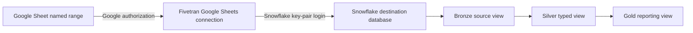

# Google Sheets to Snowflake using Fivetran

Last reviewed: 2 October 2026. Written for Windows PowerShell, Snowsight, and the Fivetran web interface. This is a reusable setup guide and an account of the FEI RSS incident. Script templates require the checks described below.

## 1. What the pipeline does



The Sheet is the editable source. Fivetran reads it and writes a Snowflake table. Snowflake supplies storage, SQL, and warehouse compute. Bronze, Silver, and Gold organize later transformations. The source connector and destination are separate configurations: passing one does not prove the other works.

The SQL in this package prepares Snowflake and queries the resulting data. It does not fetch Google Sheets itself. Clicking **Sync now** or waiting for Fivetran's schedule performs ingestion. Running `USE DATABASE` only changes worksheet context. Creating an empty database creates a container; it does not import rows.

## 2. Names and concepts to keep straight

| Item | Meaning | Session/example value |
|---|---|---|
| Snowflake account host | Endpoint for authentication | Copy from the correct Snowflake account |
| Database | Container for schemas | `FIVETRAN_DATABASE` |
| Schema | Container for source tables | Discover after sync; do not infer from display names |
| Table | Rows loaded from a named range | Discover after sync |
| Warehouse | Compute used to load/query | `COMPUTE_WH` is the shared option in these scripts |
| User | Dedicated integration identity | `FIVETRAN_USER` |
| Role | Privileges assigned to that identity | `FIVETRAN_ROLE` |
| Fivetran destination name | Dashboard label | `Warehouse` in the screenshots |
| Connection display name | Dashboard source label | `google_sheets.fei_rss_fivetran` |
| Named range | Google Sheets cells to ingest | Choose a stable name in your actual workbook |

The display name `Warehouse` is not evidence of a Snowflake warehouse literally named `Warehouse`. Likewise, a connection name containing a dot is not proof of its SQL schema/table split. SQL always needs verified database, schema, and table names.

## 3. Prepare the Sheet and Google access

Give each field a clear header in the first row, with one record per subsequent row. Keep dates consistent, avoid merged headers, and choose stable identifiers for records you will later join or deduplicate. These conventions make the copied data easier to validate.

In **Data > Named ranges**, create a range including the headers. Whole columns such as `RSS!A:D` accommodate future rows; `RSS!A1:D100` excludes row 101 until expanded. Use one connection per named range.

Choose one Google authorization method:

- **User OAuth:** authorize a Google user that can access the workbook.
- **Service account:** select this option in Fivetran and share the Sheet with its generated service-account email as Viewer.

Enter the workbook URL, select the named range, specify the destination schema/table, and use **Save & Test**. If your organization prevents external sharing, check the permitted OAuth route with the workspace administrator. [Fivetran Google Sheets setup](https://fivetran.com/docs/connectors/files/google-sheets/google-sheets-setup-guide).

## 4. Why public and private keys are needed

There are two independent authorization boundaries. Google grants access to the workbook; Snowflake grants access to the destination. A Google service-account credential cannot replace the Snowflake login key.

A key pair lets Fivetran prove it is the configured Snowflake integration user without sending that user's password. The private key signs the login assertion; Snowflake validates the signature with the registered public key. The public key cannot produce the private key in practical use. A key pair proves identity; the role's grants determine what that identity can do.

| Artifact | Where it goes | Purpose |
|---|---|---|
| `rsa_key.p8` | Local protected folder, then Fivetran's private-key field | Secret signing credential |
| `rsa_key.pub` | Local folder; its body is registered in Snowflake | Public verification key |
| `assign_public_key.sql` | Local folder; run in Snowsight | Registers the public half on `FIVETRAN_USER` |
| Passphrase, if encrypted | Fivetran passphrase field | Unlocks the local private-key material |

Snowflake supports RSA key pairs of at least 2048 bits. This guide uses its `RSA_PUBLIC_KEY` property, matching the Fivetran setup path. Snowflake also documents named key pairs for additional management options. [Snowflake key-pair authentication](https://docs.snowflake.com/en/user-guide/key-pair-auth).

The earlier form used PASSWORD and failed with a generic incorrect-credentials error. That error alone did not establish whether the password, login name, account, or authentication policy was responsible. Later evidence establishes that KEY_PAIR connected successfully. No universal password cutoff date is asserted here.

## 5. Prepare Snowflake before loading data

Open a new Snowsight SQL worksheet. Run [01_setup.sql](sql/01_setup.sql) as an administrator with the required creation/grant rights. It uses `ACCOUNTADMIN` for this initial learning setup; the ingestion user receives only the dedicated integration role. [Snowflake user creation](https://docs.snowflake.com/en/sql-reference/sql/create-user) and [grant syntax](https://docs.snowflake.com/en/sql-reference/sql/grant-privilege) explain these objects and permissions.

The script creates missing integration objects, grants the user its role, grants warehouse usage, and allows the role to create source schemas in the database. Fivetran can then create its target schema and tables. A pre-existing target schema owned by another role needs separate permission review. Defaults such as `DEFAULT_ROLE` select a starting context; they do not grant privileges.

`CREATE USER IF NOT EXISTS` leaves an existing user's type unchanged. A newly created user is SERVICE. An existing PERSON user can also authenticate with a key pair; inspect `DESCRIBE USER` before deliberately changing it. Repeated setup runs do not reset a password or replace a registered key.

Choose shared or dedicated compute consciously. The default uses the existing `COMPUTE_WH`. The commented alternative creates `FIVETRAN_WAREHOUSE` as X-Small with auto-suspend; select the same alternative in the Fivetran form. Warehouse compute can incur Snowflake charges even during repeated debugging or refreshes.

The observed destination runs on **AWS, ap_southeast_2**. The conditional GCP `CREATE INTEGRATION` grant is not required by that AWS evidence. Do not enable PrivateLink-specific settings when following the direct-connection path. [Fivetran destination guide](https://fivetran.com/docs/destinations/snowflake/setup-guide).

## 6. Generate the keys locally in PowerShell

Open PowerShell. From the repository root, run:

```powershell
& .\guides\data-engineering\google-sheets-snowflake-fivetran\scripts\New-FivetranKeys.ps1
```

The default output is `C:\Users\mettrma\.snowflake\keys\fivetran` on this computer. The script finds installed OpenSSL, generates a PKCS#8 private key, exports the public key, and writes the registration SQL. It refuses to overwrite existing output files. It does not read or upload any Google or Snowflake credentials.

For an encrypted key, use:

```powershell
& .\guides\data-engineering\google-sheets-snowflake-fivetran\scripts\New-FivetranKeys.ps1 -Encrypt -OutputDirectory "$env:USERPROFILE\.snowflake\keys\fivetran-encrypted"
```

OpenSSL prompts for a passphrase during generation and again when exporting the public key. Enter it locally. The script does not put it into a command argument or file. In Fivetran, enable the encrypted-key option and enter the matching passphrase.

For manual generation, use a new folder outside Git and run these commands there:

```powershell
$opensslPath = 'C:\Program Files\Git\mingw64\bin\openssl.exe'
& $opensslPath genpkey -algorithm RSA -pkeyopt rsa_keygen_bits:2048 -out rsa_key.p8
& $opensslPath pkey -in rsa_key.p8 -pubout -out rsa_key.pub
```

Adding `-aes-256-cbc` to `genpkey` encrypts the private key. `genpkey` writes PKCS#8 directly, avoiding a shell pipeline carrying the private material. [OpenSSL genpkey reference](https://docs.openssl.org/master/man1/openssl-genpkey/).

Keep the folder outside OneDrive, Git, and shared drives, and review who can read it. The package's `.gitignore` is a fallback for accidental files within this package; it cannot protect keys copied elsewhere or already committed. Only process instructions and placeholders belong in the repository.

## 7. Register the public key in Snowflake

Open the generated SQL file locally:

```powershell
notepad "$env:USERPROFILE\.snowflake\keys\fivetran\assign_public_key.sql"
```

Copy it into Snowsight and run it. It contains the public key only. For manual registration, use [02_assign_public_key.sql](sql/02_assign_public_key.sql) and replace its placeholder with the public-key body. Remove the `BEGIN PUBLIC KEY` / `END PUBLIC KEY` lines and join the body into one string. Do not paste a private key into a worksheet.

Inspect `DESCRIBE USER FIVETRAN_USER`: a populated `RSA_PUBLIC_KEY_FP` confirms that a key has been registered. A fingerprint by itself does not prove that Fivetran holds the matching private key. The destination connection test supplies that next check.

## 8. Fill in the Fivetran destination

| Field | Set to |
|---|---|
| Destination type / table type | Snowflake / Snowflake Native Tables |
| Deployment | SaaS for this walkthrough |
| Connection method | Connect directly |
| Host | Your account's Snowflake connection hostname, without `https://` or a path |
| Port | `443` |
| User | `FIVETRAN_USER` |
| Database | `FIVETRAN_DATABASE` |
| Auth | KEY-PAIR |
| Private key | Complete contents of `rsa_key.p8` |
| Private key encrypted | Off for default generation; On for `-Encrypt` |
| Role | `FIVETRAN_ROLE` |
| Default Virtual Warehouse | `COMPUTE_WH`, or the dedicated alternative you configured |

Open the private-key file locally and paste its contents only into the Fivetran private-key field. Preserve PEM delimiters and key text. Unencrypted PKCS#8 uses `BEGIN PRIVATE KEY`; encrypted PKCS#8 uses `BEGIN ENCRYPTED PRIVATE KEY`. Do not paste the public key into this field.

Click **Load Virtual Warehouses**, select the warehouse, and **Save & Test**. Use the test's specific error to isolate the next issue. Choose processing location and timezone deliberately for operational needs; they do not repair incorrect credentials. The successful destination overview should show **Connected** and **KEY_PAIR**.

### Changing the destination database to FEI

Changing only the Database field from `FIVETRAN_DATABASE` to `FEI` can fail because the setup granted database permissions specifically on `FIVETRAN_DATABASE`. Those grants do not extend to another database. Your personal session can see `FEI` as `ACCOUNTADMIN`, while Fivetran authenticates as `FIVETRAN_USER` and uses `FIVETRAN_ROLE`.

For the existing `FEI` database, run this in Snowsight:

```sql
USE ROLE ACCOUNTADMIN;

GRANT USAGE, MONITOR, CREATE SCHEMA
ON DATABASE FEI
TO ROLE FIVETRAN_ROLE;
```

These are the database privileges used in [Fivetran's setup guide](https://fivetran.com/docs/destinations/snowflake/setup-guide). A standalone copy is in [06_use_fei_database.sql](sql/06_use_fei_database.sql).

Then set **Database = FEI**, keep **Role = FIVETRAN_ROLE**, and click **Save & Test**. Keep the same user, warehouse, and matching key pair: the keys authenticate the user rather than selecting its database. Changing the database field does not move existing tables from the old database. Confirm the connection's behavior and discover its new target before querying it.

If the connection uses a pre-existing schema in `FEI`, inspect its permissions separately; database-level rights alone do not grant access to every existing schema/table. Missing FEI database grants are the likely explanation for the user's reported failure, but the exact failed-test message and successful retry have not been supplied.

## 9. Start ingestion and prove the data arrived

Open **Connections**, select the Google Sheets connection, ensure it is unpaused, and start the initial sync or click **Sync now**. Open its status details and wait for a completed sync with a recorded time. The destination being Connected proves access, while the connection being Active indicates it can run; neither is a row-count check.

Run section A of [03_validate_data.sql](sql/03_validate_data.sql). Find the source table across the database; Fivetran need not use `PUBLIC`. Replace the example `source_table` variable in section B with the exact relation you found, then inspect `COUNT(*)` and a bounded row sample. Compare the records against the Sheet's named range, excluding headers and unused rows.

Inspect column names before using `_FIVETRAN_SYNCED`; source naming can preserve quoted case. Its maximum value measures the last row load, not the newest article's publication date. A successful poll with no changes may leave that value unchanged. Use Fivetran's completed-sync status together with table checks to evaluate health.

Finally, make an authorized, identifiable Sheet edit, run another sync, and verify the changed row. This checks the entire route rather than just object existence. No such live edit or verification was performed in this documentation task.

## 10. Refresh behavior and downstream models

For this connector, the range is refreshed as a current-state table: rows removed from the Sheet are hard deleted, and column types can widen when inconsistent values appear. Google Forms and `IMPORTRANGE` may not update the workbook modification time used for detection. Renaming the named range requires updating the connection. [Connector behavior](https://fivetran.com/docs/connectors/files/google-sheets).

Keep Fivetran-managed tables as the ingestion layer. Add typed views or dbt models in separate schemas. [05_bronze_silver_gold.sql](sql/05_bronze_silver_gold.sql) illustrates raw text fields, safe date conversion, and a daily article count, with explicit assumptions about column names. It is not a verified description of the actual RSS table. Inspect the real source before running it.

Views follow the current source and cannot recover deleted history. If reporting requires historical snapshots, design a separate snapshot process with a stable record key, a timestamp, and documented deletion semantics. Schedule transformations after successful ingestion or check freshness before building; independent timers can run transformations before a refresh completes.

The Transformations screenshot shows an optional metadata Quickstart offering. Google Sheets ingestion does not require enabling those transformations. The metadata connection reports Fivetran activity; it is separate from the Sheet's business data.

## 11. Troubleshooting by evidence

| Symptom | Check or next action |
|---|---|
| Incorrect username/password while loading warehouses | Verify account host and actual login name; replace the failing PASSWORD setup with the registered matching KEY_PAIR |
| Database not found | Use `FIVETRAN_DATABASE`; the earlier `fivetran` value targeted a different name |
| KEY_PAIR test fails | Check key pair match, PEM format, encryption toggle/passphrase, registered user, and account |
| Warehouse list empty after login works | Check warehouse existence, role assignment, warehouse USAGE, and selected/default role |
| Permission test fails | Inspect grants and target schema ownership; an existing schema can need additional grants |
| Changing Database to FEI fails | Grant USAGE, MONITOR, CREATE SCHEMA on FEI to FIVETRAN_ROLE, keep that role selected, and retest; inspect the exact error if it persists |
| Destination Connected but no rows | Check source status, pause state, completed-sync time, range contents, and table location |
| Active connection with blank Last synced | Check running sync details; completion and SQL verification are still needed |
| PUBLIC empty | Search all schemas with the discovery SQL |
| Sheet/range not found | Check workbook URL, OAuth user access or service-account sharing, and range name |
| Expected new rows missing | Check range boundaries, last-modified detection, and completed sync status |
| Date parsing becomes NULL | Inspect real text/format and timezone; quantify invalid values instead of silently dropping them |
| Connection works but analyst cannot read | Grant analyst database/schema usage and table SELECT using the optional reader script |

When changing login configuration, retest one boundary at a time. A source authorization change will not fix Snowflake authentication. An analyst permission grant will not fix a paused source connection. Avoid repeating setup SQL blindly when the error is at another boundary.

## 12. Rotation and operational ownership

To rotate, generate a new pair in a new local folder. Register its public half in the spare `RSA_PUBLIC_KEY_2` slot, update Fivetran to the corresponding private half, test the destination, and verify a sync. Remove the old public-key slot only after the new credential works. The commented rotation statements in the registration template illustrate this sequence; inspect which slot is currently in use first.

Record who owns the workbook, Google authorization, Snowflake identity, key storage, and refresh schedule. Check Fivetran usage/billing and Snowflake compute/storage separately. A trial banner and zero paid MAR in a screenshot describe that moment; they are not a permanent cost guarantee. Pausing a connection affects scheduled data refreshes and should be recorded with its reason.

If a private key is exposed, replace the pair and retire its registered public key; deleting the visible copy alone does not revoke authentication. Never include key contents in issue reports or screenshots.

## 13. Completion checklist

- Dedicated Snowflake user, role, database rights, and warehouse rights inspected.
- Public key registered and matching private key configured in Fivetran.
- Destination test passes and overview shows Connected.
- Google authorization and named range test pass.
- Sheet connection is unpaused and a sync is completed.
- Actual SQL relation discovered; row count and sample checked.
- Controlled source change confirmed in Snowflake.
- Refresh cadence, monitoring owner, key storage, and downstream dependencies documented.

The observed session has reached Connected destination and Active source status. Completed ingestion, actual SQL table/columns, row counts, and downstream models remain unverified; see [session evidence](SESSION_EVIDENCE.md).
