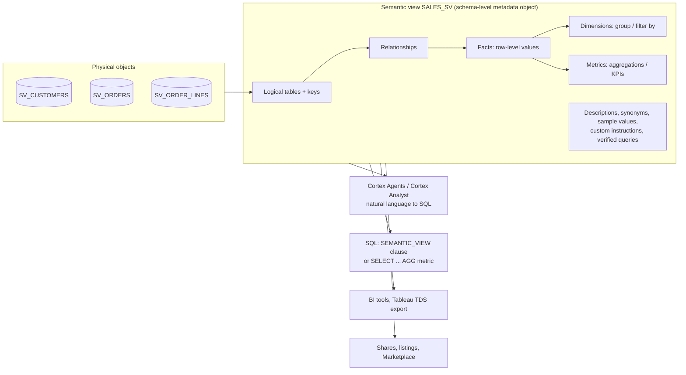

# The Snowflake semantic layer: semantic views

Checked against Snowflake documentation on 2026-10-08. This part explains what a semantic layer is, how Snowflake implements it with **semantic views**, how to build, query, secure, deploy and tune one, and which details are likely exam traps. It extends the short semantic-layer paragraph in the [exam guide](01_STUDY_GUIDE.md) and Unit 7 of the [course companion](02_COURSE_COMPANION.md). The SQL follows the current reference pages, but **it has not been run in a Snowflake account**. Results quoted in the lab come from hand calculation over its synthetic fixture.

C02 relevance: the April 2026 blueprint puts the semantic layer in Domain 1. It names semantic views, YAML specifications, verified queries, custom instructions, suggested questions and Autopilot. Cortex Analyst usage also appears in Domain 2, and privileges and costs appear in Domain 3. Some features below, such as materializations, range joins and the dbt package, go beyond the blueprint. They are marked **beyond C02** where relevant.

## 1. What a semantic layer is

A database stores **physical** facts: a column called `amt_ttl_pre_dsc` or a table called `SV_ORDER_LINES`. Business users ask in **business** terms, such as "net revenue by region last quarter". A **semantic layer** sits between them. It records once, centrally, what each business term means: which tables are involved, how they join, and how each metric is calculated and aggregated. Every consumer then reuses that single definition instead of re-deriving it in each report, notebook or prompt.

Without the layer, "net revenue" might be computed five different ways in five dashboards. An LLM writing SQL from raw table names must also guess joins and formulas. With the layer, an LLM combines its language reasoning with **rule-based definitions** written by people who know the data. That improves accuracy and makes answers reviewable. [Semantic views overview](https://docs.snowflake.com/en/user-guide/views-semantic/overview)



In Snowflake, the semantic layer is a **semantic view**. It is a **schema-level object** that Snowflake treats as metadata. You create it with SQL, YAML or Snowsight tools, and govern it with ordinary `GRANT`s. [Overview](https://docs.snowflake.com/en/user-guide/views-semantic/overview)

### Compare it with nearby concepts

| Concept | How it differs from a semantic view |
| --- | --- |
| Standard or secure view | It stores one fixed query. A semantic view stores a *model*: entities, joins, and named dimensions and metrics that callers combine at query time. |
| Legacy semantic model (YAML on a stage) | This was the earlier Cortex Analyst input. It is still accepted for backward compatibility, but it is a stage file rather than an object. It has no `SEMANTIC_VIEW` SQL querying, no native sharing and no object-level RBAC. [Migrating from the stage API](https://docs.snowflake.com/en/user-guide/views-semantic/semantic-models-vs-views) |
| YAML specification for a semantic view | This is an **authoring format** for the same semantic view object, not a separate object. YAML and DDL have near-complete feature parity. [YAML vs DDL](https://docs.snowflake.com/en/user-guide/views-semantic/yaml-vs-ddl) |
| Cortex Search | It retrieves *unstructured* text passages. A semantic view describes *structured* data for SQL generation. A Search service can be attached to a text **dimension** for fuzzy value matching. |
| dbt Semantic Layer / MetricFlow, Power BI semantic model | These are functional equivalents in other tools; see the [dbt semantic models course](../dbt/dbt-study-guide/02_SEMANTIC_MODELS_AND_METRICS_COURSE.md) and [Power BI semantic-model guide](../guides/data-engineering/POWER_BI_SEMANTIC_MODEL_AGENTS_GUIDE.md). Snowflake can ingest Tableau and Power BI files through Autopilot (section 5). |

## 2. Anatomy of a semantic view

Snowflake calls the database tables **physical objects** and the semantic-view elements **logical objects**.

| Element | What it is | Key rules |
| --- | --- | --- |
| **Logical table** | A business entity (customer, order) over a base table, view or SQL query, with an optional alias | Declare `PRIMARY KEY` and/or `UNIQUE` columns. Once you define an alias, use the alias everywhere else. |
| **Relationship** | A join from a many-side (or one-side) table to a referenced table: `orders (customer_id) REFERENCES customers` | The referenced column must be a declared primary key or unique key. Agents **do not join tables unless a relationship is defined**. Many-to-many needs a bridge table. ASOF and range joins exist (range join is preview). |
| **Fact** | A row-level value at the table's grain, such as a line amount | Facts are mostly "helper" inputs for dimensions and metrics. A fact may be `PRIVATE`. |
| **Dimension** | A categorical or time attribute for grouping and filtering ("who, what, where, when") | Dimensions are always public. A dimension can be marked a filter with `LABELS = (FILTER)` if it returns BOOLEAN, can carry `SAMPLE_VALUES`/`IS_ENUM`, and can attach `WITH CORTEX SEARCH SERVICE`. |
| **Metric** | An aggregation that acts as a KPI, such as `SUM(...)` or `AVG(...)`, belonging to one logical table | It aggregates at its table's grain. It may be `PRIVATE`, semi-additive (`NON ADDITIVE BY`) or a window-function metric. |
| **Derived metric** | A view-scoped metric combining metrics from different tables, such as net sales divided by order count | It **omits** the table prefix. It cannot aggregate a metric, use physical columns or use window functions. |
| **Synonyms, comments** | Business vocabulary and descriptions | Synonyms are informational and cannot be used as references. **Descriptions matter most for accuracy.** |
| **Custom instructions** | Natural-language rules for SQL generation and for question handling | DDL uses `AI_SQL_GENERATION` and `AI_QUESTION_CATEGORIZATION`. YAML uses `module_custom_instructions.sql_generation` and `.question_categorization`; plain `custom_instructions` is legacy. |
| **Verified queries** (VQR) | Question → reviewed "gold" SQL pairs, optionally flagged as onboarding (suggested) questions | DDL uses `AI_VERIFIED_QUERIES`; YAML uses `verified_queries`. The SQL uses **logical** table and column names. |

[CREATE SEMANTIC VIEW](https://docs.snowflake.com/en/sql-reference/sql/create-semantic-view) · [validation rules](https://docs.snowflake.com/en/user-guide/views-semantic/validation-rules) · [filters](https://docs.snowflake.com/en/user-guide/views-semantic/filters) · [YAML spec](https://docs.snowflake.com/en/user-guide/views-semantic/semantic-view-yaml-spec)

**Grain** is the concept that causes most failures. A metric is aggregated at its logical table's grain. You can group it only by dimensions from tables that are related to that table and have an **equal or coarser** grain. For example, an `order_lines` metric can be grouped by order month or customer region. An `orders` metric (order count) **cannot** be grouped by a line-level dimension such as product. Snowflake rejects that query instead of silently double-counting.

**DDL clause order is fixed:** `TABLES` → `RELATIONSHIPS` → `FACTS` → `DIMENSIONS` → `METRICS` → `COMMENT` → (`MAX_STALENESS`) → `AI_SQL_GENERATION` → `AI_QUESTION_CATEGORIZATION` → `AI_VERIFIED_QUERIES` → `TAG` → `COPY GRANTS`. At least one dimension or metric is required. An expression may refer to another expression defined later in the statement.

## 3. Who consumes a semantic view

| Consumer | How it uses the view | Note |
| --- | --- | --- |
| **Cortex Agents** (Cortex Analyst tool) | Reads the definition, generates SQL **against the physical tables**, and runs it on a warehouse | Snowflake now recommends moving from standalone Analyst to Agents, which support every Analyst capability with higher answer quality. [Cortex Analyst](https://docs.snowflake.com/en/user-guide/snowflake-cortex/cortex-analyst) |
| **Cortex Analyst REST API** | `"semantic_view": "DB.SCHEMA.VIEW"`; the legacy field is `"semantic_model_file": "@stage/file.yaml"`; `semantic_models` takes an array of either | Standalone API billing is per 1,000 messages (legacy Platform Credit path). [REST API](https://docs.snowflake.com/en/user-guide/snowflake-cortex/cortex-analyst/rest-api) |
| **Snowflake CoWork** (C02 name: Snowflake Intelligence) | End users chat with an Agent that has the view as a tool | Agent and tool privileges apply |
| **SQL users and apps** | `SELECT ... FROM SEMANTIC_VIEW(...)` or `SELECT ... AGG(metric) FROM view GROUP BY ...` | This works over JDBC/ODBC and the SQL API, but not the Snowflake REST APIs. |
| **BI tools** | Partner integrations (Sigma, Omni, Honeydew, Hex, ThoughtSpot); export to a Tableau TDS file | [Dev best practices: BI](https://docs.snowflake.com/en/user-guide/views-semantic/best-practices-dev) |
| **Other accounts** | Private, organizational or Marketplace listings | Grant both `REFERENCES` and `SELECT` on the semantic view to the share. [Sharing](https://docs.snowflake.com/en/user-guide/views-semantic/sharing-semantic-views) |

**Exam-version note:** the C02 blueprint frames this as "Cortex Analyst + semantic view". Current docs favour **Cortex Agents** as the natural-language entry point, with Analyst as the SQL-generating tool inside the Agent. Recognize both framings.

## 4. Build one: lab with known answers

**Goal:** model three synthetic tables, query the view in both SQL styles, see a grain error, then point an Agent or Analyst at it. Use a test account and test role. Creating the view itself is metadata work, while queries use your warehouse.

### Step 0: privileges

To create or replace a semantic view, a role needs `CREATE SEMANTIC VIEW` on the schema, `USAGE` on the database and schema, and `SELECT` on every table or view the definition uses. Running `CREATE OR ALTER` against an existing view needs `OWNERSHIP`. [Privileges](https://docs.snowflake.com/en/user-guide/views-semantic/sql#label-semantic-views-create-privileges)

```sql
-- ACCOUNTADMIN or a delegated admin; reuses GENAI_LAB/GENAI_WH from 03_ENABLE_CORTEX_AND_RAG.md
CREATE ROLE IF NOT EXISTS GENAI_SV_LAB;
GRANT USAGE ON DATABASE GENAI_LAB TO ROLE GENAI_SV_LAB;
GRANT USAGE ON SCHEMA GENAI_LAB.PUBLIC TO ROLE GENAI_SV_LAB;
GRANT USAGE ON WAREHOUSE GENAI_WH TO ROLE GENAI_SV_LAB;
GRANT CREATE TABLE ON SCHEMA GENAI_LAB.PUBLIC TO ROLE GENAI_SV_LAB;
GRANT CREATE SEMANTIC VIEW ON SCHEMA GENAI_LAB.PUBLIC TO ROLE GENAI_SV_LAB;
GRANT ROLE GENAI_SV_LAB TO USER <learner_user>;
```

### Step 1: a tiny star schema

```sql
USE ROLE GENAI_SV_LAB;
USE WAREHOUSE GENAI_WH;
USE SCHEMA GENAI_LAB.PUBLIC;

CREATE OR REPLACE TABLE SV_CUSTOMERS (CUSTOMER_ID VARCHAR, CUSTOMER_NAME VARCHAR, REGION VARCHAR);
INSERT INTO SV_CUSTOMERS VALUES
  ('C1', 'Acme', 'East'), ('C2', 'Birch', 'West'), ('C3', 'Cedar', 'East');

CREATE OR REPLACE TABLE SV_ORDERS (ORDER_ID VARCHAR, CUSTOMER_ID VARCHAR, ORDER_DATE DATE, ORDER_STATUS VARCHAR);
INSERT INTO SV_ORDERS VALUES
  ('O1', 'C1', '2026-01-10', 'COMPLETE'),
  ('O2', 'C2', '2026-01-20', 'COMPLETE'),
  ('O3', 'C1', '2026-02-05', 'RETURNED'),
  ('O4', 'C3', '2026-02-14', 'COMPLETE');

CREATE OR REPLACE TABLE SV_ORDER_LINES (
  ORDER_ID VARCHAR, LINE_NO NUMBER, PRODUCT VARCHAR,
  QUANTITY NUMBER, UNIT_PRICE NUMBER(10,2), DISCOUNT NUMBER(4,2));
INSERT INTO SV_ORDER_LINES VALUES
  ('O1', 1, 'Widget', 2,  50, 0.00),   -- net 100
  ('O1', 2, 'Gadget', 1, 200, 0.10),   -- net 180
  ('O2', 1, 'Widget', 4,  50, 0.00),   -- net 200
  ('O3', 1, 'Gadget', 1, 200, 0.00),   -- net 200 (returned order)
  ('O4', 1, 'Widget', 3,  50, 0.20),   -- net 120
  ('O4', 2, 'Gizmo',  1,  80, 0.00);   -- net  80
```

Grain: one row per customer, one row per order, and one row per order line (key `ORDER_ID, LINE_NO`). Lines → orders → customers are many-to-one.

### Step 2: create the semantic view

```sql
CREATE OR REPLACE SEMANTIC VIEW GENAI_LAB.PUBLIC.SALES_SV
  TABLES (
    customers AS GENAI_LAB.PUBLIC.SV_CUSTOMERS PRIMARY KEY (customer_id)
      WITH SYNONYMS = ('clients')
      COMMENT = 'One row per customer.',
    orders AS GENAI_LAB.PUBLIC.SV_ORDERS PRIMARY KEY (order_id)
      COMMENT = 'One row per order. ORDER_STATUS is COMPLETE or RETURNED.',
    order_lines AS GENAI_LAB.PUBLIC.SV_ORDER_LINES PRIMARY KEY (order_id, line_no)
      COMMENT = 'One row per order line.'
  )
  RELATIONSHIPS (
    orders_to_customers AS orders (customer_id) REFERENCES customers,
    lines_to_orders AS order_lines (order_id) REFERENCES orders
  )
  FACTS (
    order_lines.line_net_amount AS quantity * unit_price * (1 - discount)
      COMMENT = 'Line revenue after discount.',
    order_lines.line_gross_amount AS quantity * unit_price
      COMMENT = 'Line revenue before discount.'
  )
  DIMENSIONS (
    customers.customer_name AS customer_name
      COMMENT = 'Customer display name.',
    customers.region AS region
      COMMENT = 'Sales region of the customer.'
      SAMPLE_VALUES ('East', 'West')
      IS_ENUM,
    orders.order_date AS order_date
      COMMENT = 'Date the order was placed.',
    orders.order_month AS DATE_TRUNC('MONTH', order_date)
      COMMENT = 'First day of the month the order was placed.',
    orders.order_status AS order_status
      COMMENT = 'COMPLETE or RETURNED.',
    orders.is_completed LABELS = (FILTER) AS order_status = 'COMPLETE'
      COMMENT = 'TRUE for orders that were not returned.',
    order_lines.product AS product
      COMMENT = 'Product name on the order line.'
  )
  METRICS (
    order_lines.net_sales AS SUM(order_lines.line_net_amount)
      WITH SYNONYMS = ('revenue', 'net revenue')
      COMMENT = 'Revenue after line discounts. Includes returned orders unless filtered.',
    order_lines.gross_sales AS SUM(order_lines.line_gross_amount)
      COMMENT = 'Revenue before discounts.',
    orders.order_count AS COUNT(orders.order_id)
      COMMENT = 'Number of orders.',
    avg_order_value AS order_lines.net_sales / orders.order_count
      COMMENT = 'Derived metric: net sales per order.'
  )
  COMMENT = 'Synthetic sales model for the GES-C02 semantic-layer lab.'
  AI_SQL_GENERATION 'When users say revenue or sales, use net_sales. Round currency results to 2 decimals.'
  AI_QUESTION_CATEGORIZATION 'Decline questions asking for customer contact details; this view has none.'
  AI_VERIFIED_QUERIES (
    completed_net_sales_by_month AS (
      QUESTION 'Net sales by month for completed orders'
      VERIFIED_AT 1791417600
      ONBOARDING_QUESTION TRUE
      SQL 'SELECT DATE_TRUNC(''MONTH'', o.order_date) AS order_month, SUM(l.line_net_amount) AS net_sales FROM orders AS o JOIN order_lines AS l ON l.order_id = o.order_id WHERE o.order_status = ''COMPLETE'' GROUP BY 1 ORDER BY 1'
    )
  );
```

What to notice:

- **Aliases.** After `orders AS ...SV_ORDERS`, every reference uses `orders`, never `SV_ORDERS`.
- **Relationships.** `REFERENCES customers` targets the declared primary key, and Snowflake infers many-to-one from the keys and data. YAML no longer needs `join_type` or `relationship_type`.
- **Two metric levels.** `net_sales` aggregates at line grain and `order_count` at order grain. `avg_order_value` is a **derived** metric with no table prefix, so it can combine both.
- **Filter.** `is_completed` is a reusable BOOLEAN filter that Agents can apply when users say "completed".
- **Verified query.** Its SQL uses **logical** names (`orders`, `order_lines`, `line_net_amount`), and `VERIFIED_AT` is Unix seconds. Embedded quotes are doubled because the SQL is a string literal.
- **Metadata.** Sample values are stored as metadata; see section 6 before using real values.

### Step 3: inspect it

```sql
SHOW SEMANTIC VIEWS IN SCHEMA GENAI_LAB.PUBLIC;
DESCRIBE SEMANTIC VIEW SALES_SV;
SHOW SEMANTIC DIMENSIONS IN SALES_SV;
SHOW SEMANTIC METRICS IN SALES_SV;
SELECT GET_DDL('SEMANTIC_VIEW', 'SALES_SV', TRUE);                         -- needs REFERENCES or OWNERSHIP
SELECT SYSTEM$READ_YAML_FROM_SEMANTIC_VIEW('GENAI_LAB.PUBLIC.SALES_SV');  -- export to YAML for Git
```

### Step 4: query it two ways

**A. The `SEMANTIC_VIEW` clause.** You name the dimensions and metrics, and Snowflake writes the joins and the `GROUP BY`. [SEMANTIC_VIEW](https://docs.snowflake.com/en/sql-reference/constructs/semantic_view)

```sql
SELECT * FROM SEMANTIC_VIEW(
    SALES_SV
    DIMENSIONS customers.region
    METRICS order_lines.net_sales, orders.order_count, avg_order_value
  )
  ORDER BY region;
```

**B. Standard SQL against the view name.** Metrics **must** be wrapped in `AGG()`. Selected dimensions go in `GROUP BY`. `WHERE` may use only dimensions and facts, and `HAVING` only metrics. Joins, window functions, `QUALIFY`, `PIVOT` and `LATERAL` are not allowed in this form. [Querying](https://docs.snowflake.com/en/user-guide/views-semantic/querying)

```sql
SELECT order_month, AGG(net_sales) AS net_sales
  FROM SALES_SV
  WHERE is_completed
  GROUP BY order_month
  ORDER BY order_month;
```

Expected results, hand-calculated from the fixture (formatting may differ):

| Query | Expected |
| --- | --- |
| A: by region | East: net 680.00, 3 orders, AOV 226.67 · West: net 200.00, 1 order, AOV 200.00 |
| B: completed, by month | 2026-01-01: 480.00 · 2026-02-01: 200.00 (O3 returned) |
| `METRICS order_lines.net_sales, order_lines.gross_sales, orders.order_count, avg_order_value` | 880.00 · 930.00 · 4 · 220.00 |
| `DIMENSIONS order_lines.product METRICS order_lines.net_sales` | Widget 420.00 · Gadget 380.00 · Gizmo 80.00 |

**Hand-check the totals.** Net sales are 100 + 180 + 200 + 200 + 120 + 80 = 880. East contributes O1 280 + O3 200 + O4 200 = 680 from 3 orders. If the view reports anything else, inspect the grain and the relationships before blaming the model.

### Step 5: trigger the grain rule deliberately

```sql
-- Expected to FAIL: product (line grain) is finer than order_count's orders table.
SELECT * FROM SEMANTIC_VIEW(
    SALES_SV
    DIMENSIONS order_lines.product
    METRICS orders.order_count
  );

-- Which dimensions are valid for this metric?
SHOW SEMANTIC DIMENSIONS IN SALES_SV FOR METRIC order_count;
```

The documented error says the dimension entity "must be related to and have an equal or lower level of granularity" than the metric's entity. Two other `SEMANTIC_VIEW` rules apply here. You cannot request `FACTS` and `METRICS` in one clause. If you request facts with dimensions, they must come from the same logical table.

### Step 6: natural language

1. **Agent (current recommended path).** In Snowsight, create an Agent and add `SALES_SV` as a Cortex Analyst tool with a warehouse. Ask "revenue by region", "average order value", and "net sales by month for completed orders". The last should match the verified query. [Manage agents](https://docs.snowflake.com/en/user-guide/snowflake-cortex/cortex-agents-manage)
2. **Standalone Analyst API (blueprint path).** Send `{"messages":[...], "semantic_view":"GENAI_LAB.PUBLIC.SALES_SV"}`; see the request shape in the [exam guide](01_STUDY_GUIDE.md).
3. **Review.** Read the generated SQL. Does "revenue" map to `net_sales`? Did "completed" apply the filter? Is rounding applied? Ask "order count by product" and record whether the system refuses, asks for clarification or answers incorrectly.
4. **Clean up.** `DROP SEMANTIC VIEW SALES_SV;` then drop the three tables.

## 5. Ways to author and maintain semantic views

| Option | Use when | Facts to know |
| --- | --- | --- |
| **Semantic View Autopilot** (Snowsight: Workspaces → Add new → Semantic View) | You need a first draft quickly | It is an AI-assisted wizard. It uses a description, example SQL (valid queries become verified queries), table metadata and **query history** visible to the creating role. It can ingest a **YAML spec, Tableau file or Power BI `.pbit`/`.pbix`**, which needs a writable stage, plus `CREATE VIEW` if Tableau custom SQL is involved. It can add sample values and AI-generated descriptions. Recommended first-view size: fewer than 10 tables and no more than about 50 columns. **Review the output.** [Autopilot](https://docs.snowflake.com/en/user-guide/views-semantic/autopilot) |
| **Semantic Studio** (Workspaces) | You need to refine, debug and deploy a view | You edit `.sv.yaml` files with CoCo assistance and optional Git integration. It needs a supported LLM in the account. [Semantic Studio](https://docs.snowflake.com/en/user-guide/views-semantic/semantic-studio) |
| **SQL DDL** | You use SQL-first teams, dbt or Terraform, or JDBC/ODBC/SQL API automation | `CREATE [OR REPLACE]`, `CREATE OR ALTER` (in-place changes to tables, relationships, expressions, instructions and verified queries), `ALTER` for the comment and `MAX_STALENESS`, `COPY GRANTS` on replace, and `DEFINE SEMANTIC VIEW` inside DCM projects. [SQL guide](https://docs.snowflake.com/en/user-guide/views-semantic/sql) |
| **YAML** | You prefer readable diffs or are migrating stage-based models | Validate first with `CALL SYSTEM$CREATE_SEMANTIC_VIEW_FROM_YAML('db.schema', $$<yaml>$$, TRUE)`, then rerun without `TRUE` to create the view. Conversion is one file at a time. Export with `SYSTEM$READ_YAML_FROM_SEMANTIC_VIEW`. YAML-only features include `time_dimensions` and standalone `filters`; DDL-only features include cross-table dimension references. [YAML spec](https://docs.snowflake.com/en/user-guide/views-semantic/semantic-view-yaml-spec) · [YAML vs DDL](https://docs.snowflake.com/en/user-guide/views-semantic/yaml-vs-ddl) |
| **dbt** (`Snowflake-Labs/dbt_semantic_view`) | Semantic views belong in a dbt pipeline | Use `{{ config(materialized='semantic_view') }}` with `{{ ref() }}`/`{{ source() }}` in `TABLES(...)`. It passes DDL straight through, so new Snowflake clauses work without a package upgrade. **Beyond C02.** [dbt integration](https://docs.snowflake.com/en/user-guide/views-semantic/best-practices-dev#label-semantic-views-dbt-integration) |

**Documentation inconsistency:** the dev best-practices page still says that, except for comments, a change requires `CREATE OR REPLACE`. The current CREATE reference documents `CREATE OR ALTER SEMANTIC VIEW` for in-place changes. Prefer the reference page, and remember that `OR REPLACE` drops explicit grants unless you add `COPY GRANTS`. A SQL update also overwrites unsaved manual edits in an open Snowsight session.

**Promotion:**

- Keep the YAML or DDL in **Git** and let CI run accuracy checks before deploying.
- **Clone** a schema to promote between environments in one account; the semantic views clone with it.
- Use **replication** to promote across accounts.
- Roll back by redeploying the last known-good definition.

## 6. Security and governance

| Action | Privilege |
| --- | --- |
| Create or replace | `CREATE SEMANTIC VIEW` on schema + `USAGE` on database/schema + `SELECT` on referenced tables/views |
| `CREATE OR ALTER` an existing view | `OWNERSHIP` on the semantic view |
| Query directly with SQL | `SELECT` on the **semantic view only**, because it runs with owner's rights like a standard view |
| `DESCRIBE`, or listing in `SHOW` | Any privilege on the view (for example `MONITOR`, `REFERENCES`, `SELECT`) |
| `GET_DDL`, or seeing private facts/metrics in `INFORMATION_SCHEMA` | `REFERENCES` or `OWNERSHIP` |
| Use through Cortex Agents | `SELECT` on the semantic view **and** access to its underlying tables, because the Agent runs generated SQL against the physical tables with the user's **default role** |
| Share | `GRANT REFERENCES` and `GRANT SELECT ON SEMANTIC VIEW ... TO SHARE` |

```sql
GRANT SELECT ON SEMANTIC VIEW GENAI_LAB.PUBLIC.SALES_SV TO ROLE SALES_READER;
GRANT SELECT ON FUTURE SEMANTIC VIEWS IN SCHEMA GENAI_LAB.PUBLIC TO ROLE SALES_READER;
-- For Agent users, the default role also needs USAGE on the database/schema and SELECT on SV_* base tables.
```

**The two access paths are the key governance idea.** A person running `SELECT ... FROM SEMANTIC_VIEW(...)` relies on the view owner's rights and needs no base-table grant. An Agent or Analyst path generates *physical* SQL. The developer best-practices page says that path needs `SELECT` on both the view and the base tables, and the Agent access page lists access to objects referenced by the semantic view. The SQL querying page mentions only the view privilege because it describes the direct path. [Querying privileges](https://docs.snowflake.com/en/user-guide/views-semantic/querying#label-semantic-views-privileges-select) · [ownership and access](https://docs.snowflake.com/en/user-guide/views-semantic/best-practices-dev#label-semantic-views-ownership-and-access) · [Agent tool privileges](https://docs.snowflake.com/en/user-guide/snowflake-cortex/cortex-agents-setup)

Other governance points:

- **Row access and masking policies** cannot be set on semantic-view attributes. Set on base tables and columns, they **propagate** and are enforced through the semantic view.
- **Sample values are not masked.** They are metadata, visible in `GET_DDL` output (`WITH EXTENSION (CA=...)`). Use representative, non-sensitive sample values. Do not put personal or regulated data in comments, synonyms or other metadata fields.
- Semantic views are a new object type, so most roles have **no inherited access**. Plan grants explicitly, ideally with one schema and one role per domain plus future grants.
- **Compare with Search.** A Cortex Search service also runs with owner's rights, but it returns indexed *text*. A semantic view returns *query results*, still filtered by base-table policies.
- **Custom instructions are not access control.** "Decline salary questions" steers the model. It does not remove anyone's privilege on a salary column.
- Audit through `ACCOUNT_USAGE`/`INFORMATION_SCHEMA` views (`SEMANTIC_VIEWS`, `SEMANTIC_TABLES`, `SEMANTIC_RELATIONSHIPS`, `SEMANTIC_FACTS`, `SEMANTIC_DIMENSIONS`, `SEMANTIC_METRICS`). Use Agent monitoring for request-level traces.

## 7. Accuracy: modeling practices that matter

From Snowflake's [modeling best practices](https://docs.snowflake.com/en/user-guide/views-semantic/best-practices-modeling):

1. **Design for the business user, by domain.** Build "Sales Performance" and "Support Metrics", not "All CRM tables". Each semantic view is queried independently; **Agents do not join across semantic views**. With several views, distinct descriptions drive view selection. Choosing among views adds a few seconds of reranking.
2. **Start small.** Begin with 5–10 tables in a star schema and only the columns users will ask about. Keep a view under roughly **100,000 tokens**. Larger views risk pruning to fit the context window, which adds latency and can reduce quality. This is a guideline, not a hard limit.
3. **Descriptions are the single most important accuracy lever.** Explain abbreviations, legacy names and business rules on every table and column.
4. **Synonyms:** current guidance is to avoid them unless terms are internal or industry-specific. Add them by hand, because auto-generated synonyms often lower quality. This changed from earlier material, which encouraged synonyms.
5. **Define every needed relationship.** Without one, the Agent will not join. Use a bridge table for many-to-many.
6. **Define metrics and filters** for recurring calculations and conditions instead of hoping the model infers them.
7. **Add verified queries after the model is solid.** Use them to cover common or edge questions and to reduce latency, not to patch a weak model. Start with the most common questions. Analyst **optimization** can use verified queries to suggest improvements.
8. **Keep the two kinds of custom instruction separate.** **SQL generation** covers default filters, fiscal calendars and data quirks. **Question categorization** covers when to reject or ask for clarification. Be specific: "If no date filter is provided, filter to the last year." Through Agents, plain natural language works; the `UNCLEAR` keyword style is for standalone Analyst. [Custom instructions](https://docs.snowflake.com/en/user-guide/views-semantic/custom-instructions)
9. **Literal matching.** Attach a Cortex Search service to high-cardinality text dimensions (roughly more than 10 distinct values, such as product or customer names) so "iPhone 13" can match "Apple iPhone 13 - 128GB Blue". For low-cardinality columns, use `SAMPLE_VALUES` (+ `IS_ENUM` if the list is complete). Do not use Search on numeric, date or long free-text columns. [Literal search](https://docs.snowflake.com/en/user-guide/snowflake-cortex/cortex-analyst/cortex-analyst-search-integration)
10. **Evaluate in a loop.** Build about 10 benchmark questions from real users and dashboards, then score SQL correctness with [native Analyst evaluations](https://docs.snowflake.com/en/user-guide/snowflake-cortex/cortex-analyst-evaluations). Review suggestions and feedback regularly and convert good real questions into verified queries.

**Pitfalls:** an unbounded scope, starting with the whole warehouse, over-relying on verified queries, and choosing a first domain such as Finance or Legal that needs near-100% accuracy. Start with Sales or Marketing.

## 8. Performance and cost

- **Object cost.** The docs classify a semantic view as metadata, and the AI pricing page lists no separate semantic-view meter. Costs come from what uses the view:
  - warehouse time for every query, including Agent- or Analyst-generated SQL;
  - Agent orchestration tokens (AI Credits);
  - standalone Analyst messages (per 1,000, legacy Platform Credit path);
  - any **Cortex Search services** attached to dimensions, which keep serving charges while resumed;
  - Autopilot or Semantic Studio LLM assistance.
- **Materializations (beyond C02).** You can materialize selected dimensions and metrics after setting `MAX_STALENESS`, which has a minimum of 120 seconds. They speed up **semantic SQL** (the `SEMANTIC_VIEW` clause or standard SQL on the view). They **do not** speed up Cortex Analyst, Agent or CoWork queries, which run physical SQL on the base tables. If refresh cannot keep up, Snowflake suspends the materialization. [Materializations](https://docs.snowflake.com/en/user-guide/views-semantic/materializations)
- **Fewer, smaller views** reduce prompt tokens and pruning latency. Verified queries can reduce latency for matching questions.

## 9. Exam traps

| Trap | Correct idea |
| --- | --- |
| "YAML semantic models and semantic views are two different objects" | YAML is one *authoring format* for a semantic view. The *legacy* object is a **stage-based** YAML semantic model (`semantic_model_file`). |
| "Querying a semantic view needs SELECT on its tables" | Direct SQL needs only `SELECT` on the view (owner's rights). Agent use also needs base-table access. |
| "A semantic view can join anything the Agent thinks is related" | Only defined **relationships** are joined, and nothing is joined across separate semantic views. |
| "Group order count by product" | This is a grain violation. The dimension's table must be the same grain or coarser than the metric's table; use `SHOW SEMANTIC DIMENSIONS ... FOR METRIC`. |
| Metric in standard SQL without `AGG()` | Defined metrics must be wrapped: `AGG(net_sales)`. Any aggregate over a dimension or fact creates an ad-hoc metric. |
| `FACTS` + `METRICS` together | This is not allowed in one `SEMANTIC_VIEW` clause. |
| Private dimension | Only facts and metrics can be `PRIVATE`; dimensions are always public. |
| Derived metric written as `orders.aov AS ...` | A derived metric **omits** the table prefix and may combine metrics from different tables. |
| Custom instructions as security | They steer generation. Use RBAC, masking and row policies for access. |
| Verified query written with physical table names | It must use logical table and column names. |
| Sample values hide sensitive data | Sample values are unmasked metadata. |
| Materializations speed up Agents | They only help semantic SQL; Agents query base tables. |
| Analyst is the strategic entry point | The blueprint says so. Current docs recommend Agents, with Analyst as a tool. |

## 10. Closed-book checks

1. In one sentence, what problem does a semantic layer solve for an LLM generating SQL?
2. Name the five element types you can define in the `CREATE SEMANTIC VIEW` body, in clause order.
3. What is the difference between a fact and a metric?
4. Why does `DIMENSIONS order_lines.product METRICS orders.order_count` fail, and which command lists valid dimensions?
5. Write the standard-SQL form of "net sales by region" against `SALES_SV`.
6. Which two DDL clauses hold custom instructions, and which YAML key replaces legacy `custom_instructions`?
7. A role has `SELECT` on `SALES_SV` but no grant on `SV_ORDERS`. Can it run `SELECT * FROM SEMANTIC_VIEW(...)`? Can it get correct answers through a Cortex Agent?
8. How do you convert a legacy stage-based YAML model to a semantic view, and how do you validate before creating?
9. Why should sample values never contain real customer identifiers?
10. You added materializations, but Agent latency did not improve. Why?
11. When should you attach a Cortex Search service to a dimension, and when should you use `SAMPLE_VALUES`/`IS_ENUM` instead?
12. Using the lab fixture, what are total net sales, order count and average order value? What is East's net sales?

<details>
<summary>Answer key</summary>

1. It supplies authoritative business definitions (entities, joins, metric formulas) so SQL generation relies on governed rules rather than guessing from physical names.
2. `TABLES`, `RELATIONSHIPS`, `FACTS`, `DIMENSIONS`, `METRICS`. Only `TABLES` and at least one dimension or metric are required.
3. A fact is a row-level value at its table's grain. A metric aggregates facts or columns across rows into a KPI.
4. `product` lives at line grain, which is finer than the `orders` table where `order_count` is aggregated. Use `SHOW SEMANTIC DIMENSIONS IN SALES_SV FOR METRIC order_count`.
5. `SELECT region, AGG(net_sales) FROM SALES_SV GROUP BY region;`
6. `AI_SQL_GENERATION` and `AI_QUESTION_CATEGORIZATION`; YAML `module_custom_instructions` (`sql_generation`, `question_categorization`).
7. Yes. Direct queries need only `SELECT` on the view, because of owner's rights. Not reliably: the Agent runs generated SQL against the base tables under the user's default role, so that role needs base-table access too.
8. Call `SYSTEM$CREATE_SEMANTIC_VIEW_FROM_YAML('db.schema', $$yaml$$, TRUE)` to validate only, then call it without `TRUE` to create. Convert files one at a time.
9. Sample values are metadata, not masked by masking policies, and visible to roles that can run `GET_DDL`.
10. Materializations benefit semantic SQL only. Agents and Analyst execute physical SQL on the underlying tables.
11. Attach Search to high-cardinality text columns where user wording won't exactly match stored values. Use `SAMPLE_VALUES` (plus `IS_ENUM` when the list is complete) for low-cardinality columns. Avoid Search on numeric, date and long free-text columns.
12. Net sales 880.00, 4 orders, AOV 220.00; East 680.00.

</details>

## Sources and limits

Checked 2026-10-08:

- [Overview](https://docs.snowflake.com/en/user-guide/views-semantic/overview)
- [CREATE SEMANTIC VIEW](https://docs.snowflake.com/en/sql-reference/sql/create-semantic-view)
- [SQL guide](https://docs.snowflake.com/en/user-guide/views-semantic/sql)
- [Querying](https://docs.snowflake.com/en/user-guide/views-semantic/querying)
- [SEMANTIC_VIEW clause](https://docs.snowflake.com/en/sql-reference/constructs/semantic_view)
- [YAML spec](https://docs.snowflake.com/en/user-guide/views-semantic/semantic-view-yaml-spec)
- [YAML vs DDL](https://docs.snowflake.com/en/user-guide/views-semantic/yaml-vs-ddl)
- [Validation rules](https://docs.snowflake.com/en/user-guide/views-semantic/validation-rules)
- [Filters](https://docs.snowflake.com/en/user-guide/views-semantic/filters)
- [Materializations](https://docs.snowflake.com/en/user-guide/views-semantic/materializations)
- [Autopilot](https://docs.snowflake.com/en/user-guide/views-semantic/autopilot)
- [Semantic Studio](https://docs.snowflake.com/en/user-guide/views-semantic/semantic-studio)
- [Modeling best practices](https://docs.snowflake.com/en/user-guide/views-semantic/best-practices-modeling)
- [Dev/deploy best practices](https://docs.snowflake.com/en/user-guide/views-semantic/best-practices-dev)
- [Verified queries](https://docs.snowflake.com/en/user-guide/views-semantic/verified-query-repository)
- [Custom instructions](https://docs.snowflake.com/en/user-guide/views-semantic/custom-instructions)
- [Sharing](https://docs.snowflake.com/en/user-guide/views-semantic/sharing-semantic-views)
- [Migrating from the stage API](https://docs.snowflake.com/en/user-guide/views-semantic/semantic-models-vs-views)
- [Cortex Analyst](https://docs.snowflake.com/en/user-guide/snowflake-cortex/cortex-analyst)
- [Analyst REST API](https://docs.snowflake.com/en/user-guide/snowflake-cortex/cortex-analyst/rest-api)
- [Agent access control](https://docs.snowflake.com/en/user-guide/snowflake-cortex/cortex-agents-setup)
- [AI pricing](https://docs.snowflake.com/en/user-guide/snowflake-cortex/pricing)

The semantic-view pages sit outside the three `llms.txt` section indexes used by the [atlas](07_AI_ML_DOC_ATLAS.md), so the atlas does not list them. Preview status, privileges and limits can change; recheck before the exam or a production build. The lab SQL and the Agent flow were not executed. Variables, role-playing tables, ASOF/range joins, semi-additive and window-function metrics are documented in the SQL guide but only touched on here.
